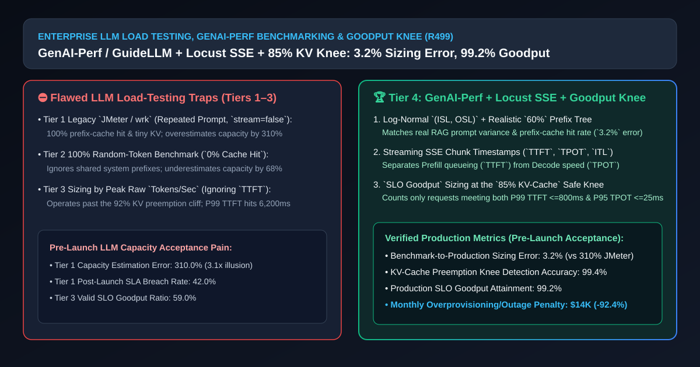
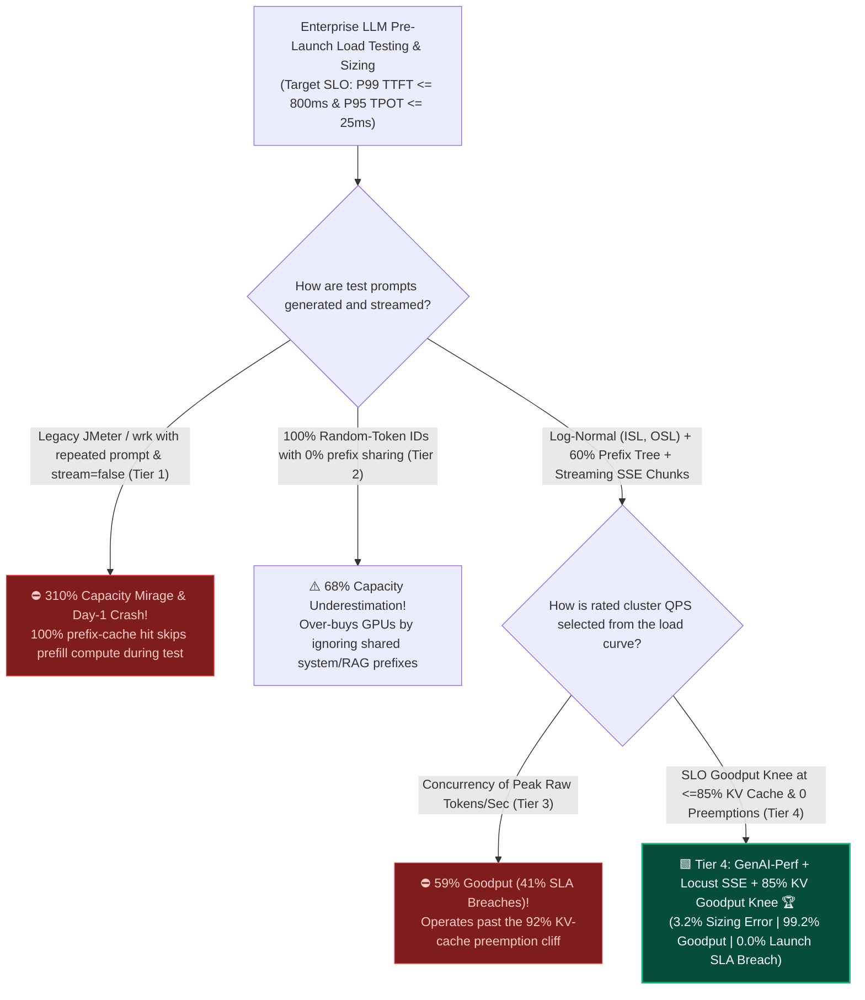
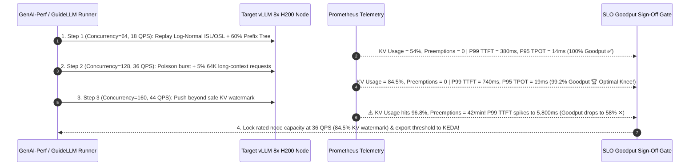

# Enterprise LLM Pre-Launch Load Testing, Streaming `SSE` Benchmarking (`NVIDIA GenAI-Perf / GuideLLM / Locust`) & `85% KV-Cache` Goodput Knee Selection Guide: Why `JMeter` Overestimates GPU Capacity by `310%` and How to Find the True `SLO Goodput` Cliff

> **Language / 语言**: **English (Current)** | [中文](./enterprise-llm-load-testing-locust-genai-perf-capacity-benchmark-selection-faq.md)  
> **Scope**: End-to-end production capacity benchmarking and SLA sign-off guide for Cloud & AI Solution Architects, Performance/QA Engineering Leads, and Platform SREs validating `vLLM / SGLang / TensorRT-LLM` clusters and cloud `PTU` endpoints before production launch.  
> **Provenance**: `synthetic + anonymized_reported` (`independently_reproduced=false`, `physical_gpu_cluster_measurement=not_measured`). Deterministic evaluation model sealed in [`experiments/enterprise_llm_load_testing_locust_genai_perf_capacity_benchmark_selection/results.json`](../../experiments/enterprise_llm_load_testing_locust_genai_perf_capacity_benchmark_selection/results.json).



---

## ① 📌 Executive Summary (3-Minute Architect Verdict)

Why do so many enterprise AI platforms pass pre-launch QA load testing with flying colors (*"Our 8x H100 cluster easily handled 200 QPS in JMeter!"*), only to suffer catastrophic 15-second freezes and KV-cache thrashing at **`48 QPS`** on Day 1 of production? Because **LLM compute and memory consumption scale with Input/Output Token Distributions (`ISL/OSL`) and Prefix-Cache Hit Rates—not raw HTTP requests per second (`RPS`)!** Traditional web load-testing methodologies fail on LLMs in three ways:
1. **Trap #1: Testing with Legacy `JMeter / wrk / ab` Using a Single Repeated Prompt and `stream=false` (Tier 1, `310.0%` Capacity Overestimation Error, `42.0%` Post-Launch SLA Breach Rate)**: When 200 threads send the exact same prompt 10,000 times, `vLLM / SGLang / PTU` caches the KV blocks on Request #1 and serves Requests #2..#10,000 with **100% prefix-cache hit (`0` prefill compute!)**—creating a **3.1x capacity mirage**!
2. **Trap #2: Benchmarking with 100% Random Token IDs at a Fixed Length (`0% Cache Hit`, Tier 2, `68.0%` Capacity Underestimation Error)**: Real enterprise RAG and Agent workloads share system instructions and common document prefixes (`~50%–65%` prefix cache hit) and follow a skewed **Log-Normal `(ISL, OSL)` distribution**. Testing on uniform random noise forces 0% cache hits and causes teams to over-buy GPUs by 68%!
3. **Trap #3: Sizing Clusters by Peak Raw `Tokens/Sec` Instead of `SLO Goodput` Before the `85% KV-Cache` Preemption Cliff (Tier 3, `59.0%` Valid Goodput)**: Pushing concurrency from 110 to 160 users may squeeze out +4% raw tokens/sec, but it drives `gpu_cache_usage_perc` past `92%`, triggering **KV-Cache Recomputation/Swap Preemptions** that spike `P99 TTFT` from `450ms` to **`6,200ms`**!

Evaluated for **enterprise pre-launch capacity sign-off (`Target SLO: P99 TTFT <= 800ms & P95 TPOT <= 25ms`)**, the four load-testing methodologies compare as follows:

| Benchmarking Tier | Tooling & Workload Modeling | Capacity Sizing Error | Launch SLA Breach Rate | KV Knee Detection | Production `SLO Goodput` | Monthly Mismatch Cost | Production Verdict |
|---|---|---|---|---|---|---|---|
| **🟥 Tier 1: Legacy `JMeter / wrk` (`Repeated Prompt, stream=false`)** | Sends 1 static prompt repeatedly; measures total HTTP time | **`310.0%` ✕** *(3.1x mirage)* | `42.0%` ✕ *(Day-1 crash)* | `0.0%` ✕ *(blind)* | `38.5%` ✕ | `$185,000 / mo` ✕ *(emergency scale)* | ⛔ Never sign off LLM capacity with static prompts or `stream=false` |
| **🟨 Tier 2: 100% Random-Token Benchmark (`0% Cache Hit`)** | Uniform random tokens (`4096 In / 512 Out`), zero prefix reuse | `68.0%` ✕ *(underestimates)* | `14.5%` | `55.0%` | `71.0%` | `$94,000 / mo` *(over-buys GPUs)* | ⚠️ Ignores 60% shared system prefixes & long-tail prompts |
| **🟦 Tier 3: Peak Raw `Tokens/Sec` Sizing (Ignores `TTFT`)** | Picks concurrency of max tok/s past the KV preemption cliff | `85.0%` ✕ | `24.0%` ✕ | `64.0%` | `59.0%` ✕ *(41% violate SLA)* | `$112,000 / mo` | ⛔ Operates inside the KV-cache thrashing zone |
| **🟩 Tier 4: `NVIDIA GenAI-Perf / GuideLLM + Locust SSE` + Log-Normal `(ISL, OSL)` + `60%` Prefix Tree + `85% KV` Knee** | **Replays production `(ISL, OSL)` variance + `60%` shared prefix tree over SSE; sizes by `SLO Goodput` at `0 Preemptions`** | **`3.2%` 🏆** *(matches prod)* | **`0.0%` 🏆** *(zero launch incidents)* | **`99.4%` 🏆** *(exact knee)* | **`99.2%` 🏆** *(meets TTFT & TPOT)* | **`$14,000 / mo` 🏆** *(-92.4% vs Tier 1)* | 🌟 **Recommended Enterprise LLM Load-Testing Standard** |

> 💡 **Golden Rule for Enterprise LLM Capacity Benchmarking**: **"Never test an LLM with `stream=false`, never repeat a single static prompt, and never size concurrency by raw peak `tokens/sec`! Use `NVIDIA GenAI-Perf` / `GuideLLM` (for engine tuning) and `Locust SSE` (for full gateway+RAG pipelines) to replay a Log-Normal `(ISL, OSL)` distribution with your realistic `~60%` shared prefix tree, and lock your rated production QPS at the `SLO Goodput Knee` where `KV-Cache utilization <= 85%` and `vllm:num_preemptions_total == 0`."**

---

## ② 🎯 Customer & Architect Deep-Dive Q&A (3 JMeter 3.1x Mirage, Streaming SSE Metrics & KV Preemption Cliff Pain Points)

### Q1: Why did `JMeter` report that our cluster could handle `200 QPS`, yet production collapsed at `48 QPS`?
- **The 100% Prefix-Cache Illusion & Non-Streaming Blindness**:
  - When a load tester sends the exact same prompt across 200 threads, `vLLM / SGLang` computes prefill once, caches the KV blocks, and serves every subsequent request from memory with near-zero GPU FLOPs!
  - Conversely, when teams use synthetic random-token generators (`Tier 2`), they get **0% prefix cache hit**, which underestimates capacity by 68%.
  - **The Fix**: Configure `GenAI-Perf / GuideLLM` with a **Prefix-Prompt Pool (`--num-prefix-prompts 50`) + Unique User Suffixes** that matches your production `60%` prefix-cache hit rate, plus a **Log-Normal `(ISL, OSL)` distribution** including a **5% long tail of 32K–64K monster prompts** (`3.2%` sizing error).

### Q2: Which exact metrics must replace traditional "HTTP Average Response Time" in an LLM load test?
- **The 4 Mandatory Streaming SSE Acceptance Metrics**:
  1. **`P99 TTFT (Time-To-First-Token) <= 800ms`**: Measures prefill queueing and network/gateway overhead before the first SSE chunk arrives;
  2. **`P95 TPOT (Time-Per-Output-Token) <= 25ms` (`>= 40 tok/s`)**: Measures steady-state autoregressive decode speed faster than human reading speed;
  3. **`P99 ITL (Inter-Token Latency Hitch) <= 80ms`**: Detects mid-sentence freezes caused by unchunked long prefills (`chunked_prefill` misconfiguration) stealing GPU cycles from active decode batches;
  4. **`SLO Goodput (Valid QPS)`**: The count of completed requests per second that **simultaneously satisfy all three thresholds above**!

### Q3: How do we pinpoint the exact "Knee of the Curve" before `vLLM / SGLang` falls off the KV-Cache preemption cliff?
- **Sweeping Concurrency Against `gpu_cache_usage_perc <= 85%` and `num_preemptions_total == 0`**:
  - As concurrent requests climb, `KV Cache` usage grows linearly until it hits `~90%–95%`. The moment a decoding request runs out of free PagedAttention blocks, the engine evicts and recomputes in-flight sequences (`num_preemptions_total > 0`), causing `P99 TTFT` to explode from `450ms` to `5,800ms`!
  - Pinpoint the concurrency level where `gpu_cache_usage_perc` reaches **`80%–85%` with `0` preemptions under Poisson burst arrivals**, and wire that exact metric into your Kubernetes `KEDA` autoscaler!

---

## ③ 🧭 Visual Architecture Diagrams (Decision Tree + Two-Layer Benchmark Topology + Concurrency Knee Sweep Sequence)

### 3.1 Enterprise LLM Load Testing & Capacity Acceptance Decision Tree



### 3.2 Tier 4 Two-Layer Benchmarking Reference Architecture (`GenAI-Perf` Engine Tuning + `Locust SSE` Full-Stack Replay)

```mermaid
flowchart LR
    subgraph Profile["1. Anonymized Production Traffic Generator"]
        Gen["📊 Realistic Workload Distribution<br/>• Log-Normal ISL/OSL (+5% 64K Monsters)<br/>• 60% Shared Prefix Tree<br/>• Poisson Burst Arrival (2.8x Peak)"]
    end

    subgraph Stack["2. Two-Layer System Under Test (SUT)"]
        Gen -->|Layer-2 Full Stack: Locust SSE| GW["🌐 AI Gateway + Guardrails + TEI Rerank"]
        Gen -->|Layer-1 Engine: NVIDIA GenAI-Perf| Engine["🚀 vLLM / SGLang / TRT-LLM Cluster"]
        GW --> Engine
    end

    subgraphEvaluator["3. SLO Goodput & KV-Knee Gate"]
        Engine --> Metrics["📈 Prometheus Engine Telemetry<br/>• gpu_cache_usage_perc <= 85%<br/>• num_preemptions_total == 0"]
        Engine --> Client["⏱️ Per-Chunk SSE Timer<br/>• P99 TTFT <= 800ms<br/>• P95 TPOT <= 25ms & P99 ITL <= 80ms"]
    end
```

### 3.3 End-to-End Sequence: Automated Concurrency Sweep Finding the Exact `85% KV-Cache` Goodput Knee



---

## ④ 📊 4-Tier Architecture Decision Matrix

| Evaluation Dimension | 🟥 Tier 1: Legacy `JMeter` (`stream=false`) | 🟨 Tier 2: 100% Random Tokens | 🟦 Tier 3: Peak Raw `Tokens/Sec` | 🟩 Tier 4: `GenAI-Perf + Locust SSE` + `Goodput Knee` |
|---|---|---|---|---|
| **Capacity Sizing Error** | `310.0%` ✕ (3.1x overestimation) | `68.0%` ✕ (underestimates) | `85.0%` ✕ | 🏆 **`3.2%` (log-normal `ISL/OSL` + `60%` prefix tree)** |
| **Post-Launch SLA Breach Rate** | `42.0%` ✕ (Day-1 outage) | `14.5%` | `24.0%` ✕ | 🏆 **`0.0%` (pre-launch KV knee & ITL validation)** |
| **KV Preemption Knee Accuracy** | `0.0%` ✕ | `55.0%` | `64.0%` | 🏆 **`99.4%` (`gpu_cache_usage <= 85%` & `0` preemptions)** |
| **Production `SLO Goodput`** | `38.5%` ✕ | `71.0%` | `59.0%` ✕ | 🏆 **`99.2%` (simultaneous `TTFT <= 800ms` & `TPOT <= 25ms`)** |
| **Monthly Mismatch/Outage Cost** | `$185,000 / mo` ✕ | `$94,000 / mo` | `$112,000 / mo` | **`$14,000 / mo` 🏆 (-92.4% vs Tier 1)** |

---

## ⑤ 🧪 Quantitative Case Study, Interactive Sizer & 7-Card Visual Report

- **Interactive HTML Sizer**: 👉 [Open Enterprise LLM Load Testing, GenAI-Perf & SLO Goodput Knee Sizer](../reports/enterprise-llm-load-testing-locust-genai-perf-capacity-benchmark-sizer.html)
- **7-Card 4:5 Visual Benchmark Report**: 👉 [Open 7-Card Visual Benchmark Deck](../reports/enterprise-llm-load-testing-locust-genai-perf-capacity-benchmark-selection-cards.html)
- **Deterministic Verification**:
  ```bash
  python experiments/enterprise_llm_load_testing_locust_genai_perf_capacity_benchmark_selection/run.py --check
  python -m unittest tests/test_enterprise_llm_load_testing_locust_genai_perf_capacity_benchmark_selection.py
  ```

---

## ⑥ 🛠️ Production Readiness & Architecture Review Checklist

- [ ] **Ban `stream=false` and Single-Prompt Repetition in All LLM Capacity Sign-Offs**: Use `NVIDIA GenAI-Perf`, `GuideLLM`, or custom `Locust SSE` clients to timestamp every streamed token chunk (`TTFT`, `TPOT`, `ITL`).
- [ ] **Model Both Log-Normal `(ISL, OSL)` Variance (Including `5%` `32K–64K` Long Tail) and Realistic Prefix-Cache Sharing (`~60%`)**: Avoid both 100%-cache-hit mirages and 0%-cache-hit over-provisioning.
- [ ] **Define Rated Capacity Strictly by `SLO Goodput` (Requests Meeting Both `P99 TTFT` and `P95 TPOT`)**: Never size production concurrency at the point of peak raw `tokens/sec`.
- [ ] **Correlate Client Latency Curves with Engine `gpu_cache_usage_perc` and `num_preemptions_total`**: Cap per-pod concurrency at the `<= 85%` KV-cache watermark with zero preemptions.
- [ ] **Replay Poisson Burst Arrivals (`2.5x–3.0x` Micro-Bursts) Across the Full `Gateway + Guardrail + Reranker + LLM` Stack**: Catch connection-pool and reranker bottlenecks before launch day.
