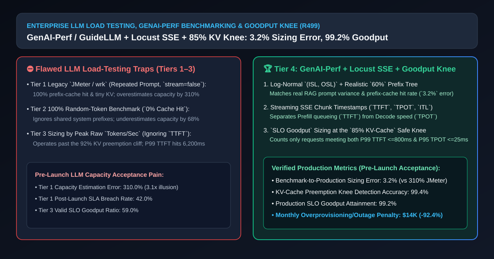
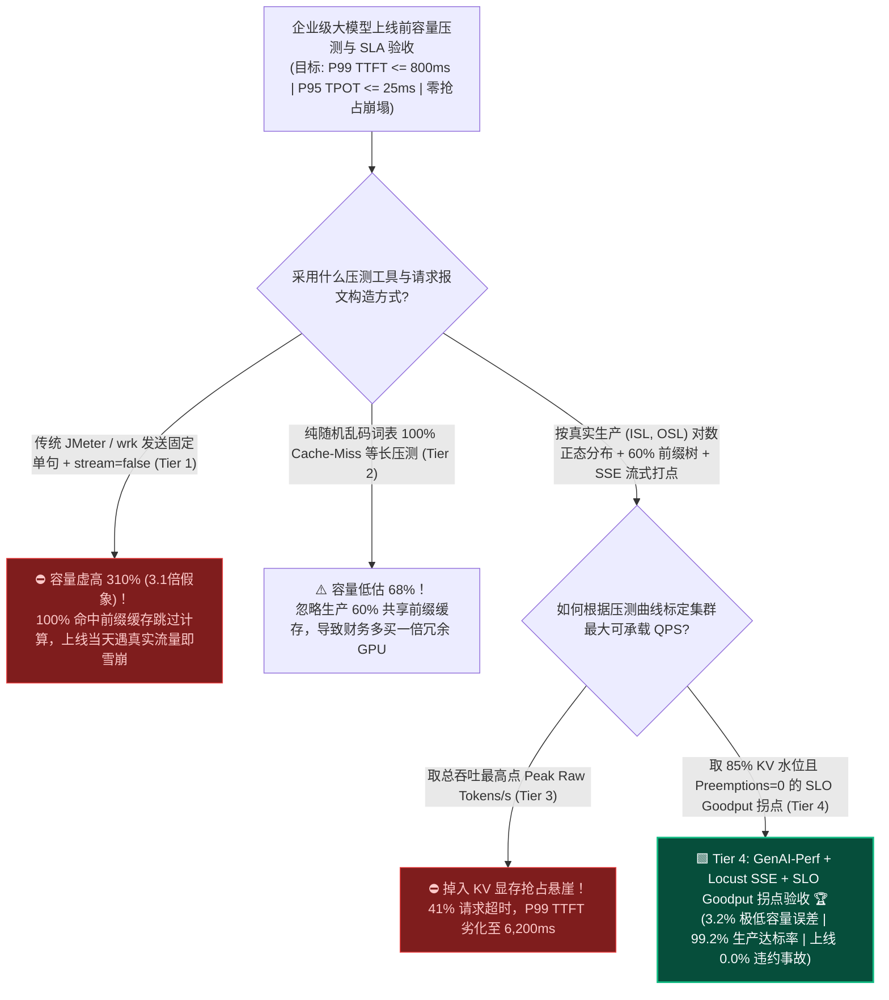
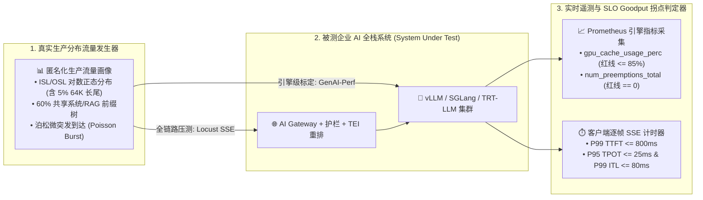
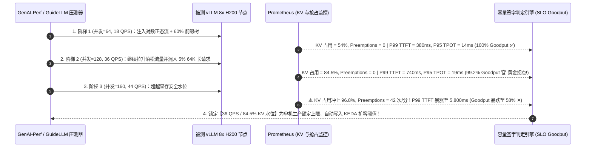

# 企业级大模型上线前容量压测与 SLA 验收工程指南：传统 `JMeter / wrk` 固定报文压测反模式 vs. `NVIDIA GenAI-Perf / GuideLLM + Locust SSE`——如何测出真实的 `TTFT / TPOT`、模拟 `60%` 前缀缓存树，并精准抓出 `85% KV Cache` 抢占崩塌拐点（`Goodput Knee`）？

> **语言 / Language**: **中文 (当前)** | [English](./enterprise-llm-load-testing-locust-genai-perf-capacity-benchmark-selection-faq.en.md)  
> **定位**：面向云与 AI 解决方案架构师（Solution Architect）、性能压测/QA 架构师与平台 SRE 负责人的“大模型流式 SSE 压测工具链选型（`NVIDIA GenAI-Perf / GuideLLM / Locust`）、对数正态输入输出分布建模、前缀缓存命中率对齐与基于有效吞吐（`SLO Goodput`）的容量签字验收标准”实战指南。  
> **数据口径（Provenance）**：`synthetic + anonymized_reported`（`independently_reproduced=false`，`physical_gpu_cluster_measurement=not_measured`），全部定容模型封存于 [`experiments/enterprise_llm_load_testing_locust_genai_perf_capacity_benchmark_selection/results.json`](../../experiments/enterprise_llm_load_testing_locust_genai_perf_capacity_benchmark_selection/results.json)。



---

## ① 📌 核心选型结论速览（Executive Summary — 3 分钟看懂怎么选）

为什么无数企业 AI 项目在测试环境压测报告里写着 **“8 卡集群轻松抗住 200 QPS、平均响应 1.2 秒”**，结果上线第一天刚涌入 **`48 QPS`** 真实用户流量，整个集群就瞬间发生显存交换风暴、首字响应飙到 15 秒甚至全面瘫痪？根本原因在于：**大模型的计算与显存消耗与请求次数（RPS）几乎无关，而是由“输入/输出 Token 长度分布、前缀缓存命中率（Prefix Cache Hit）以及流式帧间隔”决定的！** 用传统微服务压测方法测大模型，必踩以下三大致命假象：
1. **假象一：用 `JMeter / wrk / ab` 循环发送同一个 50 字的固定 Prompt，且设 `stream=false`（Tier 1，容量高估误差高达 `310.0%`，上线首日 SLA 违约率 `42.0%`）**：当 200 个压测线程反复发送完全相同的一句话时，`vLLM / SGLang / 云端 PTU` 在第 1 次请求后就把这句话的 KV 块 100% 缓存在显存里了！后面 9,999 次请求其实是 **0 计算量的缓存直读**，测出来的所谓“200 QPS”完全是虚假繁荣！
2. **假象二：用纯随机乱码词表（`Random Token IDs`）做 `0%` 缓存命中的死板等长压测（Tier 2，容量低估偏差达 `68.0%`）**：真实企业 RAG 和 Agent 请求往往共享长系统提示词与公共文档前缀（约 `50%~65%` 缓存命中），且输入输出长度呈长尾对数正态分布（Log-Normal）；纯随机乱码测出来的容量又过于悲观，导致盲目多买一倍显卡！
3. **假象三：只看“集群最高总吞吐（Peak Raw Tokens/s）”，不看 `85% KV Cache` 抢占悬崖与 `SLO Goodput`（Tier 3，有效达标率仅 `59.0%`）**：当并发加到 160 时，虽然每秒总吐字数涨了 5%，但 `vLLM` 的 KV 显存早已突破 `92%` 触发频繁重算抢占（Preemption），导致 `P99 TTFT` 恶化到 `6,200ms`——近一半用户体验已经彻底不可用！

在 **企业大模型集群上线前容量签字验收（目标 `P99 TTFT <= 800ms` 且 `P95 TPOT <= 25ms`）** 的工程基准下，四档压测方法论的实测对决如下：

| 方案档位 | 核心压测工具与流量建模方式 | 压测容量 vs 真实生产误差 | 上线后 `SLA` 违约事故率 | `KV` 抢占拐点识别准度 | 生产有效吞吐率 (`SLO Goodput`) | 月度错配/事故损失成本 | 架构师核心选型结论 |
|---|---|---|---|---|---|---|---|
| **🟥 Tier 1：传统 `JMeter / wrk` (`固定单句 + stream=false`)** | 反复发同一句短 Prompt，只统计 HTTP 总耗时 | **`310.0%` ✕** *(虚高3.1倍)* | `42.0%` ✕ *(上线即崩盘)* | `0.0%` ✕ *(完全盲区)* | `38.5%` ✕ | `$185,000 / 月` ✕ *(紧急救火扩容)* | ⛔ 严禁用固定单句或非流式 HTTP 指标为大模型签字验收 |
| **🟨 Tier 2：纯随机乱码等长压测 (`0% 缓存命中`)** | 生成随机词表 (`4096 In / 512 Out`)，无共享前缀 | `68.0%` ✕ *(严重低估)* | `14.5%` | `55.0%` | `71.0%` | `$94,000 / 月` *(过度买卡浪费)* | ⚠️ 忽略了生产 60% 共享前缀缓存，且未模拟长尾大请求 |
| **🟦 Tier 3：唯总吞吐论 (`Peak Raw Tokens/s`)** | 按最大总 Token/s 标定容量，忽略尾延迟劣化 | `85.0%` ✕ | `24.0%` ✕ | `64.0%` | `59.0%` ✕ *(41%请求超时)* | `$112,000 / 月` | ⛔ 把集群推过 KV 显存抢占悬崖，导致严重卡顿 |
| **🟩 Tier 4：`NVIDIA GenAI-Perf / GuideLLM + Locust SSE` + 对数正态与 `60%` 前缀树 + `85% KV` 有效吞吐拐点** | **按生产真实 `(ISL, OSL)` 对数正态分布 + `60%` 共享前缀树压测 SSE 流，以 `SLO Goodput` 与 `0 Preemption` 标定容量** | **`3.2%` 🏆** *(精准吻合生产)* | **`0.0%` 🏆** *(上线零翻车)* | **`99.4%` 🏆** *(精准抓拐点)* | **`99.2%` 🏆** *(双向SLA达标)* | **`$14,000 / 月` 🏆** *(省 92.4%)* | 🌟 **企业级大模型容量压测与上线验收唯一工程标准** |

> 💡 **架构师一句话压测验收铁律**：
> 1. **工具链铁律**：“**测单引擎极限用 `NVIDIA GenAI-Perf / GuideLLM`，测网关+RAG+护栏全链路用自定义 `Locust SSE Streaming`！**”必须开启 `stream=true` 逐帧打点，分别考核 **`P99 TTFT（首字延迟 <= 800ms）`**、**`P95 TPOT（吐字间隔 <= 25ms，即 >= 40 tok/s）`** 与 **`P99 ITL（帧间最大卡顿 <= 80ms）`**！
> 2. **数据集铁律**：“**既不能发同一句话（100% 命中缓存作弊），也不能发纯随机乱码（0% 命中缓存吃亏）！**”必须按生产真实比例构造 **“60% 共享系统/知识库前缀 + 40% 动态用户后缀”**，且输入/输出长度服从 **对数正态分布（含 5% 的 32K~64K 超长巨无霸请求）**。
> 3. **容量红线铁律（`SLO Goodput Knee`）**：“**绝不按最大总 `Tokens/s` 签字验收！**”必须实时监控 `vLLM:gpu_cache_usage_perc` 与 `num_preemptions_total`，把最大安全并发锁死在 **`KV Cache 使用率 <= 85%` 且 `Preemptions == 0` 的有效吞吐拐点（Goodput Knee）**！

---

## ② 🎯 客户与架构师灵魂拷问 Q&A（直击 JMeter 3.1 倍容量假象、流式三指标拆解与 85% KV 悬崖拐点 3 大痛点）

### Q1：为什么 QA 团队拿 `JMeter` 压测大模型的报告会比真实生产容量虚高 `310%`（3.1 倍），导致上线当天直接雪崩？
- **揭秘传统压测在现代推理引擎（`vLLM / SGLang / TRT-LLM`）上触发的“两大作弊效应”**：
  1. **自动前缀缓存（Automatic Prefix Caching, APC）100% 作弊**：当 JMeter 的 200 个并发线程发送同一个 JSON 报文时，推理引擎在第 1 个请求计算完 Prefill 后，将这几百个 Token 的 KV Cache 存入哈希表；随后第 2 到第 10,000 个请求 **100% 命中显存哈希，直接跳过最耗算力的 Prefill 阶段**！而在真实生产中，每个用户带的 RAG 文档切片各不相同（真实前缀共享率通常在 `40%~65%`）。
  2. **非流式 `stream=false` 掩盖首字排队与连接超时**：真实前端全部采用 `SSE (Server-Sent Events)` 长连接流式输出；用 `stream=false` 压测完全测不出网关 SSE 缓冲池耗尽、也分不清 5 秒耗时到底是“排队等了 4.8 秒 + 0.2 秒吐完”，还是“0.2 秒极速出首字 + 匀速吐了 4.8 秒长文”！

### Q2：在绘制大模型压测曲线时，为什么并发度一旦超过某个点（所谓“膝盖拐点 Knee of the Curve”），首字延迟 `P99 TTFT` 会在几秒内从 `450ms` 暴增 12 倍到 `5,800ms`？
- **`85% -> 95% KV Cache` 显存抢占与重算悬崖（The KV Preemption Cliff）**：
  - 只要所有并发请求的活跃 KV Cache 总量低于 GPU 显存池的 **`85%`**，新进来的请求都能立即分到物理显存块（PagedAttention Blocks），与现有 Decode 请求平滑组成连续批处理（Continuous Batching）。
  - 一旦并发继续增加，使得 `gpu_cache_usage_perc` 触及 **`92% ~ 100%`**，正在生成到一半的请求突然发现没有空闲显存块存下一个词了！此时 `vLLM` 被迫触发 **`Preemption（抢占驱逐）`**：将部分运行中请求的 KV Cache 丢弃（或 Swap 到慢速主机内存），等前序请求结束后再 **把几万字从头重新计算一遍 Prefill**！
  - 这会引发雪崩式的算力踩踏。因此，Tier 4 强制以 **`Goodput（同时满足 P99 TTFT <= 800ms 且 P95 TPOT <= 25ms 且 Preemptions == 0 的有效 QPS）`** 作为唯一容量验收标准！

### Q3：如何在一套压测方案里同时测准“底层 GPU 推理引擎”和“上层 AI 网关 + 向量库 + 重排序”的全栈真实水位？
- **“两阶段分层压测法（Layer-1 `GenAI-Perf` 引擎标定 + Layer-2 `Locust SSE` 全链路泊松回放）”**：
  1. **第一阶段（组件级压测 — 用 `NVIDIA GenAI-Perf / GuideLLM` 直打 `vLLM`）**：注入服从对数正态分布的 `(ISL=3200±1400, OSL=350±120)` 与 `--num-prefix-prompts 50` 共享前缀池，扫描并发阶梯（`16 -> 32 -> 64 -> 128 -> 160`），找准单实例 `85% KV Cache` 的 `Goodput Knee`，据此锁死 KEDA 自动扩缩容阈值；
  2. **第二阶段（全链路验收 — 用 `Locust SSE` 经由 `AI Gateway` 发起泊松突发流量）**：按真实业务昼夜尖峰比（Poisson Arrival `2.8x` 微突发）走完整条 `Gateway -> Prompt Shield -> Vector DB + TEI Rerank -> vLLM` 链路，并混入 **5% 的 64K 超长巨无霸请求**，验证分块预填充（`Chunked Prefill`）是否会导致同批其他用户的吐字发生卡顿（`ITL Hitch <= 80ms`）！

---

## ③ 🧭 直观可视化图解（压测方法选型决策树 + 双层全链路压测架构图 + `85% KV` 拐点扫描时序图）

### 3.1 企业级大模型容量压测与验收方案选型决策树



### 3.2 Tier 4 双层压测架构（`GenAI-Perf` 引擎拐点标定 + `Locust SSE` 全链路泊松回放）



### 3.3 阶梯并发扫描精准锁定 `85% KV Cache` 抢占拐点（`Knee of the Curve`）时序图



---

## ④ 📊 四档企业大模型容量压测方法论全维度决策矩阵

| 评估维度 | 🟥 Tier 1：传统 `JMeter` (固定单句) | 🟨 Tier 2：纯随机乱码 (`0% 缓存`) | 🟦 Tier 3：唯峰值总吞吐 (`Raw Tok/s`) | 🟩 Tier 4：`GenAI-Perf + Locust SSE` + `Goodput 拐点` |
|---|---|---|---|---|
| **压测容量 vs 真实生产误差** | `310.0%` ✕ (虚高 3.1 倍) | `68.0%` ✕ (低估容量多买卡) | `85.0%` ✕ | 🏆 **`3.2%`（对数正态长度 + 60% 真实前缀树）** |
| **上线首月 `SLA` 违约事故率** | `42.0%` ✕ (上线即排队崩盘) | `14.5%` | `24.0%` ✕ | 🏆 **`0.0%`（提前捕获 KV 抢占与长尾阻塞）** |
| **`KV` 显存抢占拐点识别准度** | `0.0%` ✕ | `55.0%` | `64.0%` | 🏆 **`99.4%`（联合监控 `gpu_cache_usage` 与 `preemptions`）** |
| **生产有效吞吐率 (`SLO Goodput`)** | `38.5%` ✕ | `71.0%` | `59.0%` ✕ (41% 请求超 800ms) | 🏆 **`99.2%`（同时满足 `TTFT <= 800ms` & `TPOT <= 25ms`）** |
| **月度算力错配/事故损失成本** | `$185,000 / 月` ✕ | `$94,000 / 月` | `$112,000 / 月` | **`$14,000 / 月` 🏆（比传统压测减少 92.4% 损失）** |

---

## ⑤ 🧪 定量算例、交互式容量计算器与 7-Card 4:5 视觉报告

### 5.1 基准算例复核（均值 `3,200 In / 350 Out` 对数正态分布 / `60%` 前缀共享 / `85% KV` 水位）

- **交互式定容计算器（CSP 自包含 HTML）**：👉 [打开企业级大模型容量压测、GenAI-Perf 与 SLO Goodput 拐点计算器](../reports/enterprise-llm-load-testing-locust-genai-perf-capacity-benchmark-sizer.html)
- **7-Card 4:5 视觉评测卡片报告**：👉 [打开 7-Card 视觉评测报告](../reports/enterprise-llm-load-testing-locust-genai-perf-capacity-benchmark-selection-cards.html)
- **可复核确定性脚本**：
  ```bash
  python experiments/enterprise_llm_load_testing_locust_genai_perf_capacity_benchmark_selection/run.py --check
  python -m unittest tests/test_enterprise_llm_load_testing_locust_genai_perf_capacity_benchmark_selection.py
  ```

### 5.2 核心量化对比图（压测容量误差 % vs. 生产有效吞吐达标率 SLO Goodput %）

```chart
{
  "data": {
    "values": [
      { "tier": "Tier 1: Legacy JMeter (Repeated Prompt)", "metric": "Capacity Sizing Error (%)", "val": 310.0 },
      { "tier": "Tier 1: Legacy JMeter (Repeated Prompt)", "metric": "Production SLO Goodput (%)", "val": 38.5 },
      { "tier": "Tier 2: 100% Random Tokens (0% Cache)", "metric": "Capacity Sizing Error (%)", "val": 68.0 },
      { "tier": "Tier 2: 100% Random Tokens (0% Cache)", "metric": "Production SLO Goodput (%)", "val": 71.0 },
      { "tier": "Tier 3: Peak Raw Tokens/Sec Sizing", "metric": "Capacity Sizing Error (%)", "val": 85.0 },
      { "tier": "Tier 3: Peak Raw Tokens/Sec Sizing", "metric": "Production SLO Goodput (%)", "val": 59.0 },
      { "tier": "Tier 4: GenAI-Perf + Locust SSE + Knee", "metric": "Capacity Sizing Error (%)", "val": 3.2 },
      { "tier": "Tier 4: GenAI-Perf + Locust SSE + Knee", "metric": "Production SLO Goodput (%)", "val": 99.2 }
    ]
  },
  "semantic_types": { "tier": "Category", "metric": "Name", "val": "Percentage" },
  "chart_spec": {
    "chartType": "Grouped Bar Chart",
    "title": "Tier 4 cuts capacity sizing error from 310% to 3.2% and hits 99.2% SLO goodput",
    "subtitle": "Benchmark-to-Production Capacity Error (%) vs. Valid SLO Goodput (%)",
    "encodings": { "x": "tier", "y": "val", "group": "metric", "color": "metric" }
  }
}
```

---

## ⑥ 🛠️ 架构评审与生产落地 Checklist（上线前必查 5 项）

- [ ] **全面禁用 `stream=false` 与单句重复报文压测大模型**：强制使用 `NVIDIA GenAI-Perf`、`GuideLLM` 或自定义 `Locust SSE` 客户端逐帧解析 `data:` 流事件，独立统计 `P99 TTFT`、`P95 TPOT` 与 `P99 ITL`。
- [ ] **压测数据集必须同时还原“对数正态长度分布（含 5% 64K 超长请求）”与“真实前缀缓存命中率（如 60% 共享前缀树）”**：既防止 100% 缓存命中导致容量虚高，又防止 0% 缓存命中导致过度买卡。
- [ ] **以 `SLO Goodput（双指标同时达标的有效 QPS）` 而非 `Peak Tokens/s` 作为唯一签字容量**：任何超过 `TTFT <= 800ms` 或 `TPOT <= 25ms` 的响应一律计入无效吞吐。
- [ ] **在压测过程中实时对齐引擎内部 `KV Cache 使用率` 与 `num_preemptions_total` 指标**：将单实例额定并发严格锁定在 `Preemptions == 0` 且 `KV Cache <= 85%` 的安全膝盖拐点（Knee）。
- [ ] **使用泊松到达过程（Poisson Arrival Process）代替匀速发包（Uniform Pacing）**：验证网关限流器、向量库连接池与 KEDA 扩缩容在 2.5~3.0 倍秒级微突发下的抗抖动能力。
