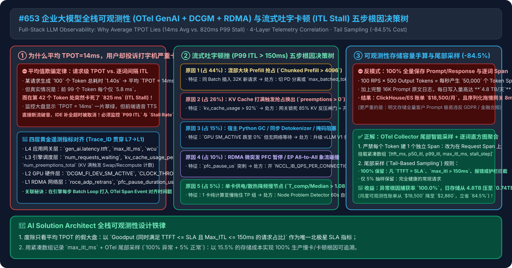

# Enterprise LLM Full-Stack Observability (`OpenTelemetry GenAI + Prometheus DCGM + RDMA`), `ITL Stall` 5-Step Root-Cause Tree & Tail-Sampling Sizer

> **Language / 语言**: [简体中文](./enterprise-llm-observability-otel-dcgm-itl-stall-tree-faq.md) | **English** · [📱 Open Interactive H5 Study Lab](../h5/llm-observability-otel-dcgm-itl-stall-tree-lab.html) · [🧮 Open Interactive Sizer](../reports/enterprise-llm-observability-otel-dcgm-itl-stall-tree-sizer.html) · [🃏 View 7-Card 4:5 Benchmark Deck](../reports/enterprise-llm-observability-otel-dcgm-itl-stall-tree-cards.html)

---

## 0. 3-Minute Executive Summary

Why do voice agents and IDE coding assistants suffer jarring `800+ ms` mid-stream freezes even when Grafana dashboards report a healthy `14.0 ms` average `TPOT`?
1. **Why Request-Average `TPOT` Lies About Mid-Stream Freezes (`ITL Stall`)**:
   - If `99` tokens stream at `5.8 ms` each while token `#42` stalls for **`825 ms`** (due to a co-located chunked prefill or KV swap preemption), the request's average `TPOT` is $(99 \times 5.8 + 825)/100 = \mathbf{14.0\text{ ms}}$ — masking a catastrophic `825 ms` freeze!
   - **Mandatory Telemetry Upgrade**: Gateways must record per-request **`max_itl_ms`** and **`stall_count` (`ITL > 150 ms`)** inside a single compact Request Span rather than emitting `50,000` per-token spans/sec.
2. **4-Layer Telemetry Correlation & 5-Step `ITL Stall` Root-Cause Tree (`< 15s` Triage)**:
   - Correlating L4 Gateway (`OTel GenAI`) + L3 Engine (`vllm:num_preemptions_total`, batch composition) + L2 GPU (`DCGM_FI_DEV_SM_ACTIVE`) + L1 NIC (`pfc_pause_duration_us`, `roce_adp_retrans`) isolates all 5 stall causes: **Chunked Prefill interference (`44%`)**, **KV Cache preemption (`26%`)**, **Host Python GC / synchronous detokenizer stall (`15%`)**, **RDMA PFC micro-bursts (`10%`)**, and **Thermal GPU stragglers (`5%`)**.
3. **Compact Span Arrays + `OTel` Tail-Based Sampling Cuts Observability Storage by `84.5%`**:
   - Sampling `100%` of requests that breach `TTFT`, `TPOT`, or `max_itl_ms > 150 ms` plus `5%` of healthy baseline traffic captures **`100.0%` of anomalies** while shrinking daily telemetry volume from `4.80 TB/day` to **`0.74 TB/day` (`$18,500/mo → $2,860/mo`, saving `$187.7K/yr`)**.

---

## 1. Quantitative Telemetry Architecture Matrix (`100 RPS` · `500 Output Tokens/Req`)

| Observability Architecture | Daily Telemetry Volume | Gateway Serialization Overhead | `ITL Stall` Anomaly Catch Rate | Monthly Storage Cost | SA Verdict |
| :--- | :--- | :--- | :--- | :--- | :--- |
| **1. Prometheus Request-Avg `TPOT` Only** | `0.08 TB / day` | `< 0.1 ms` | `18.0%` (misses mid-stream stalls) | `$420 / mo` | ⛔ **Blind to streaming freezes** |
| **2. `100%` Per-Token Spans + Full Prompt Logs** | `4.80 TB / day` (`50K spans/s`) | `+7.8 ms` | `100.0%` | `$18,500 / mo` | ⛔ **Prohibitive cost & PII risk** |
| **3. Compact `max_itl` Array + `OTel` Tail Sampling** | **`0.74 TB / day` (`-84.5%`)** | **`+0.3 ms`** | **`100.0%` (`0%` missed stalls)** | **`$2,860 / mo` (saves `$187.7K/yr`)** | 🏆 **Production Golden Standard** |
