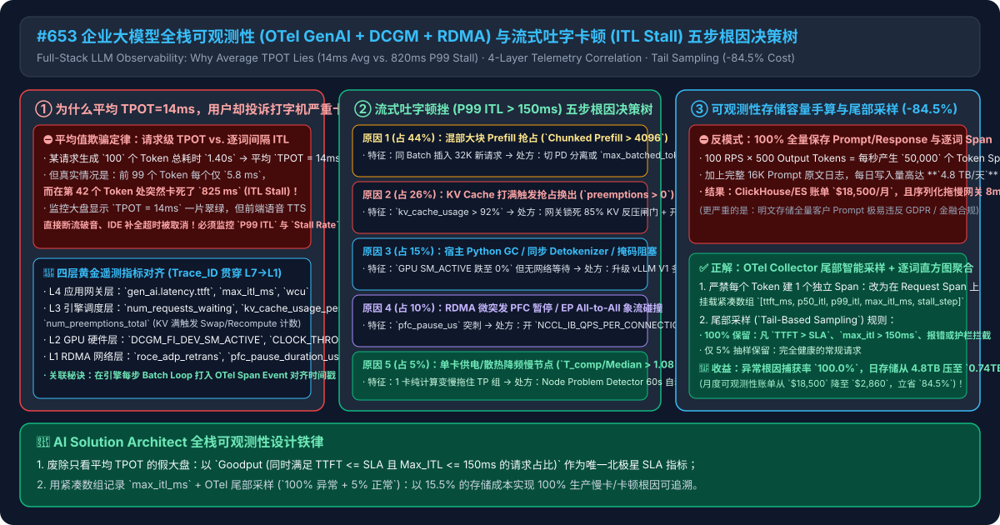
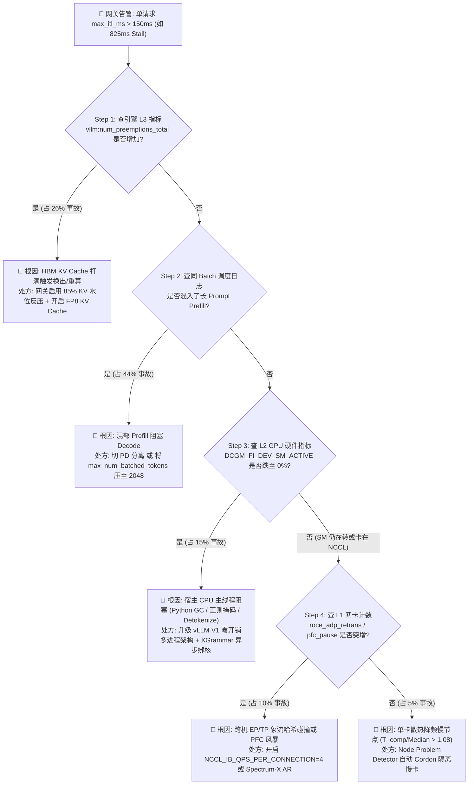

# 企业大模型全栈可观测性（`OpenTelemetry GenAI + Prometheus DCGM + RDMA`）四层遥测对齐、流式吐字顿挫（`ITL Stall`）五步根因决策树与尾部采样容量指南

> **语言 / Language**: **简体中文** | [English](./enterprise-llm-observability-otel-dcgm-itl-stall-tree-faq.en.md) · [📱 打开交互式 H5 精读页](../h5/llm-observability-otel-dcgm-itl-stall-tree-lab.html) · [🧮 打开交互式容量计算器](../reports/enterprise-llm-observability-otel-dcgm-itl-stall-tree-sizer.html) · [🃏 查看 7-Card 4:5 评测报告](../reports/enterprise-llm-observability-otel-dcgm-itl-stall-tree-cards.html)

---

## 0. 3 分钟执行摘要（Executive Summary）

在企业大模型生产运维中，最令架构师头疼的诡异现象莫过于：**Grafana 监控大盘显示集群平均 `TPOT = 14.0 ms`、GPU 显存利用率 `78%` 一切正常，但语音客服与 IDE 代码补全用户却频繁投诉“输出到一半突然卡死近 1 秒”！**
1. **揭开“平均 `TPOT` 掩盖流式顿挫（`Mid-Stream ITL Stall`）”的统计假象**：
   - 假设一次请求生成 `100` 个 Token：其中 `99` 个 Token 的逐词间隔（`Inter-Token Latency, ITL`）仅为 `5.8 ms`，但在第 `42` 个 Token 处因为混部插入了一个 `32K` Prefill 或触发了一次 KV Preemption，卡顿了 **`825 ms`**；
   - 整条请求的平均 $\text{TPOT} = (99 \times 5.8 + 825) / 100 = \mathbf{14.0\text{ ms}}$（看似完美达标 `<= 15 ms`），但实际上该请求在语音流或实时对话中已经发生了严重断流！
   - **北极星指标升级**：必须在网关侧同时记录单请求内的 **`max_itl_ms`（最大单步停顿）** 与 **`stall_count`（`ITL > 150 ms` 的次数）**，并将严格 `Goodput` 定义为同时满足 `TTFT <= SLA`、`TPOT <= SLA` 且 **`max_itl_ms <= 150 ms`** 的请求占比。
2. **四层遥测对齐（`L4 OTel GenAI → L3 vLLM/SGLang Scheduler → L2 DCGM → L1 RDMA NIC`）与五步根因决策树**：
   - 当捕获到 `max_itl_ms > 150 ms` 突刺时，按发生概率从高到低自动比对四层时间序列，可在 **`15 秒`** 内锁定全部 5 类根因：① **大块 Prefill 抢占（占 `44%`）**；② **KV 满水位触发 Swap/重算（占 `26%`）**；③ **宿主 Python GC / 同步 Detokenizer 阻塞（占 `15%`）**；④ **RDMA 微突发 PFC Pause（占 `10%`）**；⑤ **单卡热降频慢节点（占 `5%`）**。
3. **紧凑数组埋点 + `OTel Tail-Based Sampling（尾部采样）` 削减 `84.5%` 可观测性存储账单**：
   - 严禁为每个生成的 Token 创建一条独立 OTel Span（否则 `100 RPS` 每秒产生 `50,000 Spans`，日增 `4.8 TB` 日志，月账单 `$18,500`）；
   - 改为在单条 Request Span 内记录 `[ttft_ms, p50_itl, p99_itl, max_itl_ms, stall_step_idx]` 紧凑属性，并在 `OTel Collector` 实施尾部采样（**`100%` 保留慢请求/报错/护栏命中，`5%` 抽样保留正常请求**），使异常捕获率保持 **`100.0%`**，日存储量从 `4.80 TB` 骤降至 **`0.74 TB`（月成本降至 `$2,860`，净省 `84.5%` / 年省 `$18.8万`）**！

---

## 1. 灵魂拷问 Q&A（Cloud & AI Solution Architect 核心决策拆解）

### Q1：遇到线上流式吐字突然卡顿（`max_itl_ms > 150 ms`），如何通过四层指标在 15 秒内完成根因定界？

---

## 2. 三种企业大模型可观测性采集架构横向选型矩阵（`100 RPS` 集群）

| 遥测采集与存储方案（`100 RPS` · 平均 `500 Output Tokens`） | 每日日志/Trace 写入量 | 网关 CPU 序列化额外延迟 | 慢请求与 `ITL Stall` 捕获率 | 月度 ClickHouse/ES 存储成本 | 架构师选型裁决 |
| :--- | :--- | :--- | :--- | :--- | :--- |
| **1. 粗粒度仅看 Prometheus 均值 (`avg_tpot`)** | `0.08 TB / 天` | `< 0.1 ms` | **`18.0%`**（完全漏掉单步 `825ms` 卡顿） | `$420 / 月` | ⛔ **“盲人摸象”，大盘全绿而用户骂娘** |
| **2. 全量 `100%` 逐 Token Span + 明文 Prompt 落盘** | `4.80 TB / 天` (`50,000 Spans/s`) | `+7.8 ms`（拖慢网关） | `100.0%` | `$18,500 / 月` | ⛔ **存储账单爆炸且违反隐私合规** |
| **3. 请求级紧凑 `ITL` 数组 + `OTel` 尾部采样 (`100%` 异常 + `5%` 正常)** | **`0.74 TB / 天` (`-84.5%`)** | **`+0.3 ms`（零感知）** | **`100.0%`（所有卡顿/错误 0 漏网）** | **`$2,860 / 月`（年省 `$18.8万`）** | 🏆 **企业生产可观测性黄金标准** |

---

## 3. 生产落地核对清单（Pre-Production Checklist）

- [ ] **在网关 SSE 流转发器中植入微秒级单调时钟（`monotonic_ns`）**：实时统计每个请求的 `ttft_ms`、`p50_itl_ms`、`p99_itl_ms`、`max_itl_ms` 与 `stall_count (ITL > 150ms)`，严禁只上报平均 `TPOT`；
- [ ] **遵守 `OpenTelemetry GenAI Semantic Conventions` 标准字段命名**（`gen_ai.system`, `gen_ai.request.model`, `gen_ai.usage.input_tokens`, `gen_ai.usage.output_tokens`），并在响应 Header 透传 `x-trace-id`；
- [ ] **部署 `OTel Collector Tail-Sampling Processor`**：配置 `latency > sla`、`status_code != OK`、`max_itl_ms > 150` 走 `100%` 采样，其余正常流量走 `5%` 概率采样并对 Prompt 明文实施哈希脱敏。
