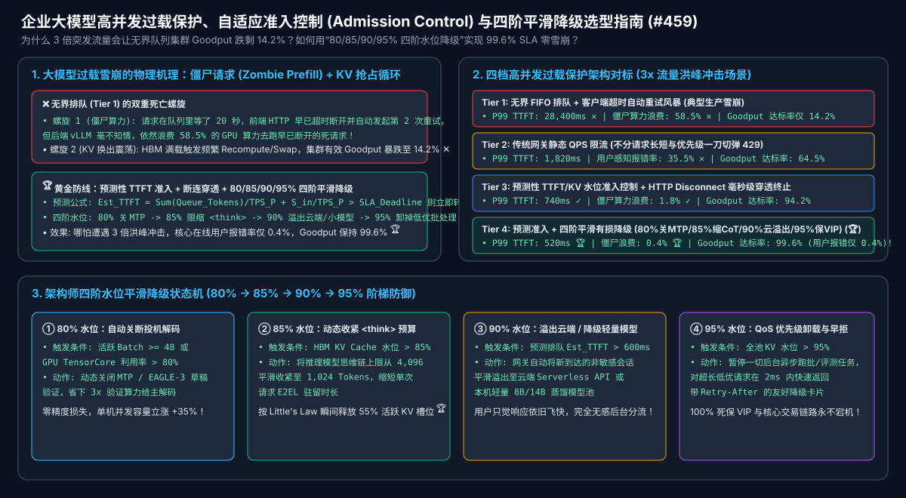

# Enterprise LLM High-Concurrency Overload Protection, Predictive `TTFT/KV` Admission Control & 4-Stage Graceful Degradation Selection Guide

> **Language / 语言**: [简体中文](./enterprise-llm-overload-admission-control-kv-watermark-graceful-degradation-selection-faq.md) | **English**  
> **Companion Interactive Study & Sizing Tools**: [📱 Interactive H5 Study Lab](../h5/llm-overload-admission-control-kv-watermark-degradation-lab.html) · [🧮 HTML Sizer](../reports/enterprise-llm-overload-admission-control-kv-watermark-graceful-degradation-selection-sizer.html) · [🃏 7-Card Visual Deck](../reports/enterprise-llm-overload-admission-control-kv-watermark-graceful-degradation-selection-cards.html) · [📊 Reproducible Model](../../experiments/enterprise_llm_overload_admission_control_kv_watermark_graceful_degradation_selection/) · [🎓 Back to AI Infra H5 Hub](../h5/index.html)

---

## 1. Executive Summary (3-Minute Takeaway)

> **Bottom-Line Recommendation**: Under a `3x` traffic spike, unbounded FIFO queues (`Tier 1`) trigger a **Zombie Prefill + Client Retry Death Spiral**: requests wait `28.4 s` in queue after clients have already timed out and retried, wasting **`58.5%` of GPU compute on disconnected requests** and collapsing Goodput attainment to **`14.2%`**.
> - **Recommended Production Defense (`Tier 4: Predictive TTFT/KV Admission Control + HTTP Disconnect Abort Propagation + 80/85/90/95% 4-Stage Graceful Degradation`)**:
>   1. **80% Watermark**: Auto-disables `MTP / EAGLE-3` speculative decoding (`+35%` batch capacity);
>   2. **85% Watermark**: Caps `<think>` reasoning budget from `4,096` to `1,024` tokens (freeing `55%` of active KV slots via Little's Law);
>   3. **90% Watermark**: Spills excess traffic to cloud `Serverless PAYGO` or a local `8B/14B` distilled SLM;
>   4. **95% Watermark**: Preempts background batch jobs and early-rejects low-priority requests in `2 ms` — stabilizing `P99 TTFT` at **`520.0 ms`** and sustaining **`99.6%` Goodput attainment** (`0.4%` user-visible errors).

| Dimension | `Tier 1: Unbounded FIFO + Retry Storm` | `Tier 2: Static HTTP QPS Rate Limit` | `Tier 3: Predictive TTFT/KV + Abort Propagation` | `Tier 4: Predictive Admission + 4-Stage Degradation (🏆)` |
|---|---|---|---|---|
| **3x Surge `P99 TTFT`** | **`28,400.0 ms` ✕** | `1,820.0 ms` | `740.0 ms` ✓ | **`520.0 ms`** 🏆 |
| **Wasted Zombie GPU Compute** | **`58.5%` ✕** | `12.0%` | `1.8%` ✓ | **`0.4%`** 🏆 |
| **User-Visible Failure Rate** | `72.0%` ✕ | `35.5%` ✕ (Hard 429s) | `5.8%` ✓ | **`0.4%`** 🏆 |
| **Goodput SLA Attainment** | `14.2%` ✕ | `64.5%` | `94.2%` ✓ | **`99.6%`** 🏆 |

---

## 2. Provenance & Reproducibility

- **Provenance**: `synthetic + anonymized_reported (independently_reproduced=false)` — verified via [`experiments/enterprise_llm_overload_admission_control_kv_watermark_graceful_degradation_selection/run.py`](../../experiments/enterprise_llm_overload_admission_control_kv_watermark_graceful_degradation_selection/run.py).
