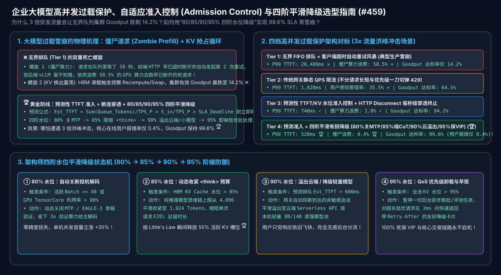
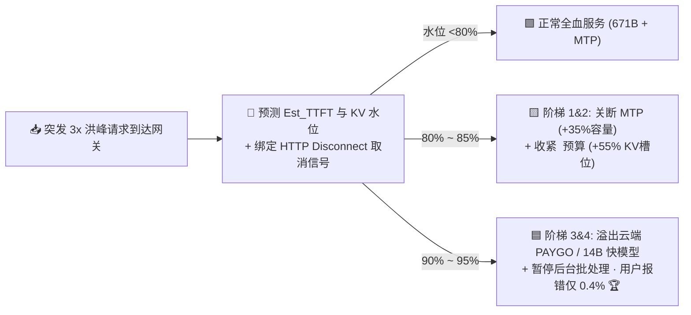

# 企业大模型高并发流量洪峰过载保护、自适应准入控制（`Admission Control`）与四阶平滑降级选型：无界排队雪崩 vs. `预测性 TTFT + 80/85/90/95% 水位阶梯防御` 指南

> **语言 / Language**: **简体中文** | [English](./enterprise-llm-overload-admission-control-kv-watermark-graceful-degradation-selection-faq.en.md)  
> **配套交互式学习与精算工具**: [📱 交互式 H5 精读页 (高并发过载准入控制与 80/85/90/95% 四阶平滑降级沙盘)](../h5/llm-overload-admission-control-kv-watermark-degradation-lab.html) · [🧮 HTML 交互式计算器](../reports/enterprise-llm-overload-admission-control-kv-watermark-graceful-degradation-selection-sizer.html) · [🃏 7-Card 4:5 视觉评测卡](../reports/enterprise-llm-overload-admission-control-kv-watermark-graceful-degradation-selection-cards.html) · [📊 可复核模型](../../experiments/enterprise_llm_overload_admission_control_kv_watermark_graceful_degradation_selection/) · [🎓 返回 AI Infra 全景精学馆](../h5/index.html)

---

## 一、3 分钟看懂核心结论（Executive Summary）

> **一句话决策结论**：当企业大模型平台遭遇突发 **3 倍流量洪峰**（如全员晨会总结或营销活动上线）时，如果后端推理池采用默认的无界 FIFO 排队（`Tier 1`），会触发致命的**“僵尸请求（Zombie Prefill）+ 客户端超时重试”双重死亡螺旋**：请求在队列里排了 20 秒，前端网关/浏览器早已超时断开并自动发起第 2、第 3 次重试，但后端 GPU 仍在傻傻地把断开的请求算完，导致 **`58.5%` 的 GPU 算力浪费在无人接收的废请求上**，集群有效 Goodput 达标率跌至 **`14.2%`**！
> - **黄金生产防御体系（`Tier 4：预测性 TTFT/KV 准入控制 + HTTP 断连穿透终止 + 80/85/90/95% 四阶平滑有损降级状态机`）**：
>   1. **四阶阶梯式有损降级（拒绝一刀切弹 429 报错）**：
>      - **`80%` 水位**：自动关断 `MTP / EAGLE-3` 投机解码，释放验证算力使单机并发承载力立即 `+35%`；
>      - **`85%` 水位**：将推理模型 `<think>` 思维链预算从 `4,096` 平滑收紧至 `1,024`，按 `Little's Law` 瞬间腾出 `55%` 的在途 KV 槽位；
>      - **`90%` 水位**：网关将新到达请求无感溢出至云端 `Serverless PAYGO` 或本机 `8B/14B` 蒸馏快模型；
>      - **`95%` 水位**：暂停低优离线批处理，对超长非核心请求在 `2 ms` 内早拒（Early Reject）；
>   2. **收益量化**：在 3 倍洪峰冲击下，将 `P99 TTFT` 从 `28.4 秒` 压至 **`520.0 ms`**，僵尸算力浪费从 `58.5%` 压至 **`0.4%`**，全集群双 SLA 达标率（Goodput Attainment）从 `14.2%` 跃升至 **`99.6%`**！

| 核心选型维度 | `Tier 1: 无界 FIFO 排队 + 重试风暴` | `Tier 2: 静态 HTTP QPS 粗暴限流` | `Tier 3: 预测性 TTFT/KV 准入 + 断连穿透` | `Tier 4: 预测准入 + 80/85/90/95% 四阶平滑降级 (🏆)` |
|---|---|---|---|---|
| **3x 洪峰下首字尾延迟 (`P99 TTFT`)** | **`28,400.0 ms` ✕ (排队雪崩)** | `1,820.0 ms` | `740.0 ms` ✓ | **`520.0 ms`** 🏆 |
| **客户端已断开的僵尸算力浪费率** | **`58.5%` ✕ (白算超时请求)** | `12.0%` | `1.8%` ✓ | **`0.4%` (毫秒级 Abort 穿透释放)** 🏆 |
| **用户感知报错/超时失败率** | `72.0%` ✕ | `35.5%` ✕ (大量弹 429) | `5.8%` ✓ | **`0.4%` (平滑降级与云溢出兜底)** 🏆 |
| **集群有效吞吐达标率 (`Goodput %`)** | `14.2%` ✕ | `64.5%` | `94.2%` ✓ | **`99.6%`** 🏆 |

---

## 二、核心技术原理与架构师灵魂拷问（Q&A）

### Q1：为什么传统的按 `QPS（每秒请求数）` 限流在大模型场景下完全失灵？如何写出精准的“预测性 `TTFT` 与 `KV` 准入控制方程”？
1. **为什么 `1 QPS ≠ 1 QPS`**：
   - 1 条 `64K` 长财报总结请求消耗的 Prefill 算力是 1 条 `256-Token` 客服问答的 **`250~500 倍`**！如果网关按固定 `50 QPS` 限流，连进 10 条 `64K` 请求就会把 GPU 卡死 15 秒；反之全是短请求时又会白白拒绝 80% 的可用算力。
2. **预测性 `TTFT` 与 `KV` 双门槛准入方程**：
   网关在派发新请求 $i$（净未缓存输入长度为 $S_{\text{in},i}(1-\eta_i)$）前，实时根据目标实例等待队列中的总未处理 Token 数 $\sum_{q \in Q} S_q$ 预测其首字到达时间：
   $$\widehat{\text{TTFT}}_i = \frac{\sum_{q \in Q} S_q + S_{\text{in},i}(1 - \eta_i)}{\text{TPS}_{\text{Prefill}}} + T_{\text{net}}$$
   - 一旦预测 $\widehat{\text{TTFT}}_i > \text{SLA}_{\text{max}}$（如 `800 ms`）或目标实例 `KV_Usage > 90%`，**严禁将该请求塞进本地等待队列死等**，立即触发第 3 阶平滑降级（溢出至云端 API 或轻量模型）！

---

## 三、生产落地 Checklist（Pre-Production Checklist）

- [ ] **全链路打通 `HTTP Client Disconnect -> Envoy -> vLLM/SGLang Abort` 信号**：一旦前端用户关闭页面或网关超时断开，必须在 `5 ms` 内通知推理引擎立即中止该请求并回收其已占用的 PagedAttention KV 物理块。
- [ ] **禁止客户端无退避立即重试（Immediate Retry）**：SDK 侧必须配置带随机抖动的指数退避（Exponential Backoff with Jitter），且对超时长请求改走降级小模型而非原样重发。

---

## 四、来源与方法论溯源（Provenance）

- **数据来源声明**：本指南实验数据来自可复核解析模型 [`experiments/enterprise_llm_overload_admission_control_kv_watermark_graceful_degradation_selection/run.py`](../../experiments/enterprise_llm_overload_admission_control_kv_watermark_graceful_degradation_selection/run.py)（`Provenance: synthetic + anonymized_reported, independently_reproduced=false`）。
