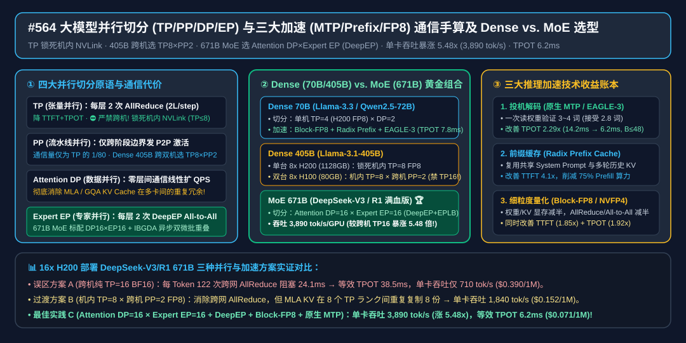

# Enterprise LLM Parallelism (`TP` / `PP` / `Attention DP` / `Expert EP`), Three Acceleration Levers (`MTP/EAGLE-3` / `Prefix Cache` / `FP8·INT4`) Communication Cost Hand-Calculation & `Dense (70B/405B)` vs. `MoE (671B)` Optimal Partitioning Guide (`#564`)

> **Language / 语言**: [简体中文](./enterprise-llm-parallelism-tp-pp-dp-ep-dense-moe-sizing-faq.md) | **English** · [📱 Interactive H5 Study Lab (SVG Topology + Live Sizer)](../h5/enterprise-llm-parallelism-tp-pp-dp-ep-dense-moe-sizer-lab.html) · [🧮 Interactive HTML Sizer](../reports/enterprise-llm-parallelism-tp-pp-dp-ep-dense-moe-sizing-sizer.html) · [🃏 7-Card Visual Report](../reports/enterprise-llm-parallelism-tp-pp-dp-ep-dense-moe-sizing-cards.html) · [Back to Catalog](../full-catalog-en.md)

---

## 1. 3-Minute Executive Summary

1. **Bottom-Line Conclusion**:
   - When deploying frontier models (`DeepSeek-V3/R1 671B` or `Llama-3.1-405B`) across a 2-node `16x H200` cluster, naively extending Tensor Parallelism across nodes (**`Cross-Node TP=16`**) triggers `122–160` inter-node RDMA `AllReduce` barriers per generated token. Network synchronization stalls reach **`24.1 ms/token`**, degrading `P99 TPOT` to **`38.5 ms`** and collapsing throughput to **`710 tok/s/GPU`** (`$0.390 / 1M tokens`).
   - Switching to **`Intra-Node NVLink TP=8 × Inter-Node PP=2 (FP8)`** eliminates cross-node `AllReduce` (`0.9 ms` communication), which is optimal for **Dense 405B**, but on `DeepSeek MLA` it still duplicates the single shared KV latent vector `8x` across each TP group (`1,840 tok/s/GPU`, `15.2 ms TPOT`).
   - Adopting the full-stack **`Attention DP=16 × Expert EP=16 (DeepEP IBGDA Dual-Microbatch Overlap) + Block-FP8 + Radix Prefix Cache + Native MTP Speculative Decoding`** architecture hides `92%+` of `All-to-All` latency (`1.1 ms` exposed), eliminates KV Cache duplication (`1x`), boosts throughput **`5.48x` to `3,890 tok/s/GPU`**, cuts effective `P99 TPOT` to **`6.2 ms` (`6.21x` faster)**, and lowers token cost to **`$0.071 / 1M` (`5.49x` cheaper)**!
2. **The Four Parallelism Dimensions & Their Communication Laws**:
   - **`TP` (Tensor Parallelism)**: `2 AllReduces` per layer ($2L$ barriers/step). Cuts both `TTFT` and `TPOT`, but **must stay strictly within intra-node NVLink (`TP <= 8`) or rack-scale NVL72 (`MNNVL`)**.
   - **`PP` (Pipeline Parallelism)**: `1 P2P Send/Recv` activation transfer per stage boundary (`40x–80x` less traffic than `TP`). Ideal for cross-node **Dense 405B (`TP=8 × PP=2`)**.
   - **`Attention DP` (Data Parallelism)**: Zero communication during Attention and **zero KV Cache duplication across ranks**; scales cluster `QPS / TPS` linearly.
   - **`Expert EP` (Expert Parallelism)**: `2 All-to-All` collectives (`Dispatch` + `Combine`) per MoE layer via `DeepEP` + `EPLB` redundant hot-expert balancing.

---

## 2. Deep-Dive Q&A: Communication Math, Accelerator Trade-offs & Dense vs. MoE Recipes

### Q1: Why does Cross-Node `TP=16` collapse over 400G RDMA while Intra-Node `TP=8` over NVLink adds `< 0.5 ms`?
- **Answer**: Using Hockney's $\alpha\text{-}\beta$ model for 61 layers ($122$ `AllReduce` barriers per step, payload $M \approx 458.75\text{ KB}$ at $B=64$ FP8):
  - **Intra-Node `TP=8` on NVSwitch (`busbw = 380 GB/s`, $\alpha \approx 1.8\ \mu\text{s}$)**:
    $$T_{\text{TP8\_NVL}} = 122 \times (1.8\ \mu\text{s} + 2.1\ \mu\text{s}) \approx \mathbf{0.48\text{ ms/token}}$$
  - **Cross-Node `TP=16` over 400G RoCEv2/IB (`busbw = 45 GB/s`, $\alpha \approx 165\ \mu\text{s}$ including fabric switch & synchronization jitter)**:
    $$T_{\text{TP16\_RDMA}} = 122 \times (165\ \mu\text{s} + 19\ \mu\text{s}) \approx \mathbf{22.5\sim 24.1\text{ ms/token}}$$
  - **Cross-Node `PP=2` (`TP=8 × PP=2`)**: Only `1` P2P transfer of `458.75 KB` between Layer 30 and Layer 31 = **`0.03 ms`**!

---

### Q2: How do Speculative Decoding (`MTP/EAGLE-3`), Prefix Caching, and `Block-FP8 / W4A16` Quantization interact with Parallelism?

| Accelerator | Metric Improved | Quantitative Gain & Mechanism | Communication Impact & Guardrail |
| :--- | :--- | :--- | :--- |
| **`Native MTP / EAGLE-3` Speculative Decoding** | **`TPOT` cut by `1.9x–2.5x`** (`14.2ms -> 6.2ms`) | Verifies `3–4` draft tokens per HBM weight read (accepts `~2.8` tokens/step) | Best for `B <= 48`; auto-disable at `B > 64` when Tensor Cores saturate |
| **`Radix Prefix Caching`** | **`TTFT` cut by `3.2x–6.8x`** + `-75%` Prefill FLOPs | Reuses KV blocks for shared System Prompts, RAG docs, and multi-turn history | Requires gateway **KV-Aware Prefix Routing** to keep cache hit rate `>= 65%` |
| **`Block-FP8 (1x128)` vs. `W4A16 AWQ`** | **Improves both `TTFT` (`1.85x`) & `TPOT` (`1.92x`)** | Halves weight memory, KV Cache footprint, and **`AllReduce / All-to-All` network bytes** | Use **`Block-FP8`** for high-concurrency Hopper/Blackwell; use `W4A16` only for low-batch (`B <= 16`) memory-constrained nodes |

---

## 3. Quantitative Comparison Matrix (`16x H200 · DeepSeek-V3/R1 671B`)

| Metric | Scheme A: Cross-Node Pure TP (`TP=16 · BF16`) | Scheme B: Hybrid TP+PP (`TP=8 × PP=2 · FP8`) | Scheme C: Decoupled MoE (`Attention DP16 × Expert EP16 + FP8 + MTP`) 🏆 |
| :--- | :--- | :--- | :--- |
| **Exposed Comm Latency / Step** | `24.1 ms / tok` (122 RDMA AllReduces ✕) | `0.9 ms / tok` | **`1.1 ms / tok` (`92%` hidden via Dual-Microbatch)** |
| **MLA KV Cache Duplication Factor** | `16x` (Severe HBM waste ✕) | `8x` | **`1x` (Zero duplication, `8x` higher concurrency ✓)** |
| **Effective `P99 TPOT`** | `38.5 ms` (SLA Breach ✕) | `15.2 ms` | **`6.2 ms` (`6.21x` faster with Native MTP ✓)** |
| **Per-GPU Goodput (`tok/s/GPU`)** | `710 tok/s/GPU` | `1,840 tok/s/GPU` | **`3,890 tok/s/GPU` (`5.48x` higher)** |
| **16-GPU Cluster Throughput** | `11,360 tok/s` | `29,440 tok/s` | **`62,240 tok/s`** |
| **Cost per 1M Tokens (`$/1M`)** | `$0.390 / 1M` | `$0.152 / 1M` | **`$0.071 / 1M` (`5.49x` lower cost)** |

---

## 4. Solution Architect Pre-Production Checklist

- [ ] **Pin `TP <= 8` strictly inside intra-node NVLink**; use `PP` for cross-node Dense 405B and `Attention DP × Expert EP` for cross-node MoE.
- [ ] **Enable `--enable-dp-attention` on DeepSeek MLA models** to eliminate `8x` KV Cache duplication across TP ranks.
- [ ] **Configure `DeepEP` (`IBGDA`) + `EPLB` hot-expert replication** and set dynamic batch cutoffs (`B <= 48`) for `MTP / EAGLE-3` speculative decoding.
