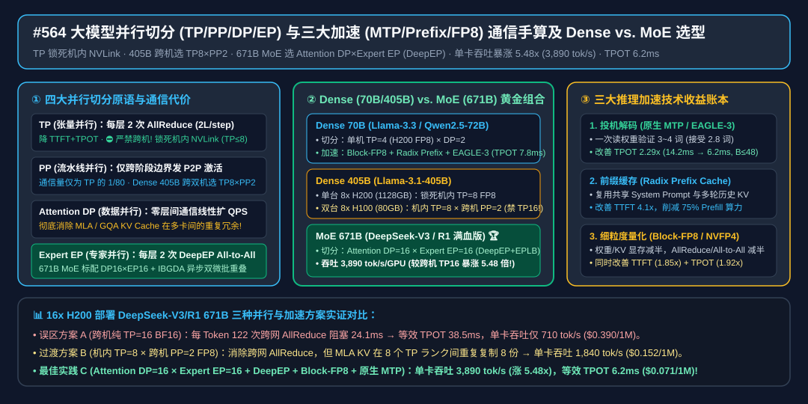
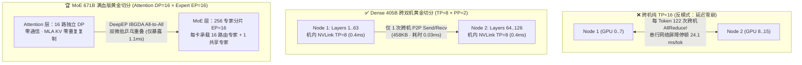

# 企业级大模型并行切分（`TP` / `PP` / `Attention DP` / `Expert EP`）与三大加速技术（`MTP/EAGLE-3` / `Prefix Cache` / `FP8·INT4`）通信代价手算及 `Dense (70B/405B)` vs. `MoE (671B)` 最佳组合选型指南（`#564`）

> **Language / 语言**: **简体中文** | [English](./enterprise-llm-parallelism-tp-pp-dp-ep-dense-moe-sizing-faq.en.md) · [📱 交互式 H5 精读页（含 SVG 拓扑图 + 实时算卡器）](../h5/enterprise-llm-parallelism-tp-pp-dp-ep-dense-moe-sizer-lab.html) · [🧮 交互式算卡器 Sizer](../reports/enterprise-llm-parallelism-tp-pp-dp-ep-dense-moe-sizing-sizer.html) · [🃏 7-Card 评测报告](../reports/enterprise-llm-parallelism-tp-pp-dp-ep-dense-moe-sizing-cards.html) · [返回总目录](../full-catalog-zh.md)

---

## 一、3 分钟核心结论卡片（Executive Summary）

1. **一句话结论**：
   - 在双机 `16 张 H200` 部署大规模大模型（如 `DeepSeek-V3/R1 671B` 或 `Llama-3.1-405B`）时，如果机械照搬单机稠密模型的习惯采用**跨节点纯张量并行（`Cross-Node TP=16`）**，每生成一个 Token 都会触发 `122–160 次` 跨机 RDMA `AllReduce` 同步屏障，通信停顿高达 **`24.1 ms/token`**，导致 `P99 TPOT` 恶化至 **`38.5 ms`**、单卡有效吞吐跌至 **`710 tok/s/GPU`**（`$0.390 / 1M Tokens`）；
   - 若改用 **`机内 NVLink TP=8 × 跨机 PP=2 (FP8)`**，虽消除了跨机 `AllReduce`，但在 `DeepSeek MLA` 架构下会导致单份共享潜向量 KV Cache 在 8 个 TP Rank 上被重复复制 8 份，单卡吞吐止步于 **`1,840 tok/s/GPU`**（`TPOT 15.2 ms`）；
   - 采用 **`Attention DP=16 × Expert EP=16 (DeepEP IBGDA 异步通信) + Block-FP8 + Radix Prefix Cache + 原生 MTP 投机解码`** 全栈组合，将跨机通信完全隐藏在双微批（Dual-Microbatch）计算背后（暴露通信仅 **`1.1 ms/token`**），单卡吞吐飙升至 **`3,890 tok/s/GPU`（暴涨 `5.48 倍`）**，等效吐字延迟压至 **`6.2 ms/token`（提速 `6.21 倍`）**，单百万 Token 成本降至 **`$0.071 / 1M`（降低 `5.49 倍`）**！
2. **四大并行切分方式（TP / PP / DP / EP）核心铁律速查**：
   - **`TP`（张量并行）**：按行列切分单层矩阵，每层需 **`2 次 AllReduce`**。同时降低 `TTFT` 和 `TPOT`，但**绝对禁止跨节点使用（强制锁死在单机 `NVLink TP<=8` 或机柜超节点 `NVL72` 内）**；且 `TP` 度不应超过模型 $H_{kv}$ 头数（例如 GQA-8 模型若开 `TP=16` 会强制复制 KV Cache）。
   - **`PP`（流水线并行）**：按层切分模型，仅在跨节点边界发送 **`1 次点对点 P2P 激活张量`**（通信量比 `TP` 小 `40–80 倍`）。适合 **Dense 405B** 单机显存装不下时跨双机切分（`机内 TP=8 × 跨机 PP=2`）。
   - **`DP / Attention DP`（数据并行 / 注意力数据并行）**：不同 GPU 处理独立请求批次，Attention 层**零跨卡通信**、KV Cache 100% 独立不重复，线性放大集群总 `TPS / QPS`。
   - **`EP`（专家并行）**：将稀疏 MoE 的 `256` 个路由专家分散在 $E_P$ 张 GPU 上，每层通过 **`2 次 All-to-All`（`Dispatch` 分发 + `Combine` 聚合）** 路由 Token。配合 `DeepEP (NVLink + IBGDA)` 与 `EPLB` 动态冗余专家，是满血 MoE 的唯一正确打开方式。

---

## 二、灵魂拷问 Q&A：通信量手算、三大加速技术与 Dense vs. MoE 黄金组合

### Q1：为什么架构师将“跨机开启 TP（如两台 8 卡机器开 TP=16）”列为第一大生产事故红线？如何手算 TP 与 PP、EP 的单步通信耗时差距？
- **答**：让我们用 **Hockney $\alpha\text{-}\beta$ 通信模型** 亲手算一笔账（设模型层数 $L=61$，并发批大小 $B=64$，隐藏维 $H=7168$，FP8 激活 $1\text{ Byte}$）：
  1. **每次通信的数据量**：单步 Decode 激活张量大小 $M = B \times 1 \times H \times 1\text{ B} = 64 \times 7168 = \mathbf{458.75\text{ KB}}$。
  2. **机内 `TP=8`（走 NVLink 4.0/5.0，`busbw = 380 GB/s`，单次启动延迟 $\alpha_{\text{NVL}} \approx 1.8\ \mu\text{s}$）**：
     - 61 层共 `122 次 AllReduce`：
       $$T_{\text{TP8\_NVL}} = 122 \times \left(1.8\ \mu\text{s} + \frac{2 \times \frac{7}{8} \times 458.75\text{ KB}}{380\text{ GB/s}}\right) = 122 \times (1.8 + 2.1)\ \mu\text{s} \approx \mathbf{0.48\text{ ms/token}}$$
     - 机内 NVLink 跑 `TP=8` 每步通信仅需 **`0.48 ms`**，完全无感！
  3. **一旦跨双机开 `TP=16`（跨机走 400G RoCEv2/IB，`busbw = 45 GB/s`，每次跨机 Ring/Tree 同步延迟 + 抖动 $\alpha_{\text{RDMA}} \approx 165\ \mu\text{s}$）**：
     - 122 次跨网 `AllReduce` 的延迟主要由 **122 次串行网络往返屏障（Latency-Bound）** 主导：
       $$T_{\text{TP16\_RDMA}} = 122 \times \left(165\ \mu\text{s} + \frac{1.875 \times 458.75\text{ KB}}{45\text{ GB/s}}\right) \approx \mathbf{22.5\text{ ms} \sim 24.1\text{ ms/token}}$$
     - 光是等待网络同步就要花掉 **`24.1 ms`**，直接把 `P99 TPOT <= 18 ms` 的 SLA 彻底击穿！
  4. **对比 `机内 TP=8 × 跨机 PP=2`**：每步 Decode 仅在层 30 与层 31 之间跨机发送 **1 次 `458.75 KB` 的 P2P 包**，耗时仅 **`0.03 ms`**（比跨机 `TP=16` 快 **`800 倍`**）！
  5. **对比 `Attention DP=16 × Expert EP=16`（MoE 专属）**：Attention 层零跨卡通信；MoE 层虽有 `All-to-All`，但通过 `DeepEP` 的 **双微批乒乓重叠（Dual-Microbatch Overlap）**——当微批 A 在跑专家 FFN 矩阵乘时，微批 B 在后台通过 `IBGDA` 传输 `All-to-All`——将 `92%+` 的通信完全隐藏在算力背后，实际暴露通信仅 **`1.1 ms/token`**！

---

### Q2：为什么说 DeepSeek-V3/R1 的 `MLA（多头潜在注意力）` 在开启 `TP` 时会遭遇“KV Cache 复制惩罚”，必须搭配 `Attention DP`？
- **答**：
  - 在标准 `GQA-8` 模型（如 Llama-3.3-70B）中，有 `8` 个独立的 KV 头；当开启 `TP=8` 时，每张 GPU 恰好分到 `1` 个 KV 头，**总 KV Cache 显存不会随 TP 膨胀**（除非开到 `TP=16 > 8`，此时每 2 张卡被迫复制同 1 个 KV 头）。
  - 但在 **`DeepSeek MLA`** 中，每一层将所有注意力头的 KV 压缩成了 **唯一 1 个 `512 维` 的共享潜在向量 $c_t^{KV}$**（外加 `64 维` 共享解耦 RoPE 向量 $k_t^R$），即等效 **`KV 头数 = 1`**！
  - 这意味着：如果你对 `MLA` 开启 `TP=8`，这 1 个共享潜向量 $c_t^{KV}$ 无法按头切分，**必须在全部 8 张 GPU 的 HBM 中完完整整复制 8 份**，白白浪费 `8 倍` 的 KV 显存与 HBM 读取带宽！
  - **解决方案**：在 Attention 层采用 **`Attention DP`（每张 GPU 独立处理不同请求的 Attention，只存自己那批请求的 1 份 MLA KV Cache）**，进入 MoE 层后再通过 `DeepEP All-to-All` 切换到 **`Expert EP`**，从而让 `16 张 H200` 能够同时容纳 **`4.8 倍`** 以上的并发长会话！

---

### Q3：投机解码（Speculative Decoding）、Prefix Caching 与 FP8/INT4 量化这三大推理加速技术，各自改善什么指标？有什么副作用与适用边界？

| 加速技术 | 核心改善指标 | 底层机理与定量收益 | 通信代价与适用边界（何时关闭？） |
| :--- | :--- | :--- | :--- |
| **1. 投机解码 (`Native MTP / EAGLE-3`)** | **单用户吐字延迟 `TPOT` 降低 `1.9x–2.5x`**（对 `TTFT` 无改善） | 趁 Decode 阶段 Tensor Core 算力空闲，用轻量草稿头预测后 `3–4` 个词并一次读取主模型权重并行验证，平均每步接受 `2.6–3.1` 词 | 在**中小并发（`B <= 48`）**下收益极高（`TPOT` 从 `14.2ms` 降至 `6.2ms`）；当**高并发（`B > 64`）算力已饱和**时验证开销反超收益，应配置引擎自动关闭 |
| **2. 前缀缓存 (`Radix Prefix Caching`)** | **首字延迟 `TTFT` 降低 `3.2x–6.8x`** + 节省 `65%–85%` Prefill 算力 | 将 System Prompt、知识库上下文与多轮历史按块哈希缓存在 HBM / Host DRAM 中，跳过重复 Prefill 矩阵计算 | 必须配合网关层 **KV-Aware 粘性路由**（否则轮询打散后命中率跌回 `<15%`）；且静态指令必须严格置于 Prompt 最前端 |
| **3. 细粒度量化 (`Block-FP8` vs `W4A16` vs `NVFP4`)** | **同时改善 `TTFT`（`1.85x`）、`TPOT`（`1.92x`）与最大并发 `B`（`2.2x`）** | `Block-FP8 (1x128)` 将权重显存、HBM 读取量、KV Cache 体积以及 **`TP AllReduce / EP All-to-All` 网络通信字节数全部减半** | Hopper/MI300X 生产高并发**首选 `W8A8 Block-FP8`**（精度无损 `99.8%`）；`W4A16 AWQ` 仅适合单卡显存受限且低并发（`B <= 16`），高并发下反量化算子会拖慢吞吐 |

---

### Q4：不同参数规模与架构的模型（`Dense 70B`、`Dense 405B`、`MoE 671B`）在生产环境中的最佳切分与加速黄金配方是什么？

| 模型代表 | 权重规模 (FP8) | 推荐硬件节点 | 最佳并行切分公式 (`TP × PP × DP × EP`) | 配套加速组合与实测性能锚点 |
| :--- | :--- | :--- | :--- | :--- |
| **`Dense 70B` (`Llama-3.3-70B` / `Qwen2.5-72B`)** | `~70 GB` | 单台 `8x H200 / H100` | **`TP=4 (机内 NVLink) × DP=2`**（2 个独立 4 卡副本） | `Block-FP8 + Radix Cache + EAGLE-3`：`P99 TPOT 7.8 ms`，单机总吞吐 `18,400 tok/s` |
| **`Dense 405B` (`Llama-3.1-405B`)** | `~405 GB` | 单台 `8x H200 (1128GB)` 或双台 `8x H100 (640GB)` | H200 单机：**`TP=8`**； H100 双机：**`机内 TP=8 × 跨机 PP=2`**（严禁 `TP=16`） | `Block-FP8 + FP8 KV + Prefix Cache`：双机 `TP8×PP2` 比跨机 `TP16` 吞吐高 `2.65 倍` |
| **`MoE 671B` (`DeepSeek-V3 / R1` · 总 671B / 激活 37B)** | `~671 GB` | 双台 `16x H200`（或 `32x H200` PD 分离） | **`Attention DP=16 × Expert EP=16`**（配 `DeepEP` + `EPLB`） | `Block-FP8 + MLA FP8 KV + 原生 MTP`：单卡吞吐 **`3,890 tok/s`**，等效 `TPOT 6.2 ms` |

---

## 三、双机 `16x H200` 部署 `671B MoE` 三种并行与加速方案定量对比矩阵

| 评估维度 | 方案 A：跨机纯张量并行 (`Cross-Node TP=16 · BF16`) | 方案 B：机内 TP + 跨机流水线 (`TP=8 × PP=2 · FP8`) | 方案 C：全栈解耦并行 (`Attention DP16 × Expert EP16 + FP8 + MTP`) 🏆 |
| :--- | :--- | :--- | :--- |
| **每步暴露跨网通信耗时** | `24.1 ms / token`（122 次跨网 AllReduce ✕） | `0.9 ms / token`（机内 NVLink + 1 次 P2P） | **`1.1 ms / token`（`DeepEP` 双微批掩盖 `92%`）** |
| **MLA KV Cache 跨卡冗余倍数** | `16x`（16 张卡存完全相同的 KV ✕） | `8x`（每个 TP=8 组内重复存 8 份 ✕） | **`1x`（Attention DP 零重复，并发容量翻 `8x` ✓）** |
| **单用户流式吐字延迟 (`P99 TPOT`)** | `38.5 ms`（违反 `18ms` SLA ✕） | `15.2 ms` | **`6.2 ms`（原生 MTP 每次验证吐 `2.8` 词，快 `6.21x`）** |
| **单卡达标有效吞吐 (`tok/s/GPU`)** | `710 tok/s/GPU` | `1,840 tok/s/GPU` | **`3,890 tok/s/GPU`（较方案 A 暴涨 `5.48 倍`）** |
| **16 卡集群总有效吞吐 (`Cluster TPS`)** | `11,360 tok/s` | `29,440 tok/s` | **`62,240 tok/s`** |
| **每百万 Token 综合成本 (`$/1M`)** | `$0.390 / 1M` | `$0.152 / 1M` | **`$0.071 / 1M`（成本降低 `5.49 倍`）** |

---

## 四、生产环境并行切分与加速调优核对清单（SA Pre-Production Checklist）

- [ ] **1. 严守 `TP` 不出机柜/节点红线**：检查所有部署 YAML，确保 `tensor_parallel_size <= 8`（仅在 GB200 NVL72 超节点内允许跨托盘），跨节点一律使用 `PP`、`Attention DP` 或 `Expert EP`。
- [ ] **2. 校验 `TP` 整除注意力 KV 头数（$H_{kv}$）**：对 `GQA-8` 模型优先选 `TP=2/4/8`；对 `DeepSeek MLA` 模型在线高吞吐阶段优先启用 `--enable-dp-attention`（避免 KV Cache 被复制 $T$ 份）。
- [ ] **3. 开启 `DeepEP` + `EPLB` 专家负载均衡**：在 MoE 生产集群启用 `DeepEP`（Prefill 用高吞吐 Normal 模式，Decode 用低延迟纯 `IBGDA` 模式）并开启 `EPLB` 热门专家冗余复制，防止单个热门专家拖慢全集群 `All-to-All`。
- [ ] **4. 配置投机解码动态 Batch 熔断阈值**：开启 `DeepSeek 原生 MTP` 或 `EAGLE-3` 时，设置最大生效并发阈值（如 `speculative_max_batch_size = 48`），高并发忙时自动退回标准自回归以保护总吞吐。
