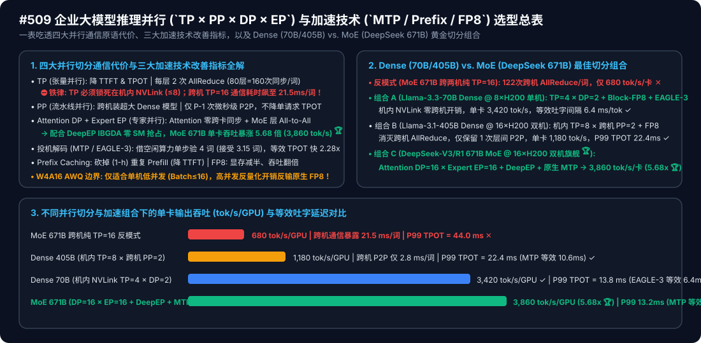

# Enterprise LLM Parallelism (`TP × PP × Attention DP × Expert EP`), Speculative Decoding (`MTP/EAGLE-3`), Prefix Caching & Quantization (`FP8/INT4`) Selection Guide (#509)

> **Executive Summary**:
> When sizing `70B / 405B Dense` or `DeepSeek-V3/R1 671B MoE` clusters, the costliest architectural mistake is **applying dense cross-node `TP` to sparse MoE models or stretching `TP` across PCIe/Ethernet boundaries**:
> 1. **The `TP` (Tensor Parallelism) Iron Law**: `TP` executes **`2 AllReduces per layer`** (`160` global sync barriers per generated token for an 80-layer model!). **`TP` must stay strictly inside an intra-node NVLink/NVSwitch domain (`TP <= 8`)**. Running naive cross-node `TP=16` on `DeepSeek-671B` adds **`21.5 ms/token`** of exposed network sync overhead, collapsing throughput to **`680 tok/s/GPU`** (`P99 TPOT 44.0 ms` ✕);
> 2. **Dense Model Golden Recipes (`70B / 405B`)**:
>    - **`Llama-3.3-70B` (Single-Node 8×H200)**: Use **`TP=4 × DP=2 + Block-FP8 + EAGLE-3`** (`3,420 tok/s/GPU`, effective `6.4 ms/tok`);
>    - **`Llama-3.1-405B` (2-Node 16×H200)**: Use **`Intra-Node TP=8 × Cross-Node PP=2 + Block-FP8`**, replacing 160 cross-node AllReduces with a single inter-node P2P send/recv (`2.8 ms` comm tax);
> 3. **Sparse MoE Golden Recipe (`DeepSeek-V3/R1 671B`)**: Use **`Attention DP=16 × Expert EP=16 + DeepEP (IBGDA) + EPLB + Native MTP`**, eliminating Attention cross-GPU sync and dispatching MoE tokens via zero-SM-tax RDMA `All-to-All`, achieving **`3,860 tok/s/GPU` (`5.68x` higher than `TP=16` 🏆)** and **`5.8 ms` effective TPOT 🏆**!
>
> **⚡ Interactive H5 Study Lab**: [**Open TP/PP/DP/EP Parallelism & Acceleration Interactive Sizer (`docs/h5/llm-parallelism-tp-pp-dp-ep-spec-quant-sizer-lab.html`)**](../h5/llm-parallelism-tp-pp-dp-ep-spec-quant-sizer-lab.html)

---

## 1. Parallelism & Acceleration Trade-off Matrix

| Technique | Collective / Mechanism | Per-Token Comm Formula | Primary Metric Improved | Production Boundary |
| :--- | :--- | :--- | :--- | :--- |
| **`TP` (Tensor Parallelism)** | `2x AllReduce / layer` (`160/tok`) | $2 \frac{T-1}{T} B S d b_{\text{act}}$ | Reduces **TTFT & TPOT**; pools HBM | **Intra-node NVLink only (`TP <= 8`)** |
| **`PP` (Pipeline Parallelism)** | `P-1 P2P Send/Recv` | $B_{\text{micro}} S d b_{\text{act}}$ | Fits multi-node Dense models (`405B`) | Does not cut single-request TPOT |
| **`Attention DP + Expert EP`** | `0` Attn sync + `2x All-to-All / MoE layer` | $2 B S k d \frac{E-1}{E} b_{\text{act}}$ | **`5.68x` higher MoE throughput** | Requires RDMA + `DeepEP` + `EPLB` |
| **Speculative (`MTP / EAGLE-3`)** | Parallel verification of $\gamma=4$ tokens | Draft head overhead (~2–4%) | Cuts effective **TPOT by `2.0x–2.3x`** | Best at low/medium batch (`Batch <= 64`) |
| **`Prefix Caching` (`RadixAttention`)** | KV Radix tree prefix match | Saves $(1-h)$ prefill & KV xfer | Cuts **TTFT & P-Pool GPUs by $(1-h)$** | Does not reduce Decode HBM reads |
| **`Block-FP8` vs `W4A16 AWQ`** | Hardware FP8 Tensor Core vs Int4 dequant | `0.5x` weight & KV bytes | **`2x` HBM capacity + `2x` TOPS** | **FP8 wins at `Batch >= 16`**; W4A16 for low-batch edge |

---

## 2. Quantitative Decision Matrix (`H200 141GB Cluster`)

| Model & Parallel Configuration | Parallel Strategy & Primitive | Exposed Comm / Token | Base `P99 TPOT` | Effective `TPOT` (with MTP) | Output `tok/s/GPU` | SA Verdict |
| :--- | :--- | :--- | :--- | :--- | :--- | :--- |
| **Anti-Pattern: `DeepSeek-671B` Cross-Node `TP=16`** | `TP=16` (`122x` Cross-Node AllReduce) | `21.5 ms` ✕ | `44.0 ms` ✕ | `44.0 ms` ✕ | `680 tok/s` ✕ | ⛔ **Never use** |
| **Recipe A: `Llama-3.3-70B Dense` (8×H200)** | **`TP=4 × DP=2` (NVLink) + `FP8` + `EAGLE-3`** | `1.4 ms` ✓ | `13.8 ms` ✓ | **`6.4 ms` ✓** | **`3,420 tok/s` ✓** | ✅ **70B Gold Standard** |
| **Recipe B: `Llama-3.1-405B Dense` (16×H200)** | **`Intra-Node TP=8 × Cross-Node PP=2` + `FP8`** | `2.8 ms` ✓ | `22.4 ms` ✓ | `10.6 ms` ✓ | `1,180 tok/s` ✓ | ✅ **405B Multi-Node** |
| **Recipe C: `DeepSeek-671B MoE` (16×H200 🏆)** | **`Attn DP=16 × Expert EP=16 + DeepEP + MTP` 🏆** | **`2.1 ms` 🏆** | **`13.2 ms` 🏆** | **`5.8 ms` 🏆** | **`3,860 tok/s (5.68x)` 🏆** | **✅ MoE Flagship** |

---

## 3. Companion Links

- **Interactive H5 Study Lab**: [docs/h5/llm-parallelism-tp-pp-dp-ep-spec-quant-sizer-lab.html](../h5/llm-parallelism-tp-pp-dp-ep-spec-quant-sizer-lab.html)
- **7-Card 4:5 Visual Report**: [docs/reports/enterprise-llm-parallelism-tp-pp-dp-ep-spec-quant-sizing-selection-cards.html](../reports/enterprise-llm-parallelism-tp-pp-dp-ep-spec-quant-sizing-selection-cards.html)
- **HTML Sizer**: [docs/reports/enterprise-llm-parallelism-tp-pp-dp-ep-spec-quant-sizing-selection-sizer.html](../reports/enterprise-llm-parallelism-tp-pp-dp-ep-spec-quant-sizing-selection-sizer.html)
- **Reproducible Model**: [`experiments/enterprise_llm_parallelism_tp_pp_dp_ep_spec_quant_sizing_selection/run.py`](../../experiments/enterprise_llm_parallelism_tp_pp_dp_ep_spec_quant_sizing_selection/run.py)
