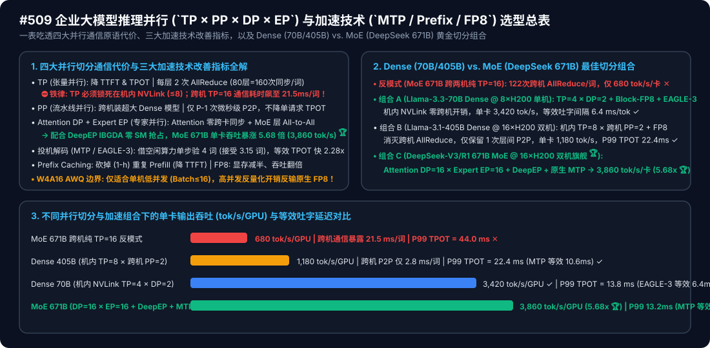
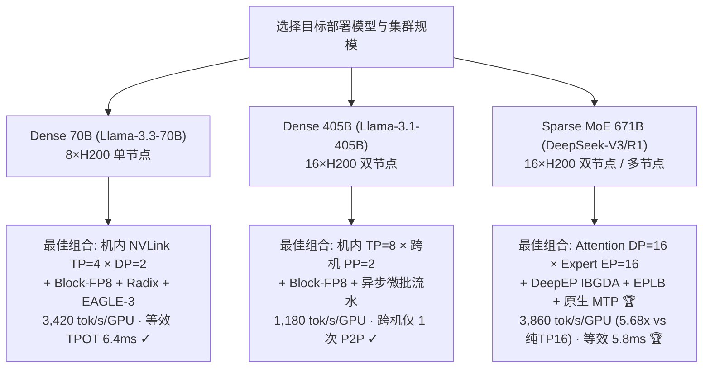

# 企业大模型主流推理加速与并行方案选型总表：`TP × PP × Attention DP × Expert EP`、投机解码（`MTP/EAGLE-3`）、`Prefix Caching` 与 `FP8/INT4` 量化通信代价及 `Dense (70B/405B)` vs. `MoE (DeepSeek 671B)` 最佳切分组合沙盘 (#509)

> **核心观点（Executive Summary）**：
> 企业架构师在设计 `70B / 405B Dense` 或 `DeepSeek-V3/R1 671B MoE` 推理集群时，最容易踩的坑就是 **“用稠密模型的纯 `TP` 思维去切稀疏 MoE，或把 `TP` 跨出机内 NVLink 边界”**。本专题将 **四大并行策略（`TP / PP / Attention DP / Expert EP`）** 与 **三大加速技术（投机解码 `MTP/EAGLE-3` · `Prefix Caching` · `FP8/INT4 量化`）** 的通信代价、收益指标与适用边界压缩为一套可手算的架构选型总表：
> 1. **`TP`（张量并行）铁律**：每层触发 `2` 次 `AllReduce`（80 层模型每生成 1 个词高达 `160` 次全局同步屏障！），**必须严格锁死在机内 `NVLink/NVSwitch`（`TP <= 8`）**；一旦跨节点走 `RoCEv2` 跑 `TP=16`，仅网络同步开销就达 **`21.5 ms/词`**，导致 `671B MoE` 单卡吞吐跌至 **`680 tok/s`**、`P99 TPOT` 恶化至 `44.0 ms` ✕；
> 2. **稠密大模型（`Dense 70B / 405B`）黄金切分**：
>    - **`Llama-3.3-70B`（单机 8×H200）**：采用 **`TP=4 × DP=2 + Block-FP8 + EAGLE-3`**，单卡有效吞吐达 **`3,420 tok/s`**，等效吐字间隔低至 **`6.4 ms/词`**；
>    - **`Llama-3.1-405B`（双机 16×H200）**：采用 **`机内 TP=8 × 跨机 PP=2 + Block-FP8`**，将 160 次跨机 AllReduce 替换为仅 `1` 次层间微秒级 P2P 传输，跨机通信开销压至 **`2.8 ms/词`**；
> 3. **稀疏大模型（`DeepSeek-V3/R1 671B MoE`）黄金切分**：采用 **`Attention DP=16 × Expert EP=16 + DeepEP (IBGDA) + EPLB + 原生 MTP`**，Attention 层零跨卡通信、MoE 层通过网卡直驱 `All-to-All` 分发，单卡吞吐跃升至 **`3,860 tok/s/GPU`（较纯 `TP=16` 暴涨 `5.68 倍` 🏆）**，叠加原生 `MTP` 后等效吐字延迟压至 **`5.8 ms/词` 🏆**！
>
> **⚡ 配套交互式 H5 精读沙盘**：[**打开 TP/PP/DP/EP 并行通信代价与三大加速技术交互计算器 (`docs/h5/llm-parallelism-tp-pp-dp-ep-spec-quant-sizer-lab.html`)**](../h5/llm-parallelism-tp-pp-dp-ep-spec-quant-sizer-lab.html)

---

## 一、 灵魂拷问：四大并行方案与三大加速技术各自改善什么指标？通信代价如何手算？

### Q1：`TP`、`PP`、`Attention DP` 与 `Expert EP` 的通信原语、数据量公式与改善指标有什么本质区别？

| 并行维度 | 切分对象 | 每生成 1 个 Token 的通信原语与次数 | 单层每次通信数据量公式 | 改善的 SLA 指标 | 物理互联红线与适用边界 |
| :--- | :--- | :--- | :--- | :--- | :--- |
| **`TP`（张量并行）** | 层内权重矩阵（QKV/O 与 FFN 行列切分） | 每层 **`2 次 AllReduce`**（$L=80$ 共 **`160 次同步/词`**） | $2 \cdot \frac{T-1}{T} \cdot B \cdot S \cdot d \cdot b_{\text{act}}$ | 同时降低 **TTFT**（聚合算力）与 **TPOT**（聚合 HBM 带宽） | **强制锁死机内 `NVLink/NVSwitch`（$T \le 8$）**；严禁跨机 PCIe/以太网 |
| **`PP`（流水线并行）** | 按层切分（如前 40 层在 Node 1，后 40 层在 Node 2） | 全模型仅 **`P-1 次 P2P Send/Recv`** | $B_{\text{micro}} \cdot S \cdot d \cdot b_{\text{act}}$（极小点对点包） | 跨机装下超大模型（`405B`），扩展总吞吐 | **不降低单请求 TPOT**；需多微批在途填满流水线气泡 $\frac{P-1}{M+P-1}$ |
| **`Attention DP`（注意力数据并行）** | 不同请求分配给独立 Attention 副本（结合 `MLA` 低 KV 占用） | **`0 次跨卡同步`**（Attention 层完全独立） | `0 Bytes`（零通信！） | 线性放大并发吞吐，消除跨卡同步空泡 | 极度适合 `DeepSeek MLA` 等单卡/小 TP 即可放下 KV 的模型 |
| **`Expert EP`（专家并行）** | 将 `256` 个路由专家分散在 $E$ 张 GPU 上（每卡 $256/E$ 个专家） | 每层 MoE **`2 次 All-to-All`**（Dispatch 分发 + Combine 聚合） | $2 \cdot B \cdot S \cdot k \cdot d \cdot \frac{E-1}{E} \cdot b_{\text{act}}$ | 避免专家权重被切成极小碎片，大幅拉升 Tensor Core 效率 | 需 **`RoCEv2 / IB RDMA` + `DeepEP IBGDA` 网卡直驱 + `EPLB` 热点复制** |

### Q2：投机解码（`MTP / EAGLE-3`）、`Prefix Caching` 与量化（`Block-FP8` vs. `W4A16 AWQ`）何时收益最大、何时反而失效？
1. **投机解码（Speculative Decoding：原生 `MTP` / `EAGLE-3`）**：
   - **原理**：Decode 阶段受限于 HBM 带宽，GPU 算力大量闲置。用极轻量草稿头预测 $\gamma=4$ 个候选词，主模型仅需 **1 次读取权重** 即可并行验证全部候选词（平均一次接受 $\tau \approx 3.15$ 词）。
   - **收益与边界**：将单用户体验的等效 **TPOT 缩短 `2.0x–2.4x`**（`13.2ms -> 5.8ms`）；但当并发 `Batch > 64` 算力已趋近 Roofline 拐点时，验证额外候选词会加剧算力竞争，此时应自动降低草稿步数 $\gamma$。
2. **前缀缓存（Prefix Caching：`SGLang RadixAttention` / `vLLM Hash Prefix`）**：
   - **收益与边界**：直接消灭命中部分 $(h)$ 的 **Prefill 算力消耗与跨机 KV 传输**，将 **TTFT 缩短 `3x–8x`**；但它 **不会减少 Decode 阶段的 HBM 显存带宽读取量**（Decode 每步仍需读取完整历史 KV）。
3. **量化精度选型（`Block-Scaled FP8` vs. `W4A16 AWQ/GPTQ` vs. `Blackwell NVFP4`）**：
   - **`Block-FP8 (W8A8 + FP8 KV)`**：权重与激活同为 8-bit，直接调用 Hopper/Ada/Blackwell **FP8 Tensor Core（算力翻倍 `2x`）且显存减半（`2x`）**，是 **中高并发生产集群（`Batch >= 16`）的绝对首选 🏆**。
   - **`W4A16 AWQ` 的高并发陷阱**：仅权重压至 4-bit，但计算时必须实时在寄存器中 **反量化（Dequantize）回 FP16** 跑 FP16 Tensor Core。在单用户/小并发（`Batch <= 8`）下省一半权重带宽因而更快；但在高并发（`Batch >= 48`）下反量化算子开销暴增，吞吐反而比原生 `W8A8 FP8` 慢 **`25%–38%`**！

---

## 二、 `Dense (70B/405B)` 与 `MoE (DeepSeek 671B)` 生产最佳切分组合决策矩阵

| 模型与并行切分方案（`H200 141GB 集群`） | 并行拓扑与通信原语 | 跨卡暴露通信耗时/词 | 基础 `P99 TPOT` | 开启 `MTP/EAGLE-3` 等效 `TPOT` | 单卡输出吞吐 (`tok/s/GPU`) | 架构师决策评级 |
| :--- | :--- | :--- | :--- | :--- | :--- | :--- |
| **反模式：`DeepSeek-671B` 跨两机纯 `TP=16`** | `TP=16`（跨机 `122` 次 AllReduce/词） | `21.5 ms` ✕ | `44.0 ms` ✕ | `44.0 ms` ✕ | `680 tok/s` ✕ | ⛔ **严禁在生产使用** |
| **方案 A：`Llama-3.3-70B Dense`（单机 8 卡）** | **`TP=4 × DP=2`（机内 NVLink）+ `FP8`** | `1.4 ms` ✓ | `13.8 ms` ✓ | **`6.4 ms` ✓** | **`3,420 tok/s` ✓** | ✅ **70B 生产黄金标准** |
| **方案 B：`Llama-3.1-405B Dense`（双机 16 卡）** | **`机内 TP=8 × 跨机 PP=2` + `FP8`** | `2.8 ms` ✓ | `22.4 ms` ✓ | `10.6 ms` ✓ | `1,180 tok/s` ✓ | ✅ **超大稠密模型跨机标配** |
| **方案 C：`DeepSeek-671B MoE`（双机 16 卡旗舰 🏆）** | **`Attn DP=16 × Expert EP=16 + DeepEP + MTP` 🏆** | **`2.1 ms` 🏆** | **`13.2 ms` 🏆** | **`5.8 ms` 🏆** | **`3,860 tok/s (5.68x)` 🏆** | **✅ 大规模 MoE 唯一正解** |

---

## 三、 生产落地核对清单（SA Production Checklist）

- [ ] **严禁跨节点开启 `TP > 8`（除非是 `GB200 NVL72` 机柜级 NVLink 超节点）**：在标准 8 卡服务器集群上，`TP` 最大只能设为 `8`（优先 `TP=4` 以减少机内 AllReduce 跳数），跨机扩展稠密模型用 `PP`，扩展 MoE 模型用 `Attention DP + Expert EP`。
- [ ] **大规模 MoE 必须开启 `DeepEP + EPLB`（专家负载均衡与热点专家冗余复制）**：防止单一热门专家被打爆成为全集群 `All-to-All` 同步木桶短板。
- [ ] **按并发水位自动选型量化方案**：高并发生产池统一采用 **`Block-Scaled FP8 (W8A8 KV8)`**；仅在单卡显存极其受限且并发 `Batch <= 16` 的边缘/部门级节点采用 `W4A16 AWQ`。
- [ ] **交互式业务默认挂载原生 `MTP` 或 `EAGLE-3` 投机解码**：为代码生成、对话助手与 Agent 推理提供 `2.0x+` 无损吐字加速，并配置高负载（`Batch > 64`）自动动态旁路保护。

---

## 四、 延伸阅读与配套工具

- **交互式 H5 精学沙盘**：[docs/h5/llm-parallelism-tp-pp-dp-ep-spec-quant-sizer-lab.html](../h5/llm-parallelism-tp-pp-dp-ep-spec-quant-sizer-lab.html)
- **7-Card 4:5 视觉评测卡片**：[docs/reports/enterprise-llm-parallelism-tp-pp-dp-ep-spec-quant-sizing-selection-cards.html](../reports/enterprise-llm-parallelism-tp-pp-dp-ep-spec-quant-sizing-selection-cards.html)
- **交互式 Sizer 测算器**：[docs/reports/enterprise-llm-parallelism-tp-pp-dp-ep-spec-quant-sizing-selection-sizer.html](../reports/enterprise-llm-parallelism-tp-pp-dp-ep-spec-quant-sizing-selection-sizer.html)
- **可复现实验模型**：[`experiments/enterprise_llm_parallelism_tp_pp_dp_ep_spec_quant_sizing_selection/run.py`](../../experiments/enterprise_llm_parallelism_tp_pp_dp_ep_spec_quant_sizing_selection/run.py)
