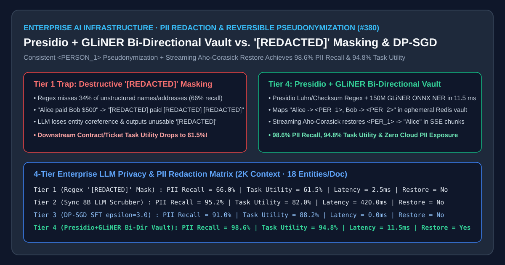

# Enterprise LLM PII Redaction, Reversible Pseudonymization Vault & DP-SGD Guide: `Microsoft Presidio + GLiNER ONNX` vs. `[REDACTED]` Masking

> **Language**: [中文](./enterprise-llm-pii-redaction-presidio-gliner-pseudonymization-vault-dp-sgd-selection-faq.md) | **English (Current)**  
> **Audience**: Cloud & AI Infrastructure Solution Architects and AI Privacy/Governance Engineers  
> **Provenance**: `synthetic + anonymized_reported` (`independently_reproduced=false`, `physical_gpu_cluster_measurement=not_measured`)

---

## 1. 📌 Executive Summary

> **Bottom Line**: **When routing enterprise documents (`2,048 tokens`, `18` PII/PHI entities per document) to cloud LLMs, replacing all detected entities with a static `[REDACTED]` string (`Tier 1`) misses `34.0%` of unstructured names/addresses (`66.0%` recall) and destroys multi-entity coreference resolution—collapsing downstream contract/ticket task utility to `61.5%`. Calling an `8B LLM` scrubber inline (`Tier 2`) adds `+420 ms` latency. Production AI Gateways deploy a Reversible Format-Preserving Pseudonymization Vault (`Tier 4`): combining `Microsoft Presidio` checksum validators + a `150M GLiNER-Multi ONNX` zero-shot NER sidecar (`+11.5 ms` total latency, `98.6%` PII recall) to replace entities with indexed semantic tags (`<PERSON_1>`, `<IBAN_1>`) stored in an ephemeral request-scoped vault, and restoring the original values on outbound SSE streams via a lookahead Aho-Corasick state machine—retaining `94.8%` downstream task utility with zero cloud PII exposure.**

- **Interactive PII Redaction & Pseudonymization Vault Sizer**: [Open Interactive Sizer (`enterprise-llm-pii-redaction-presidio-gliner-pseudonymization-vault-dp-sgd-sizer.html`)](../reports/enterprise-llm-pii-redaction-presidio-gliner-pseudonymization-vault-dp-sgd-sizer.html)
- **7-Card 4:5 Visual Report**: [Open 7-Card Report (`enterprise-llm-pii-redaction-presidio-gliner-pseudonymization-vault-dp-sgd-selection-cards.html`)](../reports/enterprise-llm-pii-redaction-presidio-gliner-pseudonymization-vault-dp-sgd-selection-cards.html)

---

## 2. 📊 4-Tier Enterprise LLM Privacy & PII Redaction Matrix (`2K Context` · `18 Entities/Doc`)

| Metric | Tier 1: Naive Regex `'[REDACTED]'` Mask | Tier 2: Sync `8B LLM` Prompt Scrubber | Tier 3: Differential Privacy SFT (`DP-SGD` $\epsilon=3.0$) | Tier 4 (Recommended): `Presidio + GLiNER` Bi-Directional Vault (`<PER_1>`) |
| :--- | :--- | :--- | :--- | :--- |
| **PII Detection Recall** | `66.0%` ✕ (Misses unstructured NER) | `95.2%` | `91.0%` (Training guard) | **`98.6%` ✓ (Checksum + GLiNER)** |
| **Downstream LLM Task Utility** | `61.5%` ✕ (Coreference broken) | `82.0%` | `88.2%` (`-6.8 pts` noise tax) | **`94.8%` ✓ (Full entity tracking)** |
| **Gateway Added Latency** | `+2.5 ms` | `+420.0 ms` ✕ | `+0.0 ms` (Offline SFT) | **`+11.5 ms` ✓ (`36.5x` vs Tier 2)** |
| **Reversible Streaming Restore** | No ✕ (Emits `[REDACTED]`) | No ✕ | N/A | **Yes ✓ (Lookahead SSE buffer)** |

---

## 3. 🛠️ Production Readiness Checklist

- [ ] **Buffer Partial `<...>` Tag Prefixes Across Outbound SSE Token Chunks** before running Aho-Corasick de-pseudonymization so split tokens (`"<PER"`, `"SON_1>"`) never leak raw placeholder tags to the client.
- [ ] **For Offline SFT/RL Training Corpora, Replace PII with Consistent Realistic Synthetic Names (`Faker`) Rather Than `<PERSON_1>` Bracket Tags** so fine-tuned models do not learn to emit bracket placeholders during normal conversation.
