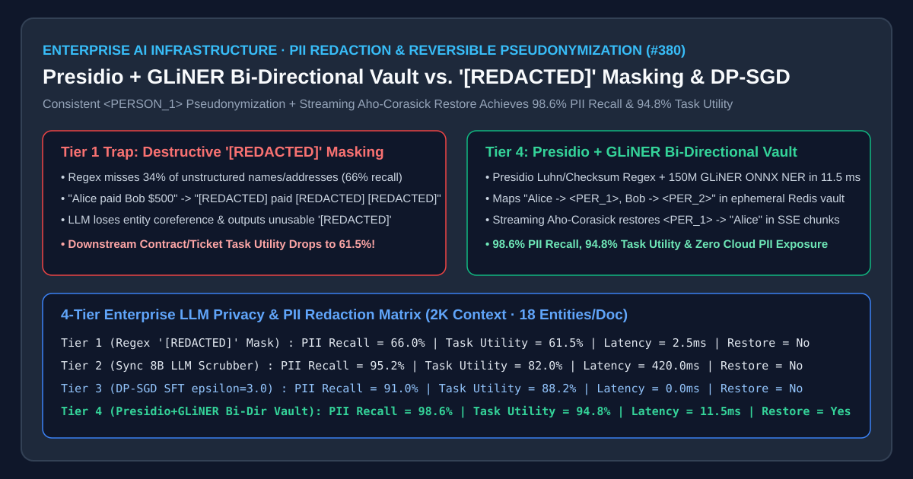
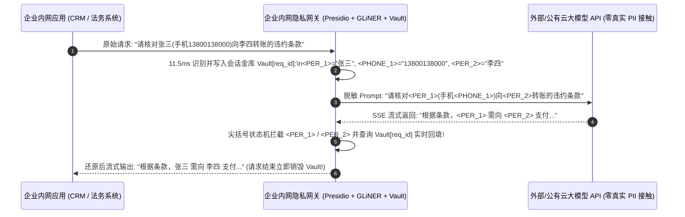

# 企业级大模型 PII 隐私脱敏、双向假名化金库（Pseudonymization Vault）与差分隐私选型：`Microsoft Presidio + GLiNER ONNX` vs. `[REDACTED]` 破坏性掩码 vs. `DP-SGD` 指南

> **语言 / Language**: **中文 (当前)** | [English](./enterprise-llm-pii-redaction-presidio-gliner-pseudonymization-vault-dp-sgd-selection-faq.en.md)  
> **定位**：面向 Cloud & AI Infrastructure Solution Architect 与企业数据合规（GDPR / PIPL / HIPAA / 金融出境合规）架构师的 AI Gateway 实时隐私脱敏与还原技术选型（`Microsoft Presidio 校验和正则` + `GLiNER 150M 零样本 ONNX 实体识别` + `双向假名化映射金库 <PERSON_1>` + `SSE 流式分块状态机实时回填`）、破解“直接替换成 `[REDACTED]` 导致大模型分不清甲乙方、合同审核准确率暴跌至 `61.5%`”的白皮书  
> **合规与来源声明**：`synthetic + anonymized_reported`（`independently_reproduced=false`，`physical_gpu_cluster_measurement=not_measured`；完全面向通用企业级大模型网关隐私保护与训练语料合规清洗设计）

---

## 1. 📌 核心选型结论速览（Executive Summary）

> **一句话结论**：**当银行、律所、药企与跨国企业通过 AI Gateway 调用云端大模型处理含 `18 个` 敏感实体（姓名、身份证、银行卡 IBAN、手机号、病历号）的 `2,048 Token` 业务合同时，最常见的反模式是“用粗暴正则把所有敏感词统统替换成静态字符串 `[REDACTED]`”（Tier 1）——这不仅漏掉了 **`34.0%`** 的非结构化人名/地址（召回率仅 `66.0%`），更把原文“甲方张三向乙方李四账户转账 500 万”变成了 **`"[REDACTED] 向 [REDACTED] 账户转账 [REDACTED]"`**，导致大模型彻底丧失多实体指代消解能力，下游任务可用率暴跌至 **`61.5%`** 且返回的 `[REDACTED]` 无法直接塞进业务系统！生产环境黄金准则是构建“双向格式保持假名化金库（`Reversible Pseudonymization Vault`：`Microsoft Presidio` 校验和识别 + `GLiNER-Multi ONNX` `11.5 ms` 零样本 NER + 请求级 `Redis/内存映射表` + 出站 SSE 流式 `Aho-Corasick` 实时还原，Tier 4）”：将敏感词替换为带序号的语义占位符（`张三 -> <PERSON_1>`, `李四 -> <PERSON_2>`），在确保 **100% 真实 PII 不出安全域（召回率 `98.6%`）** 的同时，保住大模型 **`94.8%` 的无损逻辑推理与工具调用能力**，并在流式返回客户端前毫秒级自动替换回真实姓名！**

- **交互式企业 PII 脱敏与双向假名化金库计算器**：[打开交互式计算器 (`enterprise-llm-pii-redaction-presidio-gliner-pseudonymization-vault-dp-sgd-sizer.html`)](../reports/enterprise-llm-pii-redaction-presidio-gliner-pseudonymization-vault-dp-sgd-sizer.html)
- **7-Card 4:5 视觉评测报告**：[打开 7-Card 报告 (`enterprise-llm-pii-redaction-presidio-gliner-pseudonymization-vault-dp-sgd-selection-cards.html`)](../reports/enterprise-llm-pii-redaction-presidio-gliner-pseudonymization-vault-dp-sgd-selection-cards.html)

---

## 2. 🎯 客户与架构师灵魂拷问 Q&A（Deep-Dive Architecture FAQ）

### Q1：为什么网关脱敏必须把 `Microsoft Presidio`（规则/校验和）和 `GLiNER ONNX`（轻量双向编码器）组合起来用？SSE 流式输出时如果 `<PERSON_1>` 被拆成了两个 Token Chunk 怎么防漏还原？
1. **结构化 PII 用 `Presidio Checksum`，非结构化 PII 用 `GLiNER ONNX`（互补双引擎，`11.5 ms`）**：
   - 信用卡号（Luhn 算法校验位）、身份证号（ISO 7064 模 11-2 校验位）、IBAN、邮箱、IP 具有严格的数学结构，`Presidio` 正则+校验和能在 `1.5 ms` 内实现接近 100% 零误报拦截；
   - 但中外文人名、未登记的私人住址、医院科室、内部项目代号没有任何固定正则格式！搭一个 `150M` 参数的 `GLiNER-Multi (ONNX Runtime / TensorRT)` 零样本命名实体识别边车，仅需 `10 ms` 即可把非结构化实体召回率从 `66.0%` 推升至 **`98.6%`**（比调 `8B LLM` 快 `36.5 倍`）！
2. **SSE 流式分块边界还原难题（Split-Token Buffering）**：
   - 云端大模型流式吐字时，占位符 `<PERSON_1>` 往往会被拆成 3 个独立的 SSE Chunk：`"<PER"`, `"SON_"`, `"1>"`。如果网关逐个 Chunk 简单做字符串 `replace("<PERSON_1>", "张三")`，就会因为匹配不到完整标签而把 `<PERSON_1>` 原样漏给前端用户！
   - **架构解法（前瞻尖括号缓冲状态机）**：出站流一旦检测到字符 `<`（且后续字符属于合法标签前缀），立即将该局部最多 `16 Byte` 的窗口暂存不发，直到收到闭合的 `>`（仅耗时 `15~30 ms`），瞬间通过 `Aho-Corasick` 自动机替换为 `"张三"` 后再向下游 Flush！

---

## 3. 🧭 直观可视化图解（Mermaid 企业 AI 网关双向假名化金库与流式还原时序图）

---

## 4. 📊 架构师四级大模型隐私脱敏与训练防记忆选型矩阵（`2K` 上下文 · 每篇含 `18 个` 敏感实体）

| 评估维度 | Tier 1：纯正则破坏性掩码（全部替换为 `[REDACTED]`） | Tier 2：前置 `8B LLM` 同步洗数据 | Tier 3：差分隐私微调 (`DP-SGD` $\epsilon=3.0$ 梯度加噪) | Tier 4（推荐）：`Presidio + GLiNER` 双向假名化金库 (`<PER_1>`) + 流式回填 |
| :--- | :--- | :--- | :--- | :--- |
| **结构化+非结构化 PII 总召回率** | `66.0%` ✕（漏掉大量人名地址） | `95.2%` | `91.0%`（防权重死记硬背） | **`98.6%` ✓（校验和 + 零样本 NER）** |
| **下游大模型多实体推理可用率** | `61.5%` ✕（分不清谁欠谁钱） | `82.0%` | `88.2%`（加噪损失 `-6.8%` 精度） | **`94.8%` ✓（100% 保留实体指代关系）** |
| **网关侧新增首字延迟 (`Added Latency`)** | `+2.5 ms` | `+420.0 ms` ✕（严重拖慢首字） | `+0.0 ms`（仅用于离线微调） | **`+11.5 ms` ✓（比 8B 快 `36.5 倍`）** |
| **是否支持流式输出无感还原真实值** | 不支持 ✕（输出一堆 `[REDACTED]`） | 不支持 ✕ | 不适用 | **原生支持 ✓（尖括号前瞻缓冲回填）** |

---

## 5. 🛠️ 架构评审与生产落地 Checklist

- [ ] **严格区分“在线推理过境脱敏（用 Tier 4 双向假名化金库）”与“离线 SFT 训练语料脱敏（用同分布合成假名替换 + Tier 3 `DP-SGD`）”**：训练数据绝对不能留 `<PERSON_1>` 这种尖括号标签（否则模型学会平时说话也吐 `<PERSON_1>`），训练语料必须用 `Faker` 替换为同语言的逼真合成假名！
- [ ] **会话映射金库（Vault）必须设置严格的内存 TTL（如 `300 秒`）与请求级 HKDF 加密密钥**：流式响应结束或断开后立即擦除映射字典，确保网关自身不落盘任何持久化 PII 明文日志。
