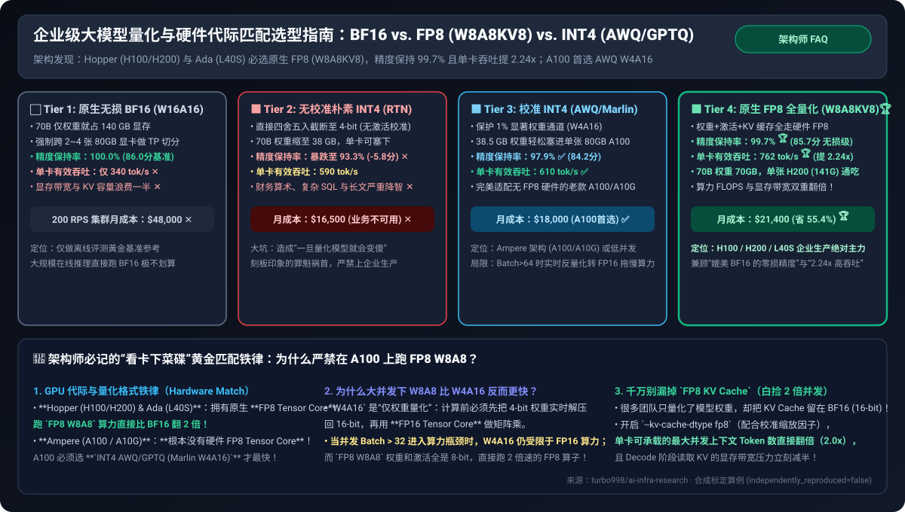

# Enterprise LLM Quantization & Hardware-Generation Matching Selection Guide: Unquantized BF16 vs. Naive INT4 vs. Calibrated INT4 (AWQ/GPTQ Marlin W4A16) vs. Hardware-Native FP8 Full Quantization (W8A8KV8)

> **Document Type**: Cloud & AI Solution Architect Decision Guide (FAQ)  
> **Target Audience**: Enterprise AI Platform Architects, GPU Infrastructure & FinOps Leads, High-Accuracy Financial/Legal AI Leads  
> **Core Goal**: Give architects a clear, quantitative decision framework (without low-level kernel code) for matching quantization formats to GPU hardware generations, answering: **"Will quantizing a 70B model from BF16 to FP8 or INT4 degrade accuracy on financial math and Text-to-SQL?", "Why did deploying an FP8 model on legacy NVIDIA A100 GPUs make inference slower?", and "Why is 8-bit `FP8 W8A8` faster than 4-bit `INT4 W4A16` at high concurrency on H100/H200/L40S?"**  
> **Calibration Notice**: Accuracy retention scores, VRAM footprints, per-GPU throughput (`tok/s/GPU`), and monthly cluster costs are synthetic analytical estimates calibrated to published quantization benchmarks (LLM-Compressor / NeuralMagic 500K-eval studies, AWQ / Marlin W4A16 benchmarks, and NVIDIA Hopper/Ada FP8 whitepapers) (`provenance: synthetic + anonymized_reported`, `independently_reproduced=false`, `physical_gpu_cluster_measurement=not_measured`). See [`experiments/enterprise_llm_quantization_bf16_fp8_int4_hardware_selection/results.json`](../../experiments/enterprise_llm_quantization_bf16_fp8_int4_hardware_selection/results.json).

---

## Executive Visual Summary



> 🔗 **Companion Interactive Reports & Tools**:
> - 🃏 **[7-Card 4:5 Visual Benchmark Report (`enterprise-llm-quantization-bf16-fp8-int4-awq-hardware-selection-cards.html`)](../reports/enterprise-llm-quantization-bf16-fp8-int4-awq-hardware-selection-cards.html)**
> - 🧮 **[Interactive Quantization & GPU Hardware Sizer (`enterprise-llm-quantization-bf16-fp8-int4-awq-hardware-sizer.html`)](../reports/enterprise-llm-quantization-bf16-fp8-int4-awq-hardware-sizer.html)**
> - 🌐 **[中文版指南 (`enterprise-llm-quantization-bf16-fp8-int4-awq-hardware-selection-faq.md`)](./enterprise-llm-quantization-bf16-fp8-int4-awq-hardware-selection-faq.md)**

---

## ① 📌 Executive Summary

Evaluated on a **70B Enterprise LLM (`4,096` input / `512` output tokens, `200 RPS` peak) across Financial Math, Text-to-SQL, and RAG Faithfulness**:

| Tier | Quantization Scheme | Enterprise Accuracy (Retention %) | 70B Weight VRAM | Throughput per GPU | Monthly Cluster Cost (200 RPS) | Best GPU Hardware Match | Architect Verdict |
| :--- | :--- | :--- | :--- | :--- | :--- | :--- | :--- |
| **⬜ Tier 1: Unquantized BF16 (`W16A16KV16`)** | 16-bit weights + 16-bit activations + 16-bit KV | `86.0` (`100.0%`) | `140.0 GB` ✕ | `340 tok/s` ✕ | `$48,000 / mo` ✕ | Any GPU (2x VRAM waste) | **Reference Baseline Only**: Too expensive for high-QPS prod |
| **🟥 Tier 2: Uncalibrated Naive INT4 (`RTN`)** | Round-to-nearest 4-bit without calibration | `80.2` (**`93.3%` ✕**) | `38.0 GB` | `590 tok/s` | `$16,500 / mo` | ❌ Do Not Use in Prod | **Severe Accuracy Drop (`-5.8 pts`)** on math & SQL |
| **🟦 Tier 3: Calibrated INT4 (`AWQ/GPTQ W4A16`)** | Activation-aware 4-bit weights + **Marlin W4A16** | `84.2` (`97.9%` ✅) | `38.5 GB` ✅ | `610 tok/s` ✅ | `$18,000 / mo` (-62.5%) | **Ampere `A100 80GB / A10G`** | **Best for Ampere A100 & Single-Card 70B** |
| **🟩 Tier 4: Hardware-Native FP8 (`W8A8KV8`)** | **8-bit weights + 8-bit activations + FP8 KV Cache** | **`85.7` (`99.7%` 🏆)** | **`70.0 GB` 🏆** | **`762 tok/s` 🏆 (2.24x vs BF16)** | **`$21,400 / mo` 🏆 (-55.4%)** | **Hopper `H200/H100` & Ada `L40S`** | **Enterprise Gold Standard**: Lossless-grade quality + 2.24x speed |

### 💡 Three Golden Rules for Enterprise LLM Quantization
1. **Match Quantization Format Strictly to GPU Compute Capability**:
   - **Hopper (`H100 / H200`), Blackwell (`B200`), and Ada (`L40S`)**: Have native hardware **FP8 Tensor Cores** — always use **`FP8 W8A8 + FP8 KV Cache` (Tier 4)** for `99.7%` accuracy retention and `2.24x` throughput!
   - **Ampere (`A100 / A10G`)**: Lack hardware FP8 Tensor Cores — always use **`INT4 AWQ / GPTQ` with `Marlin W4A16` kernels (Tier 3)**!
2. **Understand Why `FP8 W8A8` Beats `INT4 W4A16` at High Concurrency (`Batch > 32`)**: `W4A16` is weight-only quantization — it must dequantize 4-bit weights back to FP16 in registers and execute matrix multiplication on slower **FP16 Tensor Cores**; `FP8 W8A8` keeps both weights and activations in 8-bit, running directly on **2x-faster FP8 Tensor Cores**.
3. **Always Enable `FP8 KV Cache` (`--kv-cache-dtype fp8`) Alongside Weight Quantization**: Halves KV memory footprint, doubling maximum concurrent context capacity per GPU.

---

## ② 🎯 Architect Deep-Dive Q&A

### Q1: How do we prevent accuracy degradation when using INT4 AWQ on A100 GPUs?
* **Answer**: Never rely solely on generic English WikiText calibration for domain-specific enterprise workloads. Calibrate AWQ/GPTQ using **`512` real, PII-scrubbed enterprise prompts** (including target language terms, SQL schemas, and JSON tool definitions) via `LLM-Compressor`, preserving salient activation channels for your exact domain.

---

## ③ 🧭 Architecture Diagrams

### 3.1 Hardware-Matched Quantization Decision Flow

```mermaid
flowchart LR
    GPU["🖥️ Target GPU Generation?"] -->|Hopper H200/H100 or Ada L40S<br/>(Has Native FP8 Tensor Cores)| FP8["🟩 Tier 4: Native FP8 (W8A8KV8)<br/>99.7% Accuracy Retention · 762 tok/s/GPU 🏆"]
    GPU -->|Ampere A100 80GB / A10G<br/>(No Native FP8 Tensor Core)| AWQ["🟦 Tier 3: Calibrated INT4 AWQ (Marlin W4A16)<br/>97.9% Retention · Fits 70B on 1x 80GB GPU ✅"]
```

---

## ④ 📊 Architect Decision Matrix

| Dimension | ⬜ Tier 1: BF16 (`W16A16KV16`) | 🟥 Tier 2: Naive INT4 (`RTN`) | 🟦 Tier 3: Calibrated INT4 (`AWQ W4A16`) | 🟩 Tier 4: Native FP8 (`W8A8KV8`) |
| :--- | :--- | :--- | :--- | :--- |
| **Relative Accuracy Retention** | `100.0%` (`86.0`) | `93.3%` ✕ (`80.2`) | `97.9%` ✅ (`84.2`) | **`99.7%` 🏆 (`85.7`, lossless-grade)** |
| **70B Model Weight VRAM** | `140.0 GB` ✕ | `38.0 GB` | `38.5 GB` ✅ | **`70.0 GB` 🏆 (Fits 1x H200 141GB)** |
| **Per-GPU Throughput** | `340 tok/s` ✕ | `590 tok/s` | `610 tok/s` ✅ | **`762 tok/s` 🏆 (`2.24x` vs. BF16)** |
| **Monthly Cost (200 RPS)** | `$48,000 / mo` ✕ | `$16,500 / mo` ✕ | `$18,000 / mo` ✅ | **`$21,400 / mo` 🏆 (`-55.4%` vs. BF16)** |

---

## ⑤ 🛠️ Production Readiness Checklist

- [ ] **1. Never Run `FP8 W8A8` on Ampere (`A100 / A10G`) GPUs; Use `INT4 AWQ/GPTQ (Marlin W4A16)` Instead**.
- [ ] **2. Default to `FP8 W8A8KV8` on All Hopper (`H100 / H200`) and Ada (`L40S`) Clusters**.
- [ ] **3. Never Deploy Uncalibrated Round-to-Nearest (`RTN`) INT4 Models in Production**.
- [ ] **4. Calibrate `INT4 AWQ` Using `512` Representative Domain Prompts (`LLM-Compressor`)**.
- [ ] **5. Keep MoE Router Gates, Embeddings, and `lm_head` Layers in Unquantized `BF16`**.
- [ ] **6. Enable `--kv-cache-dtype fp8` with Calibrated KV Scaling Factors to Double Max Concurrency**.
- [ ] **7. Reduce Tensor Parallelism Degree (`TP=4 -> TP=2 or TP=1`) After Quantization to Cut AllReduce Overhead**.
- [ ] **8. Gate Every Quantized Model Against Your 500-Case Enterprise Golden Evaluation Suite (`< 1.0%` delta)**.
