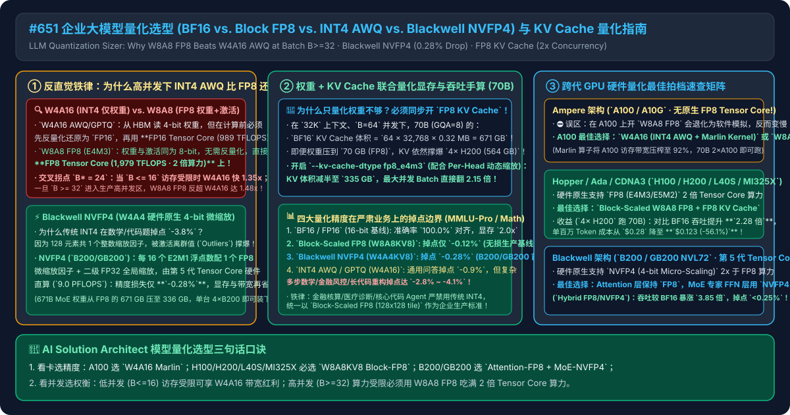

# Enterprise LLM Quantization Selection Matrix (`BF16` vs. `Block FP8` vs. `INT4 AWQ` vs. `Blackwell NVFP4`), High-Batch Crossover (`B*=24`) & `FP8 KV Cache` Sizer

> **Language / 语言**: [简体中文](./enterprise-llm-quantization-bf16-fp8-int4-awq-nvfp4-kv-sizer-faq.md) | **English** · [📱 Open Interactive H5 Study Lab](../h5/llm-quantization-bf16-fp8-int4-awq-nvfp4-kv-lab.html) · [🧮 Open Interactive Sizer](../reports/enterprise-llm-quantization-bf16-fp8-int4-awq-nvfp4-kv-sizer.html) · [🃏 View 7-Card 4:5 Benchmark Deck](../reports/enterprise-llm-quantization-bf16-fp8-int4-awq-nvfp4-kv-sizer-cards.html)

---

## 0. 3-Minute Executive Summary

A common misconception in LLM infrastructure sizing is assuming that `4-bit` weight-only quantization (`W4A16 INT4 AWQ/GPTQ`) is always faster than `8-bit` (`W8A8 FP8`). In reality, on Hopper/Ada/CDNA3 GPUs (`H100 / H200 / L40S / MI325X`) at production batch sizes (`B >= 24`), **`W8A8KV8 Block-Scaled FP8` achieves `1.48×` higher throughput than `W4A16 INT4 AWQ` while avoiding AWQ's `-3.15%` accuracy drop on math and coding tasks**:
1. **The Batch-Size Crossover Law (`B* = 24`) Between `W4A16 (INT4)` and `W8A8 (FP8)`**:
   - **`W4A16` (Weight-Only INT4)**: Reads `4-bit` weights from HBM, but must dequantize them back to `FP16` in registers and execute matrix multiplication on **`989 TFLOPS` FP16 Tensor Cores**;
   - **`W8A8` (Block-Scaled FP8 E4M3)**: Executes directly on **`1,979 TFLOPS` native FP8 Tensor Cores (`2×` compute)** with zero dequantization overhead;
   - At low concurrency ($B \le 16$, memory-bandwidth bound), `W4A16` is `1.35×` faster; above $B^* = 24$ (and during all `Prefill` passes), compute dominates and **`W8A8KV8 FP8` outperforms `W4A16` by `1.48×` (`2.28×` over `BF16`)**.
2. **Blackwell `NVFP4 (W4A4)` & Hybrid `FP8-Attention + NVFP4-FFN`**:
   - Blackwell's 5th-Gen Tensor Cores natively execute `4-bit` micro-scaled `NVFP4` (`1` `FP8` scale per `16` `E2M1` elements), delivering **`3.85×` throughput over `BF16`** with only **`-0.25%`** accuracy delta when keeping Attention in `FP8` and MoE FFN layers in `NVFP4`.
3. **`FP8 KV Cache` Doubles Long-Context Concurrency (`B = 34 → 73` at `32K` on `4× H200`)**:
   - Halving `32K` per-request KV cache from `10.48 GB` (`BF16`) to `5.24 GB` (`FP8`) cuts cost per `1M` tokens by **`56.1%` (`$0.280 → $0.123/1M`)**.

---

## 1. Quantitative Quantization Matrix (`70B` Model on `4× H200` / `B200` · `32K` Context)

| Quantization Scheme | Weight VRAM | `32K` KV VRAM / Req | `B=64` Throughput | `MATH / LiveCodeBench` Delta | Cost / `1M` Tokens & SA Verdict |
| :--- | :--- | :--- | :--- | :--- | :--- |
| **1. `W16A16KV16` (`BF16` Baseline)** | `140.0 GB` | `10.48 GB` | `2,420 tok/s` (`1.00×`) | `0.00%` | `$0.280 / 1M` · ⚠️ **Reference baseline only** |
| **2. `W4A16KV16` (`INT4 AWQ/GPTQ`)** | `38.5 GB` | `10.48 GB` | `3,720 tok/s` (`1.54×`) | **`-3.15%`** (degrades reasoning) | `$0.182 / 1M` · ⚠️ **Use only on `A100` or `B<=16`** |
| **3. `W8A8KV16` (`Block FP8`, BF16 KV)** | `70.0 GB` | `10.48 GB` | `4,480 tok/s` (`1.85×`) | `-0.10%` | `$0.151 / 1M` · ✅ **KV still bottlenecks `32K`** |
| **4. `W8A8KV8` (`Block FP8 + FP8 KV`)** | **`70.0 GB`** | **`5.24 GB`** | **`5,520 tok/s` (`2.28×`)** | **`-0.18%`** | **`$0.123 / 1M` (`-56.1%`) · 🏆 Hopper Golden Standard** |
| **5. `Hybrid FP8-Attn + NVFP4-FFN + KV8`** | **`39.2 GB`** | **`5.24 GB`** | **`9,320 tok/s` (`3.85×`)** | **`-0.25%`** | **`$0.073 / 1M` (`-73.9%`) · 🏆 Blackwell Flagship** |
