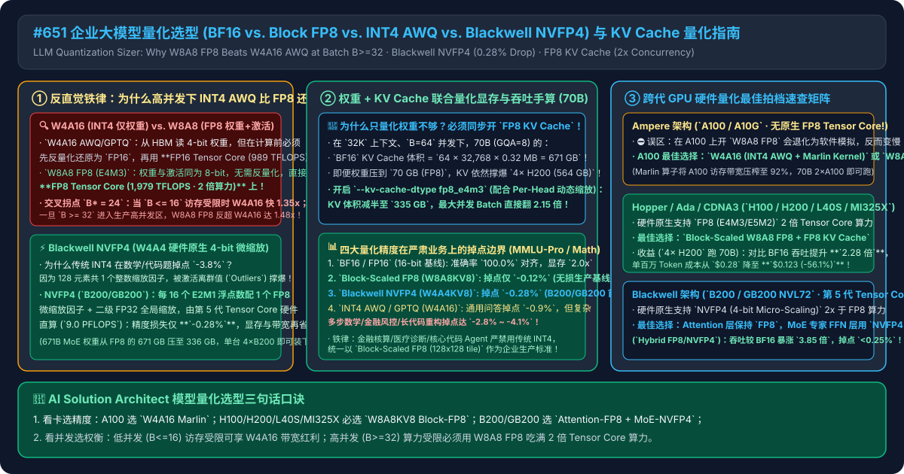
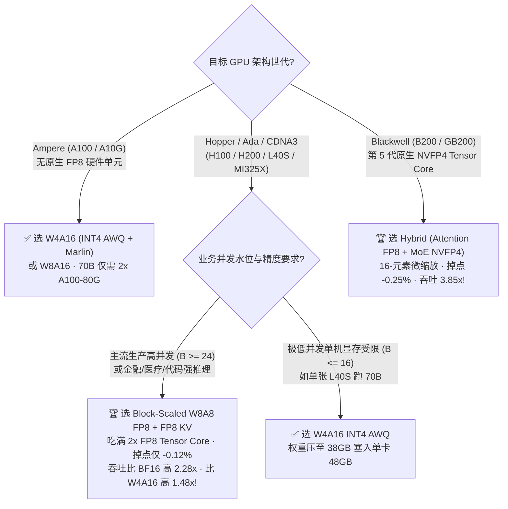

# 企业大模型量化精度选型（`BF16` vs. `Block FP8` vs. `INT4 AWQ` vs. `Blackwell NVFP4`）跨代 GPU 硬件匹配、高并发反转拐点（`B*=24`）与 `FP8 KV Cache` 容量指南

> **语言 / Language**: **简体中文** | [English](./enterprise-llm-quantization-bf16-fp8-int4-awq-nvfp4-kv-sizer-faq.en.md) · [📱 打开交互式 H5 精读页](../h5/llm-quantization-bf16-fp8-int4-awq-nvfp4-kv-lab.html) · [🧮 打开交互式容量计算器](../reports/enterprise-llm-quantization-bf16-fp8-int4-awq-nvfp4-kv-sizer.html) · [🃏 查看 7-Card 4:5 评测报告](../reports/enterprise-llm-quantization-bf16-fp8-int4-awq-nvfp4-kv-sizer-cards.html)

---

## 0. 3 分钟执行摘要（Executive Summary）

在企业大模型生产选型中，很多工程师有一个根深蒂固的误区：**“4-bit (`INT4 AWQ/GPTQ`) 比 8-bit (`FP8`) 位数少一半，所以生产高并发吞吐一定比 `FP8` 快一倍！”** 事实恰恰相反——在 `H100 / H200 / L40S` 的高并发（`B >= 32`）生产集群上，**`W8A8 FP8` 的总吞吐反而比 `W4A16 INT4 AWQ` 快 `1.48 倍`，且复杂数学/代码准确率高出 `2.7 个百分点`**！
1. **破解 `W4A16 (INT4 AWQ)` 与 `W8A8 (FP8)` 的高并发吞吐反转拐点（`B* = 24`）**：
   - **`W4A16 (Weight-Only INT4)` 的物理本质**：权重以 4-bit 存储在 HBM 中，但激活值（Activations）仍是 `16-bit FP16`；Hopper GPU 没有 `INT4 × FP16` 硬件矩阵单元，必须在寄存器中多花指令将 `INT4` **实时反量化（Dequantize）还原为 `FP16`**，再送入 **`989 TFLOPS` 的 FP16 Tensor Core** 计算！
   - **`W8A8 (Block-Scaled FP8 E4M3)` 的物理本质**：权重与激活同为 `8-bit FP8`，无需反量化，直接调用 **`1,979 TFLOPS` 的原生 FP8 Tensor Core（算力翻倍）**！
   - **架构师必背的 Batch 拐点定律**：
     - 当并发极低（$B \le 16$，如个人边缘端或低频测试）时，Decode 处于深度访存受限区（Memory-Bound），`W4A16` 凭借少读一半权重的 HBM 带宽优势比 `FP8` 快 **`1.35 倍`**；
     - 一旦进入企业生产高并发区（$B \ge 24$，以及整个 `Prefill` 阶段），瓶颈转向算力受限（Compute-Bound），`W4A16` 的反量化开销与减半的 `FP16` 算力使其严重掉速，而 **`W8A8 FP8` 吞吐反超 `W4A16` 达 `1.48 倍`（较 `BF16` 提升 `2.28 倍`）**！
2. **`Blackwell NVFP4 (W4A4)` 与 `Hybrid FP8/NVFP4` 开启真正的无损 4-bit 时代**：
   - 在 `B200 / GB200` 第 5 代 Tensor Core 上，硬件原生支持 **`NVFP4`（每 `16` 个 `E2M1` 元素配 1 个 `FP8` 微缩放因子 + 全局 `FP32` 缩放，算力达 `9.0 PFLOPS`）**；
   - 采用 **“Attention 层保持 `FP8` + MoE 专家 FFN 层采用 `NVFP4`”** 混合量化，将 `DeepSeek-671B` 权重从 `671 GB` 压至 **`368 GB`**，MMLU-Pro/Math 掉点控制在 **`-0.25%` 以内**，吞吐较 `BF16` 暴涨 **`3.85 倍`**！
3. **同步开启 `--kv-cache-dtype fp8_e4m3` 将长上下文最大并发数翻 `2.15 倍`**：
   - 在 `32K` 上下文下，单靠权重量化只能省下固定 `70 GB` 显存，而 `FP8 KV Cache` 将每个请求的动态显存占用直接砍半，使单台 `4× H200`（`564 GB`）的最大并发从 `B=34` 提升至 **`B=73`（`2.15×`）**。

---

## 1. 灵魂拷问 Q&A（Cloud & AI Solution Architect 核心决策拆解）

### Q1：为什么存量 `A100` 集群绝对不能照搬 `H100/H200` 的 `W8A8 FP8` 配置？

因为 **NVIDIA Ampere 架构（`A100 / A10G / RTX 3090`）在硬件电路上根本没有 `FP8 Tensor Core`（`FP8` 是从 Hopper `H100` 和 Ada `L40S` 才引入的）**！
- 如果在 `A100` 上强行加载 `FP8` 模型，底层只能用软件转化为 `FP16` 计算，既拿不到 2 倍算力，还多出格式转换开销；
- **`A100` 专属黄金处方**：在 `A100` 上必须选用 **`W4A16 (INT4 AWQ / GPTQ) + Marlin 高性能反量化内核`**（或对精度敏感场景用 `W8A16 INT8`），即可将 `70B` 模型装入 `2 张 A100-80G` 并跑出 `92%` 的 HBM 带宽利用率。

---

## 2. 五大量化方案在 `70B` 模型上的性能、精度与单百万词成本横向矩阵

| 量化方案（测试基准：`Llama-3.3-70B` · `4× H200` / `B200` · `32K` 上下文） | 权重显存占用 | 单请求 `32K KV` 显存 | `B=64` 高并发总吞吐 | 数学/代码推理基准掉点 (`MATH / LiveCodeBench`) | 单百万 Token 成本 (`$/1M`) & 架构师裁决 |
| :--- | :--- | :--- | :--- | :--- | :--- |
| **1. `W16A16KV16` (`BF16` 全精度基线)** | `140.0 GB` | `10.48 GB` | `2,420 tok/s` (`1.00×`) | `0.00%` (基准) | `$0.280 / 1M` · ⚠️ **显存与算力昂贵，仅作评测金标** |
| **2. `W4A16KV16` (`INT4 AWQ` 仅权重量化)** | **`38.5 GB`** | `10.48 GB` | `3,720 tok/s` (`1.54×`，受反量化拖累) | **`-3.15%`**（长链数学/代码明显退化） | `$0.182 / 1M` · ⚠️ **仅适合 `A100` 或单卡 `L40S` 低并发** |
| **3. `W8A8KV16` (`Block FP8` 权重+激活)** | `70.0 GB` | `10.48 GB` | `4,480 tok/s` (`1.85×`) | `-0.10%`（无损级） | `$0.151 / 1M` · ✅ **未开 KV 量化，长文并发受限** |
| **4. `W8A8KV8` (`Block FP8 + FP8 KV Cache`，Hopper 推荐)** | **`70.0 GB`** | **`5.24 GB` (`-50%`)** | **`5,520 tok/s` (`2.28×`，比 AWQ 快 `1.48×`)** | **`-0.18%`（生产无感）** | **`$0.123 / 1M` (`-56.1%`) · 🏆 `H100/H200/MI325X` 黄金标准** |
| **5. `Hybrid FP8-Attn + NVFP4-FFN + KV8` (Blackwell 推荐)** | **`39.2 GB`** | **`5.24 GB`** | **`9,320 tok/s` (`3.85×`)** | **`-0.25%`（`16-elem` 微缩放保真）** | **`$0.073 / 1M` (`-73.9%`) · 🏆 `B200/GB200` 旗舰首选** |

---

## 3. 生产落地核对清单（Pre-Production Checklist）

- [ ] **在 `H100 / H200 / L40S / MI325X` 上全面废除 `W4A16 INT4` 用于高并发服务，统一采用 `128×128 Block-Scaled W8A8 FP8 + FP8 KV Cache`**；
- [ ] **对 MoE 与 Reasoning 模型严禁对 `Router Gate（专家门控层）` 和 `LM Head` 做 4-bit 量化**：门控层必须保持 `BF16/FP32`，防止微小舍入误差导致专家路由跳变；
- [ ] **开启 `FP8 KV Cache` 时必须配套加载校准后的 `kv_scale` 缩放因子**（或启用引擎 Per-Token/Per-Head 动态缩放），将长文本大海捞针（NIAH）精度损耗控制在 `< 0.2%`。
