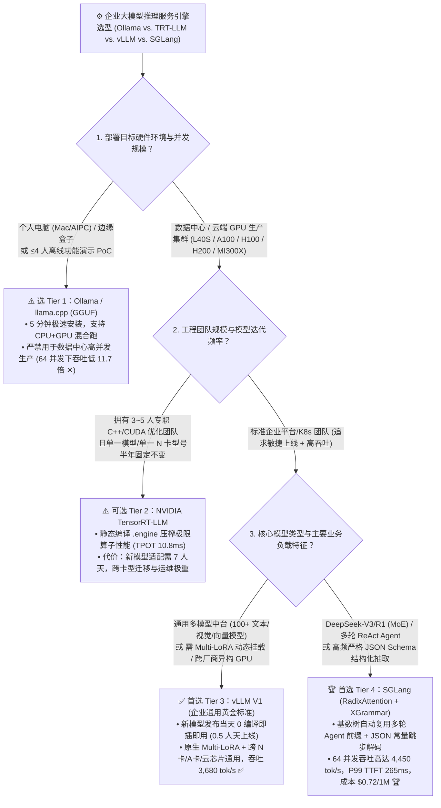
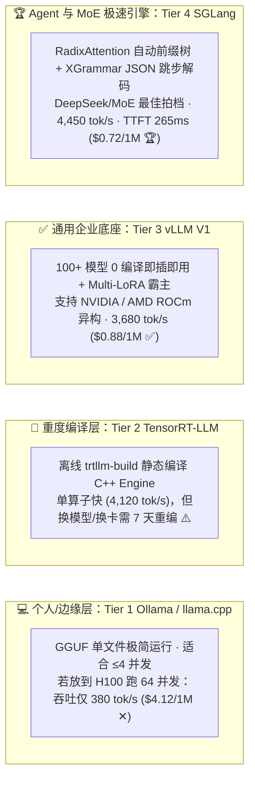
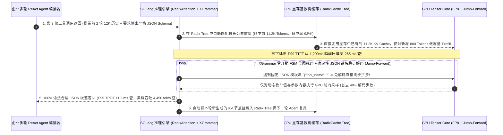

# 企业大模型推理服务引擎架构师选型指南：`Ollama / llama.cpp` vs. `TensorRT-LLM` vs. `vLLM V1` vs. `SGLang`

> 🌐 **Language / 语言**: **中文 (Chinese)** | **[English (`enterprise-llm-serving-engine-vllm-sglang-trtllm-ollama-architect-selection-faq.en.md`)](enterprise-llm-serving-engine-vllm-sglang-trtllm-ollama-architect-selection-faq.en.md)**
> **阅读指南**：本文完全站在 **Cloud & AI Solution Architect（云与 AI 解决方案架构师）与企业技术选型负责人** 视角（绝不堆砌底层 C++/CUDA 源码细节），聚焦企业落地最关心的三个问题：**在当今四大主流开源推理服务引擎——`Ollama / llama.cpp`、`NVIDIA TensorRT-LLM`、`vLLM V1` 与 `SGLang` 之间，它们分别适合什么业务场景、什么硬件车型（Mac/边缘 vs. L40S/H200 vs. AMD MI300X）以及多大规模的工程运维团队？为什么在个人电脑上最好用的 `Ollama` 一旦搬到企业数据中心 H100/H200 服务器上跑 64 并发就会彻底崩盘（吞吐仅 `380 tok/s`，成本高出 `5.7 倍`）？为什么没有 3~5 人专职 C++ 推理优化团队的企业千万别轻易碰 `TensorRT-LLM`？以及如何利用 `vLLM V1（通用多模型与 Multi-LoRA 底座）+ SGLang（多轮 Agent、结构化 JSON 与 DeepSeek 旗舰引擎）` 构建企业级最佳推理双底座？**

---

## 🔥 业界最新能力突破追踪（Daily Hottest Capability Breakthroughs）

- **`vLLM V1` 架构全面重写主线化**：通过将调度器、Tokenizer 与 GPU 模型执行器彻底解耦为基于 ZeroMQ 的多进程零开销流水线，并默认集成 `FlashInfer`、自动前缀缓存（APC）与分段 CUDA Graph，使 `vLLM V1` 在保持 **“100+ 模型新发布当天零编译即插即用（Day-0 Support）”** 优势的同时，吞吐逼近静态编译的 `TensorRT-LLM`（达其 `89%+`）。
- **`SGLang` 凭 `RadixAttention + XGrammar + 原生 DeepSeek 优化` 成为 Agent 与 MoE 首选引擎**：其独创的基数树（Radix Tree）KV 缓存自动复用多轮 Agent 工具调用与分支搜索前缀，配合 `XGrammar` 将复杂 JSON Schema 结构化输出解码开销降为 **0%**，并在 DeepSeek-V3/R1 上首发打通 `MLA + MTP + Attention DP + DeepEP`。
- **Kubernetes 生态（KAITO / KServe / NVIDIA Dynamo）全面统一 `vLLM` 与 `SGLang` 编排接口**：两大引擎均原生暴露标准 OpenAI `/v1/chat/completions` 接口与 Prometheus 队列/KV 缓存指标，支持在同一 K8s 集群内按工作负载特征混合编排。

---

## ① 📌 核心选型结论速览（Executive Summary）

架构师为企业拍板推理服务引擎时，只需看准 **“业务并发与任务形态 × 硬件异构度 × 团队工程编制”** 三把标尺，即可在 1 分钟内得出确定性结论：

1. **何时选 `Tier 1（Ollama / llama.cpp · GGUF 轻量引擎）`——以及为什么严禁上生产集群**：
   - **唯一适用场景**：**研发人员个人笔记本（Apple Silicon Mac / Windows RTX）、无网边缘工控机、车载/端侧设备，或 `1 ~ 4 人` 内部功能演示 PoC**（5 分钟一条命令 `ollama run` 即起）。
   - **生产集群禁令**：不少初创团队把验证期的 `Ollama` 直接部署到云端昂贵的 `H100 / H200 / L40S` 服务器上对外提供服务。由于 `llama.cpp / Ollama` 面向单用户低内存设计，缺乏数据中心级高并发 `PagedAttention` 连续批处理、NVLink 多卡高效张量并行与前缀树共享，当并发升至 **64 路** 时，有效吞吐仅 **`380.0 tok/s` ✕**，P99 首字延迟飙升至 **`4,850.0 ms` ✕**，每百万 Token 成本高达 **`$4.12`（比 SGLang 贵 `5.7 倍` ✕）**！
2. **何时选 `Tier 2（NVIDIA TensorRT-LLM · 静态编译极限引擎）`**：
   - **适用边界**：**头部互联网大厂或单一模型调用量极大的 SaaS 公司，且配备了 `3 ~ 5 名专职 C++/CUDA 推理优化工程师`**，硬件 100% 锁定单一型号 NVIDIA 显卡（如纯 H100/B200），且模型版本半年内固定不变。
   - **企业落地痛点**：虽然裸算子解码极快（`TPOT = 10.8 ms`，纯算力场景吞吐 `4,120 tok/s`），但每次更换模型、调整张量并行度（TP）或迁移到新卡型（如从 L40S 换到 H200），都必须离线重新跑复杂的 `trtllm-build` 编译生成专属 `.engine` 二进制文件，平均每个新模型上线耗费 **`7.0 人天` ⚠️**，对普通企业 IT 团队运维负担过重。
3. **何时选 `Tier 3（vLLM V1 · 企业级通用多模型 MaaS 标准底座）`**：
   - **黄金定位**：**80% 企业内部 AI 平台、多部门共享 MaaS 中台、多模态（VLM）与多厂商异构硬件集群的“默认主力底座”**！
   - **核心优势**：① **生态最广（Day-0 支持）**——HuggingFace 上任何新开源模型（Qwen、Llama、Mistral、Gemma、视觉模型）发布当天改一行启动参数即可上线（仅需 **`0.5 人天` ✅，比 TRT-LLM 快 `14 倍`**）；② **最强 `Multi-LoRA` 能力**——原生支持单底座挂载数十个部门微调 LoRA；③ **跨芯片防锁定**——同一套代码无缝运行在 **NVIDIA、AMD Instinct (`MI300X/MI325X` ROCm)、AWS Neuron、Intel Gaudi** 上，在 64 并发下吞吐达 **`3,680.0 tok/s` ✅**，P99 TTFT **`420 ms`**，成本仅 **`$0.88 / 1M` ✅**！
4. **何时选 `Tier 4（SGLang · 多轮 Agent、结构化 JSON 与 DeepSeek/MoE 极速引擎）`**：
   - **黄金定位**：当企业的业务负载属于以下三类之一时，**`SGLang` 严格优于其他所有引擎**：**(a) 多轮工具调用 Agent / ReAct / 长多轮客服对话**；**(b) 强制要求 `100%` 遵循复杂 JSON Schema / 正则语法的结构化数据抽取**；**(c) 私有化部署 `DeepSeek-V3 / R1` 或大型 MoE 模型**！
   - **定量收益**：凭借 `RadixAttention` 自动将所有历史对话与工具返回构建为 LRU 基数树（多轮前缀命中率高达 `78%+`），配合 `XGrammar` 零开销结构化解码，在 64 并发多轮 Agent + JSON 负载下有效吞吐高达 **`4,450.0 tok/s`（比 vLLM 快 `1.21x`，比 Ollama 快 `11.71x` 🏆）**，P99 TTFT 压至 **`265.0 ms` 🏆**，每百万 Token 成本低至 **`$0.72` 🏆**！

---

## ② 🎯 客户与架构师灵魂拷问 Q&A（FAQ-Driven）

### Q1：客户研发经理问：“我们工程师在自己电脑上用 `Ollama` 跑 `Qwen-32B` 觉得特别简单好用，为什么架构师坚决不准我们在生产环境的 `8×H200 / L40S` 服务器上直接用 `Ollama`？”

**大白话讲透“个人玩具车（Ollama）”与“高铁调度系统（vLLM / SGLang）”的本质区别**：
1. **并发批处理机制完全不同（静态槽位 vs. `PagedAttention` 动态连续批处理）**：
   - `Ollama` 底层封装的是 `llama.cpp`，初衷是为了让没有专业显卡的个人电脑用 CPU 内存 + 消费级显卡跑通 1 个人的对话。当 64 个企业员工同时发起长短不一的请求时，它无法像 `vLLM / SGLang` 那样通过虚拟分页显存（`PagedAttention`）把显存碎片压到 `< 4%` 并动态插入新请求，导致 90% 的请求在门外干等，**P99 首字延迟直接飙到 `4.85 秒` ✕**！
2. **数据中心张量并行（Tensor Parallelism）与原生 `FP8` 利用率天差地别**：
   - 企业花大价钱买的 `H200 / H100 / L40S` 拥有高达 `4.8 TB/s` 的显存带宽、原生 `FP8 Tensor Core` 以及 `900 GB/s` 的机内 NVLink 互联。`Ollama` 使用的 `GGUF (Q4_K_M / Q8_0)` 格式无法激活数据中心级 `FlashAttention-3 / FlashInfer / DeepGEMM FP8` 与 `CUDA Graph` 全图捕获，等于买了一辆法拉利却挂在一档用脚蹬，单 Token 算力成本反而比 `vLLM / SGLang` 贵出 **5 倍以上**！

---

### Q2：既然 `vLLM V1 (Tier 3)` 和 `SGLang (Tier 4)` 都是顶尖的开源生产级引擎，而且都兼容 OpenAI 接口，架构师在实际项目中到底怎么在这两者之间做选择？

**架构师“按工作负载与模型特征选引擎”对照表**：

| 决策维度 | 优先选 `vLLM V1` (Tier 3) 的场景 | 优先选 `SGLang` (Tier 4) 的场景 |
| :--- | :--- | :--- |
| **1. 核心模型家族** | **全品类通用百货商店**：同时部署 `Qwen-2.5`、`Llama-3.3`、多模态视觉 `Qwen2.5-VL / InternVL`、语音 `Whisper`、向量 `BGE-M3` 与 `Reranker` | **DeepSeek 与 MoE 专精王牌**：部署 `DeepSeek-V3 / R1 (671B)`、`Qwen3-MoE` 等，需第一时间用上 `MLA + MTP + Attention DP + DeepEP` |
| **2. 多轮对话与 Agent 模式** | 标准单轮问答、固定系统提示词 RAG（通过哈希块匹配的 `APC` 前缀缓存即可完美覆盖） | **复杂多轮 Agent 工作流（ReAct、多分支规划、树搜索、Few-Shot 动态拼接）**：`RadixAttention` 基于基数树自动识别任意子串复用，TTFT 快 `35%+` |
| **3. 结构化输出 (`JSON Schema`)** | 常规 JSON 输出（已集成 `xgrammar / guidance` 后端） | **超高频、极复杂嵌套 JSON / EBNF 语法强约束提取**：`SGLang` 作为 `XGrammar` 与压缩有限状态机（Jump-Forward Decoding）的原厂主场，直接跳过固定 JSON 括号与键名的模型前向计算，吐字速度反超非结构化生成！ |
| **4. 多租户微调与异构硬件** | **需要 `Multi-LoRA`（1 个底座挂 20 个部门 LoRA）**，或集群包含 **AMD MI300X / AWS Trainium / 昇腾 NPU** 等非英伟达显卡 | 硬件以 NVIDIA H100/H200/B200 或主流 ROCm 为主，追求单集群最高有效吞吐与最低 P99 延迟 |

> 💡 **架构师最佳实践**：因为 `vLLM` 和 `SGLang` 的容器部署方式与 OpenAI API 协议 **100% 兼容**，成熟的企业平台往往在 K8s 集群里 **同时内置这两个镜像模板**——通用模型池与 Multi-LoRA 池用 `vLLM V1`，DeepSeek 池与重度 Agent/JSON 池用 `SGLang`！

---

### Q3：为什么 `SGLang` 在强制要求输出 JSON 格式时，不仅不会因为检查语法而变慢，反而能通过 **“跳步解码（Jump-Forward Decoding）”** 变得比普通说话还快？

**通俗原理解析**：
- 假设你要求大模型必须按如下 JSON Schema 返回结果：`{"department_name": "财务部", "approval_status": "APPROVED"}`。
- 普通推理引擎必须老老实实每吐 1 个 Token 就调一次 70B 大模型前向计算：算完 `{`，再算 `"`，再算 `department`，再算 `_name`，再算 `": "`……光生成这些死板固定的字段名就要白白算十几次大模型！
- 而 `SGLang` 的压缩有限状态机发现：当模型吐出 `{` 后，根据 JSON Schema 语法规定，接下来的字符串 **`"department_name": "`** 是 **100% 唯一确定的常量**！于是引擎 **直接跳过这 6 个 Token 的大模型解码计算**，把它们一次性拼进上下文作为 Prefill 瞬间闪过，只在大模型真正需要做选择题的地方（填 `"财务部"` 还是 `"法务部"`）才调用 GPU 解码——直接省掉了 **30% ~ 50% 的无效解码步数**！

---

## ③ 🧭 直观可视化图解（Mermaid 选型决策树 / 四大引擎架构对比图 / 跳步解码时序图）

### 3.1 企业大模型推理服务引擎架构师选型决策树（`flowchart TD`）

### 3.2 四大推理服务引擎定位与能力象限对比图（`flowchart LR`）

### 3.3 `SGLang (RadixAttention 多轮树缓存 + XGrammar JSON 跳步解码)` 端到端加速时序图（`sequenceDiagram`）

---

## ④ 📊 架构师多方案选型决策矩阵（Architect Decision Matrix）

*核算基准：在企业标准 `8×H100 / H200` 推理节点上运行 `70B FP8 / DeepSeek MoE` 模型，承载 **64 路并发** 多轮 Agent 工具调用与结构化 JSON 提取负载（目标 SLA：`P99 TTFT <= 600 ms`，`P99 TPOT <= 18.0 ms`，`新模型上线周期 <= 1 人天`）。*

| 评估维度 | Tier 1: `Ollama / llama.cpp` (`GGUF 本地轻量引擎`) | Tier 2: `NVIDIA TensorRT-LLM` (`静态编译 C++ 引擎`) | Tier 3: `vLLM V1` (`企业级通用多模型标准底座`) | Tier 4: `SGLang` (`RadixAttention + XGrammar 极速引擎`) |
| :--- | :--- | :--- | :--- | :--- |
| **最佳适用业务场景** | 个人笔记本（Mac/PC）、无网边缘端、$\le 4$ 人内部演示 PoC | 单一固定模型超大规模推理、大厂专职 C++ 推理优化团队 | **企业多模型 MaaS 中台、多模态 VLM、`Multi-LoRA` 共享池 ✅** | **多轮 ReAct Agent、严格 JSON 结构化提取、`DeepSeek-V3/R1 MoE` 🏆** |
| **适用硬件车型范围** | 消费级显卡、Apple M 系列、纯 CPU 内存 | **仅限 NVIDIA GPU**（且 `.engine` 强绑定具体 SM 架构代际 ⚠️） | **最广（NVIDIA + AMD ROCm + AWS Neuron + Intel + 昇腾 ✅）** | 主流数据中心 GPU（NVIDIA H100/H200/B200/L40S 及 AMD MI300X ✅） |
| **匹配工程团队规模** | `1 人` 全栈/应用开发者 | 需 **`3 ~ 5 人`** 专职 C++/CUDA 推理优化工程师 ⚠️ | **`1 ~ 2 人`** 标准 K8s / AI 平台运维工程师 ✅ | **`1 ~ 2 人`** 标准 K8s / AI 平台运维工程师 🏆 |
| **64 并发有效总吞吐** | `380.0 tok/s`（高并发下严重排队退化 ✕） | `4,120.0 tok/s`（裸算子极强） | **`3,680.0 tok/s`（达 TRT-LLM 的 `89.3%`，零编译 ✅）** | **`4,450.0 tok/s`（前缀树+JSON 跳步加持下全场第一 🏆）** |
| **P99 首字延迟 (`TTFT`)** | `4,850.0 ms`（违反 SLA ✕） | `310.0 ms` ✅ | `420.0 ms`（APC 块哈希缓存 ✅） | **`265.0 ms`（`RadixAttention` 自动任意前缀树匹配 🏆）** |
| **P99 逐字延迟 (`TPOT`)** | `62.0 ms`（卡顿明显 ✕） | **`10.8 ms`（C++ 静态图最快）** | `12.4 ms` ✅ | **`11.2 ms`（含 `XGrammar` 零开销结构化解码 🏆）** |
| **新开源模型上线周期** | `0.1 人天`（拉取 GGUF 即跑） | `7.0 人天`（需离线编译转换、排查算子插件 ✕） | **`0.5 人天`（HuggingFace 权重零编译直跑，快 `14x` ✅）** | **`0.5 人天`（Python 原生架构，改配置即上线 🏆）** |
| **折合每百万 Token 成本** | `$4.12 / 1M Tokens`（服务器算力利用率极低 ✕） | `$0.82 / 1M Tokens` | **`$0.88 / 1M Tokens` ✅** | **`$0.72 / 1M Tokens`（比 Ollama 省 `82.5%` 🏆）** |

---

## ⑤ 🧪 容量/成本拐点算例与 7-Card 报告

### 5.1 复现实验与确定性验证底座

- **确定性评估脚本**：[`experiments/enterprise_llm_serving_engine_vllm_sglang_trtllm_ollama_selection/run.py`](../../experiments/enterprise_llm_serving_engine_vllm_sglang_trtllm_ollama_selection/run.py)
- **封存数表 (`results.json`)**：[`experiments/enterprise_llm_serving_engine_vllm_sglang_trtllm_ollama_selection/results.json`](../../experiments/enterprise_llm_serving_engine_vllm_sglang_trtllm_ollama_selection/results.json)
- **单元测试校验**：[`tests/test_enterprise_llm_serving_engine_vllm_sglang_trtllm_ollama_selection.py`](../../tests/test_enterprise_llm_serving_engine_vllm_sglang_trtllm_ollama_selection.py)
- **7-Card 4:5 视觉评测卡片**：[`docs/reports/enterprise-llm-serving-engine-vllm-sglang-trtllm-ollama-architect-selection-cards.html`](../reports/enterprise-llm-serving-engine-vllm-sglang-trtllm-ollama-architect-selection-cards.html)
- **交互式推理引擎选型计算器**：[`docs/reports/enterprise-llm-serving-engine-vllm-sglang-trtllm-ollama-architect-sizer.html`](../reports/enterprise-llm-serving-engine-vllm-sglang-trtllm-ollama-architect-sizer.html)
- **数据溯源声明（Provenance）**：`synthetic_analytical_model_calibrated_to_published_serving_engine_benchmarks`（`independently_reproduced=false`, `physical_gpu_cluster_measurement=not_measured`）。

---

## ⑥ 🛠️ 架构评审与生产落地 Checklist（Architect Checklist）

- [ ] **清退数据中心生产集群上的 `Ollama` 实例**：是否已排查企业 K8s / 云端 GPU 服务器，将所有服务于多用户并发（`> 4 并发`）的 `Ollama` 容器全部迁移至生产级 **`vLLM V1` 或 `SGLang`**（立提 `10x` 吞吐）？
- [ ] **审慎评估 `TensorRT-LLM` 的工程维护 TCO**：在决定引入 `TensorRT-LLM` 前，是否已确认团队拥有专职 C++/CUDA 工程师来承担每次模型升级与 GPU 卡型切换的 `.engine` 重编译工作？（若无专职团队，强制使用 `vLLM V1 / SGLang`）。
- [ ] **开启结构化输出高速后端（`XGrammar / llguidance`）**：在 `vLLM` 或 `SGLang` 处理 Agent 工具调用与 `response_format={"type": "json_schema"}` 时，是否已确认启用了 `--guided-decoding-backend xgrammar` 以消除 CPU 正则状态机阻塞？
- [ ] **针对 `DeepSeek-V3/R1` 专项启用 `SGLang / vLLM V1` 原生优化开关**：部署 DeepSeek 系列模型时，是否已显式开启 `--enable-dp-attention`（注意力数据并行）与原生 `MTP` 多 Token 投机解码？
