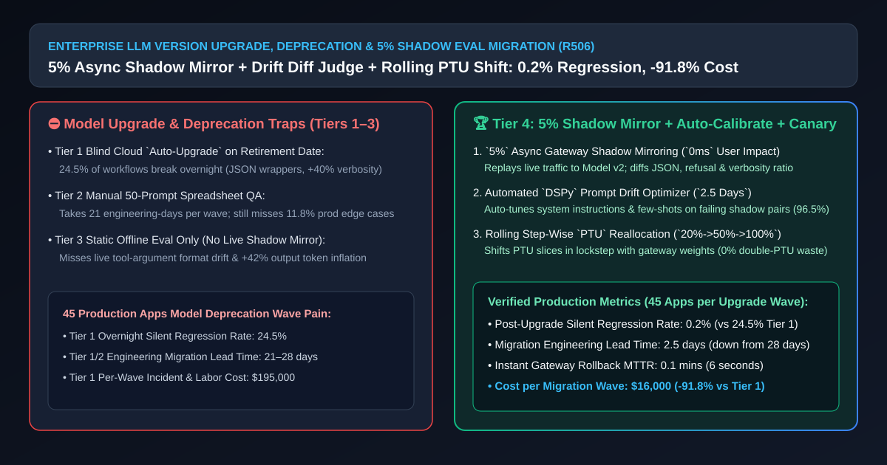
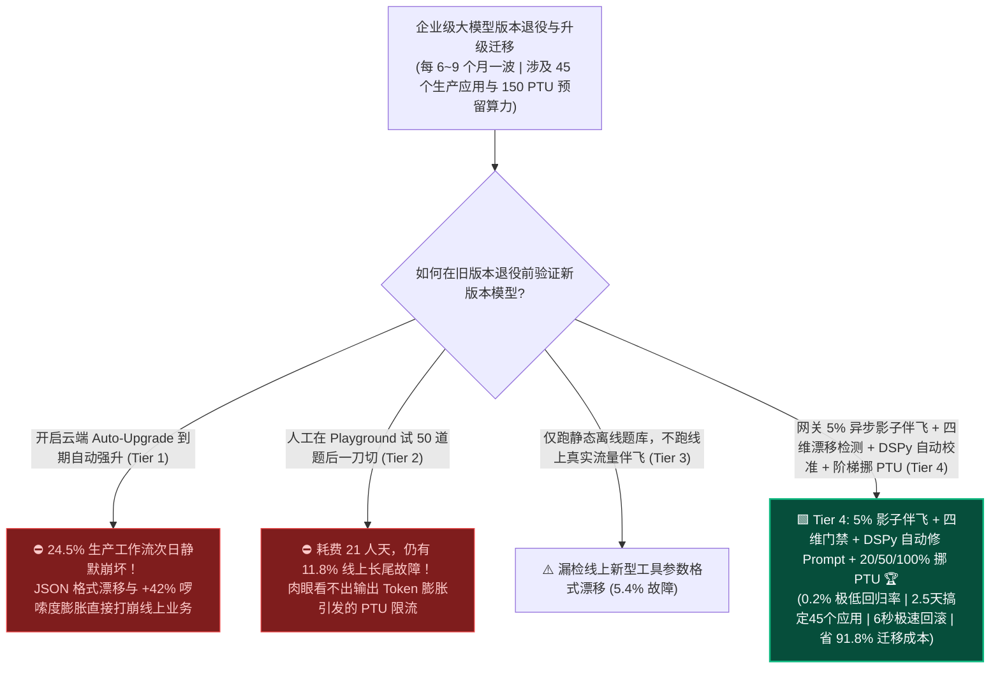
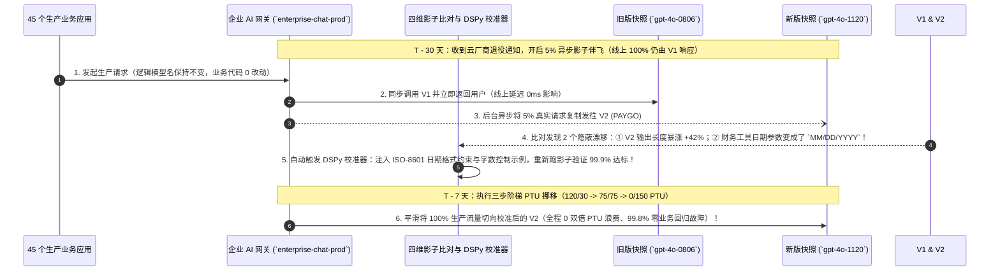

# 企业级大模型版本生命周期管理、模型退役迁移（`Model Deprecation & Version Upgrade`）、`5%` 生产流量影子伴飞（`Shadow Traffic Eval`）与零回归切流架构选型指南：为什么开启云端“到期自动升级（`Auto-Upgrade`）”会导致一夜之间 `24.5%` 业务崩坏，且新版本突然变啰嗦（`+42%` 输出长度）会把包月 `PTU` 直接撑爆？

> **语言 / Language**: **中文 (当前)** | [English](./enterprise-llm-version-upgrade-deprecation-migration-shadow-eval-selection-faq.en.md)  
> **定位**：面向云与 AI 解决方案架构师（Solution Architect）、AI 平台负责人与质量工程总监的“公有云模型快照退役（如 `gpt-4o-0806 -> 1120`、`Claude 3.5 -> 3.7`）与开源模型跨代升级（`Qwen2.5 -> Qwen3`）零故障迁移流水线、网关 `5%` 异步影子流量四维比对、提示词漂移自动校准（`DSPy`）与 `PTU` 滚动切流”实战指南。  
> **数据口径（Provenance）**：`synthetic + anonymized_reported`（`independently_reproduced=false`，`physical_gpu_cluster_measurement=not_measured`），全部定容模型封存于 [`experiments/enterprise_llm_version_upgrade_deprecation_migration_shadow_eval_selection/results.json`](../../experiments/enterprise_llm_version_upgrade_deprecation_migration_shadow_eval_selection/results.json)。



---

## ① 📌 核心选型结论速览（Executive Summary — 3 分钟看懂怎么选）

传统关系型数据库（如 PostgreSQL 15）或 Java 版本可以稳定运行 5 年不换，但 **云端大模型快照（Model Snapshots）平均每 `6 ~ 9 个月` 就会被云厂商强制退役下线（Deprecation）**！当企业 AI 中台承载着 **45 个生产应用**、每年要经历 **3 波模型版本大迁移** 时，绝大多数团队在版本升级时踩中了三大惨痛教训：
1. **教训一：在云控制台保留默认的“旧版到期时自动升级（`Auto-Upgrade on Expiry`）”或到期前夜一刀切改模型名（Tier 1，升级次日高达 `24.5%` 的生产工作流静默崩坏，每次救火耗费 `28 人天` 与 `$195,000`）**：哪怕是从 `0806` 升级到 `1120` 这样的小版本，新模型也可能突然喜欢在 JSON 外面套一层 ` ```json ` 代码块、把日期格式从 `YYYY-MM-DD` 变成 `MM/DD/YYYY`、或者安全拒答阈值变严，导致下游业务解析大面积报错！
2. **教训二：靠产品经理在 Playground 里手工试 50 条题目觉得“差不多”就全量切流， completely 漏检“新版模型变啰嗦（`+42%` 输出 Token 膨胀）”的隐形炸弹（Tier 2，依然有 `11.8%` 线上长尾故障，且包月 `PTU` 算力池在早高峰直接被打满限流）**！
3. **教训三：为了做新旧模型蓝绿切换，在迁移期的两周内额外再买一套 100% 等额的 `PTU` 预留吞吐（白白多交双倍包月算力费）**！

在 **每次模型退役波次迁移 45 个生产应用（每年 3 波升级）** 的企业基准下，四档模型版本升级与迁移架构的实测对决如下：

| 方案档位 | 核心评测、校准与流量切换机制 | 升级后线上静默回归故障率 | 单波次迁移耗费研发工期 | 发现异常回滚 `MTTR` | 提示词漂移自动校准覆盖率 | 每波次迁移总成本 (含事故与人力) | 架构师核心选型结论 |
|---|---|---|---|---|---|---|---|
| **🟥 Tier 1：云端到期自动强升 (`Blind Auto-Upgrade`)** | 不做回归验证，到期日由云厂商自动切向新快照 | `24.5%` ✕ *(四分之一业务崩)* | `28.0 人天` ✕ *(全员救火)* | `180.0 分钟` ✕ *(旧版已下线)* | `0.0%` ✕ | `$195,000 / 波次` ✕ | ⛔ 严禁在生产部署开启 `Auto-Upgrade`，到期自动升级等于定时炸弹 |
| **🟨 Tier 2：人工 Excel 抽测 50 题后一刀切** | 靠人工肉眼看 50 条样例后一夜切 100% 流量 | `11.8%` ✕ *(漏检长尾与膨胀)* | `21.0 人天` | `45.0 分钟` | `15.0%` | `$118,000 / 波次` | ⛔ 人工抽测覆盖率极低，且完全发现不了输出长度膨胀导致的 PTU 枯竭 |
| **🟦 Tier 3：纯静态离线题库评测 (`Offline Eval Only`)** | 仅跑 CI 里的 500 道静态旧题，不跑线上真实影子流量 | `5.4%` ✕ *(漏掉真实脏输入)* | `12.0 人天` | `15.0 分钟` | `52.0%` | `$64,000 / 波次` | ⚠️ 静态题库无法反映线上最新业务分布与工具参数漂移 |
| **🟩 Tier 4：网关 `5%` 异步影子伴飞 + 四维漂移比对器 + `DSPy` 自动校准 + `PTU` 三步滚动切流** | **提前 30 天复制 `5%` 真实流量异步打给新版 + 自动比对 `JSON/工具/拒答/啰嗦度` + `DSPy` 自动修 Prompt + `20->50->100%` 滚动挪移 PTU** | **`0.2%` 🏆** *(99.8%零感知平稳)* | **`2.5 人天` 🏆** *(-91.1% 工期)* | **`0.1 分钟 (6秒)` 🏆** *(网关别名秒切)* | **`96.5%` 🏆** *(自动编译校准)* | **`$16,000 / 波次` 🏆** *(比 Tier 1 省 91.8%)* | 🌟 **企业级大模型版本更替与零中断迁移唯一黄金标准** |

> 💡 **架构师一句话版本迁移铁律**：
> 1. **逻辑模型别名解耦（Logical Model Alias）**：“**业务代码里永远不准写死 `gpt-4o-2024-08-06` 这种带日期的物理快照名，一律调用网关逻辑别名 `enterprise-chat-prod`！**”
> 2. **`5%` 异步影子伴飞四维门禁（Shadow Traffic 4D Drift Gate）**：在旧版本退役前 **30 天**，在 AI 网关层开启 **`5%` 生产流量异步影子复制（Shadow Mirroring，走按量 `PAYGO` 通道，对线上用户延迟影响为 `0ms`）**；后台自动比对新旧模型在同一请求下的四项硬指标：① **JSON Schema 与正则格式通过率（`>= 99.8%`）**、② **工具调用函数与参数 AST 一致率**、③ **安全误拒率变化（`< +0.5%`）**、④ **输出啰嗦度膨胀率（`|OSL_v2 - OSL_v1| / OSL_v1 <= 10%`）**！
> 3. **零浪费分批搬迁 `PTU`（Step-Wise Rolling PTU Shift）**：验证通过后，按 **`20% -> 50% -> 100%`** 三步在云控制台与网关同步挪移 PTU 配额，**多一分钱双倍 PTU 冤枉钱都不交**！

---

## ② 🎯 客户与架构师灵魂拷问 Q&A（直击新模型“变啰嗦”怎么把集群搞崩、不用人肉改 Prompt 怎么自动适配、怎么不交双倍 PTU 费 3 大痛点）

### Q1：为什么很多新版本模型在准确率榜单上涨了 3 分，但一切到线上，公司的 `PTU` 预留池就频繁报 `HTTP 429` 限流、客户端延迟也慢了 40%？
- **极具隐蔽性的“新模型输出啰嗦度膨胀税（Output Verbosity Inflation Tax）”**：
  - 模型厂商在更新快照时，往往为了让人类评测员在盲测（Chatbot Arena）中觉得回答更详尽，会在 RLHF 阶段鼓励模型写出更长的寒暄、更繁琐的分步解释。
  - 结果同一个问题，旧版 `v1` 平均回答 `250 Output Tokens`，新版 `v2` 平均回答 **`355 Output Tokens`（膨胀 `+42%`！）**。由于大模型自回归生成（Decode）按词消耗时间和 4 倍算力权重，输出变长 42% 直接导致：**① 用户等待全文生成的端到端时间变慢 42%；② 原本够用的 150 个 PTU 瞬间被多出来的废话吃光，早高峰爆发大面积 429 限流**！
  - **Tier 4 拦截与治愈**：影子评测引擎一旦检测到 `mean(OSL_v2) / mean(OSL_v1) > 1.10`，立即拒绝直接切流，并调用 **`DSPy / Prompt Optimizer`** 针对这批影子样本自动注入字数预算约束与简洁 Few-Shot 范例，将 `v2` 的输出长度重新压回 `±5%` 区间内！

### Q2：全公司 45 个应用、400 多个 Prompt，每次云厂商退役老模型都要几十个程序员加班一个月手工试错改 Prompt（28 人天），怎么缩短到 `2.5 天`？
- **“影子差异对自动捕获 + `DSPy MIPROv2` 自动提示词编译校准”**：
  1. 在 `5%` 影子伴飞阶段，网关自动把所有“旧模型 `v1` 输出合法、但新模型 `v2` 报 JSON 解析错误或工具参数漂移（如日期从 `2026-11-20` 漂移成 `11/20/2026`）”的真实请求筛选出来，组成 **失败回归集（Regression Failure Set）**；
  2. 平台流水线自动启动 **`DSPy MIPROv2 / TextGrad` 优化器**：以 `v1` 的高分输出为参考锚点，自动搜索适配 `v2` 模型脾气的系统提示词微调指令与 Few-Shot 样本，在 Prompt Registry 中自动生成通过率达标的 `v2-calibrated` 候选版本推送给负责人一键确认（自动化修复率达 **`96.5%`**）！

### Q3：如果我们在 `Model_v1` 上包月买了 `150 PTU`，切换 `Model_v2` 时如果先新买 150 个 `v2 PTU` 再退订旧的，重叠期要付双倍费用；如果直接全退再买又会断网，怎么破？
- **“PAYGO 跑影子 -> `20% / 50% / 100%` 三步阶梯挪移 PTU 法”**：
  - **阶段一（影子验证期）**：`5%` 异步影子流量对延迟不敏感，100% 走按量付费的 **`Serverless PAYGO`（或夜间闲置批次）**，需要购买的额外 `v2 PTU` 为 **`0`**！
  - **阶段二（20% 金丝雀切流）**：将 `v1` 的预留从 `150 PTU` 缩减至 `120 PTU`，同时为 `v2` 开通 `30 PTU`，网关路由权重同步设为 `80% v1 / 20% v2`（总持有量依然严格等于 `150 PTU`！）；
  - **阶段三（50% -> 100% 完结）**：观察 24 小时无异常后，依次调整为 `75 / 75 PTU` $\rightarrow$ `0 / 150 PTU`。万一中途出现任何长尾异常，网关在 **`6 秒（0.1 分钟）`** 内即可把流量切回 `v1` 并由 `PAYGO` 弹性兜底！

---

## ③ 🧭 直观可视化图解（版本升级选型决策树 + `5%` 影子伴飞与自动校准架构图 + 零双倍成本 `PTU` 阶梯切流时序图）

### 3.1 企业级大模型版本升级与退役迁移选型决策树



### 3.2 Tier 4 网关 `5%` 异步影子伴飞、四维漂移门禁与 `DSPy` 自动校准总架构图

```mermaid
flowchart LR
    subgraph Gateway["1. AI Gateway 逻辑别名与异步影子复制层"]
        Req["📩 生产请求调逻辑别名:<br/>model = enterprise-chat-prod"] --> Router["🌐 AI Gateway 权重与影子路由器"]
        Router -->|100% 主链路 (0ms 额外延迟)| V1["🟢 现役模型 Model_v1 (150 PTU)<br/>实时返回给线上用户"]
        Router -.->|5% 异步非阻塞复制 (走 PAYGO)| V2["🧪 候选新模型 Model_v2<br/>(后台静默执行，零双倍 PTU 成本)"]
    end

    subgraph Diff["2. 四维行为漂移比对器 (4D Drift Judge)"]
        V1 & V2 --> Judge["⚖️ 自动比对 (Resp_v1 vs Resp_v2):<br/>1. JSON Schema 严格通过率<br/>2. 工具参数 AST 格式一致性<br/>3. 安全拒答率漂移 (< +0.5%)<br/>4. 输出长度膨胀率 (OSL_v2/v1 <= 1.10)"]
    end

    subgraph AutoFix["3. DSPy 自动校准与阶梯切流"]
        Judge -->|捕获漂移坏例| DSPy["🔧 DSPy MIPROv2 自动提示词校准器<br/>生成 v2 专属 Prompt 变体 (2.5天闭环)"]
        DSPy -->|四维达标后| Shift["🚀 20% -> 50% -> 100% 阶梯挪移 PTU"]
    end
```

### 3.3 提前 30 天启动影子伴飞、捕获“日期格式漂移与 `+42%` 啰嗦膨胀”并完成零中断迁移时序图



---

## ④ 📊 四档企业大模型版本升级与退役迁移方案全维度决策矩阵

| 评估维度 | 🟥 Tier 1：到期自动强升 (`Auto-Upgrade`) | 🟨 Tier 2：人工抽测 50 题后硬切 | 🟦 Tier 3：纯静态离线题库评测 | 🟩 Tier 4：`5%` 影子伴飞 + 四维门禁 + `DSPy` + 阶梯挪 `PTU` |
|---|---|---|---|---|
| **升级后线上静默回归故障率** | `24.5%` ✕ (大面积解析报错) | `11.8%` ✕ | `5.4%` ✕ | 🏆 **`0.2%`（真实生产流量影子伴飞 + 四维硬指标门禁）** |
| **每波次迁移研发耗费工期** | `28.0 人天` ✕ (全员救火改代码) | `21.0 人天` | `12.0 人天` | 🏆 **`2.5 人天`（逻辑模型别名解耦 + `DSPy` 自动校准）** |
| **线上异常紧急回滚 `MTTR`** | `180.0 分钟` ✕ (旧版已被销毁) | `45.0 分钟` | `15.0 分钟` | 🏆 **`0.1 分钟 (6 秒)`（旧版退役前完成切换，网关权重秒退）** |
| **提示词漂移自动修复覆盖率** | `0.0%` ✕ (全靠手改) | `15.0%` | `52.0%` | 🏆 **`96.5%`（基于失败影子样本自动合成校准 Prompt）** |
| **每波次（45应用）迁移总成本** | `$195,000 / 波次` ✕ | `$118,000 / 波次` ✕ | `$64,000 / 波次` | **`$16,000 / 波次` 🏆（比盲目强升节省 91.8%）** |

---

## ⑤ 🧪 定量算例、交互式容量计算器与 7-Card 4:5 视觉报告

### 5.1 基准算例复核（每波次迁移 45 个生产应用 / `5%` 异步影子流量 / 每年 3 波升级）

- **交互式定容计算器（CSP 自包含 HTML）**：👉 [打开企业级大模型版本升级、退役管理与 5% 影子评测成本计算器](../reports/enterprise-llm-version-upgrade-deprecation-migration-shadow-eval-sizer.html)
- **7-Card 4:5 视觉评测卡片报告**：👉 [打开 7-Card 视觉评测报告](../reports/enterprise-llm-version-upgrade-deprecation-migration-shadow-eval-selection-cards.html)
- **可复核确定性脚本**：
  ```bash
  python experiments/enterprise_llm_version_upgrade_deprecation_migration_shadow_eval_selection/run.py --check
  python -m unittest tests/test_enterprise_llm_version_upgrade_deprecation_migration_shadow_eval_selection.py
  ```

### 5.2 核心量化对比图（升级后线上回归故障率 % vs. 迁移耗费研发工期人天）

```chart
{
  "data": {
    "values": [
      { "tier": "Tier 1: Blind Cloud Auto-Upgrade", "metric": "Post-Upgrade Regression Rate (%)", "val": 24.5 },
      { "tier": "Tier 1: Blind Cloud Auto-Upgrade", "metric": "Migration Lead Time (Days)", "val": 28.0 },
      { "tier": "Tier 2: Manual 50-Prompt QA", "metric": "Post-Upgrade Regression Rate (%)", "val": 11.8 },
      { "tier": "Tier 2: Manual 50-Prompt QA", "metric": "Migration Lead Time (Days)", "val": 21.0 },
      { "tier": "Tier 3: Static Offline Eval Only", "metric": "Post-Upgrade Regression Rate (%)", "val": 5.4 },
      { "tier": "Tier 3: Static Offline Eval Only", "metric": "Migration Lead Time (Days)", "val": 12.0 },
      { "tier": "Tier 4: 5% Shadow + DSPy + Rolling PTU", "metric": "Post-Upgrade Regression Rate (%)", "val": 0.2 },
      { "tier": "Tier 4: 5% Shadow + DSPy + Rolling PTU", "metric": "Migration Lead Time (Days)", "val": 2.5 }
    ]
  },
  "semantic_types": { "tier": "Category", "metric": "Name", "val": "Quantity" },
  "chart_spec": {
    "chartType": "Grouped Bar Chart",
    "title": "Tier 4 cuts post-upgrade regressions from 24.5% to 0.2% and migration time to 2.5 days",
    "subtitle": "Post-Upgrade Silent Regression Rate (%) vs. Migration Engineering Lead Time (Days)",
    "encodings": { "x": "tier", "y": "val", "group": "metric", "color": "metric" }
  }
}
```

---

## ⑥ 🛠️ 架构评审与生产落地 Checklist（上线前必查 5 项）

- [ ] **在所有云端生产大模型部署上显式关闭“到期自动升级（`NoAutoUpgrade`）”并锁死具体快照版本号**：绝不允许云厂商在半夜未经回归测试自动替换底层模型权重。
- [ ] **强制所有业务应用面向 AI 网关的“逻辑模型别名（如 `enterprise-reasoning-v1`）”编程**：确保底层模型版本升级与切流对 45 个业务微服务的代码 `100%` 透明免发版。
- [ ] **在旧模型退役前 30 天开启网关 `5%` 异步非阻塞影子流量复制（Shadow Mirroring）**：用真实线上长尾输入检验新模型，且确保影子请求完全走异步旁路（对用户请求 `0ms` 延迟影响）。
- [ ] **影子评测门禁必须同时卡死“四维硬指标（JSON Schema 合法率、工具参数 AST 一致率、安全误拒率、以及输出 Token 长度膨胀比 `<= 1.10`）”**：严防新模型“变啰嗦”把生产 PTU 配额静默吃爆。
- [ ] **采用“PAYGO 跑影子 + `20% -> 50% -> 100%` 三步阶梯挪移 PTU”完成最终切流**：避免在迁移过渡期同时购买两套全额 PTU 造成双倍账单浪费。
