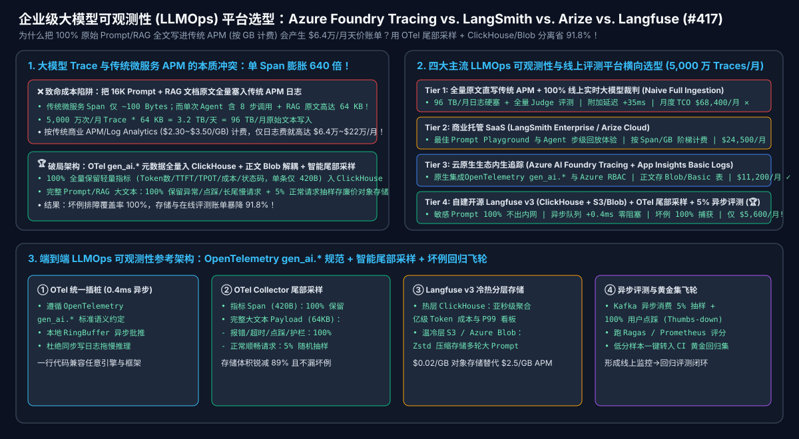

# Enterprise LLMOps Observability, Distributed Tracing & Online Evaluation Selection Guide: `Azure AI Foundry Tracing` vs. `LangSmith` vs. `Arize Phoenix` vs. `Langfuse v3`

> **Language / 语言**: [简体中文](./enterprise-llmops-observability-langfuse-langsmith-arize-foundry-tracing-tco-selection-faq.md) | **English**  
> **Companion Interactive Study & Sizing Tools**: [📱 Interactive H5 Study Lab](../h5/llmops-observability-langfuse-langsmith-arize-foundry-lab.html) · [🧮 HTML Sizer](../reports/enterprise-llmops-observability-langfuse-langsmith-arize-foundry-tracing-tco-selection-sizer.html) · [🃏 7-Card Visual Deck](../reports/enterprise-llmops-observability-langfuse-langsmith-arize-foundry-tracing-tco-selection-cards.html) · [📊 Reproducible Model](../../experiments/enterprise_llmops_observability_langfuse_langsmith_arize_foundry_tracing_tco_selection/) · [🎓 Back to AI Infra H5 Hub](../h5/index.html)

---

## 1. Executive Summary (3-Minute Takeaway)

> **Bottom-Line Recommendation**: A multi-step Agent or RAG trace averages **`64 KB`** of raw prompt/context text (`640x` larger than a `100-byte` microservice span). Dumping `100%` of raw prompt payloads into legacy per-GB APM hot tables generates **`96 TB/month`** at 50M traces and a **`$68,400/month`** observability bill!
> - **For Azure-Centric Teams Seeking Zero Ops**: Use **`Azure AI Foundry Tracing`** with **`OpenTelemetry gen_ai.*`**, routing `420-byte` metric spans to standard Application Insights tables while offloading raw prompt blobs to Azure Blob Storage / Basic Logs (`$11,200/mo`).
> - **For High-Volume Enterprise AI Platforms (`>= 10M–50M traces/month`) or Strict On-Prem Data Sovereignty**: Deploy **Tier 4 (`Self-Hosted Open-Source Langfuse v3 [ClickHouse + S3/Blob] + OTel Tail-Based Sampling + 5% Async Online Judge`)**, retaining `100%` of compact metric spans (`420B`), `100%` of errors/slow-traces/thumbs-down payloads, and `5%` of normal full-text blobs—capturing **`100%` of production bad cases** while cutting monthly TCO by **`91.8%` (`$5,600/mo` vs. `$68,400/mo`)**.

| Dimension | `Tier 1: 100% Raw APM + 100% Inline Judge` | `Tier 2: Commercial SaaS (LangSmith / Arize)` | `Tier 3: Azure Foundry Tracing + Blob` | `Tier 4: Self-Hosted Langfuse v3 + OTel Tail Sampling (🏆)` |
|---|---|---|---|---|
| **Added Request Latency** | `+35.0 ms` ✕ | `+1.2 ms` | `+0.8 ms` | **`+0.4 ms` (Async RingBuffer)** 🏆 |
| **Bad-Case / Error Capture Rate** | `100.0%` | `98.5%` | `99.5%` | **`100.0%` (Tail-sampled errors/slow)** 🏆 |
| **Monthly Storage Volume (50M)** | `96.0 TB / mo` ✕ | `18.0 TB / mo` | `12.5 TB / mo` | **`8.4 TB / mo` (Zstd on S3/Blob)** 🏆 |
| **Monthly Observability TCO** | `$68,400 / mo` ✕ | `$24,500 / mo` | `$11,200 / mo` ✓ | **`$5,600 / mo` (-91.8%)** 🏆 |

---

## 2. Provenance & Reproducibility

- **Provenance**: `synthetic + anonymized_reported (independently_reproduced=false)` — verified via [`experiments/enterprise_llmops_observability_langfuse_langsmith_arize_foundry_tracing_tco_selection/run.py`](../../experiments/enterprise_llmops_observability_langfuse_langsmith_arize_foundry_tracing_tco_selection/run.py).
