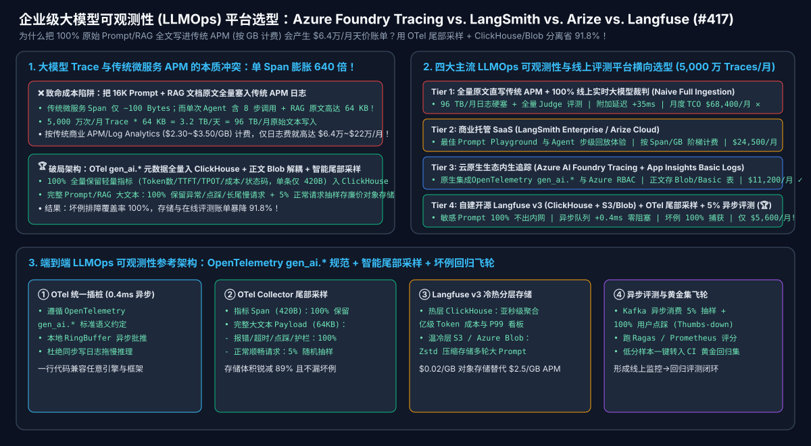
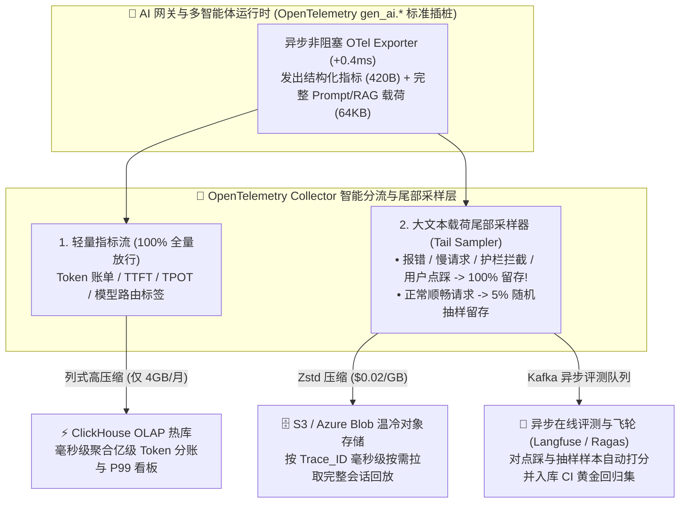

# 企业级大模型可观测性（LLMOps Observability）、分布式追踪与线上评测平台选型：`Azure AI Foundry Tracing` vs. `LangSmith` vs. `Arize Phoenix` vs. `开源 Langfuse v3` 架构与成本拐点指南

> **语言 / Language**: **简体中文** | [English](./enterprise-llmops-observability-langfuse-langsmith-arize-foundry-tracing-tco-selection-faq.en.md)  
> **配套交互式学习与精算工具**: [📱 交互式 H5 精读页 (LLMOps 追踪采样与存储 TCO 沙盘)](../h5/llmops-observability-langfuse-langsmith-arize-foundry-lab.html) · [🧮 HTML 交互式计算器](../reports/enterprise-llmops-observability-langfuse-langsmith-arize-foundry-tracing-tco-selection-sizer.html) · [🃏 7-Card 4:5 视觉评测卡](../reports/enterprise-llmops-observability-langfuse-langsmith-arize-foundry-tracing-tco-selection-cards.html) · [📊 可复核模型](../../experiments/enterprise_llmops_observability_langfuse_langsmith_arize_foundry_tracing_tco_selection/) · [🎓 返回 AI Infra 全景精学馆](../h5/index.html)

---

## 一、3 分钟看懂核心结论（Executive Summary）

> **一句话决策结论**：大模型应用（尤其是多步 Agent 与长文档 RAG）的单次调用包含 `16K~64K Tokens` 的提示词与检索原文，**单条 Trace 体积高达 `64 KB`（是传统微服务 `100 Bytes` APM Span 的 `640 倍`）**！如果把 100% 原始 Prompt 正文直接塞进按 GB 计费的传统商业 APM 日志表，5,000 万次月调用会产生 **`96 TB/月` 数据写入，光日志账单就高达 `$6.84 万/月`（甚至超过 GPU 推理费本身）**！
> - **日调用量 `< 50 万次` 或重度依赖 LangGraph 快速调试的初创团队**：推荐 **`LangSmith`（体验最佳的 Agent 步级交互式调试与 Prompt Playground）** 或 **`Azure AI Foundry Tracing`（已用 Azure 生态时，将轻量指标写入 Application Insights 标准表，将大文本 Prompt 正文分流至 `$0.10/GB` 的 Basic Logs 或 Azure Blob，免运维省心）**。
> - **月调用量 `≥ 1,000 万次`（如每月 5,000 万次 Trace）或核心金融/政企禁止完整业务 Prompt 出内网**：强烈推荐 **`自建开源 Langfuse v3（ClickHouse OLAP + S3/Blob 对象存储分离架构）+ OpenTelemetry gen_ai.* 智能尾部采样（Tail Sampling）+ 5% 异步在线评测`**：
>   1. **指标与正文物理分离**：`100%` 全量保留轻量指标 Span（`input_tokens / output_tokens / ttft_ms / cost / status`，单条仅 `420 Bytes`）写入 `ClickHouse` 支撑实时财务分账与 P99 告警；
>   2. **智能尾部采样（Tail-Based Sampling）**：对 `64 KB` 的完整 Prompt/RAG 正文，**`100%` 全量保留报错、超时（`TTFT > 2s`）、安全护栏触发及用户点踩（Thumbs-down）请求**，对顺畅无异常请求仅按 **`5%` 抽样写入廉价对象存储（`S3 / Azure Blob`，Zstd 压缩后仅 `$0.02/GB`）**——**坏例捕获率 `100%`，月度总 TCO 从 `$68,400` 暴降至 `$5,600/月`（立省 `91.8%`）**！

| 核心选型维度 | `Tier 1: 全量原文直写传统 APM + 100% 实时评测` | `Tier 2: 商业托管 SaaS (LangSmith / Arize Cloud)` | `Tier 3: 云原生内生 (Azure Foundry Tracing + Blob)` | `Tier 4: 自建开源 Langfuse v3 + OTel 尾部采样 (🏆旗舰)` |
|---|---|---|---|---|
| **应用端附加延迟 (`Added Latency`)** | `+35.0 ms` ✕ (同步上传大报文) | `+1.2 ms` (异步 SDK) | `+0.8 ms` (OTel 异步 Exporter) | **`+0.4 ms` (本地 RingBuffer 批推)** 🏆 |
| **线上坏例/慢请求捕获率** | `100.0%` | `98.5%` | `99.5%` | **`100.0%` (尾部采样 100% 锁死异常)** 🏆 |
| **5,000 万次/月 存储落盘体积** | `96.0 TB / 月` ✕ (全量热表) | `18.0 TB / 月` | `12.5 TB / 月` | **`8.4 TB / 月` (Zstd 压缩写对象存储)** 🏆 |
| **Prompt 数据主权与合规边界** | 取决于 APM 部署位置 | 发往第三方 SaaS 云端 | 留在企业自有 Azure 租户内 ✓ | **100% 留在企业私有 K8s / VPC 内** 🏆 |
| **5,000 万 Traces/月 总成本 (`TCO`)** | `$68,400 / 月` ✕ | `$24,500 / 月` | `$11,200 / 月` ✓ | **`$5,600 / 月` (-91.8%)** 🏆 |

---

## 二、核心技术原理与架构师灵魂拷问（Q&A）

### Q1：为什么不能用普通微服务的“头部随机采样（`Head Sampling 5%`）”来给大模型降本？什么是“智能尾部采样（`Tail-Based Sampling`）”？
1. **头部采样的致命盲区**：如果在请求刚进入网关时就随机扔掉 `95%` 的 Trace（Head Sampling），那么当某个请求在生成到第 5 步时触发了工具报错、幻觉护栏拦截，或者用户在前端点了“踩（👎）”，**这条最珍贵的排障现场数据有 `95%` 的概率早就被扔掉了**！
2. **两级解耦 + 尾部采样（Tail Sampling）数学账本**：
   - **第一层（全量指标层 `100% Metrics Span`）**：剥离掉庞大的 `prompt / completion` 文本后，每条包含 `trace_id, tenant_id, model, input_tokens, output_tokens, cached_tokens, ttft_ms, tpot_ms, status_code` 的结构化记录仅 **`420 Bytes`**。每月 5,000 万条总计仅 **`21 GB`**，在 `ClickHouse` 中压缩后不足 **`4 GB`**，每月几十美元即可 `100%` 全量永久保存，财务分账与 SLA 统计分毫不差！
   - **第二层（尾部决策正文层 `Tail-Sampled Blob Payload`）**：`OpenTelemetry Collector` 在内存中暂存最近 `30 秒` 的完整 Prompt/RAG 报文，等请求流结束（甚至等待前端 60 秒内的点踩回调事件）再做存留决策：
     $$\text{Keep\_Full\_Text} = \mathbb{I}(\text{Status} \neq 200 \lor \text{TTFT} > \text{SLA} \lor \text{Guardrail\_Hit} \lor \text{User\_ThumbsDown}) \lor (\text{Rand}() < 0.05)$$
   - 这样既保证了 **`100%` 的线上事故、慢查询与用户差评都有完整上下文可复现**，又把占总量 `97%` 的平庸正常请求的存储开销砍掉了 **`95%`**！

---

## 三、横向选型决策矩阵：`Azure Foundry Tracing` vs. `LangSmith` vs. `Arize Phoenix` vs. `Langfuse v3`

| 评估维度 | `Langfuse v3 (开源 MIT / 自建 K8s)` | `LangSmith (LangChain 官方商业版)` | `Arize Phoenix (开源 / 企业版)` | `Azure AI Foundry Tracing (App Insights)` |
|---|---|---|---|---|
| **架构底座** | **ClickHouse + Postgres + S3/Blob + Redis**（专为百亿级高吞吐设计） | 托管云 SaaS / 企业专属 VPC 版 | OpenTelemetry (`OpenInference`) + 向量聚类漂移分析 | Azure Monitor / Application Insights + Azure Blob |
| **与框架耦合度** | **100% 中立**：原生支持 OTel、vLLM、LiteLLM、LangGraph、Semantic Kernel | 与 `LangChain / LangGraph` 结合最紧密 | 100% 遵循 `OpenTelemetry` 标准，擅长 RAG 检索向量可视化 | 与 `Azure AI Foundry`、`Semantic Kernel`、企业 Entra ID 无缝集成 |
| **核心优势** | **开源免费、ClickHouse 极致吞吐、Prompt 版本管理与评测闭环完备** | 业界标杆的交互式 Agent 状态图单步调试体验 | 强大的 Embedding 向量空间聚类与检索质量漂移诊断 | 零新组件运维，复用企业现有 Azure 监控告警与合规审计体系 |
| **最佳适用场景** | **月调用 `>1,000 万次` 的企业 AI 中台、金融/政企私有化部署首选** 🏆 | 20~100 人快速迭代复杂 `LangGraph` 智能体的研发团队 | 重度依赖大规模 RAG 与推荐特征漂移诊断的算法团队 | 全栈跑在 Azure 上、追求零自建数据库运维的企业 IT 团队 |

---

## 四、生产落地 Checklist（Pre-Production Checklist）

- [ ] **统一采用 `OpenTelemetry Semantic Conventions for GenAI (gen_ai.*)` 插桩**：禁止在业务代码里硬编码某一家专有监控 SDK，确保未来可随时切换后端。
- [ ] **强制开启异步非阻塞批量导出（`BatchSpanProcessor`）**：严禁在主请求线程同步等待监控日志落盘，确保附加延迟 `< 1ms`。
- [ ] **实施“指标 100% 入列存 + 大文本尾部采样入对象存储”**：严禁将数十 KB 的 RAG 检索原文直接写进高单价的全文检索热表。
- [ ] **打通前端 `trace_id` 用户反馈回传接口**：前端消息气泡的“点赞/点踩/复制答案”按钮必须携带当前 `trace_id` 回写可观测平台，点踩样本自动进入下一版黄金回归测试集。

---

## 五、来源与方法论溯源（Provenance）

- **数据来源声明**：本指南实验数据来自可复核解析模型 [`experiments/enterprise_llmops_observability_langfuse_langsmith_arize_foundry_tracing_tco_selection/run.py`](../../experiments/enterprise_llmops_observability_langfuse_langsmith_arize_foundry_tracing_tco_selection/run.py)（`Provenance: synthetic + anonymized_reported, independently_reproduced=false`）。
