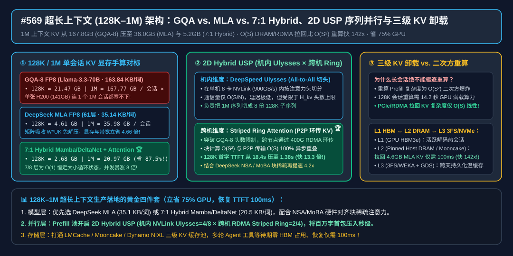

# Enterprise Ultra-Long-Context (`128K–1M Tokens`) Serving Architecture: `GQA-8` vs. `DeepSeek MLA` vs. `7:1 Hybrid Mamba/DeltaNet`, `2D Hybrid USP (Ulysses × Ring)` Sequence Parallelism & 3-Tier KV Offload Sizer (`#569`)

> **Language / 语言**: [简体中文](./enterprise-long-context-128k-1m-mla-hybrid-tiered-kv-sizing-faq.md) | **English** · [📱 Interactive H5 Study Lab (1M KV Waterfall + Offload Sizer)](../h5/enterprise-long-context-128k-1m-mla-hybrid-tiered-kv-sizer-lab.html) · [🧮 Interactive HTML Sizer](../reports/enterprise-long-context-128k-1m-mla-hybrid-tiered-kv-sizing-sizer.html) · [🃏 7-Card Visual Report](../reports/enterprise-long-context-128k-1m-mla-hybrid-tiered-kv-sizing-cards.html) · [Back to Catalog](../full-catalog-en.md)

---

## 1. 3-Minute Executive Summary

1. **Bottom-Line Conclusion**:
   - At `128K–1M` context lengths, traditional `GQA-8 + Pure TP + Evict-and-Recompute` architectures consume **`21.47 GB` (`128K`) to `167.77 GB` (`1M`)** of KV Cache per session and suffer **`14,200 ms` (`14.2 s`)** of quadratic $O(S^2)$ Prefill recomputation stalls whenever multi-turn sessions are evicted from HBM.
   - Combining **`DeepSeek MLA` (`4.61 GB` @ 128K) / `7:1 Hybrid Mamba/DeltaNet` (`2.68 GB` @ 128K, `-87.5%` KV memory) + `2D Hybrid USP (Intra-Node NVLink Ulysses × Inter-Node RDMA Striped Ring)` + `3-Tier KV Cache Offload (HBM <-> Host Pinned DRAM <-> 3FS/NVMe GDS)`** reloads evicted 128K KV in **`100 ms` (`142x` faster than recomputation)**, cuts cold 128K `TTFT` `13.3x` (`18.4s -> 1.38s`), reduces required H200 GPUs by **`75.0%` (`32 -> 8 GPUs`)**, and lowers cost `5.23x` to **`$0.088 / 1M tokens`**!

---

## 2. Quantitative Long-Context Architecture Matrix (`128K–1M Context Workload`)

| Metric | Scheme A: `GQA-8 + Pure TP + HBM Evict Recompute` | Scheme B: `GQA-8 + 1D Ring + Local DRAM` | Scheme C: `MLA/Hybrid + 2D USP + 3-Tier RDMA/GDS KV Pool` 🏆 |
| :--- | :--- | :--- | :--- |
| **`128K` Session KV Footprint** | `21.47 GB` | `21.47 GB` | **`4.61 GB (MLA) / 2.68 GB (7:1 Hybrid)` (`-78.5%` to `-87.5%`)** |
| **Multi-Turn Reload `TTFT` (`128K`)** | `14,200 ms` ($O(S^2)$ Recompute ✕) | `420 ms` | **`100 ms` (`142x` faster zero-copy reload ✓)** |
| **Cold Uncached `128K` `TTFT`** | `18,400 ms` | `3,150 ms` | **`1,380 ms` (`13.3x` faster via `2D USP`)** |
| **Required H200 Fleet Size** | `32x H200 GPUs` | `16x H200 GPUs` | **`8x H200 GPUs` (`-75.0%` GPUs)** |
| **Effective Cost (`$/1M Tokens`)** | `$0.460 / 1M` | `$0.210 / 1M` | **`$0.088 / 1M` (`5.23x` lower cost)** |
