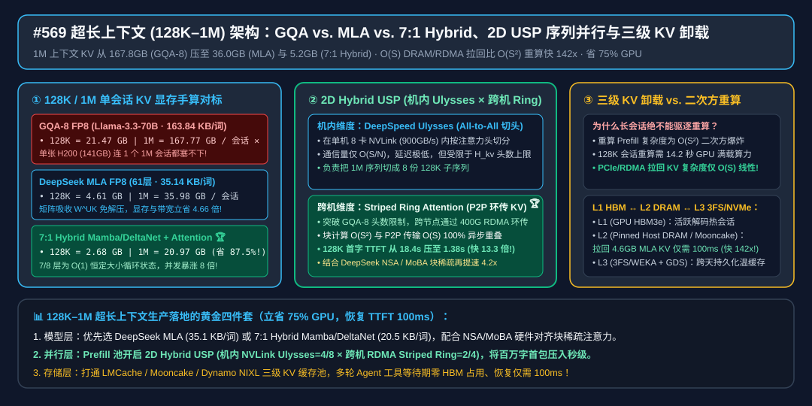

# 企业超长上下文（`128K–1M Tokens`）推理架构选型：`GQA-8` vs. `DeepSeek MLA` vs. `7:1 Hybrid Mamba/DeltaNet`、`2D Hybrid USP (Ulysses × Ring)` 序列并行与三级 KV Cache 卸载手算指南（`#569`）

> **Language / 语言**: **简体中文** | [English](./enterprise-long-context-128k-1m-mla-hybrid-tiered-kv-sizing-faq.en.md) · [📱 交互式 H5 精读页（含 1M KV 瀑布图 + 卸载算卡器）](../h5/enterprise-long-context-128k-1m-mla-hybrid-tiered-kv-sizer-lab.html) · [🧮 交互式算卡器 Sizer](../reports/enterprise-long-context-128k-1m-mla-hybrid-tiered-kv-sizing-sizer.html) · [🃏 7-Card 评测报告](../reports/enterprise-long-context-128k-1m-mla-hybrid-tiered-kv-sizing-cards.html) · [返回总目录](../full-catalog-zh.md)

---

## 一、3 分钟核心结论卡片（Executive Summary）

1. **一句话结论**：
   - 当企业将大模型上下文从 `8K` 扩展到 **`128K–1M Tokens`**（如百万行代码仓库分析、百页招股书/年报跨文档推理、长周期多轮 Agent）时，传统 **`GQA-8 + 纯 TP + HBM 驱逐重算`** 架构会遭遇双重绝境：① 单个 `1M Token` 会话的 `GQA-8 FP8` KV Cache 高达 **`167.77 GB`**（单张 `141 GB H200` 连 1 个会话都装不下）；② 多轮对话一旦因 HBM 满载被驱逐，二次方复杂度 $O(S^2)$ 的 Prefill 重算耗时高达 **`14.2 秒`（128K）至 `320 秒`（1M）**；
   - 采用 **`DeepSeek MLA / 7:1 Hybrid 线性注意力 + 2D Hybrid USP (机内 NVLink Ulysses × 跨机 RDMA Striped Ring) + 三级 KV Cache 卸载池 (HBM <-> Host Pinned DRAM <-> 3FS/NVMe GDS)`**：
     - 单会话 `128K` KV 显存从 `21.47 GB` 骤降至 **`4.61 GB`（MLA）与 `2.68 GB`（7:1 Hybrid，直降 `87.5%`）**；
     - 多轮会话从 Host Pinned DRAM / RDMA 内存池零拷贝拉回 KV 的耗时仅 **`100 ms`（比 $O(S^2)$ 重算快 `142 倍`）**；
     - 支撑峰值长文负载所需的 H200 总卡数从 `32 张` 缩减至 **`8 张 H200`（立省 `75.0%` GPU）**，单百万有效 Token 成本从 `$0.460` 降至 **`$0.088 / 1M`（降低 `5.23 倍`）**！

---

## 二、灵魂拷问 Q&A：128K–1M KV 显存手算、2D USP 序列并行与 $O(S)$ 卸载数学原理

### Q1：在 `128K` 和 `1M Tokens` 下，`GQA-8`、`DeepSeek MLA` 与 `7:1 Hybrid Mamba/DeltaNet` 的单会话 KV Cache 显存分别是多少？
- **答**：
  1. **`Llama-3.3-70B (GQA-8 · FP8 KV = 163.84 KB/Token)`**：
     - `128K (131,072 Tokens)`：$131,072 \times 163.84\text{ KB} = \mathbf{21.47\text{ GB}}$；
     - `1M (1,048,576 Tokens)`：$1,048,576 \times 163.84\text{ KB} = \mathbf{167.77\text{ GB}}$。
  2. **`DeepSeek-V3/R1 (MLA · 61 层 · FP8 KV = 35.14 KB/Token)`**：
     - `128K`：$131,072 \times 35.136\text{ KB} = \mathbf{4.61\text{ GB}}$（**节省 `4.66 倍`**）；
     - `1M`：$1,048,576 \times 35.136\text{ KB} = \mathbf{35.98\text{ GB}}$。
  3. **`7:1 Hybrid Mamba-2 / Gated DeltaNet + Full Attention`（如 `Qwen3-Next / Nemotron-H / MiniMax-01` 范式，每 8 层中仅 1 层存 GQA KV，其余 7 层为恒定大小 $O(1)$ 状态矩阵）**：
     - `128K`：仅占 **`2.68 GB`**（**比标准 GQA-8 节省 `87.5%`**）；
     - `1M`：仅占 **`20.97 GB`**，单台 8x H200 即可并发承载数十路百万字长会话！

---

### Q2：为什么跨节点跑 `128K–1M` 超长 Prefill 时，既不能单用 `DeepSpeed Ulysses` 也不能单用 `Ring Attention`，而必须用 `2D Hybrid USP (Ulysses × Ring)`？
- **答**：
  - **`DeepSpeed Ulysses`（切分注意力头）**：通过 `All-to-All` 让每张 GPU 拥有完整序列长度 $S$、但只计算 $H / N$ 个注意力头。它的通信量极小，但**最大并行度被模型的 KV 头数 $H_{kv}$ 硬锁死**（例如 `GQA-8` 模型最多只能开 `Ulysses = 8`，无法扩展到 16 卡或 32 卡）且需要高带宽机内 NVLink `All-to-All`。
  - **`Striped Ring Attention`（切分序列块环传）**：不受头数限制，可将序列无限切分到多机，并通过异步点对点 `P2P Send/Recv` 将通信隐藏在块注意力计算背后；但若在机内也跑 Ring，多跳流水线延迟不如机内 NVLink `Ulysses` 快。
  - **`2D Hybrid USP (Unified Sequence Parallelism)` 黄金组合**：**机内 8 卡 NVLink 跑 `Ulysses = 8`（一跳切完 8 个 GQA 头），跨机 400G RDMA 跑 `Striped Ring = 2~4`**，将 `128K` 首字延迟 `TTFT` 从单机排队的 `18.4 s` 压降至 **`1.38 s`（提速 `13.3 倍`）**！

---

### Q3：为什么多轮长会话一旦 HBM 不够，从 `Host Pinned DRAM / RDMA 内存池` 拉回 KV Cache 比重新算一遍 Prefill 快 `100~500 倍`？
- **答**：这是 **$O(S)$ 线性传输 vs. $O(S^2)$ 二次方注意力计算** 的降维打击：
  - 重算一个 `128K Token` 会话的 Prefill，注意力层 FLOPs 随序列长度平方增长，耗费约 **`14,200 ms (14.2 s)`** 的宝贵 GPU 算力；
  - 而将该会话的 `4.61 GB (MLA FP8)` KV Cache 保存在本机 `Host Pinned DRAM`（PCIe Gen5 `52 GB/s`）或 `Mooncake / Dynamo NIXL` 400G RDMA 池（`47 GB/s`）中，下一轮对话恢复时按需流式拉回 GPU HBM 的耗时仅为：
    $$T_{\text{reload}} = \frac{4.61\text{ GB}}{47.0\text{ GB/s}} \approx \mathbf{98\text{ ms} \ (\sim 100\text{ ms})}$$
  - **恢复速度提升 `142 倍`**，且节省了 `99%` 的重算 GPU 电费与算力！

---

## 三、三种超长上下文（`128K–1M`）架构方案定量对比矩阵

| 评估维度 | 方案 A：`GQA-8 + 纯 TP + HBM 驱逐重算` | 方案 B：`GQA-8 + 单一 Ring Attention + 本地 DRAM` | 方案 C：`MLA/Hybrid + 2D USP + 三级 RDMA/GDS KV 池` 🏆 |
| :--- | :--- | :--- | :--- |
| **`128K` 单会话 KV Cache 显存** | `21.47 GB` | `21.47 GB` | **`4.61 GB (MLA) / 2.68 GB (Hybrid)`（省 `78.5%–87.5%`）** |
| **多轮 `128K` 会话恢复首字延迟 (`TTFT`)** | `14,200 ms`（全量重算 $O(S^2)$ ✕） | `420 ms` | **`100 ms`（提速 `142 倍` ✓）** |
| **首次无缓存 `128K` Prefill `TTFT`** | `18,400 ms` | `3,150 ms` | **`1,380 ms`（`2D USP + NSA/FA3` 提速 `13.3x`）** |
| **承载峰值长文负载所需 H200 卡数** | `32 张 H200` | `16 张 H200` | **`8 张 H200`（立省 `75.0%` GPU）** |
| **每百万 Token 综合成本 (`$/1M`)** | `$0.460 / 1M` | `$0.210 / 1M` | **`$0.088 / 1M`（成本降低 `5.23 倍`）** |

---

## 四、超长上下文集群落地核对清单（SA Pre-Production Checklist）

- [ ] **1. 启用三级 KV Cache 卸载（`LMCache / Mooncake / Dynamo NIXL`）**：为每台 8 卡 H200 服务器配置 `>= 1.5 TB DDR5 Host Pinned DRAM`，禁止长多轮会话因 HBM 驱逐而触发 $O(S^2)$ 重算。
- [ ] **2. 开启 `2D Hybrid USP`（机内 `Ulysses <= H_kv` × 跨机 `Striped Ring`）**：避免跨节点运行 `Ulysses All-to-All`。
- [ ] **3. 对 Agent 工具调用等待期启用 `Evict-to-DRAM on Tool Wait`**：当 Agent 挂起等待外部代码沙箱或 API 返回（耗时 `2–15 秒`）时，自动将 HBM KV 异步换出至 Host DRAM。
