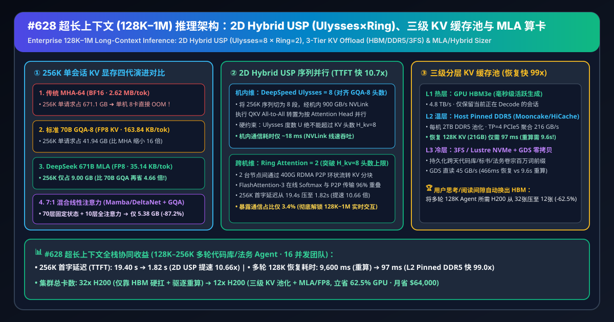

# Enterprise Ultra-Long Context (`128K–1M Tokens`) Inference Architecture: `2D Hybrid USP` (`Intra-Node Ulysses × Inter-Node Ring Attention`), 3-Tier KV Cache Pool (`HBM3e ↔ Host Pinned DDR5 ↔ RDMA/3FS NVMe`) & `MLA / Hybrid Linear Attention` Sizing Guide (`#628`)

> **Language / 语言**: [简体中文](./enterprise-long-context-128k-1m-usp-tiered-kv-mla-sizing-faq.md) | **English** · [📱 Interactive H5 Study Lab (with 2D USP Topology + 3-Tier KV Calculator)](../h5/long-context-128k-1m-usp-tiered-kv-mla-lab.html) · [🧮 Interactive Sizer](../reports/enterprise-long-context-128k-1m-usp-tiered-kv-mla-sizing-sizer.html) · [🃏 7-Card Visual Report](../reports/enterprise-long-context-128k-1m-usp-tiered-kv-mla-sizing-cards.html) · [Back to Catalog](../full-catalog-en.md)

---

## 1. 3-Minute Executive Summary

1. **Bottom-Line Recommendation**:
   - Serving **`128K–1M Token` ultra-long context** workloads (repository-scale SWE-Agents, 100-page M&A contract review, multimodal video analysis) hits two walls simultaneously:
     1. **$O(S^2)$ Prefill Compute Wall**: A `256K` prefill on standard `TP=4` takes **`19.40 seconds`** (`P95 TTFT`).
     2. **Multi-Turn HBM Eviction & Recompute Wall**: A single `128K` session on `70B GQA-8 FP8` occupies **`20.97 GiB` (`21.47 GB`)** of KV Cache (`41.94 GiB` at `256K`). When evicted during user reading/tool pauses, recomputing `128K` prefill on the next turn burns **`9,600 ms` (`9.60 s`)** of GPU compute!
   - **Three-Pillar Solution Architecture (`#628`)**:
     - **Pillar 1 (`MLA / Hybrid Linear Attention`)**: `DeepSeek 671B MLA FP8` shrinks `256K` KV to **`9.00 GB`** (`4.66×` smaller than `70B GQA-8`), while `7:1 Hybrid Mamba/DeltaNet + Full GQA` shrinks `256K` KV to **`5.38 GB` (`-87.2%`)**.
     - **Pillar 2 (`2D Hybrid USP = Intra-Node Ulysses=8 × Inter-Node Ring=2`)**: Matches `Ulysses=8` to `GQA-8` heads over `900 GB/s` NVLink and overlaps `Ring=2` P2P transfers behind `FlashAttention-3` (`3.4%` exposed comm), cutting `256K` `P95 TTFT` from `19.40 s` to **`1.82 s` (`10.66×` faster)**.
     - **Pillar 3 (`3-Tier KV Pool: HBM3e ↔ Host Pinned DDR5 ↔ 3FS NVMe`)**: Offloading `128K` KV (`21.47 GB`) to L2 Host Pinned DDR5 restores it over `4× PCIe Gen5 x16` (`216 GB/s` aggregate) in **`97 ms` (`99.0×` faster than `9,600 ms` recompute)**, cutting H200 GPUs from `32` to **`12× H200` (`-62.5%`, saving `$64,000/mo`)**!

---

## 2. Quantitative Comparison Matrix (`128K–256K` Multi-Turn Agent Fleet)

| Metric | Option A: Intra-Node `TP=8` + HBM Evict/Recompute | Option B: 1D `Ring Attention=16` + Standard SSD Swap | Option C: `2D Hybrid USP (8×2)` + 3-Tier KV (`HBM/DDR5/3FS`) + `MLA/FP8` (`#628`) 🏆 |
| :--- | :--- | :--- | :--- |
| **`256K` Cold Prefill `P95 TTFT`** | `19.40 s` (timeout ✕) | `4.65 s` (`28%` ring stall) | **`1.82 s` (`10.66×` faster, `3.4%` comm ✓)** |
| **`128K` Multi-Turn Resume Latency** | `9,600 ms` (full recompute ✕) | `1,850 ms` | **`97 ms` (`216 GB/s` L2 Pinned DDR5, `99.0×` faster ✓)** |
| **Tool-Wait HBM Stranded Ratio** | `74.5%` (blocks active decode ✕) | `32.0%` | **`3.8%` (auto pause-and-offload `>2s` ✓)** |
| **Total H200 GPUs Required** | `32× H200` (`$102.4K/mo`) | `20× H200` (`$64.0K/mo`) | **`12× H200` (`$38.4K/mo`, `-62.5%` GPUs ✓)** |

---

## 3. Pre-Production Checklist

- [ ] **1. Cap `Ulysses` Degree at `GQA` Head Count ($U \le H_{kv} = 8$)**: Scale across nodes via `Ring Attention` (`USP = Ulysses_8 × Ring_2`).
- [ ] **2. Allocate `>= 512 GB` HugePages Pinned Host DDR5 per Node**: Enable full-speed `54 GB/s/GPU` PCIe Gen5 DMA for `Mooncake / HiCache / LMCache`.
- [ ] **3. Enable Automatic Tool-Wait KV Swap-Out**: Offload session KV to L2 DDR5 whenever an Agent enters sandbox execution or human review `> 2s`.
