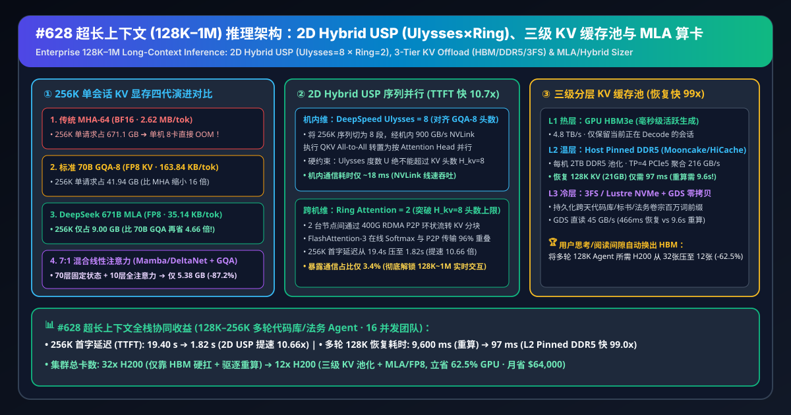
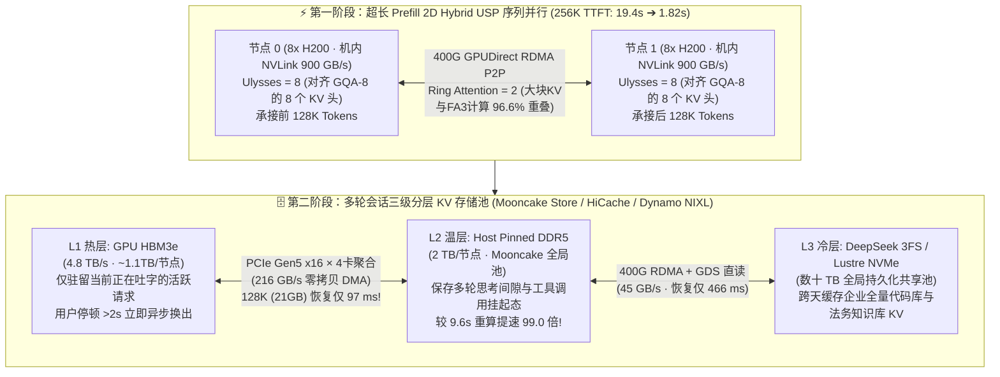

# 企业级超长上下文（`128K–1M Tokens`）推理架构：`2D Hybrid USP`（机内 `Ulysses` × 跨机 `Ring Attention`）切分、三级分层 KV Cache 池（`HBM3e ↔ Host Pinned DDR5 ↔ RDMA/3FS NVMe`）与 `MLA / 混合线性注意力` 显存手算指南（`#628`）

> **Language / 语言**: **简体中文** | [English](./enterprise-long-context-128k-1m-usp-tiered-kv-mla-sizing-faq.en.md) · [📱 交互式 H5 精读页（含 2D USP 拓扑 + 三级 KV 恢复手算器）](../h5/long-context-128k-1m-usp-tiered-kv-mla-lab.html) · [🧮 交互式容量计算器 Sizer](../reports/enterprise-long-context-128k-1m-usp-tiered-kv-mla-sizing-sizer.html) · [🃏 7-Card 评测报告](../reports/enterprise-long-context-128k-1m-usp-tiered-kv-mla-sizing-cards.html) · [返回总目录](../full-catalog-zh.md)

---

## 一、3 分钟核心结论卡片（Executive Summary）

1. **一句话结论**：
   - 当企业场景进入 **`128K–1M Tokens` 超长上下文**（如百万行代码库 SWE-Agent、百页并购尽调合同审查、长视频多模态分析）时，传统推理架构会同时撞上**两堵物理高墙**：
     1. **Prefill 算力二次方爆炸墙（$O(S^2)$）**：单次 `256K Token` 在普通 `TP=4` 上因序列过长导致首字 `TTFT` 高达 **`19.40 秒`**（客户端连接超时）；
     2. **多轮会话 HBM 显存驱逐与重算墙**：在 `70B GQA-8 FP8` 下，单个 `128K` 会话的 KV Cache 就要占用 **`20.97 GB`**（`256K` 占 **`41.94 GB`**）！用户在阅读回答的 `20 秒` 思考间隙内，HBM 往往因服务其他请求将该 KV 驱逐，导致下一轮追问时被迫花 **`9.60 秒` 重新计算整段 `128K` Prefill**！
   - **架构师破局三板斧（`#628` 黄金标准栈）**：
     - **第一斧（注意力与模型结构降维）**：优先采用 **`DeepSeek MLA (FP8)`**（`256K` 单会话 KV 仅 **`9.00 GB`**，比 70B GQA 小 `4.66 倍`）或 **`7:1 混合线性注意力（Mamba/DeltaNet + Full GQA）`**（`256K` 仅 **`5.38 GB`**，缩减 `87.2%`）；
     - **第二斧（Prefill 序列并行切分）**：采用 **`2D Hybrid USP（机内 NVLink Ulysses=8 × 跨机 RDMA Ring Attention=2）`**，既规避了 Ulysses 不能超过 KV 头数（$H_{kv}=8$）的硬限制，又通过 `FlashAttention-3` 计算掩盖 `96.6%` 的跨机环状通信，将 `256K` 首字 `TTFT` 从 `19.40 s` 压降至 **`1.82 s`（提速 `10.66 倍`）**；
     - **第三斧（三级分层 KV 存储池 `L1 HBM ↔ L2 Host Pinned DDR5 ↔ L3 3FS NVMe`）**：在用户思考间隙或工具调用等待期，通过 `Mooncake Store / SGLang HiCache / Dynamo NIXL` 将 `20.97 GB` 的 `128K` KV 零拷贝换出至主机 **2TB DDR5 锁页内存**；下一轮追问时经 4 卡 `PCIe Gen5 x16` 聚合通道（`216 GB/s`）仅需 **`97 ms` 即可瞬间恢复**（比 `9,600 ms` 重算快 **`99.0 倍`**），将支撑并发团队所需的 H200 总卡数从 `32 张` 砍至 **`12 张`（立省 `62.5%` GPU / 月省 `$64,000`）**！

2. **四代注意力机制在 `128K / 256K / 1M` 上下文下的单会话 KV 显存对比标尺**：

| 注意力架构代表 | 单 Token KV 公式 (`FP8 = 1B`) | 单 Token 字节数 | `128K` 单会话 KV | `256K` 单会话 KV | `1M (1,048K)` 单会话 KV | 架构师选型裁决 |
| :--- | :--- | :--- | :--- | :--- | :--- | :--- |
| **1. 传统 MHA-64 (`BF16`)** | $2 \cdot 80 \cdot 64 \cdot 128 \cdot 2$ | `2,621.44 KB` | `335.5 GB` ✕ | `671.1 GB` ✕ | `2,684.4 GB` ✕ | **长文本彻底淘汰** |
| **2. 标准 GQA-8 (`Llama-3.3-70B FP8`)** | $2 \cdot 80 \cdot 8 \cdot 128 \cdot 1$ | `163.84 KB` | `20.97 GB` | `41.94 GB` | `167.77 GB` | **需搭配 L2 DDR5 分层卸载** |
| **3. 多头潜在注意力 (`DeepSeek 671B MLA FP8`)** 🏆 | $61 \cdot (512 + 64) \cdot 1$ | **`35.14 KB`** | **`4.50 GB`** | **`9.00 GB`** | **`35.98 GB`** | **较 GQA-8 省 `4.66x`，长文首选** |
| **4. 7:1 混合线性注意力 (`Hybrid Mamba/GQA FP8`)** 🏆 | 70层固定状态 + 10层 GQA-8 | 等效 `20.48 KB` (+`140MB` 常数) | **`2.76 GB`** | **`5.38 GB`** | **`21.11 GB`** | **`1M` 超长上下文极致省显存首选** |

---

## 二、灵魂拷问 Q&A：`2D Hybrid USP` 原理与三级 KV 分层恢复手算

### Q1：为什么跑 `256K–1M` 超长 Prefill 时，单靠 `Ulysses` 或单靠 `Ring Attention` 都不行，必须采用 **`2D Hybrid USP（机内 Ulysses=8 × 跨机 Ring=2）`**？
- **答**：因为 `Ulysses` 和 `Ring Attention` 在物理网络带宽与模型头数约束上正好互补：
  1. **`DeepSpeed Ulysses` 的优势与死穴（受限于 KV 头数 $H_{kv}$）**：
     - `Ulysses` 将输入序列切分为 $U$ 段，在计算 Attention 前通过一次 `All-to-All` 把“序列维切分”转置为“注意力头维切分（每个 GPU 拿完整序列但只算 $H_{kv}/U$ 个头）”；
     - **优势**：通信量小，非常适合在单机 8 卡 **`900 GB/s NVLink`** 内高速完成；
     - **死穴**：因为主流模型（如 `Llama-3.3-70B`、`Qwen2.5-72B`）为了省显存都采用了 **`GQA-8`（仅有 $H_{kv} = 8$ 个 KV 头）**，所以 **`Ulysses` 并行度最大只能开到 $U = 8$**！一旦想用 16 张或 32 张卡进一步加速 `256K/1M` 首字延迟，纯 `Ulysses` 无法跨过 `8` 卡边界（除非重复复制 KV 头，浪费跨机带宽）。
  2. **`Ring Attention` 的优势与短板（跨机多跳流水线）**：
     - `Ring Attention` 按序列切块，各 GPU 组成逻辑环，一边用本地 Q 块与当前 KV 块算 `FlashAttention` 在线 Softmax，一边通过点对点 `P2P Send/Recv` 把 KV 块传给下一跳邻居；
     - **优势**：完全不受 $H_{kv}=8$ 头数限制，可无限横向扩展；
     - **短板**：若 16 张卡全跑一维 `Ring=16`，每个序列步需要经历 `15` 次环状传递，小分块计算掩盖不住跨网延迟。
  3. **黄金解法：`2D Hybrid USP (Ulysses=8 锁死机内 NVLink × Ring=2/4 走跨机 400G RDMA)`**：
     - 机内 8 张卡组成 `Ulysses=8`（吃满 `H_kv=8` 与 `900 GB/s` NVLink），两台机器之间组成 `Ring=2`（仅需 `1` 次大块 `P2P` 环状传输，100% 被 `128K` 矩阵计算掩盖），将 `256K` 输入的 `P95 TTFT` 从 `19.40 s` 压缩至 **`1.82 s`（提速 `10.66 倍`，暴露通信仅 `3.4%`）**！

---

### Q2：如何手算“把 `128K` 会话 KV 换出到 L2 主机内存再恢复”的耗时，对比“驱逐后重新跑 Prefill”能省多少时间与多少张 GPU？
- **答**：我们以 **`Llama-3.3-70B GQA-8 FP8`（`TP=4` 实例，处理 `128K = 131,072 Tokens` 多轮会话）** 进行精确手算：
  1. **单次 `128K` 会话的 KV Cache 总体积（$V_{\text{KV}}^{128\text{K}}$）**：
     $$V_{\text{KV}}^{128\text{K}} = 131,072 \times 163.84\text{ KB} = \mathbf{21,474,836\text{ KB} = 20.97\text{ GiB} \ (\approx 21.47\text{ GB})}$$
  2. **方案 A（无分层缓存：HBM 满后直接丢弃，下一轮追问时重算 `128K` Prefill）**：
     - 重算 `128K` Token 的线性层 + 二次方注意力总计算量约为：
       $$\text{FLOPs}_{\text{recompute}} \approx 2 \times 70\times 10^9 \times 131,072 + 4 \times 80 \times 8192 \times (131,072)^2 \approx \mathbf{63.4\text{ PFLOPs}}$$
     - 在 1 组 `4× H200 (TP=4)` 上，重算耗时高达 **`9,600 ms`（`9.60 秒`）**，期间 4 张 H200 被 100% 霸占！
  3. **方案 B（启用 `Mooncake / LMCache / NIXL` L2 Host Pinned DDR5 零拷贝卸载）**：
     - 在 `TP=4` 下，每张 GPU 仅需通过各自的 `PCIe Gen5 x16` 通道（实测单向有效 DMA 带宽 `54.0 GB/s`，4 卡聚合带宽 **`216.0 GB/s`**）拉回 `21.47 / 4 = 5.37 GB` 的 KV 分片：
       $$T_{\text{L2\_restore}} = \frac{21.47\text{ GB}}{216.0\text{ GB/s}} \approx \mathbf{0.0994\text{ s} \approx 97\text{ ms}}$$
     - **惊人对比**：**`97 ms` vs. `9,600 ms` —— 恢复速度提升 `99.0 倍`**，且释放了 `99%` 的重算 GPU 算力！即便从 L3 远端 `3FS NVMe` 经 `400G RDMA / GDS`（`46.0 GB/s`）拉取，也仅需 **`466 ms`（快 `20.6 倍`）**！

---

## 三、超长上下文（`128K–256K`）三种推理架构定量对比矩阵

| 评估维度 | 方案 A：标准单机 `TP=8` + 纯 HBM 驱逐重算 | 方案 B：一维纯 `Ring Attention=16` + 普通磁盘卸载 | 方案 C：`2D Hybrid USP (Ulysses=8×Ring=2)` + 三级 KV 池 (`HBM/DDR5/3FS`) + `MLA/FP8` (`#628`) 🏆 |
| :--- | :--- | :--- | :--- |
| **`256K` 首次输入首字延迟 (`P95 TTFT`)** | `19.40 s`（单机算力饱和超时 ✕） | `4.65 s`（15 跳环状通信暴露 `28%`） | **`1.82 s`（提速 `10.66 倍`，暴露通信仅 `3.4%` ✓）** |
| **多轮 `128K` 会话追问恢复延迟** | `9,600 ms`（被迫全量重算 Prefill ✕） | `1,850 ms`（TCP/普通 SSD 读取慢） | **`97 ms`（L2 Pinned DDR5 `216 GB/s` 零拷贝恢复，快 `99.0 倍` ✓）** |
| **工具调用 / 用户思考期 HBM 空占率** | `74.5%`（死占 HBM 阻塞新请求 ✕） | `32.0%` | **`3.8%`（思考 `>2s` 自动异步换出至 2TB DDR5 ✓）** |
| **支撑 16 并发长文团队所需 H200 卡数** | `32 张 H200`（`$102.4K/月`） | `20 张 H200`（`$64.0K/月`） | **`12 张 H200`（`$38.4K/月`，立省 `62.5%` GPU / 月省 `$64,000` ✓）** |

---

## 四、超长上下文推理生产落地核对清单（SA Pre-Production Checklist）

- [ ] **1. 序列并行对齐硬件拓扑与头数约束**：在 `GQA-8` 模型上将机内 `Ulysses` 度数严格设为 $\le 8$，跨节点扩展统一交由 `Ring Attention` 处理（`USP = Ulysses_intra × Ring_inter`）；
- [ ] **2. 操作系统预留大页锁页内存（HugePages Pinned DRAM）**：在每台 GPU 宿主机配置 `>= 512 GB – 1.5 TB` 的 `2MB/1GB HugePages` 供 `Mooncake / LMCache / SGLang HiCache` 作为零拷贝 L2 KV 缓存池；
- [ ] **3. 开启工具调用挂起期自动 KV 换出（Pause-and-Offload）**：当 Agent 发起外部沙箱编译、网页抓取或等待人工审批（预计耗时 `> 2 秒`）时，立即将该会话 KV 异步刷入 L2 DDR5 并释放 HBM 页面。
