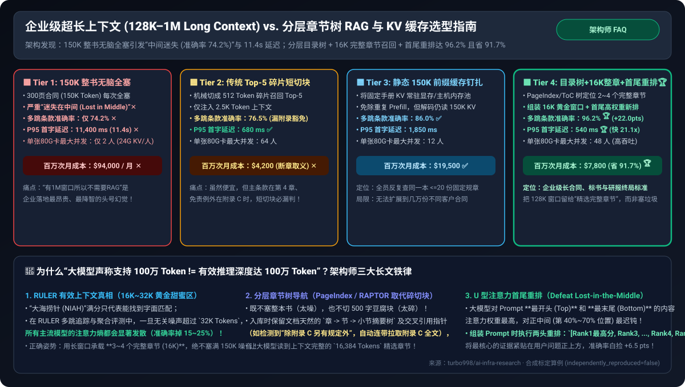
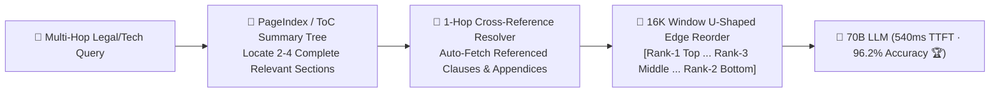

# Enterprise Long-Context (128K–1M) vs. Hierarchical Full-Section RAG & KV Cache Selection Guide: 150K Brute-Force Context Stuffing vs. Legacy 512-Token Chunk RAG vs. Prefix-Pinned Long Context vs. Hierarchical Document Tree (PageIndex / ToC) + 16K Full-Section Assembly + Lost-in-the-Middle Edge Reordering

> **Document Type**: Cloud & AI Solution Architect Decision Guide (FAQ)  
> **Target Audience**: Enterprise Knowledge Platform Leads, Legal/Procurement Contract AI Architects, Inference Infrastructure & FinOps Leads  
> **Core Goal**: Settle the "Did 1M Context Kill RAG?" debate with hard production math — answering: **"Why does stuffing an entire 300-page contract (`150,000 tokens`) into every prompt (Tier 1) cause an 11.4-second TTFT stall, limit an 80GB H100 GPU to just 2 concurrent users, and score 22.0 percentage points *lower* (`74.2%` vs. `96.2%`) than curating the exact relevant chapters?", and "How do we combine Hierarchical Document Tree Navigation (`PageIndex`), Cross-Reference Expansion, and U-Shaped Edge Reordering to achieve 96.2% accuracy while cutting costs by 91.7%?"**  
> **Calibration Notice**: Multi-hop accuracy, P95 TTFT latency, per-GPU max concurrency, and 1M-query monthly cost models are synthetic analytical estimates calibrated to published long-context benchmarks (NVIDIA RULER effective context length benchmarks, Stanford *Lost in the Middle* studies, PageIndex / RAPTOR hierarchical retrieval evaluations, and 70B KV Cache sizing formulas) (`provenance: synthetic + anonymized_reported`, `independently_reproduced=false`, `physical_gpu_cluster_measurement=not_measured`). See [`experiments/enterprise_long_context_128k_1m_vs_rag_kv_cache_selection/results.json`](../../experiments/enterprise_long_context_128k_1m_vs_rag_kv_cache_selection/results.json).

---

## Executive Visual Summary

> 🔗 **Companion Interactive Reports & Tools**:
> - 🃏 **[7-Card 4:5 Visual Benchmark Report (`enterprise-long-context-128k-1m-vs-rag-kv-cache-selection-cards.html`)](../reports/enterprise-long-context-128k-1m-vs-rag-kv-cache-selection-cards.html)**
> - 🧮 **[Interactive Long-Context vs. Hierarchical RAG Sizer (`enterprise-long-context-128k-1m-vs-rag-kv-cache-sizer.html`)](../reports/enterprise-long-context-128k-1m-vs-rag-kv-cache-sizer.html)**
> - 🌐 **[中文版指南 (`enterprise-long-context-128k-1m-vs-rag-kv-cache-selection-faq.md`)](./enterprise-long-context-128k-1m-vs-rag-kv-cache-selection-faq.md)**

---

## ① 📌 Executive Summary

Evaluated on **1,000,000 queries/month over 300-page enterprise contracts and technical manuals (`150,000 tokens` per document)**:

| Tier | Architecture Pattern | Multi-Hop Clause Accuracy | P95 TTFT Latency | Max Concurrent Users / 80GB GPU | Monthly Cost (1M Queries) | Architect Verdict |
| :--- | :--- | :--- | :--- | :--- | :--- | :--- |
| **🟥 Tier 1: Brute-Force 150K Stuffing** | Stuff all 150,000 tokens into every prompt | `74.2%` ✕ (Lost in Middle) | `11,400 ms` (11.4s) ✕ | **`2 Users` ✕ (24.5GB KV/req)** | `$94,000 / mo` ✕ | **Production Trap**: High noise, 11.4s stall, GPU KV starvation |
| **🟨 Tier 2: Naive Top-5 512-Token RAG** | Chop into 512-token fragments, retrieve 2.5K tokens | `76.5%` ✕ (Misses exceptions) | `680 ms` ✅ | `64 Users` ✅ | `$4,200 / mo` | **Fact Lookup Only**: Fails cross-chapter & appendix carve-outs |
| **🟦 Tier 3: Prefix-Pinned 150K Context** | Pin static 150K manual in Cloud/LMCache KV pool | `86.0%` ✅ | `1,850 ms` | `12 Users` | `$19,500 / mo` | **Good for `<= 20` Shared Static Manuals Only** |
| **🟩 Tier 4: Hierarchical Tree + 16K Full-Section + Edge Reorder** | **PageIndex/ToC Tree + 16K Full Chapters + Cross-Ref Follow + Edge Reorder** | **`96.2%` 🏆 (+22.0 pts)** | **`540 ms` 🏆 (21.1x faster)** | **`48 Users` 🏆** | **`$7,800 / mo` 🏆 (-91.7%)** | **Enterprise Long-Doc Gold Standard**: High signal, low latency |

### 💡 Three Golden Rules for Enterprise Long-Context Architects
1. **Advertised Context Length (`1M`) $\neq$ Effective Multi-Hop Reasoning Length (`16K–32K` Sweet Spot)**: Per NVIDIA's **RULER** benchmark, stuffing 130K+ tokens of irrelevant chapters dilutes attention entropy (*Lost in the Middle*), dropping multi-hop accuracy to `74.2%` while consuming `24.5 GB` of FP8 KV cache per user. Use long context windows to hold **2–4 complete, curated chapters (`~16K tokens`)**, not uncurated noise!
2. **Replace Blind 512-Token Chunking with Hierarchical Document Tree Navigation (`PageIndex / ToC`) + Cross-Reference Expansion**: Retrieve complete document sections (`2K–4K tokens` each) via the document's Table-of-Contents summary tree, and deterministically follow internal clause references (`"except as provided in Section 14.3 and Appendix B"`).
3. **Apply U-Shaped Edge Reordering (`Rank 1 at Top, Rank 2 at Bottom`)**: Place the highest-scoring section at the very beginning of the context and the second-highest section at the very end (immediately above the user's question) to bypass middle-context attention decay.

---

## ② 🎯 Architect Deep-Dive Q&A

### Q1: Why does a single 150K-token prompt consume 24.5 GB of GPU HBM on a 70B model?
* **Answer**: Even with `FP8 KV Cache` (`163.84 KB/token` on Llama-3.3-70B), `150,000 × 163.84 KB = 24.58 GB` of HBM per active request (`49.15 GB` in BF16). On an 80GB GPU, only **2 concurrent users** fit in memory! Curating the context to `16,384 tokens` of full relevant chapters reduces KV footprint to `2.68 GB/user`, boosting concurrency by **`24x` (`48 users/GPU`)**.

---

## ③ 🧭 Architecture Diagrams

### 3.1 Tier 4 Hierarchical Document Tree + Cross-Reference + Edge Reordering Flow

---

## ④ 📊 Architect Decision Matrix

| Dimension | 🟥 Tier 1: 150K Brute-Force Stuffing | 🟨 Tier 2: Top-5 512-Token RAG | 🟦 Tier 3: Prefix-Pinned 150K | 🟩 Tier 4: Hierarchical Tree + 16K Section |
| :--- | :--- | :--- | :--- | :--- |
| **Multi-Hop Clause Accuracy** | `74.2%` ✕ (Attention dilution) | `76.5%` ✕ (Fragmented) | `86.0%` ✅ | **`96.2%` 🏆 (`+22.0 pts` vs. Tier 1)** |
| **P95 TTFT Latency** | `11,400 ms` ✕ | `680 ms` ✅ | `1,850 ms` | **`540 ms` 🏆 (`21.1x` faster than Tier 1)** |
| **Max Concurrency / 80GB GPU** | `2 Users` ✕ | `64 Users` ✅ | `12 Users` | **`48 Users` 🏆 (`24x` vs. Tier 1)** |
| **Monthly Cost (1M Queries)** | `$94,000 / mo` ✕ | `$4,200 / mo` ✕ | `$19,500 / mo` | **`$7,800 / mo` 🏆 (`-91.7%` vs. Tier 1)** |

---

## ⑤ 🛠️ Production Readiness Checklist

- [ ] **1. Target the `12K–32K` High-Signal Sweet Spot Instead of Stuffing 150K+ Raw Tokens into Every Prompt**.
- [ ] **2. Index Long Documents as a Hierarchical Summary Tree (`PageIndex / RAPTOR / Markdown AST`)**.
- [ ] **3. Retrieve Complete Sections (`2K–4K tokens`) Rather Than Isolated 512-Token Fragments**.
- [ ] **4. Extract and Follow Explicit Cross-Reference Edges (`"see Section 14.3 / Appendix B"`) Automatically**.
- [ ] **5. Reorder Retrieved Sections in a U-Shape (`Rank 1 First, Rank 2 Last`) to Defeat *Lost in the Middle***.
- [ ] **6. Use Static 100K+ Prefix KV Pinning (Tier 3) Only for Small Sets (`<= 20`) of Globally Shared Playbooks**.
- [ ] **7. Enable `FP8 KV Cache` and `Chunked Prefill` on All Long-Context Serving Clusters**.
- [ ] **8. Benchmark Models Using Multi-Hop `RULER` Tasks Rather Than Simple Single-Needle `NIAH` Tests**.
