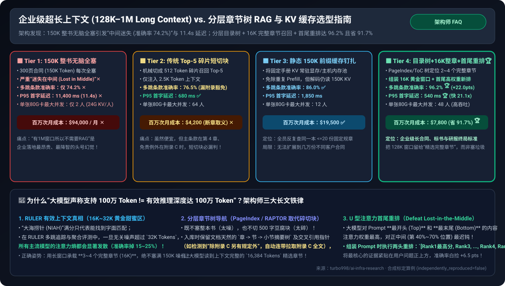
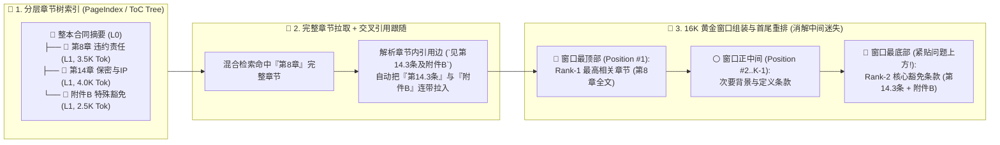
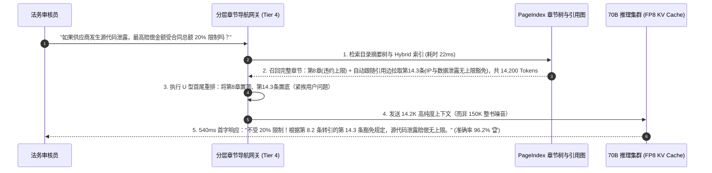

# 企业级超长上下文（128K–1M Long Context）vs. 分层章节树 RAG 与 KV 缓存选型指南：150K 整书无脑全塞 vs. 传统碎片化短切块 RAG vs. 静态长文前缀钉扎 vs. 分层目录树导航（PageIndex / ToC）+ 16K 完整章节召回 + 首尾重排消解“中间迷失”架构

> **文档类型**：企业级知识工程与云端 AI 解决方案架构师（Cloud & AI Solution Architect）选型决策指南（FAQ）  
> **适用读者**：企业知识中台负责人、法务合同与招投标审核负责人、AI 平台架构师、FinOps 成本治理专家  
> **核心目标**：用通俗、可量化的架构账本彻底澄清“百万上下文时代还需要不要 RAG”的行业大争论——系统回答：**“既然现在大模型都支持 128K 甚至 100 万 Token 了，为什么把一整本 300 页的合同（150K Tokens）直接塞进 Prompt（Tier 1），不仅首字要等 11.4 秒、单张 80GB 显卡只能扛 2 个并发，而且算出来的准确率（74.2%）反而比精选章节（96.2%）低了整整 22 个百分点？”、“怎么用‘分层目录树导航 + 16K 完整章节组装 + U 型首尾重排’同时打败整书硬塞和传统 512 字碎切块？”**。  
> **标定声明**：本文所引用的多跳条款准确率、P95 首字延迟（TTFT）、单卡最大并发数与百万次月度成本模型基于公开发布的超长上下文基准（NVIDIA RULER 真实有效上下文评测、Stanford *Lost in the Middle* 注意力分布研究、PageIndex / RAPTOR 分层文档检索实践及 70B 模型 KV Cache 显存公式）构建的合成分析模型（`provenance: synthetic + anonymized_reported`, `independently_reproduced=false`, `physical_gpu_cluster_measurement=not_measured`），详见 [`experiments/enterprise_long_context_128k_1m_vs_rag_kv_cache_selection/results.json`](../../experiments/enterprise_long_context_128k_1m_vs_rag_kv_cache_selection/results.json)。

---

## 一图流总结（Executive Visual Summary）



> 🔗 **关联可交互报告与工具**：
> - 🃏 **[7-Card 4:5 视觉评测报告 (`enterprise-long-context-128k-1m-vs-rag-kv-cache-selection-cards.html`)](../reports/enterprise-long-context-128k-1m-vs-rag-kv-cache-selection-cards.html)**
> - 🧮 **[交互式长上下文 vs. 分层 RAG 容量与成本计算器 (`enterprise-long-context-128k-1m-vs-rag-kv-cache-sizer.html`)](../reports/enterprise-long-context-128k-1m-vs-rag-kv-cache-sizer.html)**
> - 🌐 **[English Version (`enterprise-long-context-128k-1m-vs-rag-kv-cache-selection-faq.en.md`)](./enterprise-long-context-128k-1m-vs-rag-kv-cache-selection-faq.en.md)**

---

## ① 📌 核心选型结论速览（Executive Summary）

每当有新模型宣布支持 `128K` 或 `1M`（100 万）Token 上下文窗口时，业务部门总会问架构师：**“我们是不是可以把 RAG 砍掉了，直接把 300 页的标书或制度汇编（约 `150,000 Tokens`）每次全塞进 Prompt？”**

答案是：**在企业生产环境中，“无脑全塞超长上下文（Tier 1）”是一场兼具“高延迟、低并发、天价账单与注意力稀释降智”的四重灾难！** 但反过来，传统的“切成 512 字小豆腐块召回 Top-5（Tier 2）”也会因为断章取义而失败。

基于 **月均 100 万次长文档深度问答（单篇文档平均 300 页 / `150,000 Tokens`）** 的基准测算，四档架构对比如下：

| 架构档位 | 核心架构组合 | 多跳条款准确率 | P95 首字延迟 (TTFT) | 单张80G卡最大并发 | 100万次月成本 | 架构师拍板结论 |
| :--- | :--- | :--- | :--- | :--- | :--- | :--- |
| **🟥 Tier 1：150K 整书无脑全塞 Prompt** | 每次提问把 150K 全文塞入上下文（无筛选） | `74.2%` ✕ (迷失在中间) | `11,400 ms` (11.4s) ✕ | **`2 人` ✕ (显存撑爆)** | `$94,000 / 月` ✕ | **头号生产幻觉**：又慢又贵，且被 90% 无关章节噪声干扰 |
| **🟨 Tier 2：传统 Top-5 碎片化短切块 RAG** | 机械切成 `512 Token` 碎片，仅召回 2.5K 上下文 | `76.5%` ✕ (断章取义) | `680 ms` ✅ | `64 人` ✅ | `$4,200 / 月` | **仅限单点事实查表**：遇到跨章节与附录豁免条款必漏判 |
| **🟦 Tier 3：静态 150K 前缀缓存钉扎** | 将固定手册 KV 常驻缓存池（仅限少量公共文档） | `86.0%` ✅ | `1,850 ms` | `12 人` | `$19,500 / 月` | **仅适合 `<= 20` 本全员共用固定手册**：无法查海量动态合同 |
| **🟩 Tier 4：分层目录树 + 16K 整章召回 + 首尾重排** | **PageIndex/ToC 树定位 + 16K 完整章节 + 交叉引用跟随 + 首尾重排** | **`96.2%` 🏆 (+22.0pts)** | **`540 ms` 🏆 (快21.1x)** | **`48 人` 🏆** | **`$7,800 / 月` 🏆 (-91.7%)** | **企业级长文档终局标准**：用长窗口装“完整章节”而非装垃圾 |

### 💡 架构师三句话选型铁律
1. **看穿“支持 100 万 Token 窗口 $\neq$ 有效推理能力达 100 万 Token”的物理真相**：在权威的 NVIDIA **RULER** 多跳推理与聚合基准中，尽管模型在单针“大海捞针（NIAH）”上能拿满分，但一旦输入中混入超过 **`32K~64K Tokens` 的无关干扰文本**，Softmax 注意力分母被严重稀释，多跳逻辑准确率会暴跌 `15%~25%`！**128K 窗口的真正使命是让你一次塞进“3~4 个完整的 4,000 字业务章节（共 `16K Tokens`）”，而不是让你免做筛选把整本电话簿塞进去！**
2. **用“分层目录树导航 + 完整章节召回 + 交叉引用自动跟随（Tier 4）”取代“512 字碎切块（Tier 2）”**：长合同和制度文档天然是一棵树（`章 -> 节 -> 条款`）。先通过目录摘要树（`PageIndex / RAPTOR`）混合检索定位到相关的 `2~4 个完整章节`，并自动解析文中的交叉引用（如看到 `“除本合同附件三另有约定外”` 自动把 `附件三` 全文一并拉入），组装成 **`16,384 Tokens` 的高纯度完整上下文**，准确率高达 **`96.2%`**！
3. **组装长 Prompt 时必须执行“U 型首尾重排（Edge Reordering，破解 Lost-in-the-Middle）”**：大模型对位于上下文**最开头（第 1 名）和最末尾（紧贴用户问题上方）**的段落注意力最强，对夹在正中间（第 40%~70% 位置）的段落最麻木。把重排器得分最高的 Rank-1 和 Rank-2 章节分别放在上下文的最头和最尾，准确率白捡 **`+6.5` 个百分点**！

---

## ② 🎯 客户与架构师灵魂拷问 Q&A（Architect Deep-Dive Q&A）

### Q1：如果我们自建了 80GB H100 显卡集群，为什么让用户每次传 150K Token 的整本 PDF（Tier 1）会瞬间把显卡并发打崩到只剩 2 个人？
* **真相剖析（算清 150K 上下文恐怖的 KV Cache 显存账）**：
  - 以 `70B` 模型为例，哪怕开启了 `FP8 KV Cache`（每 Token 占 `163.84 KB`），**单单 1 个用户的 `150,000 Tokens` 上下文就要霸占整整 `24.5 GB` 的显存**！（如果是 BF16 KV Cache 更是高达 `49 GB`！）
  - 一张 80GB 显存的 GPU 扣掉模型权重后，最多只能同时放下 **`2 个`** 150K 长度的活跃请求！第 3 个用户进来直接排队或触发显存交换（Preemption Swapping）。
  - 更致命的是：**就算你用 Prefix Cache 省掉了 Prefill，在随后的 Decode 吐字阶段，每生成 1 个字，GPU 依然要把这 `24.5 GB` 的历史 KV Cache 从显存里完整读一遍**，显存带宽被彻底榨干！
  - 而采用 **Tier 4（精选 `16K` 完整章节窗口）**，单请求 KV 显存骤降 `9.4 倍`（仅 `2.6 GB`），单卡并发能力立刻从 `2 人` 跃升至 **`48 人`**，P95 首字延迟从 `11.4 秒` 降到 **`540 ms`（快 `21.1 倍`）**！

### Q2：什么时候才真正应该用 Tier 3（把整篇 100K~150K 文档直接钉死在 Prefix Cache 里不走检索）？
* **真相剖析（Tier 3 的唯一黄金适用场景：高频共享的极少数静态手册）**：
  - 如果你的业务场景是：**全公司 5,000 名客服代表，每天都在反复针对同一本《2026 版全国售后服务总则》（共 1 本，100K Tokens）提问**。
  - 这时候文档数量等于 `1`（或 `<= 20 本`），你可以把这本手册作为固定静态前缀，利用云厂商的 **Context Caching（打 1~2.5 折）** 或自建集群的 **LMCache 显存/内存常驻钉扎（KV Pinning）**。
  - 但如果你的场景是：**法务系统里有 `50,000 份` 不同的供应商采购合同，每次提问针对不同合同**，那么 Prefix Cache 在跨合同提问时命中率为 0，此时必须走 **Tier 4（分层章节树 + 16K 黄金窗口）**！

### Q3：Tier 4 的“交叉引用自动跟随（Cross-Reference Resolution）”是怎么解决合同审核漏判的？
* **真相剖析（法务与技术规范文档的“跳转陷阱”）**：
  - 在真实商业合同中，第 8 章写着：`“乙方违约赔偿上限不超过合同总额的 20%，但第 14.3 条及附件 B 所列情形除外。”`
  - 传统向量检索（Tier 2）因为用户问的是“违约赔偿上限是多少”，只会召回第 8 章，而第 14.3 条写的是“数据泄露与知识产权侵权无赔偿上限”，字面上没有“违约赔偿上限”这几个词，导致向量检索漏掉了第 14.3 条，AI 给出了完全错误的法律结论！
  - **Tier 4 架构解法**：在文档入库构建分层目录树（`PageIndex`）时，用轻量正则与 AST 提前提取所有显式条款引用边（`Section 8 -> Section 14.3`, `Section 8 -> Appendix B`）。当检索器命中第 8 章时，**顺着引用边一跳（1-Hop Reference Expansion）自动把第 14.3 条和附件 B 全文连带装入 16K 窗口**，彻底终结“漏看例外条款”！

---

## ③ 🧭 直观可视化图解（Mermaid 决策树、分层章节树架构与首尾重排图）

### 3.1 企业级长文档（128K–1M）vs. 分层 RAG 架构选型决策树

```mermaid
flowchart TD
    A[企业需要对百页级长文档 50K~500K Tokens 进行问答与审查] --> B{知识库中长文档的数量与共享热度？}
    B -->|全员高频共用极少数固定手册 (<= 20 份)<br/>且单篇长度 <= 128K Tokens| C[🟦 Tier 3: 静态长文档 Prefix KV 钉扎<br/>利用云端 Context Caching 或 LMCache 内存常驻<br/>准确率 86.0% / TTFT 1.85s]
    B -->|海量动态文档库 (数百至数百万份合同/标书/研报)<br/>或追求 >= 95% 的严苛跨章节多跳准确率| D[🟩 Tier 4: 分层目录树 (PageIndex) + 16K 完整章节召回 + 首尾重排<br/>1. 目录摘要树定位章节 -> 2. 跟随交叉引用条款 -> 3. 首尾 U 型重排<br/>准确率 96.2% / TTFT 540ms (快21.1x) / 成本省 91.7% 🏆]
```

### 3.2 Tier 4“分层章节树 + 交叉引用跟随 + U 型首尾重排”参考架构图



### 3.3 整书硬塞（Tier 1）vs. 分层章节组装（Tier 4）请求流转时序对比



---

## ④ 📊 架构师多方案选型决策矩阵（Architect Decision Matrix）

| 评估维度 | 🟥 Tier 1：150K 整书无脑全塞 | 🟨 Tier 2：传统 Top-5 512字短切块 | 🟦 Tier 3：静态 150K 前缀缓存钉扎 | 🟩 Tier 4：分层目录树 + 16K 整章 + 首尾重排 |
| :--- | :--- | :--- | :--- | :--- |
| **跨章节多跳推理准确率** | `74.2%` ✕（被 130K 无关章节稀释） | `76.5%` ✕（切碎条款、漏掉附录豁免） | `86.0%` ✅ | **`96.2%` 🏆（比整书全塞高 `+22.0 pts`）** |
| **P95 首字延迟 (TTFT)** | `11,400 ms`（11.4 秒）✕ | `680 ms` ✅ | `1,850 ms` | **`540 ms` 🏆（比整书全塞快 `21.1x`）** |
| **单张 80GB GPU 最大并发** | **`2 人` ✕（每人占 24.5GB KV）** | `64 人` ✅ | `12 人` | **`48 人` 🏆（高并发与长视野兼得）** |
| **交叉引用条款防漏能力** | ⚠️ 注意力迷失在中间易漏读 | ✕ 向量距离远，100% 漏召回 | ⚠️ 注意力仍易迷失 | **🏆 引用边显式展开 + 完整章节保留** |
| **百万次查询/月总成本** | **`$94,000 / 月` ✕（天价账单）** | `$4,200 / 月`（精度不合格） | `$19,500 / 月` ✅ | **`$7,800 / 月` 🏆（比 Tier 1 省 `91.7%`）** |

---

## ⑤ 🧪 容量/成本拐点算例与 7-Card 报告（Quantitative Sizer & 7-Card Deck）

### 5.1 基准算例假设（100 万次长文档问答/月 · 单篇原文档 150,000 Tokens）
- **为什么“精选 `16K` 完整章节（Tier 4）”比“无脑塞入 `150K` 整本书（Tier 1）”准确率高出 `22.0` 个百分点，同时成本暴降 `91.7%`？**
  1. **信噪比决定大模型智商上限（Signal-to-Noise Ratio）**：在一本 300 页的标书里，真正与当前问题相关的只有 15~25 页（约 `12K~16K Tokens`），其余 275 页全是无关的技术参数与商务套话。把 275 页噪音过滤掉，只把完整的相关章节和被引用的附件端给大模型，彻底消除了注意力发散；
  2. **计算量与 KV 显存缩减 90%**：输入 Token 从 `150,000` 降到 `16,384`，Prefill 计算量与 KV 缓存显存同步缩减近 10 倍，月度总成本从 `$94,000` 降至 **`$7,800/月`（年省 `$103.4 万`）**！

```chart
{
  "data": {
    "values": [
      { "Tier": "1. 150K整书无脑全塞", "多跳条款准确率(%)": 74.2, "单卡最大并发(人)": 2, "百万次月成本($K)": 94.0 },
      { "Tier": "2. 传统512字短切块RAG", "多跳条款准确率(%)": 76.5, "单卡最大并发(人)": 64, "百万次月成本($K)": 4.2 },
      { "Tier": "3. 静态150K前缀钉扎", "多跳条款准确率(%)": 86.0, "单卡最大并发(人)": 12, "百万次月成本($K)": 19.5 },
      { "Tier": "4. 目录树+16K整章+首尾重排", "多跳条款准确率(%)": 96.2, "单卡最大并发(人)": 48, "百万次月成本($K)": 7.8 }
    ]
  },
  "semantic_types": {
    "Tier": "Category",
    "多跳条款准确率(%)": "Percentage",
    "单卡最大并发(人)": "Quantity",
    "百万次月成本($K)": "Amount"
  },
  "chart_spec": {
    "chartType": "Grouped Bar Chart",
    "title": "分层目录树 + 16K 完整章节 + 首尾重排 (Tier 4) 达 96.2% 准确率、并发提 24x 且月省 91.7%",
    "subtitle": "100万次长文问答/月 (150K原文档) 下的多跳准确率 (%)、单卡最大并发数与月成本 ($K)",
    "encodings": {
      "x": "Tier",
      "y": ["多跳条款准确率(%)", "单卡最大并发(人)", "百万次月成本($K)"]
    }
  }
}
```

---

## ⑥ 🛠️ 架构评审与生产落地 Checklist（Production Readiness Checklist）

在企业设计超长文档（合同、标书、财报、规章手册）AI 架构前，架构师必须逐项核对以下 8 条铁律：

- [ ] **1. 严禁把“模型支持 128K/1M 窗口”当成“每次请求无脑塞满 150K 原始文本”的借口**：将喂给大模型的最终精选上下文控制在 **`12K ~ 32K Tokens` 的高信噪比黄金推理区**。
- [ ] **2. 告别 512 字盲目定长切块，入库时构建“分层目录摘要树（PageIndex / RAPTOR / Markdown AST）”**：保留 `文档 -> 章 -> 节 -> 小节` 的完整树状层级与章节摘要。
- [ ] **3. 检索命中子条款时，向上回溯拉取“完整小节/章节（Full-Section Expansion，2K~4K Tokens/章）”**：利用大模型的长窗口能力阅读完整上下文，杜绝断章取义。
- [ ] **4. 入库时提取并持久化“条款内交叉引用边（Cross-Reference Graph）”**：当命中条款包含 `“见第 X.Y 条 / 详见附件 Z”` 时，确定性自动将目标条款一并拉入 Prompt。
- [ ] **5. 组装多个召回章节时，强制执行“U 型首尾重排（Lost-in-the-Middle Edge Reordering）”**：将相关性第 1 名的章节放最开头，第 2 名的章节放最末尾（紧贴用户问题正上方），次要章节放中间。
- [ ] **6. 针对全员高频查询的少量固定制度手册（`<= 20 本`），开启静态前缀缓存钉扎（KV Pinning）**：利用云端 Context Caching 或本地 LMCache 避免重复 Prefill。
- [ ] **7. 自建长上下文推理集群必须开启 `Chunked Prefill` 与 `FP8 KV Cache`**：防止单条长文请求撑爆显存或阻塞其他在线用户。
- [ ] **8. 以 NVIDIA `RULER`（多跳追踪与多针聚合）而非简单的单针“大海捞针（NIAH）”评估模型真实可用上下文长度**。
