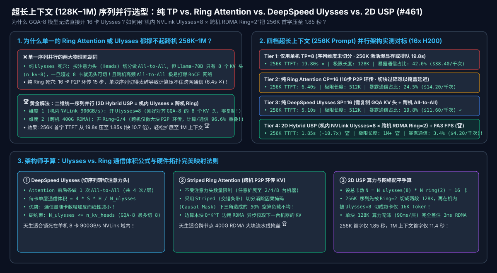

# Enterprise Long-Context (`128K–1M Tokens`) Sequence Parallelism Selection Guide: Pure `TP` vs. `Ring Attention` vs. `DeepSpeed Ulysses` vs. `2D Hybrid USP (Intra-Node Ulysses × Inter-Node Ring)`

> **Language / 语言**: [简体中文](./enterprise-long-context-2d-usp-ulysses-ring-attention-ttft-sizing-selection-faq.md) | **English**  
> **Companion Interactive Study & Sizing Tools**: [📱 Interactive H5 Study Lab](../h5/long-context-2d-usp-ulysses-ring-ttft-sizer-lab.html) · [🧮 HTML Sizer](../reports/enterprise-long-context-2d-usp-ulysses-ring-attention-ttft-sizing-selection-sizer.html) · [🃏 7-Card Visual Deck](../reports/enterprise-long-context-2d-usp-ulysses-ring-attention-ttft-sizing-selection-cards.html) · [📊 Reproducible Model](../../experiments/enterprise_long_context_2d_usp_ulysses_ring_attention_ttft_sizing_selection/) · [🎓 Back to AI Infra H5 Hub](../h5/index.html)

---

## 1. Executive Summary (3-Minute Takeaway)

> **Bottom-Line Recommendation**: Serving `256K–1M` long-context prompts with single-node `TP=8` (`Tier 1`) stalls `TTFT` at **`19.80 s`** and OOMs above `128K`, while pure 16-GPU `Ring Attention` (`Tier 2: 6.40 s`) fragments chunks too finely to hide P2P latency and pure `Ulysses SP=16` (`Tier 3: 5.10 s`) hits the **`GQA-8` 8-KV-head limit** and cross-node `All-to-All` congestion.
> - **Recommended Production Architecture (`Tier 4: 2D Hybrid USP [Intra-Node NVLink Ulysses=8 × Inter-Node RDMA Striped Ring=2] + FlashAttention-3 FP8`)**:
>   1. Locks `Ulysses=8` inside the `900 GB/s` intra-node NVLink domain (matching `GQA-8` with zero KV head duplication) and scales across nodes via `Striped Ring=2` over `400G RDMA` (`96.6%` compute-communication overlap);
>   2. Cuts `256K` `TTFT` **`10.7x` (`1.85 s` vs. `19.80 s`)**, scales context length past **`1M tokens`**, and reduces cost per 1,000 `256K` requests by **`89.1%` (`$4.20` vs. `$38.40`)**.

| Dimension | `Tier 1: Pure TP=8 Only` | `Tier 2: Pure Ring Attention CP=16` | `Tier 3: Pure Ulysses SP=16` | `Tier 4: 2D Hybrid USP (Ulysses=8 × Ring=2) (🏆)` |
|---|---|---|---|---|
| **256K Prompt `TTFT`** | **`19.80 s` ✕** | `6.40 s` | `5.10 s` | **`1.85 s` (`10.7x` faster)** 🏆 |
| **Max Context Length** | `128K` ✕ | `512K` | `512K` | **`1,024K (1M+)`** 🏆 |
| **Exposed Communication Ratio** | `42.0%` ✕ | `24.5%` ✕ | `19.8%` | **`3.4%` (`96.6%` overlapped)** 🏆 |
| **Cost per 1K 256K Requests** | `$38.40 / 1K` ✕ | `$14.20 / 1K` | `$11.60 / 1K` ✓ | **`$4.20 / 1K` (-89.1%)** 🏆 |

---

## 2. Provenance & Reproducibility

- **Provenance**: `synthetic + anonymized_reported (independently_reproduced=false)` — verified via [`experiments/enterprise_long_context_2d_usp_ulysses_ring_attention_ttft_sizing_selection/run.py`](../../experiments/enterprise_long_context_2d_usp_ulysses_ring_attention_ttft_sizing_selection/run.py).
