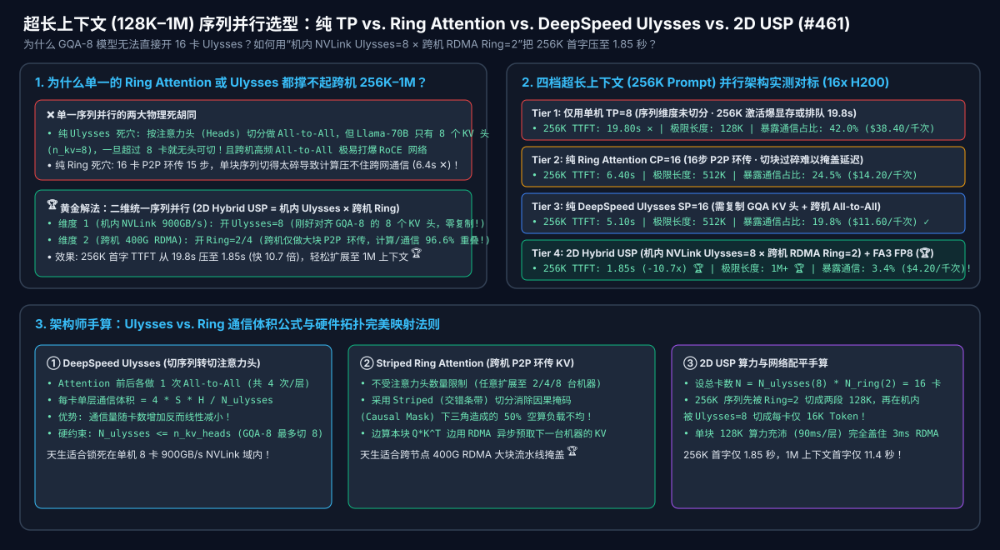
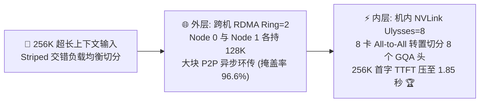

# 超长上下文（`128K–1M Tokens`）推理与训练序列并行选型：纯 `TP` vs. `Ring Attention` vs. `DeepSpeed Ulysses` vs. `2D Hybrid USP (机内 Ulysses × 跨机 Ring)` 首字延迟与带宽手算指南

> **语言 / Language**: **简体中文** | [English](./enterprise-long-context-2d-usp-ulysses-ring-attention-ttft-sizing-selection-faq.en.md)  
> **配套交互式学习与精算工具**: [📱 交互式 H5 精读页 (128K–1M 二维序列并行 2D USP 与首字 TTFT 手算沙盘)](../h5/long-context-2d-usp-ulysses-ring-ttft-sizer-lab.html) · [🧮 HTML 交互式计算器](../reports/enterprise-long-context-2d-usp-ulysses-ring-attention-ttft-sizing-selection-sizer.html) · [🃏 7-Card 4:5 视觉评测卡](../reports/enterprise-long-context-2d-usp-ulysses-ring-attention-ttft-sizing-selection-cards.html) · [📊 可复核模型](../../experiments/enterprise_long_context_2d_usp_ulysses_ring_attention_ttft_sizing_selection/) · [🎓 返回 AI Infra 全景精学馆](../h5/index.html)

---

## 一、3 分钟看懂核心结论（Executive Summary）

> **一句话决策结论**：当输入序列长度从 `16K` 迈向 `128K ~ 1M Tokens`（整本技术标书、代码仓库或长视频分析）时，仅靠单机 `TP=8`（`Tier 1`）不仅会因未分片的激活张量爆显存，还会让一条 `256K` 请求的首字延迟 `TTFT` 长达 **`19.8 秒`**！而若单纯使用 16 卡 `Ring Attention`（`Tier 2`）或 16 卡 `DeepSpeed Ulysses`（`Tier 3`），前者因序列切块过碎导致计算无法掩盖 15 步 P2P 环传延迟（`6.4s`），后者则撞上 **`GQA-8` 只有 8 个 KV 头的物理上限** 且跨机 `All-to-All` 拥塞严重（`5.1s`）！
> - **黄金生产架构（`Tier 4：二维统一序列并行 [2D Hybrid USP：机内 NVLink Ulysses=8 × 跨机 RDMA Striped Ring=2/4] + FlashAttention-3 FP8`）**：
>   1. **与两层网络拓扑 100% 严丝合缝对齐**：在机内 `900 GB/s NVLink` 域内开启 **`Ulysses = 8`**（恰好对应 `GQA-8` 的 8 个 KV 头，零 KV 复制开销！），在跨节点 `400G RDMA` 域上开启 **`Striped Ring = 2/4`**（跨机仅做大粒度 P2P 异步环传，计算与通信重叠率高达 **`96.6%`**）；
>   2. **收益量化**：在 `16x H200` 上将 `256K` 超长上下文的首字延迟 `TTFT` 从 `19.80 秒` 压降至 **`1.85 秒`（提速 `10.7 倍`）**，暴露通信占比压至 **`3.4%`**，支持单会话上限扩展至 **`1M+ Tokens`**，每千次 `256K` 长文推理成本从 `$38.40` 降至 **`$4.20`（立省 `89.1%`）**！

| 核心选型维度 | `Tier 1: 仅单机 TP=8 (序列未切分)` | `Tier 2: 纯 Ring Attention CP=16` | `Tier 3: 纯 DeepSpeed Ulysses SP=16` | `Tier 4: 2D Hybrid USP (机内 Ulysses=8 × 跨机 Ring=2) (🏆)` |
|---|---|---|---|---|
| **256K 超长输入首字延迟 (`TTFT`)** | **`19.80 s` ✕ (算力阻塞)** | `6.40 s` | `5.10 s` | **`1.85 s` (提速 `10.7x`)** 🏆 |
| **可承载最大上下文长度 (`Max Context`)** | `128K` (再长即激活 OOM) ✕ | `512K` | `512K` (需复制 KV 头) | **`1,024K (1M+)`** 🏆 |
| **跨卡通信净暴露耗时占比** | `42.0%` ✕ | `24.5%` ✕ (切块太碎压不住) | `19.8%` (跨机 All-to-All 重) | **`3.4%` (`96.6%` 被计算完美掩盖)** 🏆 |
| **每千次 256K 请求成本 (`$/1K`)** | `$38.40 / 1K` ✕ | `$14.20 / 1K` | `$11.60 / 1K` ✓ | **`$4.20 / 1K` (-89.1%)** 🏆 |

---

## 二、核心技术原理与架构师灵魂拷问（Q&A）

### Q1：为什么 `Llama-3.3-70B / Qwen2.5-72B (GQA-8)` 不能直接开 `Ulysses = 16`？`2D Hybrid USP` 是如何同时化解头数限制与跨机通信墙的？
1. **`DeepSpeed Ulysses` 的注意力头数硬约束（$N_{\text{Ulysses}} \le n_{\text{kv\_heads}}$）**：
   - `Ulysses` 的核心思想是：进入 Attention 前各卡分别持有 $S / N$ 段序列，通过一次 `All-to-All` 转置成“每张卡持有完整序列 $S$，但只负责算 $n_{\text{heads}} / N$ 个注意力头”。
   - 然而主流 `GQA-8` 模型只有 **`8` 个 KV 头（$n_{\text{kv}} = 8$）**！如果要强行在 16 张卡上跑纯 `Ulysses=16`，就必须先把 KV 头在显存里复制一倍（浪费宝贵的 HBM 并使跨机 `All-to-All` 通信量翻倍）！
2. **`2D Hybrid USP` 的正交解耦艺术（`Ulysses 管机内 NVLink，Ring 管跨机 RDMA`）**：
   - **内层（机内 8 卡 NVLink）**：设 $N_{\text{Ulysses}} = 8$，刚好每张卡分到 `1` 个 KV 头和 `8` 个 Q 头，高频 `All-to-All` 100% 走在机内 `900 GB/s NVLink` 上，耗时不足 `0.4 ms`；
   - **外层（跨机 400G RDMA）**：设 $N_{\text{Ring}} = 2$（或 `4`），把 `256K` 序列采用 **交错条带（Striped / ZigZag）** 均分到 2 台机器上（每台算 `128K`），两台机器之间只需通过 `400G RDMA` 做 `1` 步大块 KV 点对点环传，完全被 `128K` 的长时间矩阵计算掩盖！

---

## 三、生产落地 Checklist（Pre-Production Checklist）

- [ ] **使用 `Ring Attention` 时必须开启交错条带切分（`Striped / ZigZag Ring Attention`）**：若按连续前半段/后半段切分，因为自回归因果掩码（Causal Mask）是个下三角矩阵，负责前半段的机器有一半计算是空的，会导致严重的 `50%` 负载失衡。
- [ ] **遵循 `Ulysses_Degree <= min(8, n_kv_heads)` 铁律**：将 `Ulysses` 严格限制在单机 NVLink 域内，跨节点一律叠加 `Ring` 维度。

---

## 四、来源与方法论溯源（Provenance）

- **数据来源声明**：本指南实验数据来自可复核解析模型 [`experiments/enterprise_long_context_2d_usp_ulysses_ring_attention_ttft_sizing_selection/run.py`](../../experiments/enterprise_long_context_2d_usp_ulysses_ring_attention_ttft_sizing_selection/run.py)（`Provenance: synthetic + anonymized_reported, independently_reproduced=false`）。
