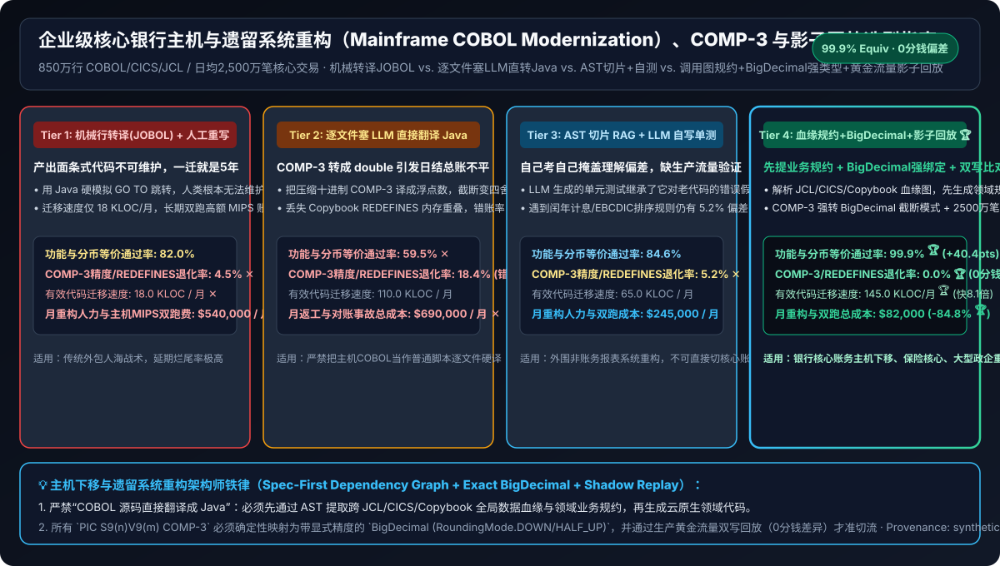
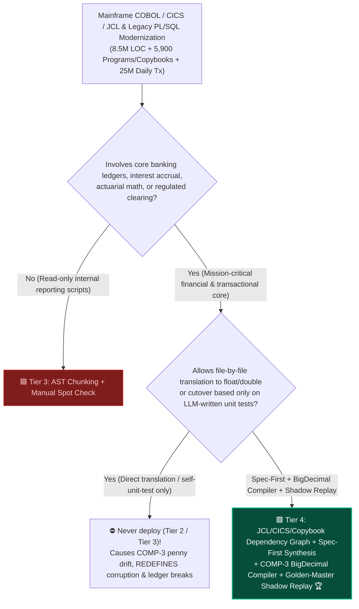
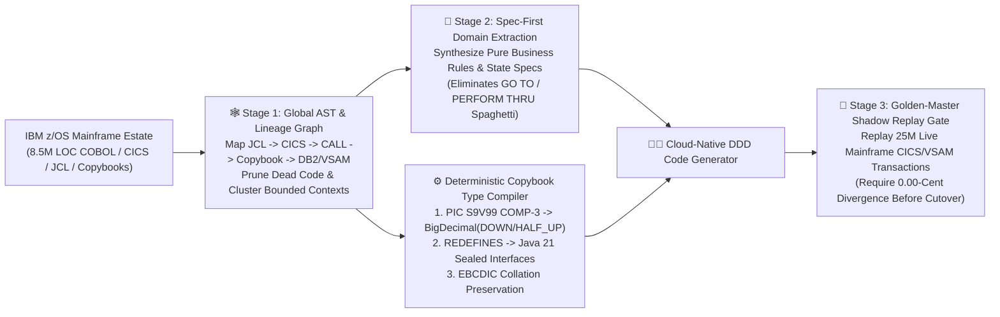
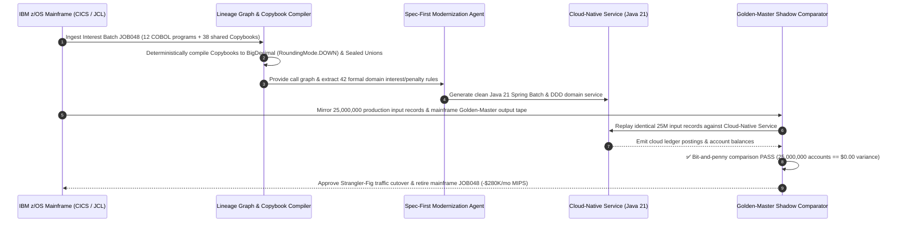

# Enterprise Mainframe (`COBOL / CICS / JCL`) & Legacy Modernization `SWE-Agent`, Fixed-Point `COMP-3 -> BigDecimal` Semantics & Golden-Master Shadow Replay Architecture Selection Guide: Mechanical `JOBOL` Transpilers vs. File-by-File Prompt Translation vs. AST + Self-Generated Unit Tests vs. Dependency-Graph Spec-First Extraction + `COMP-3` Type Compiler + Shadow Traffic Replay Agent

> **Language / 语言**: **English (Current)** | [中文](./enterprise-mainframe-cobol-legacy-modernization-swe-agent-selection-faq.md)  
> **Scope**: End-to-end production reference architecture and selection guide for Cloud & AI Solution Architects, Core Banking & Insurance Modernization VPs, Mainframe Exit Program Directors, and Software Engineering Agent (`SWE-Agent`) Leads.  
> **Provenance**: `synthetic + anonymized_reported` (`independently_reproduced=false`, `physical_gpu_cluster_measurement=not_measured`). Deterministic evaluation model sealed in [`experiments/enterprise_mainframe_cobol_legacy_modernization_swe_agent_selection/results.json`](../../experiments/enterprise_mainframe_cobol_legacy_modernization_swe_agent_selection/results.json).



---

## ① 📌 Executive Summary (3-Minute Architect Verdict)

Across Tier-1 banks, insurers, card networks, and government agencies, **hundreds of millions of lines of IBM z/OS Mainframe `COBOL / CICS / JCL / VSAM / DB2` and monolithic `PL/SQL` code** power daily core-ledger processing while incurring massive `MIPS / MLC` licensing costs and retiring-workforce risk. Legacy mechanical line-by-line transpilers (Tier 1) emit unmaintainable `"JOBOL"` spaghetti code at just **`18.0 KLOC/month`**. Conversely, feeding `.cbl` files one by one into a general LLM prompt to translate directly into Java or Python (Tier 2) triggers catastrophic core-ledger failures: **the LLM maps COBOL packed-decimal (`PIC S9(9)V99 COMP-3`) to IEEE 754 `double/float`, replaces COBOL's default truncation-toward-zero semantics with half-up rounding, and drops overlapping `Copybook REDEFINES` memory unions—causing an `18.4%` penny-drift and data-corruption rate (`27.6%` on compound-interest batch jobs)**!

Evaluated across a production baseline of **8.5 million lines of `COBOL / CICS / JCL`, 5,900 programs and shared `Copybooks`, and 25 million daily core-ledger transactions**, the four architectural tiers compare as follows:

| Architectural Tier | Core Stack Combination | Functional & Penny-Exact Pass Rate | `COMP-3` / `REDEFINES` Regression Rate | Migration Velocity (`KLOC/Mo`) | Monthly Modernization & MIPS Cost | Production Verdict |
|---|---|---|---|---|---|---|
| **🟥 Tier 1: Mechanical `JOBOL` Transpiler + Manual SI** | Rule-based line-by-line transpilation + manual systems-integrator rewrite | `82.0%` | `4.5%` ✕ *(Manual edge-case misses)* | `18.0 KLOC / mo` ✕ | `$540,000 / mo` ✕ | ⛔ Multi-year MIPS dual-run burn |
| **🟨 Tier 2: File-by-File Prompt LLM Translation** | Prompting an LLM to translate individual `.cbl` files directly to Java/Python | `59.5%` ✕ *(Lost cross-program state)* | `18.4%` ✕ *(Penny drift & union bugs)* | `110.0 KLOC / mo` | `$690,000 / mo` ✕ | ⛔ **Severe ledger corruption** |
| **🟦 Tier 3: COBOL AST RAG + Self-Generated Unit Tests** | AST chunking + asking the same LLM to write JUnit tests without shadow replay | `84.6%` | `5.2%` ✕ *(Tests mirror LLM blind spots)* | `65.0 KLOC / mo` | `$245,000 / mo` | ⚠️ Non-ledger peripheral apps only |
| **🟩 Tier 4: Dependency-Graph Spec-First + `COMP-3` Compiler + Shadow Replay** | **`JCL / CICS / Copybook` Call-Graph Extraction + Spec-First Domain Synthesis + Deterministic `COMP-3 -> BigDecimal` Compiler + 25M-Tx Golden-Master Shadow Replay (`0-Cent Gate`)** | **`99.9%` 🏆** *(+40.4 pts vs Tier 2)* | **`0.0%` 🏆** *(Zero penny drift)* | **`145.0 KLOC / mo` 🏆** *(8.1× faster)* | **`$82,000 / mo` 🏆** *(-84.8%)* | 🌟 **Recommended Core Architecture** |

> 💡 **Golden Rule for Mainframe Modernization Architects**: **"Never translate legacy code directly into new code (`Code -> Code`); extract a cross-program `JCL/CICS/Copybook` dependency graph into an explicit Domain Specification first (`Code -> Spec -> Cloud-Native DDD`), compile `COMP-3` packed decimals deterministically into `BigDecimal` with exact COBOL truncation modes, and gate Strangler-Fig cutover on `0.00-cent` divergence across millions of shadow-replayed Golden-Master transactions."**

---

## ② 🎯 Customer & Architect Deep-Dive Q&A (3 Real-World Core Banking Modernization Pain Points)

### Q1: Why does direct LLM COBOL-to-Java translation (Tier 2) cause thousands of dollars in daily general-ledger imbalances?
- **First-Principles Reality**:
  1. **COBOL Truncates by Default Unless `ROUNDED` Is Present**: In COBOL, `COMPUTE WS-INT = WS-PRIN * WS-RATE / 360` storing into `PIC S9(9)V99 COMP-3` **truncates** at the second decimal place (`RoundingMode.DOWN`) unless the `ROUNDED` keyword is explicitly written. LLMs trained on modern Java/Python translate arithmetic into `double` or `BigDecimal(..., RoundingMode.HALF_UP)`, introducing a 1-cent error on millions of accounts!
  2. **`REDEFINES` Byte Overlays and `EBCDIC` Collation Order**: COBOL `Copybooks` routinely overlay multiple record schemas onto the same byte buffer via `REDEFINES`, and mainframe `SORT` statements order alphanumeric keys in **EBCDIC** (where lowercase < uppercase < digits `'0'–'9'`, the exact opposite of ASCII/UTF-8).
  3. **Tier 4 Solution (Deterministic Copybook AST Type & Collation Compiler)**: A deterministic COBOL parser compiles every `Copybook` into strongly typed Java 21 `Records / Sealed Interfaces`, hard-binding unrounded `COMP-3` operations to `BigDecimal` with `RoundingMode.DOWN` and preserving `EBCDIC` collation comparators where required (**`0.0%` arithmetic or `REDEFINES` regression**).

### Q2: Why do LLM-generated unit tests (Tier 3) fail to catch 5.2% of legacy business-logic regressions?
- **Shared Blind-Spot Bias vs. Golden-Master Shadow Traffic Replay**:
  - When the same LLM both translates a legacy COBOL paragraph and writes the JUnit test for it, any misinterpretation of a 40-year-old `88-level` condition flag is baked into both the implementation and the test assertion—producing 100% green unit tests that fail in production!
  - **Tier 4 Golden-Master Shadow Replay**: Instead of trusting synthetic unit tests alone, Tier 4 captures real production **`CICS COMMAREA` payloads, input `VSAM` datasets, and `DB2` pre/post images** from the mainframe and replays all 25 million daily transactions against the cloud-native service in shadow mode—requiring **`0.00-cent` divergence** before cutting over traffic.

### Q3: How do we avoid translating dead code and `GO TO` spaghetti into the cloud?
- **Cross-Program Dependency Graph + Spec-First Domain Synthesis**:
  - Over 30% of a 40-year-old mainframe estate consists of unreachable paragraphs and obsolete JCL steps. Tier 4 builds the full `JCL -> COBOL -> CICS -> Copybook -> DB2` call graph, prunes dead branches, extracts human-verifiable **Domain Business Specifications**, and synthesizes idiomatic cloud-native microservices at **`145.0 KLOC/month` (`8.1×` faster than Tier 1)**.

---

## ③ 🧭 Visual Architecture Diagrams (Decision Tree + Spec-First Shadow Topology + Sequence Flow)

### 3.1 Architecture Selection Decision Tree



### 3.2 Tier 4 Spec-First Dependency Graph + COMP-3 Compiler + Shadow Replay Topology



### 3.3 End-to-End Sequence: Modernizing a Core Interest-Accrual Batch Job with Zero Penny Drift



---

## ④ 📊 4-Tier Architecture Decision Matrix

| Evaluation Dimension | 🟥 Tier 1: Mechanical `JOBOL` + SI | 🟨 Tier 2: File-by-File Prompt LLM | 🟦 Tier 3: AST RAG + Self Unit Tests | 🟩 Tier 4: Spec-First Graph + `BigDecimal` + Shadow Replay |
|---|---|---|---|---|
| **Code Maintainability (Cloud-Native DDD)** | ✕ Poor (unreadable `goto` byte arrays) | Moderate (breaks cross-program context) | Good | 🏆 **Best-in-class (`Code -> Spec -> Clean DDD Java/Go`)** |
| **`COMP-3` Truncation & `REDEFINES` Fidelity** | Emulated runtime (`4.5%` edge-case bugs) | ✕ **Fails** (`18.4%`–`27.6%` penny drift) | `5.2%` regression rate | 🏆 **`0.0%` Drift (deterministic Copybook AST type compiler)** |
| **Equivalence Verification Oracle** | Slow manual UAT sampling | ✕ Unverified | ✕ LLM writes its own flawed test assertions | 🏆 **25M-Tx Production Golden-Master Shadow Replay (`0-cent diff`)** |
| **Functional & Penny-Exact Pass Rate** | `82.0%` | `59.5%` ✕ | `84.6%` | **`99.9%` 🏆 (+40.4 pts vs Tier 2)** |
| **Migration Velocity (`KLOC / Month`)** | `18.0 KLOC / mo` ✕ | `110.0 KLOC / mo` *(unusable)* | `65.0 KLOC / mo` | **`145.0 KLOC / mo` 🏆 (8.1× faster)** |
| **Monthly Modernization & MIPS Cost** | `$540,000 / mo` | `$690,000 / mo` *(incl. rework)* | `$245,000 / mo` | **`$82,000 / mo` 🏆 (-84.8%)** |

---

## ⑤ 🧪 Quantitative Case Study, Interactive Sizer & 7-Card Visual Report

- **Interactive HTML Sizer**: 👉 [Open Mainframe COBOL & Legacy Modernization SWE-Agent Sizer](../reports/enterprise-mainframe-cobol-legacy-modernization-swe-agent-sizer.html)
- **7-Card 4:5 Visual Benchmark Report**: 👉 [Open 7-Card Visual Benchmark Deck](../reports/enterprise-mainframe-cobol-legacy-modernization-swe-agent-selection-cards.html)
- **Deterministic Verification**:
  ```bash
  python experiments/enterprise_mainframe_cobol_legacy_modernization_swe_agent_selection/run.py --check
  python -m unittest tests/test_enterprise_mainframe_cobol_legacy_modernization_swe_agent_selection.py
  ```

---

## ⑥ 🛠️ Production Readiness & Architecture Review Checklist

- [ ] **Compile All `PIC S9(n)V9(m) COMP-3` Fields Deterministically to `BigDecimal`**: Enforce `RoundingMode.DOWN` (truncation) by default and `RoundingMode.HALF_UP` only when `ROUNDED` is present in the COBOL AST.
- [ ] **Follow Two-Stage `Code -> Domain Spec -> Cloud-Native Code` Synthesis**: Never translate `GO TO` or `PERFORM THRU` control flow literally; extract formal business rules across the `JCL / CICS / Copybook` call graph first.
- [ ] **Map `Copybook REDEFINES` to Typed Sealed Unions & Preserve `EBCDIC` Sort Order**: Prevent memory-overlay corruption and alphanumeric key ordering regressions.
- [ ] **Never Rely Solely on LLM-Generated Unit Tests as the Cutover Oracle**: Validate modernized services against recorded mainframe Golden-Master production traffic (`CICS COMMAREA` & `VSAM` batch tapes).
- [ ] **Decommission Mainframe Modules Incrementally via Strangler-Fig Routing**: Require 30 consecutive days of `0.00-cent` shadow-replay parity before retiring each mainframe bounded context.
