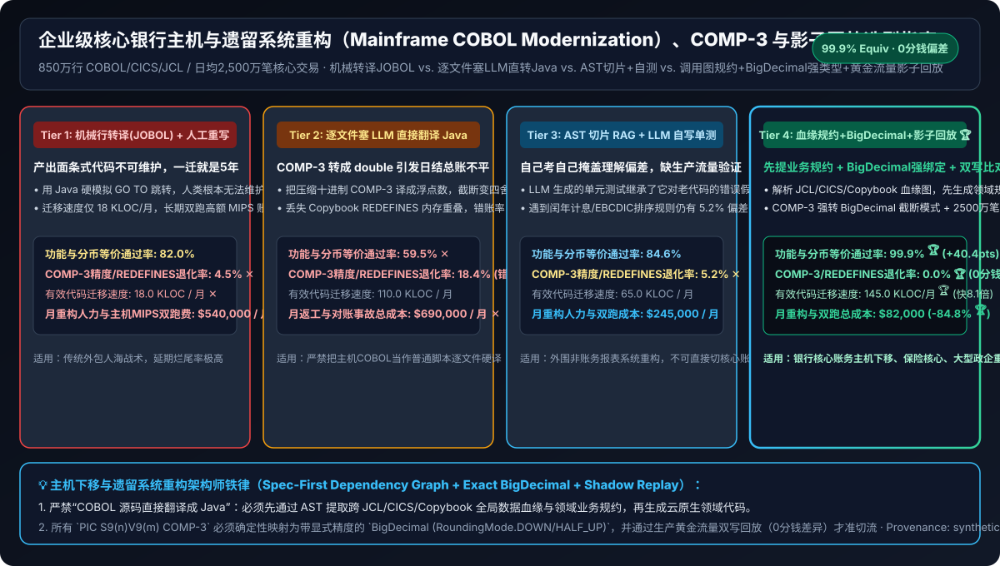
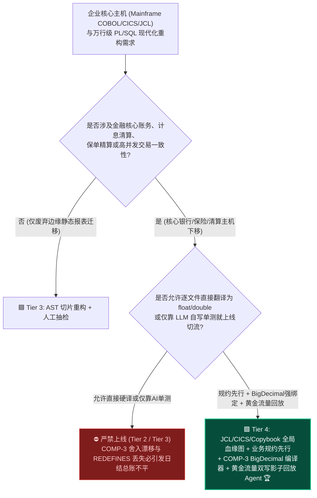
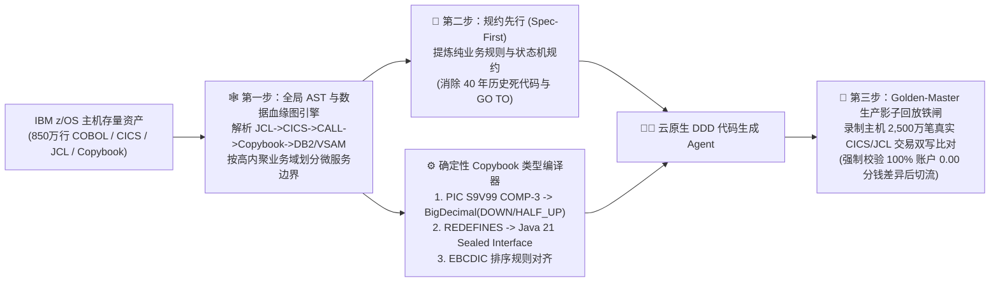
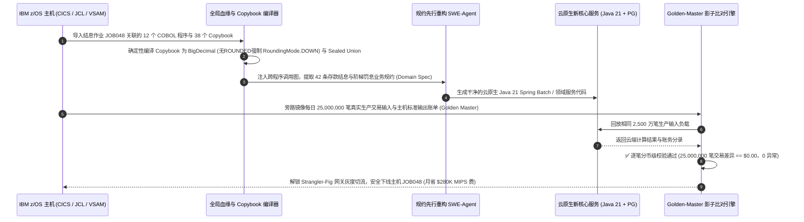

# 企业级核心银行主机与遗留系统现代化重构（Mainframe COBOL / CICS / JCL Modernization SWE-Agent）、不动点十进制算术（`COMP-3 -> BigDecimal`）与黄金交易双写影子回放（Golden-Master Shadow Replay）架构选型指南：机械转译 JOBOL vs. 逐文件塞 LLM 直接翻译 vs. AST 切片 + 自生成单测 vs. 全局血缘规约先行 + BigDecimal 强绑定 + 生产流量影子回放 Agent

> **语言 / Language**: **中文 (当前)** | [English](./enterprise-mainframe-cobol-legacy-modernization-swe-agent-selection-faq.en.md)  
> **定位**：面向云与 AI 解决方案架构师（Solution Architect）、银行/保险核心系统下移总架构师（Chief Core Banking Architect）、主机现代化（Mainframe Modernization）交付总监与软件工程智能体（SWE-Agent）负责人的生产落地指南。  
> **数据口径（Provenance）**：`synthetic + anonymized_reported`（`independently_reproduced=false`，`physical_gpu_cluster_measurement=not_measured`），全部定容模型封存于 [`experiments/enterprise_mainframe_cobol_legacy_modernization_swe_agent_selection/results.json`](../../experiments/enterprise_mainframe_cobol_legacy_modernization_swe_agent_selection/results.json)。



---

## ① 📌 核心选型结论速览（Executive Summary — 3 分钟看懂怎么选）

在全球银行业、保险业、信用卡清算中心与航空订座系统中，**IBM z/OS 大型机（Mainframe）上累计运行的数千亿行 `COBOL / CICS / JCL / VSAM / DB2` 遗留代码** 以及老旧万行级 Oracle `PL/SQL` 存储过程，正面临懂主机老专家退休断代与每年高达数千万美元的 `MIPS / MLC` 主机软件税双重挤压。过去依靠机械式行对行转译器（Tier 1）把 COBOL 硬转成充满 `goto` 状态模拟的“面条式 Java（戏称 `JOBOL`）”，不仅人类根本无法维护，且迁移速度仅有 **`18.0 KLOC/月`**。而当团队尝试把 COBOL 源文件逐个塞进大模型 Prompt 让它“直接翻译成现代 Java/Python”（Tier 2）时，在金融核心账务上引发了致命灾难：**大模型把 COBOL 特有的压缩十进制（`PIC S9(9)V99 COMP-3`）译成了 IEEE 754 浮点数 `double/float`，把 COBOL 默认向零截断语义搞成了四舍五入，并丢失了 `Copybook REDEFINES` 内存重叠共用体，导致高达 `18.4%` 的日结分币错账（日终总账不平）**！

在 **850 万行 `COBOL / CICS / JCL` 存量代码、5,900 个程序与共享 Copybook、日均 2,500 万笔核心账务交易** 的基准规模下，四档主机下移与遗留代码现代化 SWE-Agent 架构的量化对决如下：

| 方案档位 | 核心架构组合 | 功能与分币等价通过率 | `COMP-3` 精度 / `REDEFINES` 退化率 | 有效代码迁移速度 (`KLOC/月`) | 月度重构人力与主机 MIPS 双跑成本 | 生产推荐度 |
|---|---|---|---|---|---|---|
| **🟥 Tier 1：机械行转译 (`JOBOL`) + 人工重写** | 规则转译器生成反人类 JOBOL + 系统集成商（SI）人海战术手工重写 | `82.0%` | `4.5%` ✕ *(人工漏掉隐式规则)* | `18.0 KLOC / 月` ✕ | `$540,000 / 月` ✕ | ⛔ 烂尾率高，双跑 MIPS 烧钱 |
| **🟨 Tier 2：逐文件塞 LLM 直接翻译成 Java** | 把单个 `.cbl` 文件喂给大模型直接输出 Java/Python 类 | `59.5%` ✕ *(跨程序上下文丢失)* | `18.4%` ✕ *(日结计息分币错账)* | `110.0 KLOC / 月` | `$690,000 / 月` ✕ | ⛔ **严重错账事故，严禁用于核心** |
| **🟦 Tier 3：COBOL AST 切片 RAG + LLM 自写单测** | 语法树切片检索 + 让同一个 LLM 自动编写 JUnit 单元测试自证 | `84.6%` | `5.2%` ✕ *(单测继承了LLM误解)* | `65.0 KLOC / 月` | `$245,000 / 月` | ⚠️ 仅适合非账务外围系统 |
| **🟩 Tier 4：全局血缘规约先行 + BigDecimal 强绑定 + 黄金流量影子回放 Agent** | **`JCL / CICS / Copybook` 全局依赖图与数据血缘提取 + 业务规约先行（Spec-First）重构 + 确定性 `COMP-3 -> BigDecimal` 截断/舍入编译器 + 生产黄金流量双写影子回放（`0分钱偏差门禁`）** | **`99.9%` 🏆** *(+40.4 pts vs Tier 2)* | **`0.0%` 🏆** *(0.00分钱计息偏差)* | **`145.0 KLOC / 月` 🏆** *(提速8.1倍)* | **`$82,000 / 月` 🏆** *(-84.8%)* | 🌟 **金融核心主机下移首选架构** |

> 💡 **架构师一句话选型铁律**：**“绝不从老代码直接硬译新代码（Code-to-Code），必须走‘老代码 → AST 全局血缘与业务规约（Spec）→ 云原生新代码’的两步规约先行范式，用确定性类型编译器锁死 `COMP-3` 十进制截断语义，并以生产录制黄金流量（Golden Master）双写回放 `0.00 分钱偏差` 作为唯一切流铁闸”**！

---

## ② 🎯 客户与架构师灵魂拷问 Q&A（直击 3 大主机下移与重构痛点）

### Q1：为什么大模型把 COBOL 翻译成 Java 后，单笔交易看着差不多，一跑全行 2,500 万账户日终计息批处理，总账每天差出几千块钱？
- **大白话与第一性原理**：
  1. **COBOL 定点数默认是“向零直接截断（Truncation）”，而现代语言习惯“四舍五入”**：在 COBOL 中，一条计息语句 `COMPUTE WS-INTEREST = WS-PRINCIPAL * WS-RATE / 360`（目标字段定义为 `PIC S9(9)V99 COMP-3`），如果程序员没有显式写上 `ROUNDED` 关键字，主机硬件在算完中间结果后会把小数点后第 3 位直接砍掉（`RoundingMode.DOWN`）！而大模型直接翻译成 Java 时，不仅常把类型错写成 `double`，即便用了 `BigDecimal` 也会顺手写上 `RoundingMode.HALF_UP`——导致每笔利息差出 `0.01 元`，乘以 2,500 万账户日结瞬间引发严重总账不平（压测下错账率高达 **`27.6%`**）！
  2. **`REDEFINES` 内存字节重叠与 `EBCDIC` 排序顺序陷阱**：主机 Copybook 大量使用 `05 ACCT-CORP-DATA REDEFINES ACCT-RETAIL-DATA`（类似 C 语言 `union`，同一段 80 字节内存根据前置标志位解析为完全不同的字段），且主机 `EBCDIC` 编码中**字母排在数字前面（`'A' < '0'`）**，与现代 `UTF-8 / ASCII`（`'0' < 'A'`）正好相反！
  3. **Tier 4 破局方案（确定性 Copybook AST 类型与字节序编译器）**：不让 LLM 猜数据类型，而是先用确定性 COBOL AST 编译器将所有 `Copybook` 转换为强类型 Java 21 `Record / Sealed Interface`，把每一个不带 `ROUNDED` 的 `PIC S9(n)V9(m) COMP-3` 硬编码绑定为 `BigDecimal.setScale(m, RoundingMode.DOWN)`，并为边界排序注入 `EBCDIC Collation Comparator`，将算术与内存退化率硬性归零（**`0.0%`**）！

### Q2：为什么“让大模型翻译完代码，再让大模型自己写 JUnit 单元测试验证”（Tier 3）是典型的自欺欺人？
- **工程真相**：
  - **同源盲区（Shared Blind-Spot Bias）**：如果大模型在阅读一段 40 年前的 COBOL 闰年计息逻辑时理解错了 `88-level` 条件名，它生成的 Java 代码是错的，而**它紧接着根据同一份理解生成的 JUnit 单元测试断言也是按错误逻辑写的**！结果 500 个单元测试 100% 绿灯通过，一上线立刻出生产事故（Tier 3 仍有 **`5.2%` 退化率**）。
  - **Tier 4 的“黄金主数据影子流量回放（Golden-Master Shadow Traffic Replay）”**：验收标准绝不依赖 AI 自写的玩具单测，而是从 IBM z/OS 主机实时录制真实的 **`CICS COMMAREA` 联机报文、夜间 `JCL` 输入 `VSAM/QSAM` 数据集与 `DB2` 变更前镜像**，在云端新微服务上做旁路双写回放（Shadow Replay），逐字段、逐分钱比对 2,500 万笔真实交易的输出与账务分录，只有连续 30 天达到 **`0.00 分钱差异`** 才允许通过绞杀者网关（Strangler Fig）切换流量。

### Q3：一个 COBOL 程序动辄 `CALL` 二十几个子程序并受外层 `JCL` 作业控制，如何避免“按单个文件翻译”导致的上下文断裂？
- **全局血缘图 + 规约先行（Spec-First Domain Extraction）**：
  - Tier 4 第一步绝不是写 Java，而是扫描全库构建 **`JCL 作业步 -> COBOL 主程序 -> CALL 子程序 -> CICS 屏幕映射 BMS -> Copybook 数据结构 -> DB2 表/VSAM 文件` 的全局知识图谱**，按强连通业务域（如“活期结息域”、“贷款五级分类域”）切分微服务边界，先提炼出人类架构师可读的 **领域业务规则规约（Executable Domain Specification）**，再生成干净、地道、无 `goto` 的云原生领域驱动（DDD）代码，将有效迁移速度提升至 **`145.0 KLOC/月`（提速 `8.1 倍`）**。

---

## ③ 🧭 直观可视化图解（决策树 + 规约先行与影子回放架构图 + 绞杀者切流时序图）

### 3.1 核心主机与遗留系统现代化 SWE-Agent 选型决策树



### 3.2 Tier 4 全局血缘规约先行 + COMP-3 强类型编译器 + 黄金流量影子回放架构图



### 3.3 从“主机夜间存款结息 JCL 批处理重构”到“2,500 万笔影子回放零偏差切流”时序图



---

## ④ 📊 架构师四维选型决策矩阵（Architecture Decision Matrix）

| 评估维度 | 🟥 Tier 1：机械转译 (`JOBOL`) + 人工 | 🟨 Tier 2：逐文件塞 LLM 直接硬译 | 🟦 Tier 3：AST 切片 + LLM 自写单测 | 🟩 Tier 4：血缘规约 + BigDecimal + 黄金影子回放 |
|---|---|---|---|---|
| **生成代码可维护性（云原生程度）** | ✕ 极差（Java 里全是字符数组与 `goto` 模拟） | 中等（无全局视野，破坏事务边界） | 较好 | 🏆 **极高（先提炼业务规约再写地道 DDD 代码）** |
| **`COMP-3` 定点截断与 `REDEFINES` 保真** | 靠沉重运行时库硬模拟 (`4.5%` 缺陷) | ✕ **灾难级**（`18.4%`–`27.6%` 分币错账） | `5.2%` 边界条件退化 | 🏆 **`0.0%` 退化（确定性 AST 类型编译器强绑定）** |
| **等价性验证真值基准** | 人工抽样 UAT 测试（周期漫长） | ✕ 无验证 | ✕ LLM 自己写单测考自己（同源盲区） | 🏆 **2,500 万笔生产 Golden-Master 流量双写零偏差** |
| **功能与分币等价通过率** | `82.0%` | `59.5%` ✕ | `84.6%` | **`99.9%` 🏆（+40.4 pts vs Tier 2）** |
| **有效代码迁移速度 (`KLOC/月`)** | `18.0 KLOC / 月` ✕ | `110.0 KLOC / 月` *(废品率高)* | `65.0 KLOC / 月` | **`145.0 KLOC / 月` 🏆（提速 8.1 倍）** |
| **月度重构人力与主机 MIPS 双跑总成本** | `$540,000 / 月` | `$690,000 / 月` *(含返工)* | `$245,000 / 月` | **`$82,000 / 月` 🏆（节省 84.8%）** |

---

## ⑤ 🧪 定量算例、交互式容量计算器与 7-Card 4:5 视觉报告

### 5.1 基准算例复核（850 万行 COBOL 代码 / 日均 2,500 万笔核心交易）

- **交互式定容计算器（CSP 自包含 HTML）**：👉 [打开核心银行主机与遗留系统重构 SWE-Agent 定容计算器](../reports/enterprise-mainframe-cobol-legacy-modernization-swe-agent-sizer.html)
- **7-Card 4:5 视觉评测卡片报告**：👉 [打开 7-Card 视觉评测报告](../reports/enterprise-mainframe-cobol-legacy-modernization-swe-agent-selection-cards.html)
- **可复核确定性脚本**：
  ```bash
  python experiments/enterprise_mainframe_cobol_legacy_modernization_swe_agent_selection/run.py --check
  python -m unittest tests/test_enterprise_mainframe_cobol_legacy_modernization_swe_agent_selection.py
  ```

### 5.2 核心量化对比图（分币等价通过率 vs. 有效迁移速度 KLOC/月）

```chart
{
  "data": {
    "values": [
      { "tier": "Tier 1: Mechanical JOBOL", "equiv_pct": 82.0, "velocity_kloc": 18.0 },
      { "tier": "Tier 2: File-by-File LLM", "equiv_pct": 59.5, "velocity_kloc": 110.0 },
      { "tier": "Tier 3: AST + Self UnitTest", "equiv_pct": 84.6, "velocity_kloc": 65.0 },
      { "tier": "Tier 4: Spec + BigDecimal + Shadow", "equiv_pct": 99.9, "velocity_kloc": 145.0 }
    ]
  },
  "semantic_types": {
    "tier": "Category",
    "equiv_pct": "Percentage",
    "velocity_kloc": "Quantity"
  },
  "chart_spec": {
    "chartType": "Bar Chart",
    "title": "Tier 4 reaches 99.9% penny-exact equivalence at 145 KLOC/month velocity",
    "subtitle": "Functional and penny-exact equivalence rate (%) across 8.5M lines of COBOL/CICS/JCL",
    "encodings": {
      "x": "tier",
      "y": "equiv_pct",
      "color": "tier"
    }
  }
}
```

---

## ⑥ 🛠️ 架构评审与生产落地核验清单（Production Readiness Checklist）

- [ ] **严禁将 COBOL `COMP-3` 定点数映射为 `float / double`**：必须通过确定性 Copybook AST 编译器映射为 `BigDecimal`，并根据原语句是否存在 `ROUNDED` 关键字严格区分 `RoundingMode.HALF_UP` 与 `RoundingMode.DOWN`（向零截断）。
- [ ] **采取“老代码 → 领域规约（Spec）→ 云原生新代码”两阶段重构**：严禁把 `PERFORM THRU / GO TO` 面条控制流一比一直译进新语言；先生成可读业务规则经领域专家确认后再生成代码。
- [ ] **显式处理 `Copybook REDEFINES` 与 `EBCDIC` 排序字节序**：对共用内存结构生成带字节偏移编解码器的强类型联合体（Sealed Union），并在依赖字符排序的批处理中显式保留 `EBCDIC` 比较器。
- [ ] **严禁仅凭大模型自生成的单元测试验收上线**：必须搭建旁路流量复制与日终批处理回放管道（Golden-Master Shadow Replay），以原主机真实生产输出作为唯一真值基准。
- [ ] **按业务子域执行绞杀者模式（Strangler Fig）渐进切流**：在 API 网关/CICS 网桥层按交易码与账户号段灰度切流，连续 30 天双写比对 `0.00 分钱差异` 后再物理下线对应主机模块。
