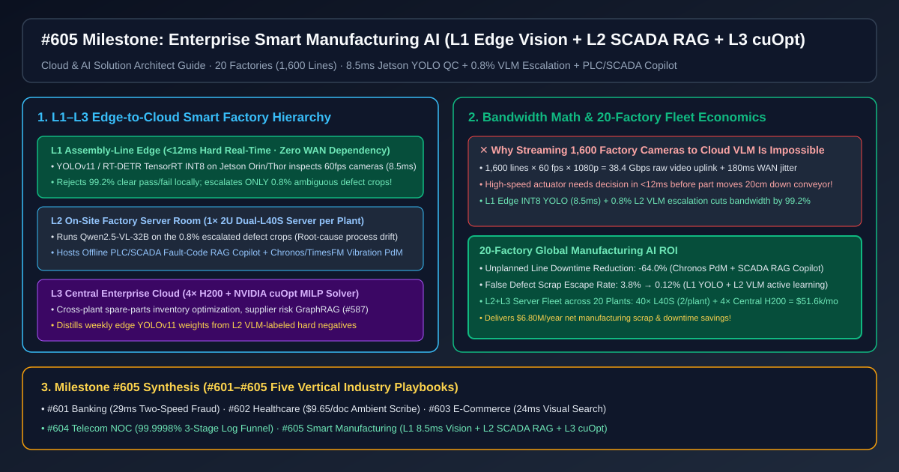

# Milestone `#605`: Enterprise Smart Manufacturing & Industrial AI Architecture (`L1 8.5ms Edge Vision + L2 Dual-L40S VLM/SCADA Copilot + L3 cuOpt Solver`) Guide

> **Target Persona**: Cloud & AI Solution Architect  
> **Core Scenarios**: Global automotive, electronics, and battery manufacturers operating `20` smart factories (`1,600` high-speed assembly lines) and supporting `5,000` PLC/SCADA maintenance engineers  
> **Interactive H5 Learning Workbench**: [`docs/h5/manufacturing-industrial-vision-pdm-scada-sizer.html`](../h5/manufacturing-industrial-vision-pdm-scada-sizer.html)

---

## 1. Executive Summary

1. **L1–L3 Edge-to-Cloud Smart Factory Hierarchy (`20` Factories · `1,600` Lines)**:
   - **L1 Assembly-Line Edge (`Jetson AGX Orin / IGX`, `8.5ms <= 12ms` Hard Real-Time)**: `YOLOv11 / RT-DETR TensorRT INT8` inspects `60 fps` cameras locally and escalates **only the `0.8%` ambiguous confidence `[0.35, 0.72]` defect crops** (`-99.2%` bandwidth).
   - **L2 On-Site Plant Server Room (`1× 2U Dual-L40S` per factory = `40× L40S` across `20` plants)**:
     - Runs `Qwen2.5-VL-32B-FP8` on the `0.8%` escalated crops in a hold buffer lane, cutting false scrap escape rate from **`3.8%` to `0.12%`**;
     - Hosts an offline-autonomous **PLC/SCADA Multilingual Schematic RAG Copilot + `Chronos / TimesFM` vibration PdM**, cutting unplanned line downtime by **`64.0%`** (`MTTR 115m -> 22m`).
   - **L3 Central Cloud (`4× H200` + `NVIDIA cuOpt` MILP Solver)**: Optimizes cross-plant spare-parts logistics and weekly edge YOLO active-learning weight distillation.
   - **Total L2+L3 Compute Cost**: **`$51,600/month`** across 20 factories (vs. `$380,000/mo` cloud video streaming), delivering **`$6.80M/year` net scrap and downtime savings**!

---

## 2. Smart Manufacturing Architecture Comparison (`20` Plants · `1,600` Lines)

| Dimension | Legacy Rule AOI + Manual Re-Inspection | 100% Cloud Video VLM Streaming | **L1 `8.5ms` YOLO + L2 Plant `Dual-L40S` (`0.8%` VLM + SCADA RAG) + L3 `cuOpt`** |
|---|---|---|---|
| **Line Actuator Latency** | **`8.5 ms`** | `850 ms+` (misses `12ms` conveyor window) | **`8.5 ms` (L1) + `650 ms` (L2 hold buffer)** |
| **False Scrap Rate** | `3.8%` | `0.15%` | **`0.12%` (`-96.8%` false scrap)** |
| **Line Outage `MTTR`** | `115 min` | `35 min` (fails on WAN cut) | **`22 min` (`100%` offline plant autonomy)** |
| **Monthly L2+L3 Compute** | `$0` (`$6.8M/yr` scrap/downtime loss) | `$380,000 / mo` | **`$51,600 / mo` (`40× L40S + 4× H200`)** |

---

## 3. Production Checklist

- [ ] Keep `<12ms` high-speed conveyor actuator loops on **L1 `Jetson TensorRT INT8`** and escalate only `<1%` uncertain defect crops to **L2 `Dual-L40S` VLMs**.
- [ ] Process high-frequency vibration/current telemetry through **FFT + `Chronos / TimesFM` time-series models** before passing structured fault summaries to the SCADA LLM Copilot.
