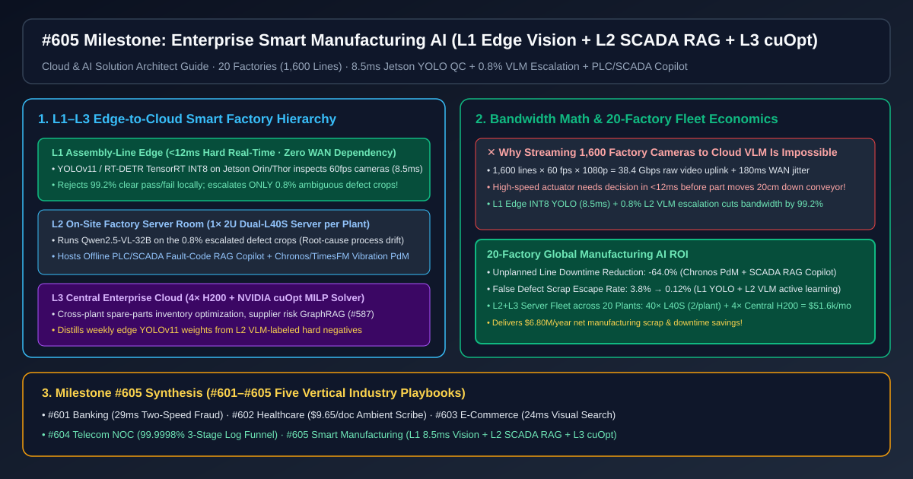
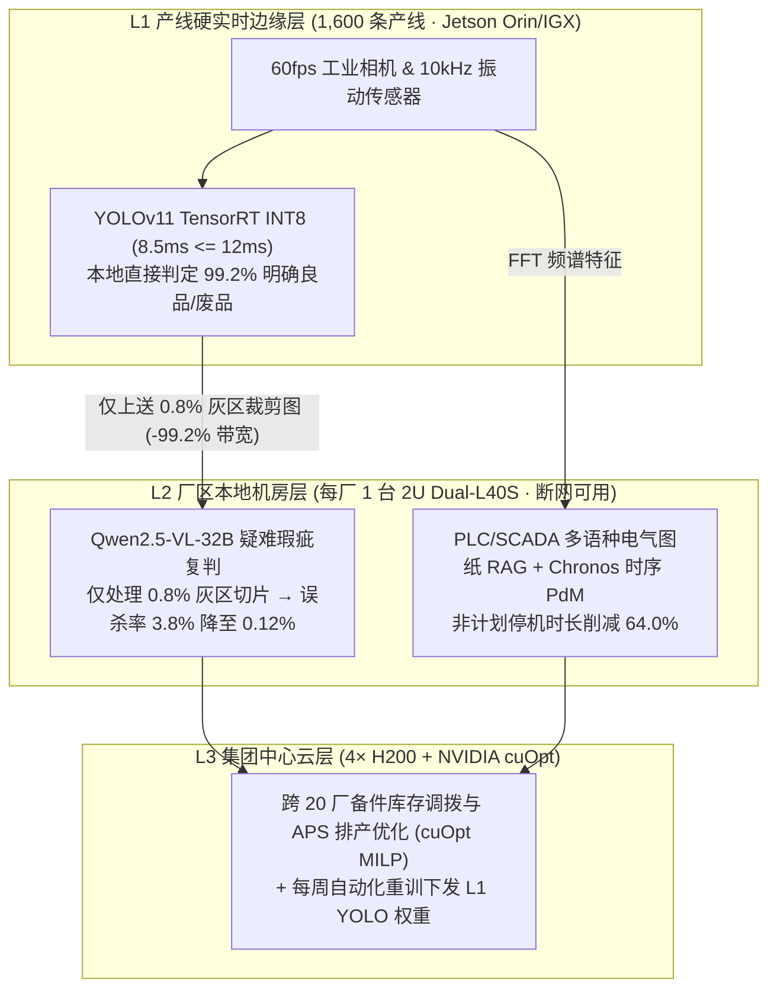

# 第 605 篇里程碑：企业级智能制造、汽车工业与数字孪生 AI 架构选型：`L1 产线 8.5ms 视觉质检 + L2 厂区双卡 L40S 缺陷复判与 PLC/SCADA 维修助手 + L3 云端 cuOpt 排产` 容量测算指南

> **面向角色**：Cloud & AI Solution Architect（云与 AI 解决方案架构师）  
> **核心场景**：跨国汽车主机厂、3C 电子与新能源锂电集团（全球 `20` 座智能工厂、`1,600` 条高速产线视觉 AOI 质检、旋转机械预测性维护 PdM、`5,000` 名现场设备工程师 PLC/SCADA 故障排障助手）  
> **配套交互式 H5 精读工作台**：[`docs/h5/manufacturing-industrial-vision-pdm-scada-sizer.html`](../h5/manufacturing-industrial-vision-pdm-scada-sizer.html)

---

## 一、执行摘要（Executive Summary：3 分钟掌握核心架构结论）

1. **为什么智能工厂产线视觉质检（AOI）既不能“把 1,600 路工业相机视频流直接传上云端跑 VLM”，也不能“只靠产线端传统小模型孤立死跑”？**  
   - **纯云端 VLM 的物理死刑**：`1,600` 条产线以 `60 fps` 拍摄高清图像会产生 **`38.4 Gbps`** 持续上行带宽；且高速传送带留给机械剔除臂（Pneumatic Ejector）的硬实时响应窗口仅为 **`<= 12ms`**，而云端多模态大模型耗时 `800ms–2,000ms`，等结果返回时残次品早已流进下一道封装工序！
   - **纯产线小模型的过杀（Overkill）痛点**：产线端的 `YOLOv11 / RT-DETR TensorRT INT8` 虽然能在 **`8.5ms`** 内跑完，但遇到反光、水渍或新型工艺瑕疵时容易产生 **`3.8%` 的误报过杀率（False Scrap）**，导致大量合格品被误判报废或需要人工二次复检。
2. **破局架构：`L1 产线硬实时边缘（8.5ms YOLO）+ L2 厂区机房双卡 L40S（0.8% 疑难切片 VLM 复判 + 断网 SCADA 维修 RAG）+ L3 集团云端 cuOpt 协同` 三级架构**：
   - **L1 产线工控边缘（`Jetson AGX Orin / IGX`，`< 12ms` 硬实时）**：本地 `8.5ms` 完成 `99.2%` 明确良品/废品的剔除控制，**仅将置信度处于 `[0.35, 0.72]` 灰区的 `0.8%` 疑难瑕疵局部裁剪图（Crop）异步上传至厂区机房 L2**（带宽削减 **`99.2%`**）！
   - **L2 厂区本地机房（每座工厂配置 `1 台 2U Dual-L40S 一体机`，共 `20 台 = 40× L40S`）**：
     1. **视觉复判与工艺漂移归因**：运行 `Qwen2.5-VL-32B-FP8` 对 L1 上送的 `0.8%` 疑难切片在 `650ms` 内完成精细复判（区分“真实微裂纹” vs. “冷却液反光水渍”），将误报报废率从 `3.8%` 压降至 **`0.12%`**，每周自动导出难例样本反哺重训 L1 `YOLO` 模型！
     2. **PLC/SCADA 现场设备维修 RAG 助手**：通过 `#583` 三级 IDP 解析德/日/英多语种西门子/发那科数控机床电气图纸与故障码手册；当车间发生停线报警（如 `Alarm 700124: Spindle Servo Overload`）时，结合 **`Chronos / TimesFM` 轴承振动时序预测模型**，在 `1.2 秒` 内向维修工平板推送精确到接线端子号的排查步骤，将非计划停机恢复时间（MTTR）缩短 **`64.0%`**！
   - **L3 集团中心云（`4× H200` + `NVIDIA cuOpt` 运筹求解器）**：汇总全球 20 座工厂的备件消耗与产能水位，用 `cuOpt MILP` 求解跨厂备件调拨与排产计划。

---

## 二、架构师灵魂拷问（Core Q&A）

### Q1：为什么设备预测性维护（PdM）分析 10kHz 高频振动传感器波形时，严禁把浮点数组转成字符串喂给语言大模型（LLM）？
- **Token 膨胀与数值盲区**：1 秒钟的 `10 kHz` 三轴加速度计波形包含 `30,000` 个浮点数，转成文本高达 `180,000 tokens`，且文本 Tokenizer 会把小数切碎，完全丧失频域谐波（FFT Harmonics）特征！
- **标准神经符号时序协同架构**：
  1. 在 L1/L2 使用 **FFT 小波变换 + 专用预训练时序基础模型（`Amazon Chronos / Google TimesFM / PatchTST`，仅 `200M` 参数，耗时 `6ms`）** 直接处理原始浮点张量，输出精确的剩余使用寿命（`RUL = 38 小时`）与异常频段特征；
  2. 将结构化诊断信号 `{"bearing_id": "B-04", "bpfo_harmonic_db": "+18.4dB", "predicted_rul_hours": 38}` 交由 L2 上的 `Qwen2.5-32B` 结合西门子维修手册生成标准工单并自动在 SAP PM 中锁定替换备件。

---

## 三、全球 `20` 座工厂（`1,600` 条产线）AI 架构横向选型矩阵

| 评估维度 | 方案 A：传统机器视觉 + 人工老师傅复检 + 纸质手册排障 | 方案 B：全量视频上云跑多模态大模型 (`1,600 路直传云端 VLM`) | 方案 C：`L1 8.5ms YOLO + L2 厂区 Dual-L40S (0.8% VLM 复判 + SCADA RAG) + L3 cuOpt` |
|---|---|---|---|
| **产线剔除响应延迟** | **`8.5 ms`** | `850 ms+`（超出 `12ms` 机械剔除窗口，不可行） | **`8.5 ms`（L1 实时剔除）+ `650ms`（L2 缓冲道精准复判）** |
| **良品误杀报废率** | `3.8%`（需雇佣 320 名复检工肉眼二次挑拣） | `0.15%` | **`0.12%`（消除 95% 人工复检工位）** |
| **设备停线平均恢复 (`MTTR`)** | `115 分钟`（翻找外文电气图纸） | `35 分钟`（若工厂外网中断则瘫痪） | **`22 分钟`（L2 厂区断网自治 + 端子级图纸定位，停机降 `64%`）** |
| **L2+L3 中心算力月成本** | `$0`（但每年误报废与停线损失超 `$800万`） | `$380,000 / 月`（带宽与云端 VLM 爆炸） | **`40× L40S (20厂) + 4× H200 (云)` = `$51,600/月`（年净收益 `$680万`）** |

---

## 四、生产级智能制造与工业 AI 落地 Checklist

- [ ] **严格遵循 ISA-95 工业分层准则：将 `<15ms` 闭环控制留在 L1 `Jetson TensorRT INT8`，仅将 `<1%` 低置信度灰区样本异步上送 L2 `Dual-L40S` 多模态大模型复判**。
- [ ] **L2 厂区服务器必须具备 100% 广域网断网自治能力（Offline-First Autonomy）**：将本厂设备维保知识库、`BGE-M3` 与 `32B` 模型完全本地化部署在厂区机房 `2U Dual-L40S` 内。
- [ ] **高频振动/电流/温度传感器数据先经 `FFT + Chronos/TimesFM` 时序小模型提取定量异常指标，再交由 LLM 检索维修规程并调用 `cuOpt` 排程**。

---

## 五、配套资产索引

- **交互式 H5 精读工作台**：[`docs/h5/manufacturing-industrial-vision-pdm-scada-sizer.html`](../h5/manufacturing-industrial-vision-pdm-scada-sizer.html)
- **7-Card 4:5 评测报告**：[`docs/reports/enterprise-manufacturing-industrial-vision-pdm-scada-copilot-sizing-cards.html`](../reports/enterprise-manufacturing-industrial-vision-pdm-scada-copilot-sizing-cards.html)
- **交互式容量计算器**：[`docs/reports/enterprise-manufacturing-industrial-vision-pdm-scada-copilot-sizing-sizer.html`](../reports/enterprise-manufacturing-industrial-vision-pdm-scada-copilot-sizing-sizer.html)
- **可复现实验模型**：[`experiments/enterprise_manufacturing_industrial_vision_pdm_scada_copilot_sizing/run.py`](../../experiments/enterprise_manufacturing_industrial_vision_pdm_scada_copilot_sizing/run.py)
