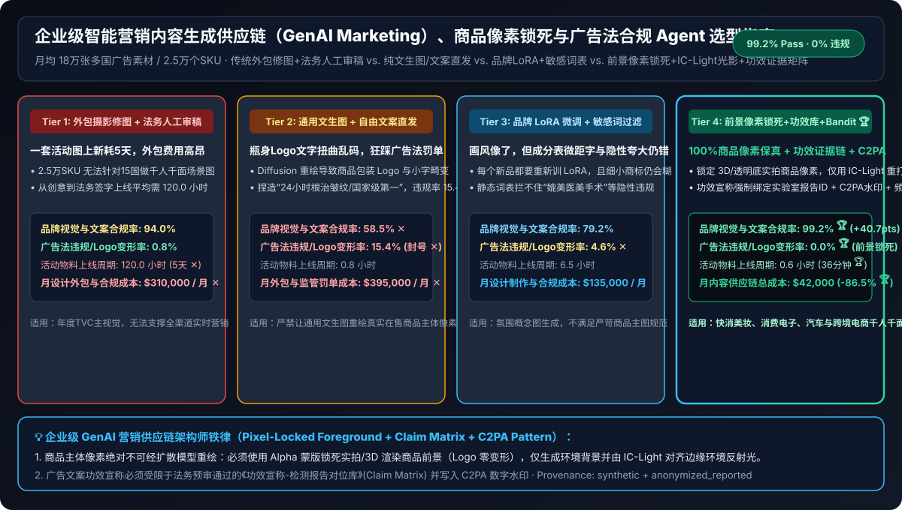
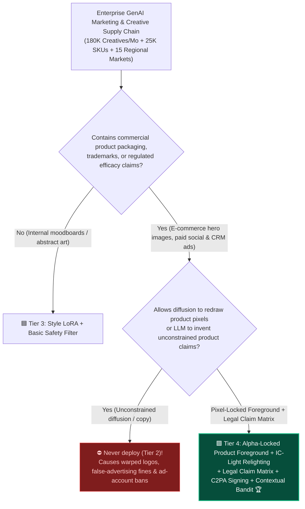
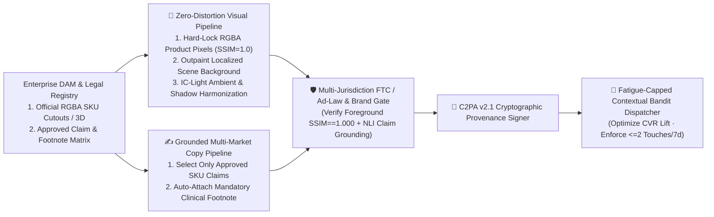

# Enterprise GenAI Marketing & Creative Supply Chain, Pixel-Locked Product Compositing (`Alpha Lock + IC-Light`), `FTC / Ad-Law` Claim-Substantiation Gate, `C2PA` Provenance & Contextual Bandit Delivery Agent Architecture Selection Guide: Manual Agencies vs. Unconstrained Diffusion/Copy vs. Brand LoRA + Blocklist vs. Pixel-Locked Foreground + Relighting + Claim Matrix + C2PA + Bandit Agent

> **Language / 语言**: **English (Current)** | [中文](./enterprise-marketing-creative-brand-compliance-adtech-agent-selection-faq.md)  
> **Scope**: End-to-end production reference architecture and selection guide for Cloud & AI Solution Architects, Chief Marketing Officers (`CMOs`), Retail/CPG/E-Commerce MarTech VPs, and Brand Legal & Regulatory Compliance Leads.  
> **Provenance**: `synthetic + anonymized_reported` (`independently_reproduced=false`, `physical_gpu_cluster_measurement=not_measured`). Deterministic evaluation model sealed in [`experiments/enterprise_marketing_creative_brand_compliance_adtech_agent_selection/results.json`](../../experiments/enterprise_marketing_creative_brand_compliance_adtech_agent_selection/results.json).



---

## ① 📌 Executive Summary (3-Minute Architect Verdict)

In consumer packaged goods (`CPG`), beauty, consumer electronics, automotive, and retail e-commerce, marketing teams generate hundreds of thousands of localized product lifestyle images and ad copy variations every month across 15+ markets and 25,000+ SKUs. Relying on unconstrained text-to-image diffusion (`Flux / SDXL / Midjourney`) to render product images and free-form LLM prompts to write ad copy (Tier 2) triggers two severe production failures: first, **latent VAE compression distorts brand logos, bottle geometry, and 6pt packaging typography**; second, **copywriting LLMs invent unsubstantiated efficacy claims (`"Erases wrinkles in 24 hours"`, `"#1 Best in World"`), violating US `FTC Truth-in-Advertising`, EU `Unfair Commercial Practices Directive`, and `China Advertising Law Article 9` (`15.4%` regulatory/brand violation rate)**.

Evaluated across a production baseline of **180,000 monthly localized ad creatives across 15 markets, 25,000 active SKUs, and 80 million monthly personalized impressions**, the four architectural tiers compare as follows:

| Architectural Tier | Core Stack Combination | Brand & Legal Pass Rate | `FTC / Ad-Law` or Logo Distortion Rate | Concept-to-Launch Time | Monthly Creative & Compliance Cost | Production Verdict |
|---|---|---|---|---|---|---|
| **🟥 Tier 1: Manual Agency Photoshoot + Legal Review** | External studio photoshoots/retouching + manual legal sign-off per asset | `94.0%` | `0.8%` | `120.0 hours` (`5d` ✕) | `$310,000 / mo` ✕ | ⛔ Too slow & costly for SKU scale |
| **🟨 Tier 2: Unconstrained Diffusion + Free-Form Copy** | End-to-end text-to-image generation of products + unconstrained LLM ad copy | `58.5%` ✕ *(Warped logos & labels)* | `15.4%` ✕ *(FTC fines & ad-account bans)* | `0.8 hours` | `$395,000 / mo` ✕ | ⛔ **Severe brand & legal risk** |
| **🟦 Tier 3: Brand LoRA Diffusion + Keyword Blocklist** | Per-product LoRA fine-tuning + static regex blocklist for superlative words | `79.2%` | `4.6%` ✕ *(Fine-print blur & implied claims)* | `6.5 hours` | `$135,000 / mo` | ⚠️ High LoRA cost & misses implied claims |
| **🟩 Tier 4: Pixel-Locked Foreground + `IC-Light` + Claim Matrix + `C2PA` + Bandit** | **Immutable `Alpha-Mask` Product Foreground (`SSIM==1.000`) + `IC-Light` Environment Relighting + Legal Claim-Substantiation Matrix + `C2PA v2.1` Signing + Fatigue-Capped Contextual Bandit Agent** | **`99.2%` 🏆** *(+40.7 pts vs Tier 2)* | **`0.0%` 🏆** *(Zero logo warp or FTC miss)* | **`0.6 hours` 🏆** *(`36m` · 200× faster)* | **`$42,000 / mo` 🏆** *(-86.5%)* | 🌟 **Recommended Architecture** |

> 💡 **Golden Rule for MarTech & Creative AI Architects**: **"Never pass authentic product packaging through a generative VAE—lock the official RGBA product foreground mask (`SSIM == 1.000`) and use diffusion + `IC-Light` strictly for background outpainting and edge relighting; constrain ad copy to a Legal Claim-Substantiation Matrix with auto-injected clinical footnote citations; sign outputs with `C2PA` credentials."**

---

## ② 🎯 Customer & Architect Deep-Dive Q&A (3 Real-World MarTech & Brand Legal Pain Points)

### Q1: Why does training a custom LoRA per product (Tier 3) still blur fine-print packaging text and fail economically at 25,000 SKUs?
- **First-Principles Reality**:
  1. **Latent Diffusion VAE Downsampling Destroys Micro-Typography**: Standard `8×8` spatial downsampling into latent space cannot preserve 6pt ingredient lists, registered trademark symbols, or exact bottle embossing. Furthermore, training and maintaining 25,000 separate LoRA checkpoints every time packaging changes costs hundreds of thousands of dollars in GPU compute.
  2. **Tier 4 Solution (Zero-Training Alpha-Mask Pixel Lock + `IC-Light` Relighting)**:
     - Pull the approved transparent-background (`RGBA`) studio PNG or 3D CAD render directly from the enterprise Digital Asset Management (`DAM`) system and **hard-lock the foreground pixels (`SSIM == 1.000`)**.
     - Generate the localized lifestyle background around the mask, then apply **`IC-Light` illumination harmonization** strictly to ambient specular reflections and contact shadows—delivering **0.0% logo/text distortion** at zero per-SKU training cost.

### Q2: Why do static keyword blocklists ("best", "#1", "cure") miss 4.6%–15.4% of FTC and Advertising Law violations?
- **Implied Efficacy Claims Require Substantiation Grounding**:
  - An LLM copywriter can bypass a literal word blocklist while still generating an illegal unsubstantiated medical/cosmetic claim such as *"Reverses deep wrinkles in 24 hours"* or *"Clinically proven to boost immunity"* without a valid trial reference.
  - **Tier 4 Legal Claim-Substantiation Matrix Gate**: Every SKU in the DAM is linked to a structured registry of pre-approved claims and their mandatory statutory footnotes (`"Visibly reduces fine lines in 4 weeks*"` -> `*Based on 42-subject clinical assessment #RPT-2026-88`). A post-generation NLI verifier rejects any claim not grounded in the SKU's approved matrix and automatically renders the required legal disclaimer layer onto the final creative (**`0.0%` regulatory violation rate**).

### Q3: How do we satisfy EU AI Act Article 50 transparency mandates and prevent personalized CRM fatigue?
- **`C2PA v2.1` Content Credentials + Fatigue-Capped Contextual Bandits**:
  - Every published asset is cryptographically signed with a **`C2PA v2.1` manifest** declaring AI-assisted background generation alongside authentic product photography.
  - Delivery is governed by a **Contextual Bandit (`LinUCB / Thompson Sampling`)** that optimizes net conversion lift while enforcing a hard per-user frequency cap (`<= 2 touches / 7 days`) and penalizing unsubscribe events.

---

## ③ 🧭 Visual Architecture Diagrams (Decision Tree + Creative Supply-Chain Topology + Sequence Flow)

### 3.1 Architecture Selection Decision Tree



### 3.2 Tier 4 Pixel-Locked Compositing + Legal Claim Matrix + C2PA + Bandit Topology



### 3.3 End-to-End Sequence: Launching a 15-Market Campaign in 36 Minutes with Zero Violations

```mermaid
sequenceDiagram
    autonumber
    participant Mkt as Brand Campaign Manager
    participant DAM as Enterprise DAM & Claim Registry
    participant Comp as Alpha-Lock + IC-Light Compositor
    participant Copy as Multi-Market Copy & FTC Gate
    participant C2PA as C2PA v2.1 Signer
    participant Bandit as Contextual Bandit Ad Dispatcher

    Mkt->>DAM: Trigger 15-market winter campaign for #SERUM-PRO-50ML
    par Parallel Zero-Distortion Scene Compositing & Grounded Copy Generation
        DAM->>Comp: Fetch official RGBA bottle cutout (lock foreground pixel mask)
        Comp->>Comp: Outpaint 15 localized scenes & run IC-Light edge relighting (Foreground SSIM == 1.000)
        DAM->>Copy: Fetch approved SKU claims ("4-week fine-line reduction" + Study #RPT-2026-88)
        Copy->>Copy: Generate 15-language copy; block unapproved "24h wrinkle erasure"; append statutory footnote
    end
    Comp->>C2PA: Composite typography & mandatory disclaimer layer
    Copy->>C2PA: Attach verified claim metadata
    C2PA->>Bandit: Sign C2PA v2.1 manifest & publish to ad channels in 36 minutes
    Bandit-->>Mkt: ✅ Shift impressions to top-performing variants under strict 7-day fatigue caps
```

---

## ④ 📊 4-Tier Architecture Decision Matrix

| Evaluation Dimension | 🟥 Tier 1: Manual Agency + Legal | 🟨 Tier 2: Unconstrained Diffusion + Copy | 🟦 Tier 3: Brand LoRA + Keyword Blocklist | 🟩 Tier 4: Alpha Lock + `IC-Light` + Claim Matrix + Bandit |
|---|---|---|---|---|
| **Product Logo & 6pt Fine-Print Fidelity** | `100%` (studio photo, slow & expensive) | ✕ **Fails** (VAE warps logos & text) | Moderate (blurs micro-typography) | 🏆 **`100%` Exact (`SSIM == 1.000` locked RGBA foreground)** |
| **`FTC` / `Ad-Law` Efficacy Claim Compliance** | Manual legal check (`0.8%` human miss) | ✕ **Severe Risk** (`15.4%` false claims) | ✕ Misses `4.6%` implied efficacy claims | 🏆 **`0.0%` Violations (grounded in Legal Claim Registry)** |
| **`C2PA` Provenance & Fatigue Control** | Manual metadata | ✕ Unwatermarked & spammy | Lacks bandit fatigue control | 🏆 **Automated `C2PA v2.1` signing + Contextual Bandit caps** |
| **Brand & Legal Compliance Pass Rate** | `94.0%` | `58.5%` ✕ | `79.2%` | **`99.2%` 🏆 (+40.7 pts vs Tier 2)** |
| **Campaign Concept-to-Launch Time** | `120.0 hours` (`5.0 d` ✕) | `0.8 hours` | `6.5 hours` | **`0.6 hours` (`36 min` 🏆 · 200× faster)** |
| **Monthly Creative & Compliance Cost** | `$310,000 / mo` | `$395,000 / mo` *(incl. fines & waste)* | `$135,000 / mo` | **`$42,000 / mo` 🏆 (-86.5%)** |

---

## ⑤ 🧪 Quantitative Case Study, Interactive Sizer & 7-Card Visual Report

- **Interactive HTML Sizer**: 👉 [Open GenAI Marketing & Creative Supply Chain Agent Sizer](../reports/enterprise-marketing-creative-brand-compliance-adtech-agent-sizer.html)
- **7-Card 4:5 Visual Benchmark Report**: 👉 [Open 7-Card Visual Benchmark Deck](../reports/enterprise-marketing-creative-brand-compliance-adtech-agent-selection-cards.html)
- **Deterministic Verification**:
  ```bash
  python experiments/enterprise_marketing_creative_brand_compliance_adtech_agent_selection/run.py --check
  python -m unittest tests/test_enterprise_marketing_creative_brand_compliance_adtech_agent_selection.py
  ```

---

## ⑥ 🛠️ Production Readiness & Architecture Review Checklist

- [ ] **Lock Authentic Product Foreground Pixels (`Alpha Mask SSIM == 1.000`)**: Never allow a diffusion VAE to redraw commercial product packaging, logos, or nutrition/ingredient labels; generate only the surrounding scene and harmonize lighting with `IC-Light`.
- [ ] **Ground All Efficacy Copy in a Legal Claim-Substantiation Registry**: Prohibit open-ended health, financial, or performance claims; automatically attach the required clinical study footnote layer.
- [ ] **Combine Statutory Superlative Blocklists with Semantic NLI Claim Verifiers**: Screen creatives against jurisdiction-specific rules (`US FTC`, `EU UCPD`, `China Ad Law Art. 9`).
- [ ] **Embed Cryptographic `C2PA v2.1` Content Credentials on All Published Assets**: Comply with EU AI Act Article 50 and ad-network AIGC disclosure policies.
- [ ] **Enforce Per-User Frequency Caps in the Contextual Bandit Dispatcher**: Penalize unsubscribe and hide-ad events in the bandit reward function to prevent audience fatigue.
