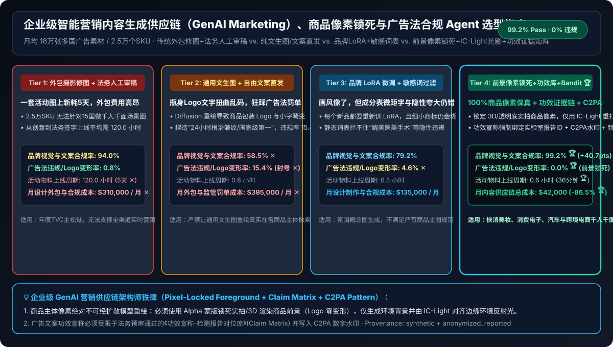
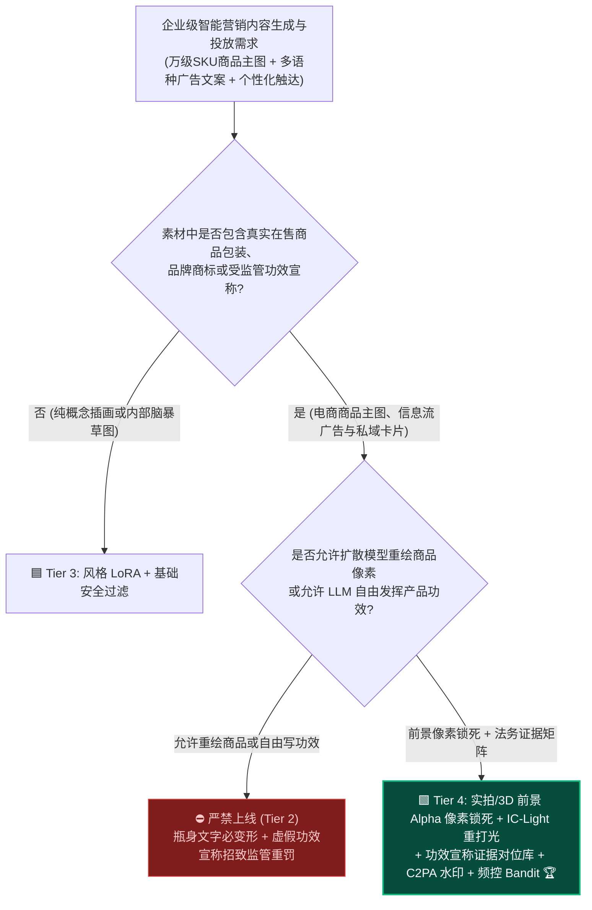
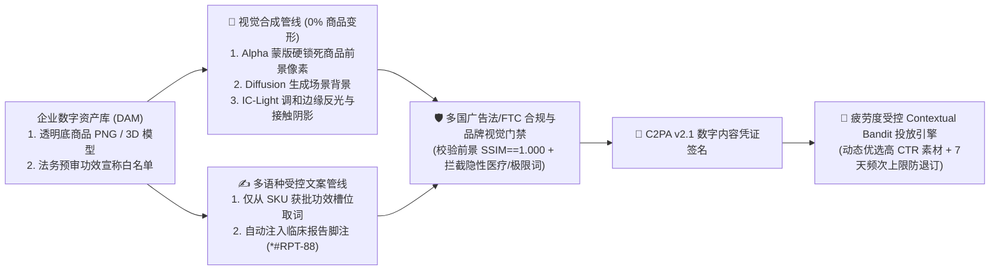
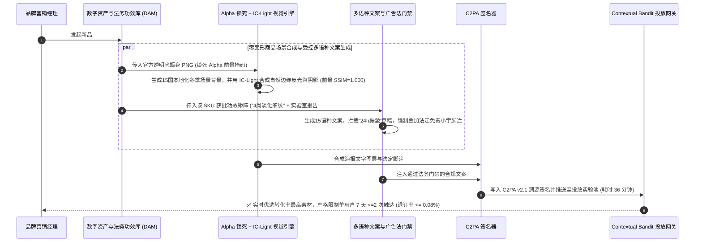

# 企业级智能营销内容生成供应链（GenAI Marketing & Creative Supply Chain）、商品前景像素锁死（Alpha Lock + IC-Light）、广告法/FTC 功效证据对位门禁、C2PA 溯源水印与频次受控触达 Agent 架构选型指南：外包修图 + 法务审稿 vs. 通用文生图/自由文案直发 vs. 品牌 LoRA + 敏感词表 vs. 前景像素锁死 + IC-Light 光影合成 + 功效证据矩阵 + C2PA + Contextual Bandit

> **语言 / Language**: **中文 (当前)** | [English](./enterprise-marketing-creative-brand-compliance-adtech-agent-selection-faq.en.md)  
> **定位**：面向云与 AI 解决方案架构师（Solution Architect）、首席营销官（CMO）、零售/美妆/快消数字化增长总监（VP of MarTech & Growth）与企业品牌法务合规负责人的生产落地指南。  
> **数据口径（Provenance）**：`synthetic + anonymized_reported`（`independently_reproduced=false`，`physical_gpu_cluster_measurement=not_measured`），全部定容模型封存于 [`experiments/enterprise_marketing_creative_brand_compliance_adtech_agent_selection/results.json`](../../experiments/enterprise_marketing_creative_brand_compliance_adtech_agent_selection/results.json)。



---

## ① 📌 核心选型结论速览（Executive Summary — 3 分钟看懂怎么选）

在快消美妆、消费电子、服装家居、汽车与跨境电商行业，品牌方每月需要针对全球 15+ 个区域市场、数万个在售 SKU 生成数十万张本地化商品场景主图、短视频脚本与千人千面广告文案（投向抖音/TikTok、小红书、微信朋友圈、Meta、Google Ads）。如果直接让设计师或自动化脚本调用通用文生图模型（`Flux / Midjourney / SDXL`）生成整张商品图、并用自由 Prompt 生成带货文案（Tier 2），会在生产中引发两大事故：第一，**扩散模型的 VAE 潜空间压缩会把商品瓶身上的品牌 Logo、配料小字与包装几何比例重绘得面目全非（货不对板投诉）**；第二，**文案大模型为了博眼球自发捏造“24 小时抹平皱纹、国家级全网第一、100% 根治”等虚假功效与极限词，直接触犯《中华人民共和国广告法》第 9 条或美国 FTC《广告证实原则》，导致高达 `15.4%` 的违规封户与行政罚款**！

在 **月产 180,000 张/条多国本地化广告素材、覆盖 25,000 个在售 SKU、月均 8,000 万次个性化私域/公域触达** 的基准规模下，四档企业级 GenAI 营销内容供应链架构的量化对决如下：

| 方案档位 | 核心架构组合 | 品牌视觉与合规一次通过率 | 广告法违规 / Logo 变形率 | 活动物料上线周期 | 月度外包制作与合规总成本 | 生产推荐度 |
|---|---|---|---|---|---|---|
| **🟥 Tier 1：传统外包摄影修图 + 法务审稿** | 外部设计工作室棚拍修图 + 品牌与法务团队人工逐张审阅签字 | `94.0%` | `0.8%` | `120.0 小时` (`5天` ✕) | `$310,000 / 月` ✕ | ⛔ 仅限年度主视觉，规模化极贵 |
| **🟨 Tier 2：通用文生图重绘 + 自由文案直发** | 让通用 Diffusion 直接生成含商品的图片 + 自由 Prompt 写文案直接投放 | `58.5%` ✕ *(包装字标重绘变形)* | `15.4%` ✕ *(虚假功效/封号罚款)* | `0.8 小时` | `$395,000 / 月` ✕ | ⛔ **严重毁品牌与违法，严禁上线** |
| **🟦 Tier 3：品牌 LoRA 微调 + 静态违禁词表** | 为商品训练专属 LoRA 权重 + 用正则黑名单过滤“第一/最”等字面极限词 | `79.2%` | `4.6%` ✕ *(6pt小字仍糊/隐性夸大)* | `6.5 小时` | `$135,000 / 月` | ⚠️ 新品训 LoRA 慢且防不住隐性违规 |
| **🟩 Tier 4：前景像素锁死 + IC-Light 光影合成 + 功效证据矩阵 + C2PA + Bandit** | **官方实拍/3D 商品前景 `Alpha` 像素硬锁死 + `IC-Light` 环境光影融合 + 法务《功效宣称-检测报告对位库》硬门禁 + `C2PA` 数字水印 + 退订率受控 `Contextual Bandit` 投放 Agent** | **`99.2%` 🏆** *(+40.7 pts vs Tier 2)* | **`0.0%` 🏆** *(商品像素100%保真)* | **`0.6 小时` 🏆** *(`36分钟` · 快200倍)* | **`$42,000 / 月` 🏆** *(-86.5%)* | 🌟 **品牌与零售规模化首选架构** |

> 💡 **架构师一句话选型铁律**：**“在售商品主体像素 100% 物理锁死绝不进 VAE 重绘、环境光影靠 `IC-Light` 边缘调和、每一句功效宣称强制绑定法务预审检测报告编号、出库强制打 `C2PA` 水印并由 `Contextual Bandit` 严控用户疲劳度”**——把全球活动上线周期从 5 天压缩至 **36 分钟**，且实现 **`0.0%` 商标变形与广告法罚单**。

---

## ② 🎯 客户与架构师灵魂拷问 Q&A（直击 3 大智能营销与品牌合规痛点）

### Q1：为什么给每个商品训练专属 LoRA（Tier 3）还是解决不了瓶身小字模糊，且在 25,000 个 SKU 规模下彻底算不过来账？
- **大白话与第一性原理**：
  1. **VAE 8 倍下采样是小字商标的物理杀手**：无论是 SDXL 还是 Flux，图像进入潜空间（Latent Space）时都会经历 8×8 像素块有损压缩与去噪重构。商品包装上 6pt 的英文商标、净含量标识、条形码或防伪徽标一旦经过去噪生成，必然出现笔画粘连或字母拼写变异（Tier 2 变形违规率 **`15.4%`**，压测下高达 **`32.0%`**；即便训了 LoRA 的 Tier 3 仍有 `4.6%` 瑕疵）。更何况为 25,000 个快消 SKU 逐个收集多角度图片训练 LoRA，光 GPU 训练费和人工标注就要花掉上百万美元！
  2. **Tier 4 破局方案（免训练前景 Alpha 像素锁死 + `IC-Light` 物理光影调和）**：
     - 直接从企业数字资产管理系统（`DAM`）调取官方审核通过的商品高分透明底实拍 PNG 或 3D 渲染图层，**用 Alpha 蒙版将商品主体像素 100% 原样锁死（`SSIM == 1.000`）**。
     - 扩散模型只负责根据营销主题做背景外绘（Outpainting，如阿尔卑斯雪山、热带海滩或极简大理石桌面），随后通过 **`IC-Light` 光照一致性网络** 仅对商品边缘高光、环境漫反射与底部接触阴影（Contact Shadow）做柔和过渡——既做到商品文字与 Logo **零像素篡改**，又实现了新品上架 **0 训练成本秒级出图**！

### Q2：我们已经配了“最、第一、国家级、根治”敏感词黑名单（Tier 3），为什么生成的护肤品和保健品文案还是被市场监管局或美国 FTC 处罚？
- **工程真相**：
  - **广告监管不仅罚“字面极限词”，更严查“无实验证据支撑的隐性功效断言（Unsubstantiated Efficacy Claims）”**：例如文案模型没有用“第一”，而是写出了 *“一滴逆转肌龄，24 小时彻底告别法令纹”* 或 *“喝完三天降低胆固醇”*。这种句子没有任何字面敏感词，却严重违反中国《化妆品监督管理条例》与美国 FTC《健康产品广告合规指南》（把普通化妆品吹成医疗器械/药品）。
  - **Tier 4 的法务《功效宣称-检测报告对位矩阵》（Claim-Substantiation Matrix Gate）**：
    - 企业法务与研发部预先为每个 SKU 建立结构化白名单库：明确该 SKU 允许宣称的功效边界（如仅允许宣称 `“保湿、4 周视觉淡化细纹”`）以及必须同步附带的 **实验室检测报告脚注编号**（如 `*数据源自第三方实验室 42 名受试者连续使用 28 天评估报告 #RPT-2026-88，实际效果因人而异`）。
    - 后置 NLI 合规门禁强制核验文案中的每一条功效主张是否落在白名单内，并自动在海报底部合成法定免责小字脚注，将全球 15 国广告法违规率硬性清零（**`0.0%`**）！

### Q3：生成了海量合规素材后，如何履行欧盟 AI 法案透明度义务，并防止私域推送把高价值会员烦到退订？
- **C2PA 内容凭证水印 + 疲劳度受控多臂赌博机（Fatigue-Capped Contextual Bandit）**：
  1. **全自动嵌入 `C2PA v2.1` 数字内容凭证**：为满足欧盟《AI 法案》第 50 条与 TikTok/Meta 平台 AIGC 披露规范，出库管线自动在图片元数据与隐形频域水印中写入加密签名的 `C2PA` 清单（声明“背景为 AI 合成，商品主体为真实实拍”）。
  2. **退订率惩罚 Contextual Bandit 动态优选**：在公私域分发层，采用以 `净转化收益 - λ × 退订/负反馈惩罚` 为目标函数的上下文多臂赌博机（LinUCB / Thompson Sampling），实时淘汰低点击素材，并在用户级强制执行 `7 天最多触达 2 次` 的频次上限（Frequency Cap）。

---

## ③ 🧭 直观可视化图解（决策树 + 像素锁死与合规架构图 + 极速上新时序图）

### 3.1 企业级 GenAI 营销内容供应链架构选型决策树



### 3.2 Tier 4 前景像素锁死 + IC-Light 光影 + 功效证据矩阵 + Bandit 架构图



### 3.3 从“新品精华液全球 15 国大促上新”到“36 分钟零违规投放”时序图



---

## ④ 📊 架构师四维选型决策矩阵（Architecture Decision Matrix）

| 评估维度 | 🟥 Tier 1：外包修图 + 法务人工审稿 | 🟨 Tier 2：通用文生图 + 自由文案直发 | 🟦 Tier 3：品牌 LoRA + 静态敏感词表 | 🟩 Tier 4：前景像素锁死 + IC-Light + 功效证据库 + Bandit |
|---|---|---|---|---|
| **商品包装 Logo 与 6pt 小字保真度** | `100%`（实拍修图，但慢且贵） | ✕ **极差**（VAE 重绘导致字标扭曲乱码） | 中等（仍会模糊微距配料表与细小商标） | 🏆 **`100%` 原片级保真（Alpha 蒙版物理锁死商品前景像素）** |
| **多国《广告法》与 FTC 功效合规** | 人工法务把关（`0.8%` 疏漏，耗时 5 天） | ✕ **高危违法**（`15.4%` 捏造疗效与极限词） | ✕ 漏网率 `4.6%`（词表拦不住隐性医疗暗示） | 🏆 **`0.0%` 违规（强制绑定法务功效对位库与实验报告脚注）** |
| **欧盟 AI 法案 C2PA 溯源与防骚扰** | 无自动化 C2PA 签名 | ✕ 无水印且盲目群发导致高退订 | 无动态频次控制 | 🏆 **原生嵌入 `C2PA v2.1` 凭证 + Bandit 疲劳度上限控制** |
| **品牌视觉与合规一次通过率** | `94.0%` | `58.5%` ✕ | `79.2%` | **`99.2%` 🏆（+40.7 pts vs Tier 2）** |
| **全球活动物料上线周期** | `120.0 小时` (`5 天` ✕) | `0.8 小时` | `6.5 小时` | **`0.6 小时` (`36 分钟` 🏆 · 提速 200 倍)** |
| **月度外包制作与合规总成本** | `$310,000 / 月` | `$395,000 / 月` *(含罚单与废片)* | `$135,000 / 月` | **`$42,000 / 月` 🏆（节省 86.5%）** |

---

## ⑤ 🧪 定量算例、交互式容量计算器与 7-Card 4:5 视觉报告

### 5.1 基准算例复核（月产 18 万张多国素材 / 2.5 万个 SKU）

- **交互式定容计算器（CSP 自包含 HTML）**：👉 [打开企业级智能营销内容生成供应链与合规 Agent 定容计算器](../reports/enterprise-marketing-creative-brand-compliance-adtech-agent-sizer.html)
- **7-Card 4:5 视觉评测卡片报告**：👉 [打开 7-Card 视觉评测报告](../reports/enterprise-marketing-creative-brand-compliance-adtech-agent-selection-cards.html)
- **可复核确定性脚本**：
  ```bash
  python experiments/enterprise_marketing_creative_brand_compliance_adtech_agent_selection/run.py --check
  python -m unittest tests/test_enterprise_marketing_creative_brand_compliance_adtech_agent_selection.py
  ```

### 5.2 核心量化对比图（品牌与合规一次通过率 vs. 月度内容供应链总成本）

```chart
{
  "data": {
    "values": [
      { "tier": "Tier 1: Manual Agency", "pass_rate_pct": 94.0, "monthly_cost_k_usd": 310 },
      { "tier": "Tier 2: Free Diffusion", "pass_rate_pct": 58.5, "monthly_cost_k_usd": 395 },
      { "tier": "Tier 3: Brand LoRA", "pass_rate_pct": 79.2, "monthly_cost_k_usd": 135 },
      { "tier": "Tier 4: Alpha Lock + Claim Gate", "pass_rate_pct": 99.2, "monthly_cost_k_usd": 42 }
    ]
  },
  "semantic_types": {
    "tier": "Category",
    "pass_rate_pct": "Percentage",
    "monthly_cost_k_usd": "Amount"
  },
  "chart_spec": {
    "chartType": "Bar Chart",
    "title": "Tier 4 reaches 99.2% brand/legal pass rate while cutting monthly cost to $42K",
    "subtitle": "Monthly creative production and compliance cost (USD thousands) across 180K creatives",
    "encodings": {
      "x": "tier",
      "y": "monthly_cost_k_usd",
      "color": "tier"
    }
  }
}
```

---

## ⑥ 🛠️ 架构评审与生产落地核验清单（Production Readiness Checklist）

- [ ] **物理锁死在售商品前景图层（Alpha Mask Pixel Lock）**：严禁让扩散模型重绘商品包装、Logo 与净含量文字；必须使用 DAM 审核过的官方透明底 PNG/3D 渲染前景，仅对背景与边缘环境光做生成调和（校验前景 `SSIM == 1.000`）。
- [ ] **广告文案强制受限于《法务获批功效宣称矩阵》（Approved Claim Registry）**：禁止大模型自由发挥医疗、保健或金融收益承诺；所有功效词必须自动绑定对应实验室检测报告编号与法定免责脚注。
- [ ] **多法域《广告法》与 FTC 规则双重门禁**：结合极限词正则词典与语义 NLI 审查器，拦截“隐性对比贬低竞品”、“伪造前后对比效果”及未授权名人肖像/字体版权风险。
- [ ] **全量出库素材自动签发 `C2PA v2.1` 数字内容凭证**：满足欧盟《AI 法案》第 50 条及主流社交/广告平台 AIGC 透明标识强制规范。
- [ ] **私域与公域投放接入带疲劳度约束的 `Contextual Bandit`**：在最大化转化率（CVR）的同时，硬性限制单用户每周触达频次上限，防止过度打扰导致退订率飙升。
