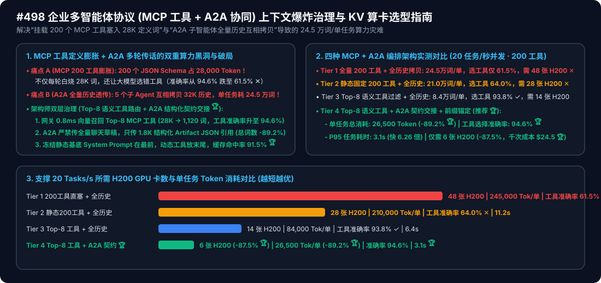

# Enterprise `MCP + A2A` Multi-Agent Context Explosion, Dynamic Tool-Schema Filtering & Shared-Prefix KV Sizer Selection Guide (#498)

> **Executive Summary**:
> Mounting `200 enterprise MCP tools` (`~140 tokens/schema = 28,000 tokens` per turn) and copying full `32K` conversation scratchpads across `5 A2A sub-agents` inflates a single user task to **`245,000 tokens` (`$480 / 1,000 tasks`)**, degrades tool-selection accuracy to **`61.5%`**, stalls `P95 E2EL` at **`19.4 seconds`**, and requires **`48x H200 GPUs`** for `20 tasks/sec`. For **Cloud & AI Solution Architects**, combining **Gateway-Level `Top-8` Semantic MCP Tool Filtering (`28,000 -> 1,120 tokens`, appended at the prompt tail to preserve `91.5%` Prefix Cache hit rate) + Scoped A2A Artifact Handoffs (`1.8K` JSON contracts instead of raw history)** slashes tokens per task by **`89.2%` (`26,500 tokens`)**, boosts tool accuracy to **`94.6%`**, accelerates `P95 E2EL` **`6.26x` to `3.1 seconds`**, and runs `20 tasks/sec` on just **`6x H200 GPUs` (`-87.5%` GPUs)**.
>
> **⚡ Interactive H5 Study Lab**: [**Open the MCP + A2A Multi-Agent Context Explosion & GPU Sizer Calculator (`docs/h5/mcp-a2a-multi-agent-tool-schema-kv-sizer-lab.html`)**](../h5/mcp-a2a-multi-agent-tool-schema-kv-sizer-lab.html)

---

## 1. Quantitative Decision Matrix (`200 MCP Tools · 5 A2A Sub-Agents · 20 Tasks/s`)

| `MCP + A2A` Orchestration Architecture | Tokens / Task | Tool Accuracy | Prefix Hit Rate | `P95` E2EL | H200 GPUs (`20 TPS`) | Cost / `1k Tasks` |
| :--- | :--- | :--- | :--- | :--- | :--- | :--- |
| **Tier 1: Naive `200-Tool` Dump + Full A2A History** | `245,000` ✕ | `61.5%` ✕ | `12.0%` ✕ | `19.4 s` ✕ | `48 GPUs` ✕ | `$480.00` ✕ |
| **Tier 2: Static `200-Tool` Prefix + Full A2A History** | `210,000` | `64.0%` ✕ | `68.0%` | `11.2 s` | `28 GPUs` | `$215.00` |
| **Tier 3: `Top-8` Semantic MCP Filter + Full History** | `84,000` | `93.8%` ✓ | `78.5%` | `6.4 s` | `14 GPUs` | `$92.00` |
| **Tier 4: `Top-8` Tail Tools + Scoped A2A Artifacts 🏆** | **`26,500 (-89.2%)` 🏆** | **`94.6%` 🏆** | **`91.5%` 🏆** | **`3.1 s` 🏆** | **`6 GPUs (-87.5%)` 🏆** | **`$24.50` 🏆** |
