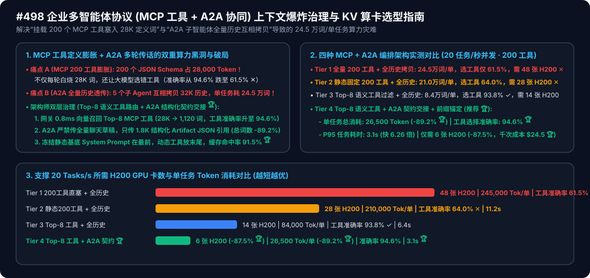
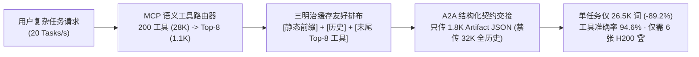

# 企业多智能体协同协议（`MCP 工具协议 + A2A 智能体互联`）上下文爆炸治理、动态工具按需挂载与共享前缀 KV 算卡选型指南 (#498)

> **核心观点（Executive Summary）**：
> 当企业通过 **MCP（Model Context Protocol）** 将内部 200+ 个业务系统 API（ERP / CRM / Jira / 数据库）接入大模型，并通过 **A2A（Agent-to-Agent Protocol）** 串联 5 个专业子智能体协同时，最容易爆发 **“单次任务烧掉 24.5 万 Token”的算力雪崩**：
> 1. **MCP 工具定义膨胀税（Tool-Schema Bloat）**：每个 MCP 工具的 JSON Schema 平均占 `140 Token`，把 200 个工具全量塞进 Prompt，用户还没说话就已经烧掉 **`28,000 Token`**！不仅拖慢首字延迟，还因选项过多引发注意力稀释，导致 **工具选择准确率从 `94.6%` 暴跌至 `61.5%` ✕**；
> 2. **A2A 全量历史乒乓拷贝（Scratchpad Ping-Pong）**：主控 Agent 与 4 个子 Agent 之间如果每次委派都把 `32K` 完整对话草稿原样复制过去，8 轮交互下来单任务累计消耗 **`245,000 Token`（每千次任务 `$480`）**，`P95` 耗时 `19.4 秒`，支撑 `20 任务/秒` 需要 **`48 张 H200` ✕**！
>
> 作为 **Cloud & AI Solution Architect**，生产级最优解是采用 **“MCP 网关 `Top-8` 语义工具预过滤（`28,000 -> 1,120 Token`）+ A2A 作用域结构化契约交接（`Scoped Artifact Handoff`）+ 静态前缀置顶锚定（`Prefix Pinning`）”**：将单任务 Token 消耗削减 **`89.2%`（`245,000 -> 26,500 Token`）**，工具选择准确率提升至 **`94.6%`**，`P95` 端到端耗时从 `19.4s` 压至 **`3.1s`（提速 `6.26 倍`）**，仅需 **`6 张 H200`（立省 `87.5%` 卡数！）** 即可支撑 20 Tasks/s！
>
> **⚡ 配套交互式 H5 精读沙盘**：[**打开 MCP + A2A 多智能体上下文爆炸治理与 GPU 算卡计算器 (`docs/h5/mcp-a2a-multi-agent-tool-schema-kv-sizer-lab.html`)**](../h5/mcp-a2a-multi-agent-tool-schema-kv-sizer-lab.html)

---

## 一、 灵魂拷问：为什么动态筛选 Top-8 工具既能省 96% Schema Token，又不会破坏 Prefix Cache？

### Q1：如果每次请求动态筛选不同的 `Top-8 MCP 工具`，难道不会导致前面的 Prefix Cache 全部失效吗？
- **会！前提是你把工具定义放在了 Prompt 的最前面！**
- **架构师的“三明治 Prompt 排布铁律（Prefix-Preserving Prompt Layout）”**：
  1. **最顶层（字节级 100% 冻结，命中 `RadixCache`）**：企业安全宪章 + 角色设定 + 领域知识库静态背景（`~8,000 Token`），所有请求完全一致；
  2. **中间层（会话级增量命中）**：当前会话的历史多轮对话上下文；
  3. **最末尾（紧贴最新一句 User Query 之后）**：由 MCP 网关通过 `0.8ms` 向量检索动态召回的 **`Top-8` 候选工具 JSON Schema（仅 `1,120 Token`）**！
- **效果**：前面 90% 的静态前缀和历史会话 **100% 命中 GPU HBM Prefix Cache（综合命中率高达 `91.5%`）**，每次只需为末尾 `1,120 Token` 的动态工具定义做增量 Prefill！

### Q2：A2A 多智能体交接时，如何消灭“把 32K 聊天记录传来传去”的二次方膨胀？
- **禁止传递原始草稿（Raw Scratchpad），强制传递结构化契约（Scoped Artifact Card）**：
  - 当主控 Agent 调用 `SQL 子 Agent` 时，A2A 消息体只传递 `{task_goal, schema_ref, constraints}`（`~1,800 Token`），子 Agent 在独立沙箱内完成多次 SQL 试错后，只向主控返回最终验证通过的 `{result_table_json, provenance_hash}`，彻底切断子任务内部推理草稿向全局上下文的泄漏！

---

## 二、 四种 MCP + A2A 多智能体编排架构选型决策矩阵（`200 个 MCP 工具 · 20 任务/秒`）

| 多智能体 `MCP + A2A` 编排架构（`20 Tasks/s`） | 单任务总消耗 Token | 工具选择准确率 (%) | Prefix 缓存命中率 | `P95` 任务耗时 | 所需 H200 卡数 | 每千次任务成本 |
| :--- | :--- | :--- | :--- | :--- | :--- | :--- |
| **Tier 1: 全量直塞 `200 工具` + A2A 全历史拷贝** | `245,000 Tok` ✕ | `61.5%` ✕ | `12.0%` ✕ | `19.4 s` ✕ | `48 张 H200` ✕ | `$480.00` ✕ |
| **Tier 2: 静态置顶 `200 工具` + A2A 全历史拷贝** | `210,000 Tok` | `64.0%` ✕ | `68.0%` | `11.2 s` | `28 张 H200` | `$215.00` |
| **Tier 3: `Top-8` 语义工具过滤 + A2A 全历史拷贝** | `84,000 Tok` | `93.8%` ✓ | `78.5%` | `6.4 s` | `14 张 H200` | `$92.00` |
| **Tier 4: `Top-8` 工具置尾 + A2A 契约交接 + 前缀锚定 🏆** | **`26,500 Tok (-89.2%)` 🏆** | **`94.6%` 🏆** | **`91.5%` 🏆** | **`3.1 s` 🏆** | **`6 张 H200 (-87.5%)` 🏆** | **`$24.50` 🏆** |

---

## 三、 生产落地核对清单（SA Production Checklist）

- [ ] **单次注入大模型的 MCP 工具数量硬性封顶 `<= 12 个`**：当企业注册工具超过 20 个时，必须在 AI Gateway 开启基于工具描述 Embedding 的 `Top-K (K=8~12)` 动态语义挂载。
- [ ] **动态挂载的 MCP 工具 Schema 必须追加在 Prompt 末尾（User Turn 附近）**：严禁插在 System Prompt 头部，防止每次工具子集变化击穿整棵 `RadixCache` 前缀树。
- [ ] **A2A 子智能体返回大型数据集（如 SQL 查询出 5,000 行记录）必须走“外部 URI 引用（Claim-Check Pattern）”**：子 Agent 将大表写入 Redis/对象存储并只向主 Agent 返回 `artifact://table_id` 与 5 行预览摘要，严禁将百万字节 JSON 直接塞进 LLM 上下文。

---

## 四、 延伸阅读与配套工具

- **交互式 H5 精学沙盘**：[docs/h5/mcp-a2a-multi-agent-tool-schema-kv-sizer-lab.html](../h5/mcp-a2a-multi-agent-tool-schema-kv-sizer-lab.html)
- **7-Card 4:5 视觉评测卡片**：[docs/reports/enterprise-mcp-a2a-multi-agent-tool-schema-bloat-kv-sizing-selection-cards.html](../reports/enterprise-mcp-a2a-multi-agent-tool-schema-bloat-kv-sizing-selection-cards.html)
- **交互式 Sizer 测算器**：[docs/reports/enterprise-mcp-a2a-multi-agent-tool-schema-bloat-kv-sizing-selection-sizer.html](../reports/enterprise-mcp-a2a-multi-agent-tool-schema-bloat-kv-sizing-selection-sizer.html)
- **可复现实验模型**：[`experiments/enterprise_mcp_a2a_multi_agent_tool_schema_bloat_kv_sizing_selection/run.py`](../../experiments/enterprise_mcp_a2a_multi_agent_tool_schema_bloat_kv_sizing_selection/run.py)
