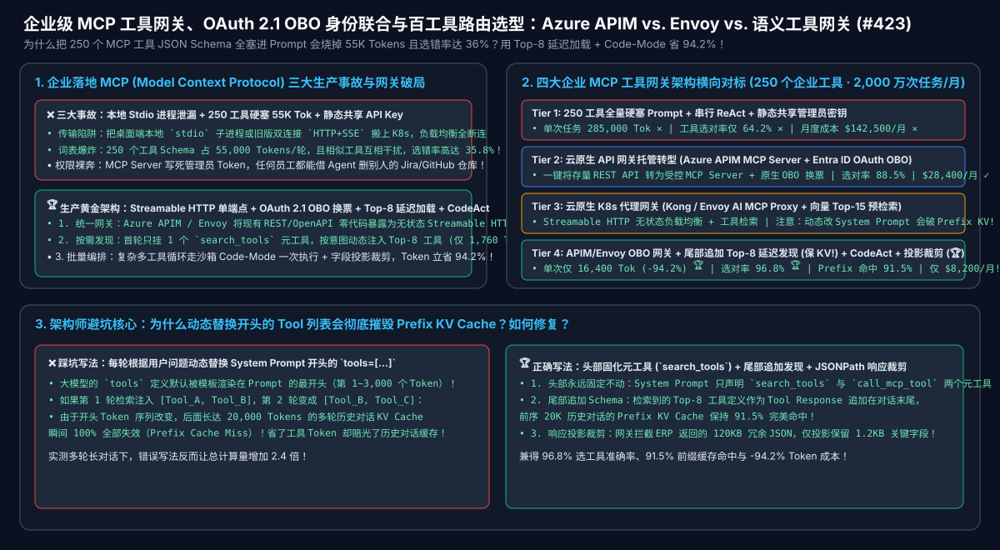

# Enterprise MCP (Model Context Protocol) Gateway, OAuth 2.1 OBO & 250-Tool Routing Selection Guide: `Azure APIM MCP Gateway` vs. `Envoy MCP Proxy` vs. `Tail-Appended Deferred Discovery`

> **Language / 语言**: [简体中文](./enterprise-mcp-gateway-apim-envoy-semantic-tool-router-obo-auth-selection-faq.md) | **English**  
> **Companion Interactive Study & Sizing Tools**: [📱 Interactive H5 Study Lab](../h5/mcp-gateway-apim-envoy-semantic-tool-router-obo-lab.html) · [🧮 HTML Sizer](../reports/enterprise-mcp-gateway-apim-envoy-semantic-tool-router-obo-auth-selection-sizer.html) · [🃏 7-Card Visual Deck](../reports/enterprise-mcp-gateway-apim-envoy-semantic-tool-router-obo-auth-selection-cards.html) · [📊 Reproducible Model](../../experiments/enterprise_mcp_gateway_apim_envoy_semantic_tool_router_obo_auth_selection/) · [🎓 Back to AI Infra H5 Hub](../h5/index.html)

---

## 1. Executive Summary (3-Minute Takeaway)

> **Bottom-Line Recommendation**: Stuffing all **250 enterprise MCP tool schemas** (`55,000 tokens/turn`) into the System Prompt burns **`285,000 tokens` per 5-step task** and degrades tool-selection accuracy to **`64.2%`**. Conversely, naively replacing the System Prompt's `tools=[...]` array on every turn via vector search invalidates the entire multi-turn **Prefix KV Cache** (crashing cache hit rate from **`88.0%` down to `18.5%`**!).
> - **For Zero-Code Transformation of Existing REST/OpenAPI Estates into Governed MCP Servers**: Use **`Azure API Management (APIM) Native MCP Server Gateway`** (`Streamable HTTP` transport + built-in `Entra ID OAuth 2.1 On-Behalf-Of [OBO]` token exchange).
> - **For High-Scale Agents Operating Across `100–500+` Tools**: Deploy **Tier 4 (`Azure APIM / Envoy OBO Gateway + Pinned Header Meta-Tools with Tail-Appended Top-8 Deferred Tool Discovery + JSONPath Response Projection + Code-Mode Batching`)**, preserving **`91.5%` Prefix KV hit rate**, lifting tool-selection accuracy to **`96.8%`**, and slashing 5-step task tokens by **`94.2%` (`16,400` vs. `285,000` tokens, saving `$134.3K/month`)**.

| Dimension | `Tier 1: Stuff All 250 Tools + Static Key` | `Tier 2: Azure APIM Managed MCP (Domain-Scoped + OBO)` | `Tier 3: Naive Header Tool-RAG Replacement` | `Tier 4: APIM/Envoy OBO + Tail-Appended Top-8 Discovery (🏆)` |
|---|---|---|---|---|
| **Tokens per 5-Step Task** | `285,000 Tokens` ✕ | `56,800 Tokens` ✓ | `42,000 Tokens` | **`16,400 Tokens` (-94.2%)** 🏆 |
| **Tool Selection Accuracy** | `64.2%` ✕ | `88.5%` ✓ | `92.4%` ✓ | **`96.8%` (Top-8 + Schema Gate)** 🏆 |
| **Multi-Turn Prefix KV Hit Rate** | `88.0%` | `89.2%` | **`18.5%` ✕ (Header mutation kills KV!)** | **`91.5%` (Pinned header + tail append)** 🏆 |
| **Monthly Token TCO (20M Tasks)** | `$142,500 / mo` ✕ | `$28,400 / mo` (-80.1%) | `$36,800 / mo` | **`$8,200 / mo` (-94.2%)** 🏆 |

---

## 2. Provenance & Reproducibility

- **Provenance**: `synthetic + anonymized_reported (independently_reproduced=false)` — verified via [`experiments/enterprise_mcp_gateway_apim_envoy_semantic_tool_router_obo_auth_selection/run.py`](../../experiments/enterprise_mcp_gateway_apim_envoy_semantic_tool_router_obo_auth_selection/run.py).
