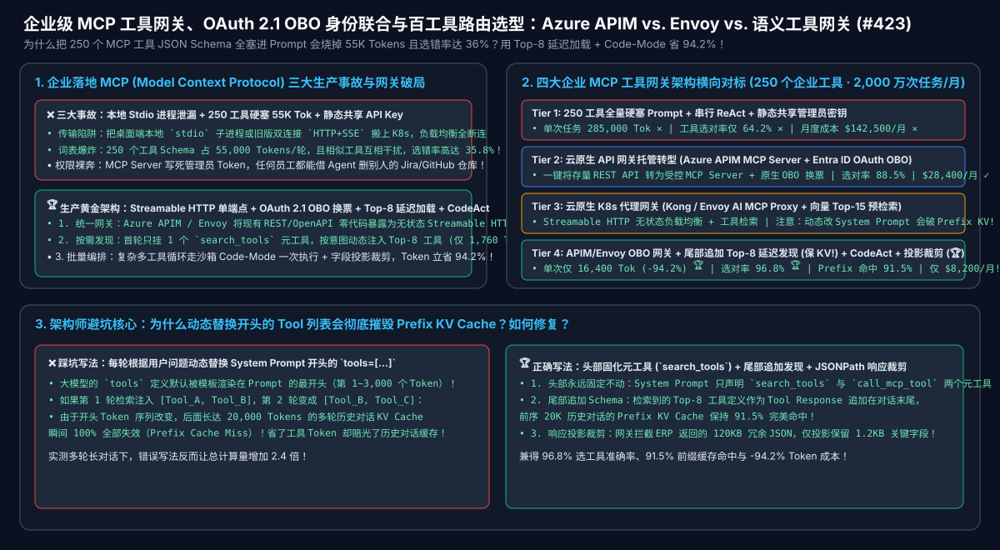
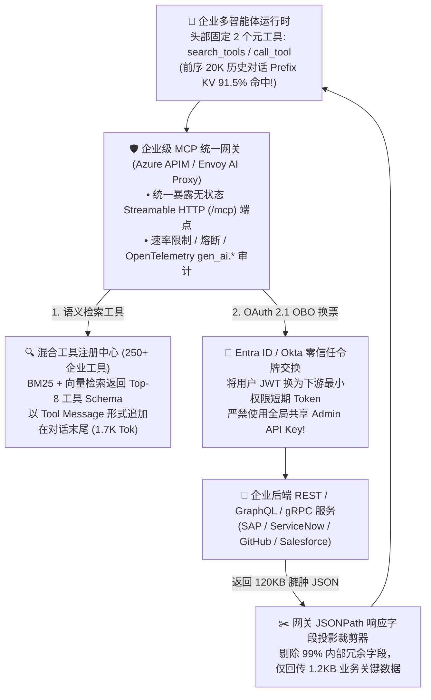

# 企业级 MCP（Model Context Protocol）工具网关、OAuth 2.1 OBO 身份联合与百工具路由选型：`Azure APIM MCP Gateway` vs. `Kong / Envoy MCP Proxy` vs. `尾部延迟发现 + CodeAct 网关` 架构与成本指南

> **语言 / Language**: **简体中文** | [English](./enterprise-mcp-gateway-apim-envoy-semantic-tool-router-obo-auth-selection-faq.en.md)  
> **配套交互式学习与精算工具**: [📱 交互式 H5 精读页 (企业级 MCP 网关与百工具路由沙盘)](../h5/mcp-gateway-apim-envoy-semantic-tool-router-obo-lab.html) · [🧮 HTML 交互式计算器](../reports/enterprise-mcp-gateway-apim-envoy-semantic-tool-router-obo-auth-selection-sizer.html) · [🃏 7-Card 4:5 视觉评测卡](../reports/enterprise-mcp-gateway-apim-envoy-semantic-tool-router-obo-auth-selection-cards.html) · [📊 可复核模型](../../experiments/enterprise_mcp_gateway_apim_envoy_semantic_tool_router_obo_auth_selection/) · [🎓 返回 AI Infra 全景精学馆](../h5/index.html)

---

## 一、3 分钟看懂核心结论（Executive Summary）

> **一句话决策结论**：当企业将内部 ERP、CRM、GitHub、ServiceNow 等 **250+ 个业务接口** 通过 **MCP（Model Context Protocol）** 接入大模型 Agent 时，若直接把 250 个工具的 JSON Schema 全塞进 System Prompt（每个工具约 `220 Tokens`），**光是工具定义每轮就要白烧 `55,000 Tokens`（5 步循环高达 `285,000 Tokens`），且由于同名/近义工具互相干扰，大模型的工具选对率会从 `96%+` 暴跌至 `64.2%`**！更致命的是，如果每轮用向量检索动态替换 System Prompt 开头的 `tools=[...]`，会导致**后续 20K 历史对话的 Prefix KV Cache 100% 失效（命中率跌至 `18.5%`）**！
> - **希望零代码把企业存量 REST/OpenAPI 快速变成受控 MCP Server**：首选 **`Azure API Management (APIM) 原生 MCP Server 网关`**（一键将现有 APIM 托管的 OpenAPI 接口暴露为符合最新 `MCP Streamable HTTP` 规范的端点，并原生内置 `Entra ID OAuth 2.1 On-Behalf-Of [OBO]` 令牌交换与速率限制）。
> - **面对 100~500+ 工具的规模化多智能体平台**：必须采用 **`Tier 4 四维协同 MCP 网关（APIM/Envoy Streamable HTTP + OAuth 2.1 OBO 细粒度换票 + 头部固化元工具 / 尾部追加 Top-8 延迟发现 [保留 91.5% Prefix KV!] + JSONPath 响应字段投影裁剪 + Code-Mode 批量编排）`**：
>   1. **单次 5 步任务 Token 消耗从 `285,000` 骤降至 `16,400`（立省 `94.2%`）**；
>   2. **工具选对率从 `64.2%` 跃升至 `96.8%`**，2,000 万次任务/月的 Token 账单从 `$142,500/月` 暴降至 **`$8,200/月`**！

| 核心选型维度 | `Tier 1: 250工具全塞 Prompt + 共享静态 Key` | `Tier 2: Azure APIM 托管 MCP 网关 (按域分组 + OBO)` | `Tier 3: 朴素每轮替换头部 Tool-RAG (破 Prefix KV!)` | `Tier 4: APIM/Envoy OBO + 尾部追加 Top-8 延迟发现 + 投影裁剪 (🏆)` |
|---|---|---|---|---|
| **单次 5 步 Agent 任务总 Token** | `285,000 Tokens` ✕ | `56,800 Tokens` ✓ | `42,000 Tokens` | **`16,400 Tokens` (-94.2%)** 🏆 |
| **百工具精确选对率 (`Accuracy`)** | `64.2%` ✕ (注意力弥散) | `88.5%` ✓ | `92.4%` ✓ | **`96.8%` (Top-8 精筛 + Schema 校验)** 🏆 |
| **多轮历史 Prefix KV 缓存命中率** | `88.0%` | `89.2%` | **`18.5%` ✕ (头部工具变动毁掉缓存!)** | **`91.5%` (头部固定元工具，尾部追加)** 🏆 |
| **身份鉴权与防越权安全模型** | 静态共享 Admin Key ✕ | **原生 `OAuth 2.1 OBO` 换票** ✓ | 需自建鉴权中间件 | **`OAuth 2.1 OBO` + OPA 参数门禁** 🏆 |
| **2,000 万次任务/月 Token 总成本** | `$142,500 / 月` ✕ | `$28,400 / 月` (-80.1%) | `$36,800 / 月` (因缓存失效反贵!) | **`$8,200 / 月` (-94.2%)** 🏆 |

---

## 二、核心技术原理与架构师灵魂拷问（Q&A）

### Q1：为什么“每轮根据用户问题检索 Top-10 工具并替换 `tools=[...]` 参数（`Tier 3`）”会导致 Prefix KV Cache 命中率从 `90%` 崩盘到 `18.5%`？如何修复？
1. **看清大模型聊天模板（Chat Template）的物理布局**：
   - 在 OpenAI、Claude、Qwen、Llama 与 DeepSeek 的底层 Prompt 模板中，传入 API 的 `tools: [...]` 数组永远被拼接在 **System Prompt 的最最开头（第 1 到第 3,000 个 Token）**，后面才跟着长达 `10,000 ~ 30,000 Tokens` 的多轮历史消息与前序工具返回值！
   - 自回归 Transformer 的 `Prefix KV Cache` 遵循极其严苛的**精确前缀匹配（Exact Prefix Match）**原则：只要第 `150` 个 Token 变了一个字，从第 `151` 个 Token 往后的全部 `25,000` 个历史 Token 的 KV 缓存瞬间**100% 全部作废**，必须从头重算 Prefill！
   - 当你在第 1 轮塞入 `[jira_search, github_pr]`，第 2 轮根据新问题替换成 `[slack_post, pagerduty_ack]` 时，每轮开头的工具列表都在变，导致每轮 `25K` 历史上下文缓存全丢！
2. **破局神技：头部固化元工具（`Pinned Meta-Tools`）+ 尾部延迟发现（`Tail-Appended Deferred Discovery`）**：
   - **头部永远一字不改**：在 API 的 `tools` 字段里永远只声明 2 个固定不变的元工具：`search_mcp_tools(query)` 和 `execute_mcp_tool(tool_name, arguments_json)`（仅占 `280 Tokens`）；
   - **尾部追加具体工具 Schema**：当 Agent 调用 `search_mcp_tools("查询华东区库存与退货单")` 时，MCP 网关在向量库中毫秒级检索出 Top-8 匹配工具的完整 JSON Schema，并将其作为普通的 **`Tool Message` 追加在对话最末尾**；
   - **完美兼得**：前序 `25,000 Tokens` 的历史对话前缀一字未改，**Prefix KV Cache 命中率高达 `91.5%`**，同时每轮只付 8 个工具的 Token 费！

### Q2：为什么企业生产环境严禁使用早期 MCP 的本地 `stdio` 或旧版双连接 `HTTP+SSE`？为什么必须升级到 `Streamable HTTP` + `OAuth 2.1 OBO` + `响应投影裁剪`？
1. **传输层演进（`Streamable HTTP` 单端点统一）**：
   - 本地 `stdio` 在多租户并发下会派生出成百上千个僵尸子进程撑爆容器内存；旧版 `HTTP+SSE` 要求客户端维持一条长连接收事件、再用另一条 POST 发请求，在多副本 K8s Ingress / API Gateway 下若无会话粘性立刻报 `404 Session Not Found`；
   - 新版 **`MCP Streamable HTTP`** 将请求与可选流式响应统一到单一 `/mcp` HTTP 端点，天生支持无状态水平扩缩容与企业级 API 网关（`Azure APIM / Envoy`）治理！
2. **身份安全（`OAuth 2.1 On-Behalf-Of [OBO]` 零信任换票）**：
   - 严禁在 MCP Server 环境变量里配死一个拥有全局权限的 `GITHUB_TOKEN` 或 `SAP_ADMIN_KEY`！
   - 客户端请求携带当前登录员工的 JWT 进入 `Azure APIM / Envoy MCP 网关`，网关通过 **`OAuth 2.1 Token Exchange (RFC 8693 / Entra ID OBO)`** 实时换取仅代表该员工本人权限范围（Scope）的下游短期令牌——员工自己没权限看的工资表，Agent 也绝对调不出来！
3. **响应字段投影裁剪（`Response Field Projection`）**：
   - 企业旧版 ERP/ServiceNow 接口动辄返回包含 300 个内部审计字段、长达 **`120 KB`（约 `32,000 Tokens`）** 的臃肿 JSON；MCP 网关通过预配置的 `JSONPath / JMESPath` 投影规则，在回传给大模型前自动剔除 `99%` 的无用元数据，将响应压缩至 **`1.2 KB`（`320 Tokens`）**！

---

## 三、选型决策矩阵：`Azure APIM MCP Gateway` vs. `Kong / Envoy AI MCP Proxy` vs. `自建 FastMCP 网关`

| 评估维度 | `Azure API Management (APIM) 原生 MCP 网关` | `Kong / Envoy AI Gateway MCP Proxy` | `自建 FastMCP + 尾部延迟发现 + CodeAct 沙箱` |
|---|---|---|---|
| **存量 API 转换能力** | **一键将 APIM 中已托管的成百上千个 OpenAPI/REST 接口直接导出为受控 MCP Server** 🏆 | 通过声明式 CRD 将 K8s 内部微服务代理为 MCP 端点 | 需用 Python `FastMCP` 编写包装层或挂载 OpenAPI |
| **OAuth 2.1 OBO 集成** | **原生内置 `validate-azure-ad-token` 与 OBO 策略，零代码打通 M365/Entra ID** 🏆 | 支持 OIDC / ExtAuthz 插件集成 | 需自行集成 OAuth 2.1 Token Exchange 逻辑 |
| **超百个工具抗干扰** | 建议按业务域拆分为多个专属 MCP Server 端点（每个 `<=20` 工具） | 支持路由级工具分组 | **支持 `search_mcp_tools` 尾部动态发现 + `Code-Mode` 循环批处理** 🏆 |
| **最佳适用场景** | **企业已有大量 REST API 资产、追求最快安全合规上线 MCP 的首选底座** | 云原生 K8s 多集群内部微服务统一暴露 MCP | **组合在 APIM 之上，解决 `100~500+` 工具词表爆炸与 Prefix KV 保活** 🏆 |

---

## 四、生产落地 Checklist（Pre-Production Checklist）

- [ ] **全面迁移至 `MCP Streamable HTTP` 传输协议**：在生产 K8s 环境废弃本地 `stdio` 与旧版双通道 `HTTP+SSE`。
- [ ] **严禁每轮动态篡改 System Prompt 开头的 `tools` 列表**：当工具总数 `> 20` 时，采用“头部固化元工具 + 尾部追加检索到的具体工具 Schema”，守护 `90%+` 的 Prefix KV 缓存命中率。
- [ ] **强制启用 `OAuth 2.1 On-Behalf-Of (OBO)` 身份透传**：彻底清除 MCP Server 配置文件中的静态全局管理员 API Key。
- [ ] **网关层配置响应大小上限（`Max Response <= 4KB`）与 `JSONPath` 投影裁剪**：防止单次未分页的后端 API 调用返回数万 Token 撑爆 Agent 上下文窗口。

---

## 五、来源与方法论溯源（Provenance）

- **数据来源声明**：本指南实验数据来自可复核解析模型 [`experiments/enterprise_mcp_gateway_apim_envoy_semantic_tool_router_obo_auth_selection/run.py`](../../experiments/enterprise_mcp_gateway_apim_envoy_semantic_tool_router_obo_auth_selection/run.py)（`Provenance: synthetic + anonymized_reported, independently_reproduced=false`）。
