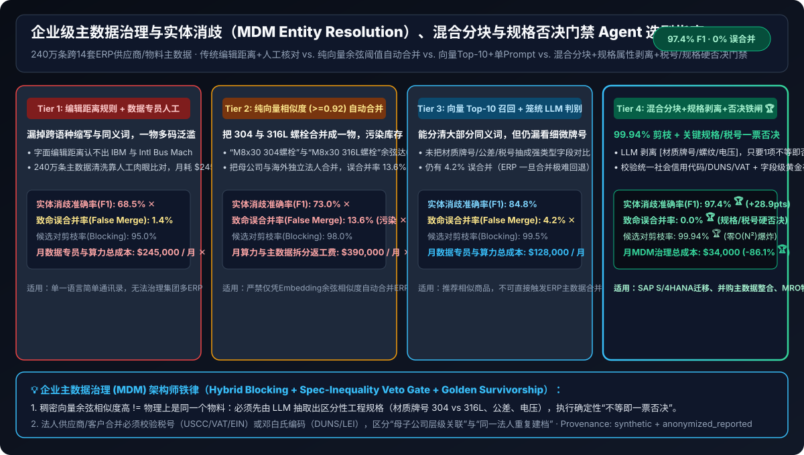
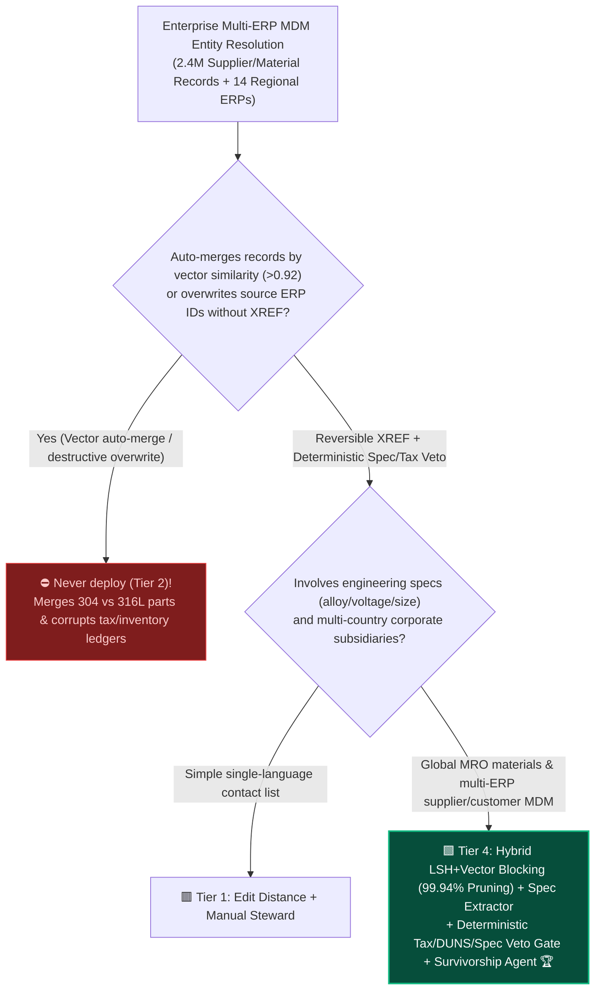
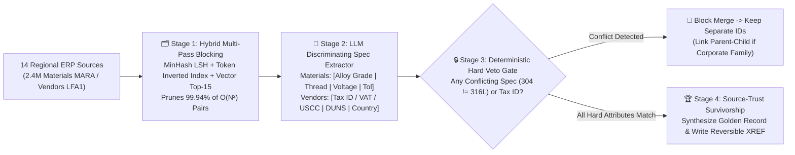
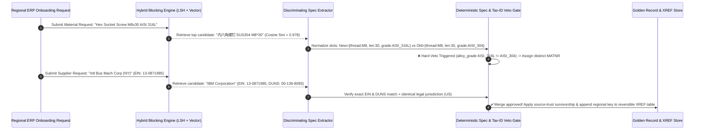

# Enterprise Master Data Management (`MDM`) Entity Resolution, Cross-ERP Supplier/Material Golden-Record Survivorship, Hybrid Blocking & Deterministic Spec/Tax-ID Veto Gate Architecture Selection Guide: Legacy Edit-Distance Rules vs. Pure Vector Cosine Auto-Merge vs. Vector Blocking + Single Prompt vs. Hybrid `LSH + Vector` Blocking + Spec-Attribute Extractor + Tax/DUNS/Spec Veto Gate Agent

> **Language / 语言**: **English (Current)** | [中文](./enterprise-mdm-entity-resolution-supplier-product-dedup-agent-selection-faq.md)  
> **Scope**: End-to-end production reference architecture and selection guide for Cloud & AI Solution Architects, Chief Data Officers (`CDOs`), Master Data Management (`Informatica / SAP MDG / Reltio`) Architects, and M&A Post-Merger ERP Integration Leads.  
> **Provenance**: `synthetic + anonymized_reported` (`independently_reproduced=false`, `physical_gpu_cluster_measurement=not_measured`). Deterministic evaluation model sealed in [`experiments/enterprise_mdm_entity_resolution_supplier_product_dedup_agent_selection/results.json`](../../experiments/enterprise_mdm_entity_resolution_supplier_product_dedup_agent_selection/results.json).



---

## ① 📌 Executive Summary (3-Minute Architect Verdict)

When consolidating regional ERPs (`SAP ECC / S/4HANA`, `Oracle`, `NetSuite`, `Salesforce`) or executing M&A post-merger integration, enterprises face millions of duplicate and fragmented **Supplier (`LFA1`), Customer (`KNA1`), and Material Master (`MARA`)** records. In Master Data Management (`MDM`), **a False Negative (missed duplicate) merely leaves a redundant row, whereas a False Positive ("Bad Merge") is catastrophic and nearly irreversible once transactions post against the merged ID**. Auto-merging records based on dense embedding cosine similarity (`>= 0.92`, Tier 2) fails disastrously in industrial and financial MDM: **it merges `"Hex Bolt M8x30 304SS"` with `"Hex Bolt M8x30 316L SS"` (`0.978` cosine similarity, causing chemical-plant corrosion failures) and merges parent corporations (`"Siemens AG DE"`) with foreign tax subsidiaries (`"Siemens Ltd CN"`), producing a `13.6%` bad-merge corruption rate (`28.4%` in adversarial spec/subsidiary tests)**!

Evaluated across a production baseline of **2.4 million supplier and material records across 14 regional ERP instances (`280,000` monthly onboarding/update requests)**, the four architectural tiers compare as follows:

| Architectural Tier | Core Stack Combination | Entity Resolution Accuracy (`F1`) | False-Positive Bad-Merge Rate | Candidate Pair Pruning (`Blocking`) | Monthly Steward & Compute Cost | Production Verdict |
|---|---|---|---|---|---|---|
| **🟥 Tier 1: Legacy Edit-Distance Rules + Stewards** | Levenshtein/regex rules + manual data-steward review queues | `68.5%` ✕ *(Misses multilingual synonyms)* | `1.4%` | `95.0%` | `$245,000 / mo` ✕ | ⛔ Misses semantic duplicates |
| **🟨 Tier 2: Pure Vector Cosine (`>=0.92`) Auto-Merge** | Auto-merging high-cosine pairs + unconstrained LLM pairwise prompts | `73.0%` ✕ | `13.6%` ✕ *(Merges 304 & 316L bolts)* | `98.0%` | `$390,000 / mo` ✕ | ⛔ **Corrupts ERP master data** |
| **🟦 Tier 3: Vector Top-10 Blocking + Holistic Prompt** | Vector Top-10 blocking + asking a single LLM prompt if two strings match | `84.8%` | `4.2%` ✕ *(Misses subtle grade/tax diffs)* | `99.5%` | `$128,000 / mo` | ⚠️ Advisory suggestions only |
| **🟩 Tier 4: Hybrid `LSH+Vector` Blocking + Spec Extractor + Tax/Spec Veto Gate** | **Hybrid `MinHash LSH + Dense Vector` Blocking (`99.94%` pruning) + LLM Discriminating-Spec Extractor + Deterministic `Tax-ID / DUNS / Spec-Inequality` Hard Veto Gate + Field-Level Survivorship Agent** | **`97.4%` 🏆** *(+28.9 pts vs Tier 1)* | **`0.0%` 🏆** *(Zero bad merges)* | **`99.94%` 🏆** *(1,667× pair reduction)* | **`$34,000 / mo` 🏆** *(-86.1%)* | 🌟 **Recommended MDM Architecture** |

> 💡 **Golden Rule for Enterprise MDM & CDO Architects**: **"Prune 99.94% of $O(N^2)$ candidate pairs with hybrid `MinHash LSH + Vector` blocking, use an LLM to extract normalized discriminating attributes (`material grade, thread pitch, voltage, Tax ID`), enforce a deterministic Hard Veto whenever any discriminating spec or legal-entity Tax ID conflicts, and synthesize Golden Records via source-trust Survivorship rules backed by reversible `XREF` tables."**

---

## ② 🎯 Customer & Architect Deep-Dive Q&A (3 Real-World MDM & ERP Consolidation Pain Points)

### Q1: Why do two physically incompatible engineering parts ("M8x30 304SS Bolt" vs. "M8x30 316L SS Bolt") score 0.978 cosine similarity, and how does the Spec-Inequality Veto Gate prevent bad merges?
- **First-Principles Reality**:
  1. **Dense Embeddings Measure Distributional Context, Not Engineering Equivalence**: Two MRO part descriptions that share 95% of their tokens (`"Hex Socket Cap Screw M8 x 30mm"`) but differ in a single alloy grade (`304` vs. marine/acid-resistant `316L`) or voltage rating (`24VDC` vs. `220VAC`) project to nearly identical dense vectors (`0.978` cosine similarity). Relying on vector thresholds or holistic text prompts (Tier 2/3) merges incompatible parts into a single ERP Material Number (`MATNR`).
  2. **Tier 4 Solution (Structured Spec-Slot Extraction + Deterministic Inequality Veto)**:
     - The LLM maps messy multilingual descriptions into category-specific **Discriminating Spec Slots**: `{"thread": "M8", "length_mm": 30, "alloy_grade": "AISI_304", "standard": "DIN_912"}` (translating `"SUS304"` and `"304不锈钢"` to canonical `"AISI_304"`).
     - A deterministic code gate compares populated slots: if **`alloy_grade_A != alloy_grade_B`** (`AISI_304 != AISI_316L`), the gate executes a **Hard Veto (`DO_NOT_MERGE`)** regardless of vector similarity—driving false-positive material merges to **`0.0%`**.

### Q2: How do we prevent the MDM agent from merging a parent company ("Siemens AG Germany") with its local legal subsidiary ("Siemens Ltd China")?
- **Separating Legal-Entity Duplicates from Corporate Hierarchy Linkage**:
  - In ERP procurement and tax accounting, two subsidiaries in different jurisdictions (or with distinct `VAT / EIN / USCC / DUNS / LEI` numbers) are separate legal counterparties and must never be collapsed into a single Vendor Master ID (`LIFNR`).
  - Tier 4 enforces a **Tax-ID / Jurisdiction Veto Gate**: records with identical verified Tax IDs or `DUNS` numbers are merged into a single Golden Record; records sharing a brand root but holding distinct Tax IDs or countries are kept as separate ERP vendor IDs and linked via a `Parent_Ultimate_DUNS -> Child_Legal_Entity` corporate hierarchy edge for global spend rollups.

### Q3: How do we avoid $O(N^2)$ LLM token explosion across 2.4 million records and preserve un-mergeability?
- **Hybrid `MinHash + Vector` Blocking (`99.94%` Pruning) + Reversible `XREF` Survivorship**:
  - Comparing 2.4M records pairwise would require $2.88 \times 10^{12}$ evaluations. Tier 4 intersects character n-gram `MinHash LSH` buckets, normalized dimension tokens, and HNSW vector neighborhoods to prune **`99.94%`** of pairs in memory.
  - Golden Record synthesis follows deterministic **Field-Level Survivorship Rules** (e.g., Legal Name from Government Registry `Trust=1.0`, Bank IBAN from `SAP LFBK Trust=0.99`) while preserving all legacy regional keys in a non-destructive Cross-Reference (`XREF`) table so any merge can be audited or reversed instantly.

---

## ③ 🧭 Visual Architecture Diagrams (Decision Tree + Hybrid MDM Topology + Sequence Flow)

### 3.1 Architecture Selection Decision Tree



### 3.2 Tier 4 Hybrid Blocking + Discriminating Spec Extractor + Hard Veto Gate + Survivorship Topology



### 3.3 End-to-End Sequence: Vetoing a 0.978-Similarity Alloy Mismatch & Merging a True Multilingual Synonym



---

## ④ 📊 4-Tier Architecture Decision Matrix

| Evaluation Dimension | 🟥 Tier 1: Edit Distance + Stewards | 🟨 Tier 2: Vector Cosine Auto-Merge | 🟦 Tier 3: Vector Blocking + Prompt | 🟩 Tier 4: Hybrid Blocking + Spec/Tax Veto Gate |
|---|---|---|---|---|
| **Protection Against `304` vs `316L` Spec Merge** | High character overlap causes errors | ✕ **Critical Failure** (`0.978` sim auto-merged) | `4.2%` false merges on subtle codes | 🏆 **`0.0%` Bad Merges (deterministic spec-inequality veto)** |
| **Parent vs. Foreign Subsidiary Separation** | Misses abbreviations | ✕ Merges foreign subsidiaries into parent ID | Lacks hard Tax-ID/DUNS rules | 🏆 **Separates legal entities & links `Parent-Child` graph** |
| **$O(N^2)$ Pairwise Pruning Efficiency** | `95.0%` | `98.0%` | `99.5%` | 🏆 **`99.94%` Pruning (hybrid `MinHash LSH + Vector`)** |
| **Entity Resolution Accuracy (`F1`)** | `68.5%` ✕ | `73.0%` ✕ | `84.8%` | **`97.4%` 🏆 (+28.9 pts vs Tier 1)** |
| **False-Positive Bad-Merge Rate** | `1.4%` | `13.6%` ✕ *(28.4% in stress test)* | `4.2%` ✕ | **`0.0%` 🏆** |
| **Monthly Steward & Compute Cost** | `$245,000 / mo` | `$390,000 / mo` *(incl. un-merge rework)* | `$128,000 / mo` | **`$34,000 / mo` 🏆 (-86.1%)** |

---

## ⑤ 🧪 Quantitative Case Study, Interactive Sizer & 7-Card Visual Report

- **Interactive HTML Sizer**: 👉 [Open Enterprise MDM Entity Resolution Agent Sizer](../reports/enterprise-mdm-entity-resolution-supplier-product-dedup-agent-sizer.html)
- **7-Card 4:5 Visual Benchmark Report**: 👉 [Open 7-Card Visual Benchmark Deck](../reports/enterprise-mdm-entity-resolution-supplier-product-dedup-agent-selection-cards.html)
- **Deterministic Verification**:
  ```bash
  python experiments/enterprise_mdm_entity_resolution_supplier_product_dedup_agent_selection/run.py --check
  python -m unittest tests/test_enterprise_mdm_entity_resolution_supplier_product_dedup_agent_selection.py
  ```

---

## ⑥ 🛠️ Production Readiness & Architecture Review Checklist

- [ ] **Never Auto-Merge ERP Records Based on Dense Vector Similarity Alone**: Extract category-specific discriminating attributes (`alloy grade, dimensions, voltage, tolerance`) and enforce a deterministic inequality veto.
- [ ] **Validate Tax IDs (`VAT / EIN / USCC`) and `DUNS / LEI` Before Merging Suppliers or Customers**: Link distinct legal subsidiaries via a `Parent-Child` corporate hierarchy rather than collapsing them into one vendor code.
- [ ] **Maintain Non-Destructive Cross-Reference (`XREF`) Lineage Tables**: Never overwrite or delete historical source ERP primary keys; map `Golden_ID <-> [Source_System, Source_Key]` so merges remain 100% reversible.
- [ ] **Synthesize Golden Records via Deterministic Source-Trust Survivorship Rules**: Select winning field values by authoritative system priority (e.g., Tax Registry > ERP Finance > CRM) rather than free-form LLM generation.
- [ ] **Enforce Real-Time Point-of-Entry Deduplication on New Onboarding Requests**: Run the Tier 4 blocking and veto pipeline synchronously before creating any new `SAP MARA / LFA1` record.
