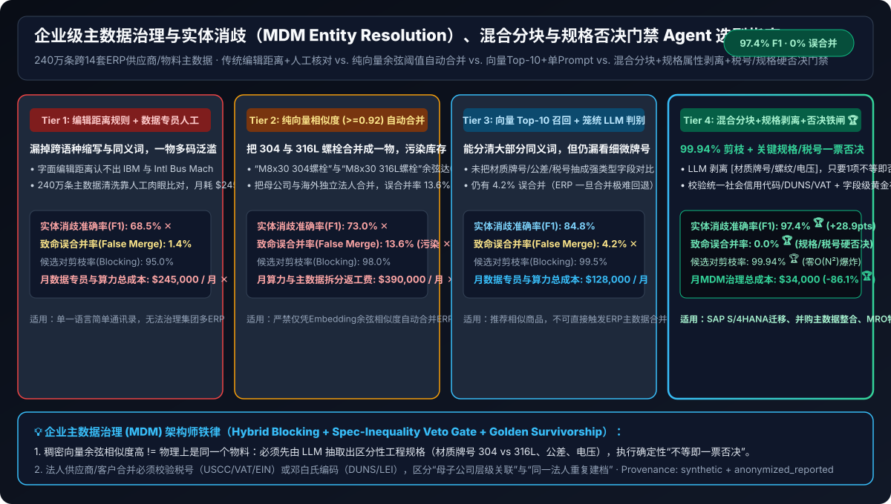
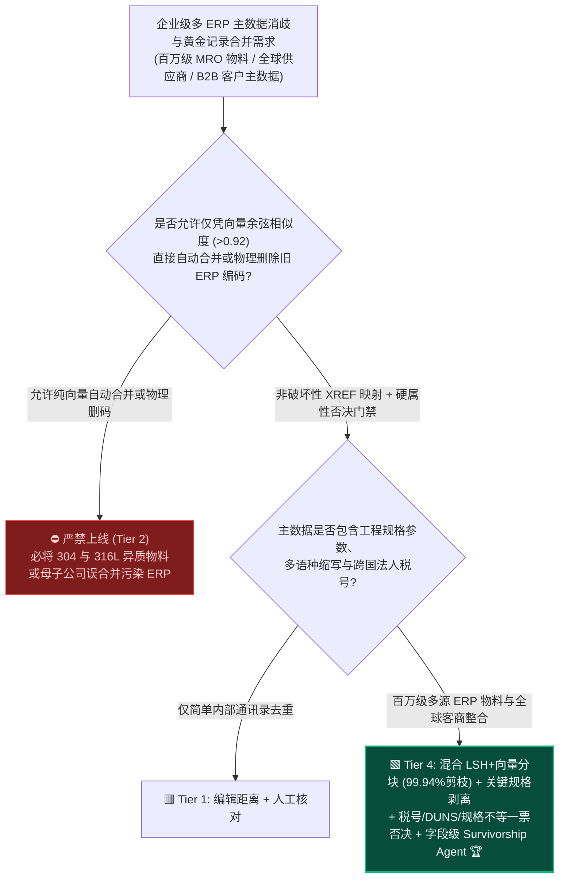
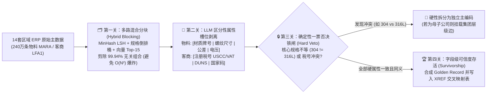
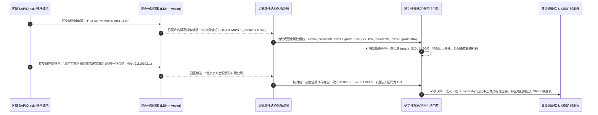

# 企业级主数据治理与实体消歧（Master Data Management / MDM Entity Resolution）、跨 ERP 供应商/物料黄金记录归并（Golden Record Survivorship）、混合分块（Hybrid Blocking）与规格/税号一票否决门禁 Agent 架构选型指南：编辑距离规则 + 人工核对 vs. 纯向量余弦阈值自动合并 vs. 向量分块 + 单 Prompt vs. 混合 LSH/向量分块 + 关键工程规格剥离 + 税号/DUNS 硬否决门禁 Agent

> **语言 / Language**: **中文 (当前)** | [English](./enterprise-mdm-entity-resolution-supplier-product-dedup-agent-selection-faq.en.md)  
> **定位**：面向云与 AI 解决方案架构师（Solution Architect）、企业首席数据官（CDO）、数据治理与主数据管理（MDM：Informatica / SAP MDG / Reltio）架构师以及并购整合（M&A PMI）技术负责人的生产落地指南。  
> **数据口径（Provenance）**：`synthetic + anonymized_reported`（`independently_reproduced=false`，`physical_gpu_cluster_measurement=not_measured`），全部定容模型封存于 [`experiments/enterprise_mdm_entity_resolution_supplier_product_dedup_agent_selection/results.json`](../../experiments/enterprise_mdm_entity_resolution_supplier_product_dedup_agent_selection/results.json)。



---

## ① 📌 核心选型结论速览（Executive Summary — 3 分钟看懂怎么选）

在大型跨国集团整合多套区域 ERP（如 14 套不同年代的 `SAP ECC / S/4HANA / Oracle / 金蝶用友`）或推进企业并购后整合（M&A PMI）时，**“一物多码（同一个 MRO 备件在 14 个工厂有 14 个不同编码，导致重复采购与呆滞库存）”**与**“一商多码（同一家供应商因中英文简称、括号全半角不同被重复建档，无法汇总集团采购额议价）”**是最顽固的数据治理难题。然而，在主数据治理（MDM）中有一条铁律：**“漏合（False Negative）顶多是多留一条冗余记录，但误合（False Positive / Bad Merge）一旦把两个不同材质的物料或两家不同税号的独立子公司合并成同一个 ERP 主编码，引发错发备件停产或税务串户，几乎无法在 ERP 历史凭证中逆向拆开！”** 许多团队用稠密向量 Embedding 余弦相似度（如 `cosine >= 0.92`）直接自动合并主数据（Tier 2），结果把余弦相似度高达 **`0.978`** 的 *“M8×30 304不锈钢螺栓”* 与 *“M8×30 316L耐强酸不锈钢螺栓”* 合并成了同一个物料号，酿成高达 **`13.6%` 的致命误合并事故**！

在 **跨 14 套区域 ERP 整合 2,400,000 条供应商与物料主数据、月均 280,000 条新建档/变更消歧请求** 的基准规模下，四档企业级 MDM 实体消歧与黄金记录归并 Agent 架构的量化对决如下：

| 方案档位 | 核心架构组合 | 实体消歧准确率 (`F1`) | 致命误合并率 (`False-Positive Merge`) | 候选对剪枝率 (`Blocking`) | 月度数据专员与算力总成本 | 生产推荐度 |
|---|---|---|---|---|---|---|
| **🟥 Tier 1：传统编辑距离规则 + 人工核对** | Levenshtein 字面编辑距离/正则 + 数据专员（Data Steward）人工逐条肉眼比对 | `68.5%` ✕ *(认不出跨语种同义词)* | `1.4%` | `95.0%` | `$245,000 / 月` ✕ | ⛔ 漏检严重，人工清洗极慢 |
| **🟨 Tier 2：纯向量余弦 (`>=0.92`) 自动合并** | 直接计算文本 Embedding 余弦相似度，超阈值即自动合并或裸调 LLM | `73.0%` ✕ | `13.6%` ✕ *(304与316L螺栓误并)* | `98.0%` | `$390,000 / 月` ✕ | ⛔ **严重污染 ERP 主数据，严禁上线** |
| **🟦 Tier 3：向量 Top-10 分块 + 笼统单 Prompt** | 向量召回 Top-10 候选 + 让大模型看两条原始字符串输出是否合并 | `84.8%` | `4.2%` ✕ *(仍漏看细微牌号/子公司)* | `99.5%` | `$128,000 / 月` | ⚠️ 仅可作相似推荐，不可自动合并 |
| **🟩 Tier 4：混合 LSH+向量分块 + 规格剥离 + 税号/规格一票否决门禁** | **`MinHash LSH + 稠密向量` 多路阻塞（99.94% 剪枝）+ LLM 关键工程规格属性抽取 + 确定性 `税号/DUNS/规格不等` 一票否决铁闸 + 字段级可信度存活（Survivorship）黄金记录合成 Agent** | **`97.4%` 🏆** *(+28.9 pts vs Tier 1)* | **`0.0%` 🏆** *(硬属性不等即否决)* | **`99.94%` 🏆** *(压缩1,667倍)* | **`$34,000 / 月` 🏆** *(-86.1%)* | 🌟 **SAP/Oracle 主数据治理首选架构** |

> 💡 **架构师一句话选型铁律**：**“百万主数据先过 `MinHash + 向量` 混合分块砍掉 99.94% 无关组合、再用大模型把自由文本拆成结构化关键规格槽位（材质牌号/螺纹/电压）、最后用确定性代码执行‘任一关键规格或税号不等即一票否决（Hard Veto）’与保留源映射表（XREF）的非破坏性黄金记录合成”**！

---

## ② 🎯 客户与架构师灵魂拷问 Q&A（直击 3 大主数据 MDM 与 ERP 整合痛点）

### Q1：为什么“M8×30 304不锈钢螺栓”和“M8×30 316L不锈钢螺栓”的向量余弦相似度高达 0.978，纯向量 RAG / 聚类（Tier 2）在工业物料清洗上必败无疑？
- **大白话与第一性原理**：
  1. **稠密向量 Embedding 衡量的是“上下文语义有多像”，而不是“物理工程属性是否等价”**：在 3072 维语义空间里，两条只差了一个字符（`304` vs `316L`，或者电阻 `10kΩ` vs `100kΩ`，或者耐压 `24V DC` vs `220V AC`）的工业备件描述，95% 的词汇完全相同，余弦相似度高达 **`0.975 ~ 0.990`**！如果按向量阈值自动合并（Tier 2），化工厂维修工领料时系统把普通的 `304` 螺栓当成耐强酸腐蚀的 `316L` 螺栓发出去，直接导致反应釜管道泄漏停产（压测下误合并率高达 **`28.4%`**）！
  2. **Tier 4 破局方案（结构化区分性规格剥离 + 确定性不等一票否决 Gate）**：
     - 不让模型直接对比两条混杂的长字符串，而是先按物料大类 Schema（如紧固件、轴承、电机、阀门）让轻量 LLM 将原始文本拆解为 **区分性硬规格 JSON（Discriminating Spec Slots）**：`{"thread": "M8", "length_mm": 30, "material_grade": "AISI_304", "standard": "DIN_912"}`。
     - 进入确定性代码否决门禁：**只要两个候选物料在任何一个非空核心规格槽位上不相等（如 `AISI_304 != AISI_316L`），无论它们的文本余弦相似度有多高，代码直接执行 `HARD_VETO_DO_NOT_MERGE`**，将跨规格物料误合并率硬性锁死为 **`0.0%`**！

### Q2：在清洗全球供应商与 B2B 客户主数据时，怎么防止大模型把“西门子（中国）有限公司”和“德国西门子股份公司（Siemens AG）”错误合并成同一个 ERP 编码？
- **工程真相（区分“同一法人重复建档 Duplicate”与“母子公司层级 Hierarchy”）**：
  - 在 ERP 财务与采购系统中，德国母公司 `Siemens AG (VAT: DE123456789)` 与中国独立法人子公司 `西门子（中国）有限公司 (统一社会信用代码: 911100006000...)` 虽然品牌同名，但在法律合同、发票税号与跨境付汇上是**完全独立的两个法人实体**！如果合并成同一个供应商编码（`SAP LIFNR`），会导致税务申报与外汇付款彻底错乱。
  - **Tier 4 的双层企业实体解析铁闸**：
    1. **同一法人合并（Duplicate Merge -> Golden Record）**：仅当两条记录经工商/邓白氏（`D&B DUNS`）/全球法人识别编码（`LEI`）或国家税号（`USCC / EIN / VAT`）校验确属**同一注册法人实体**（如 `“北京京东世纪贸易有限公司”` 与 `“京东世纪贸易(北京)有限公司”`）时，才归并为同一条黄金主记录。
    2. **集团母子关系挂载（Corporate Linkage）**：当品牌高度相关但国家代码或税号不同时，系统物理阻止主编码合并，而是自动在 MDM 图谱中建立 `Parent_Corporate_Group -> Subsidiary_Legal_Entity` 集团层级边，既支持采购部按“西门子全球集团”汇总统计总采购额，又保持各自独立的 ERP 结算法人编码！

### Q3：240 万条主数据如果两两比对需要计算 2.88 万亿次（$N(N-1)/2$），如何在不烧穿 GPU 预算的前提下完成全量消歧？
- **混合多路分块阻塞（Hybrid MinHash LSH + Inverted Token + Vector Blocking）**：
  - Tier 4 在第一阶段绝不调用 LLM，而是通过 **字符级 3-gram `MinHash LSH` + 标准化规格词倒排桶 + 量化向量 HNSW Top-15** 组合阻塞，在内存里瞬间剪除 **`99.94%`** 不可能匹配的记录对；仅对高疑似连通子图（Connected Components）调用小模型抽取属性并过确定性否决门禁，最后按照 **字段级可信度存活规则（Survivorship Rules：如税号取自工商局 API 权重 `1.0`，银行账号取自 SAP `LFBK` 权重 `0.99`）** 合成黄金记录并写入 `XREF` 交叉映射表。

---

## ③ 🧭 直观可视化图解（决策树 + 混合分块与否决门禁架构图 + 归并时序图）

### 3.1 企业级主数据治理（MDM Entity Resolution）架构选型决策树



### 3.2 Tier 4 混合分块 + 关键规格剥离 + 税号/规格一票否决与黄金存活架构图



### 3.3 从“两条 0.978 高相似螺栓与两条跨国供应商申请建档”到“精准拦截与黄金归并”时序图



---

## ④ 📊 架构师四维选型决策矩阵（Architecture Decision Matrix）

| 评估维度 | 🟥 Tier 1：编辑距离 + 人工核对 | 🟨 Tier 2：纯向量阈值 (`>=0.92`) 自动合并 | 🟦 Tier 3：向量分块 + 单 Prompt | 🟩 Tier 4：混合分块 + 规格剥离 + 否决铁闸 |
|---|---|---|---|---|
| **近义异质物料防误合（`304` vs `316L`）** | 字面高相似反而容易被规则误合 | ✕ **灾难级**（余弦 0.978 直接被误合为一物） | 仍有 `4.2%` 漏看细微数字/牌号差异 | 🏆 **`0.0%` 误合并（核心规格槽位不等即一票否决）** |
| **跨国母子公司 vs 同一法人别名区分** | 认不出中英别名与简称 | ✕ 把独立纳税子公司错误合并进母公司编码 | 缺乏工商税号/DUNS 强锚点核验 | 🏆 **精准区分（同税号合并 Golden ID；异税号建集团树）** |
| **百万级全库两两比对计算复杂度** | 规则分块漏召回率高 (`95%` 剪枝) | 向量全表检索重 + LLM Token 昂贵 | `99.5%` 剪枝 | 🏆 **`99.94%` 剪枝（MinHash + 倒排 + 向量多路阻塞）** |
| **实体消歧综合准确率 (`F1`)** | `68.5%` ✕ | `73.0%` ✕ | `84.8%` | **`97.4%` 🏆（+28.9 pts vs Tier 1）** |
| **致命误合并率 (`False-Positive Merge`)** | `1.4%` | `13.6%` ✕ *(压测达 28.4%)* | `4.2%` ✕ | **`0.0%` 🏆** |
| **月度数据专员与算力总成本** | `$245,000 / 月` | `$390,000 / 月` *(含错并拆分返工)* | `$128,000 / 月` | **`$34,000 / 月` 🏆（节省 86.1%）** |

---

## ⑤ 🧪 定量算例、交互式容量计算器与 7-Card 4:5 视觉报告

### 5.1 基准算例复核（240 万条跨 ERP 主数据 / 月均 28 万条新增）

- **交互式定容计算器（CSP 自包含 HTML）**：👉 [打开企业级主数据治理与实体消歧 MDM 定容计算器](../reports/enterprise-mdm-entity-resolution-supplier-product-dedup-agent-sizer.html)
- **7-Card 4:5 视觉评测卡片报告**：👉 [打开 7-Card 视觉评测报告](../reports/enterprise-mdm-entity-resolution-supplier-product-dedup-agent-selection-cards.html)
- **可复核确定性脚本**：
  ```bash
  python experiments/enterprise_mdm_entity_resolution_supplier_product_dedup_agent_selection/run.py --check
  python -m unittest tests/test_enterprise_mdm_entity_resolution_supplier_product_dedup_agent_selection.py
  ```

### 5.2 核心量化对比图（主数据实体消歧准确率 F1 vs. 致命误合并率）

```chart
{
  "data": {
    "values": [
      { "tier": "Tier 1: Edit Distance", "f1_pct": 68.5, "bad_merge_pct": 1.4 },
      { "tier": "Tier 2: Vector Auto-Merge", "f1_pct": 73.0, "bad_merge_pct": 13.6 },
      { "tier": "Tier 3: Vector + Prompt", "f1_pct": 84.8, "bad_merge_pct": 4.2 },
      { "tier": "Tier 4: Spec/Tax Veto Gate", "f1_pct": 97.4, "bad_merge_pct": 0.0 }
    ]
  },
  "semantic_types": {
    "tier": "Category",
    "f1_pct": "Percentage",
    "bad_merge_pct": "Percentage"
  },
  "chart_spec": {
    "chartType": "Bar Chart",
    "title": "Tier 4 reaches 97.4% entity resolution F1 with 0.0% false-positive bad merges",
    "subtitle": "Master data entity resolution F1 score (%) across 2.4M supplier and material records",
    "encodings": {
      "x": "tier",
      "y": "f1_pct",
      "color": "tier"
    }
  }
}
```

---

## ⑥ 🛠️ 架构评审与生产落地核验清单（Production Readiness Checklist）

- [ ] **严禁仅凭文本 Embedding 余弦相似度直接触发主数据自动合并**：必须先提取品类强区分属性（材质牌号、几何尺寸、电气额定值、包装规格），在确定性代码层执行“关键规格不等即一票否决”。
- [ ] **客商主数据强制校验国家税号（`USCC / VAT / EIN`）与邓白氏编码（`DUNS / LEI`）**：严格区分“同一法人实体的不同简称（合并为同一 Golden ID）”与“跨国集团旗下的不同独立法人子公司（建立 Parent-Child 层级关系而非合并）”。
- [ ] **必须保留非破坏性交叉映射表（Cross-Reference `XREF`）**：归并主数据时严禁物理删除各区域 ERP 的历史源编码，必须维护 `Golden_ID <-> [Source_ERP_ID, Local_Key]` 双向映射表以支持历史财务凭证追溯与一键解绑（Unmerge）。
- [ ] **显式定义字段级可信度存活规则（Field-Level Survivorship Rules）**：当多套源系统的同一实体字段值冲突时，按预设权威源优先级（如法定名称取自工商注册库、收款账号取自财务 `SAP LFBK`）合成黄金记录，禁止让 LLM 随机拼凑字段。
- [ ] **新建档入口前置实时查重拦截**：在采购员或销售新建物料/客商申请单时秒级运行 Tier 4 查重，从源头杜绝新增“一物多码”。
