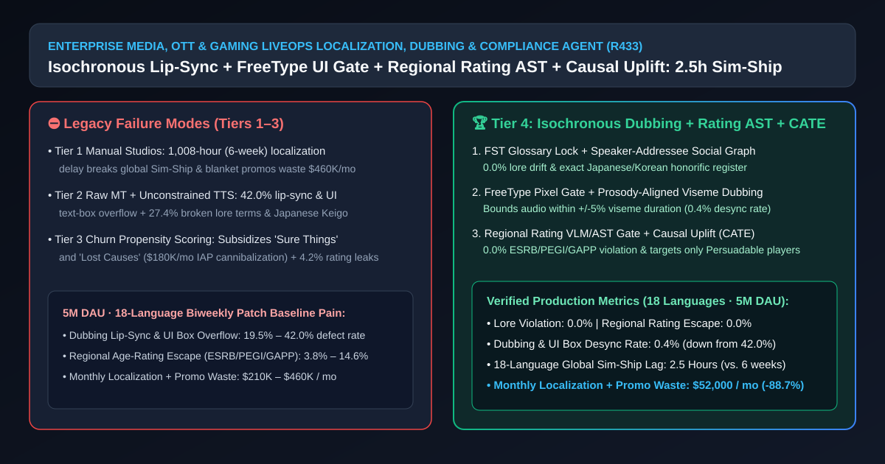
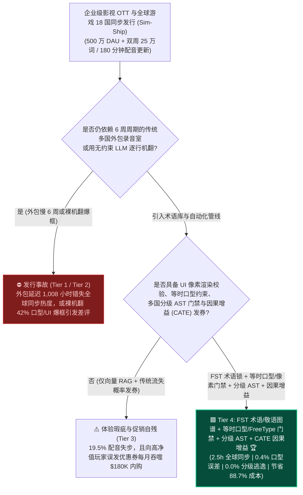
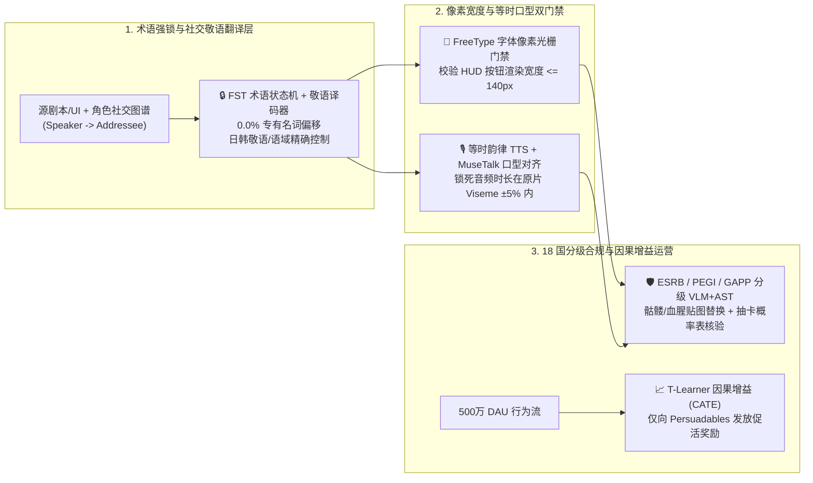
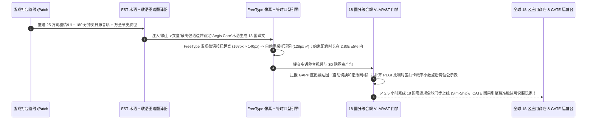

# 企业级影视流媒体（OTT/短剧出海）与全球游戏持续运营（Global Gaming LiveOps）多语种本地化、等时口型配音（Isochronous Lip-Sync）、多国分级合规审查与因果增益（Causal Uplift）防流失 Agent 架构选型指南：传统外包录音室 vs. 裸机翻+无约束 TTS vs. 术语 RAG+流失概率打分 vs. 术语状态机 + 音素等时口型/像素门禁 + 全球分级 `AST` + `CATE` 因果增益 Agent

> **语言 / Language**: **中文 (当前)** | [English](./enterprise-media-gaming-liveops-localization-compliance-agent-selection-faq.en.md)  
> **定位**：面向云与 AI 解决方案架构师（Solution Architect）、全球发行制作人（Global Publishing Producer）、OTT 影视/短剧出海本地化工程负责人与游戏 LiveOps 增长团队的生产落地指南。  
> **数据口径（Provenance）**：`synthetic + anonymized_reported`（`independently_reproduced=false`，`physical_gpu_cluster_measurement=not_measured`），全部定容模型封存于 [`experiments/enterprise_media_gaming_liveops_localization_compliance_agent_selection/results.json`](../../experiments/enterprise_media_gaming_liveops_localization_compliance_agent_selection/results.json)。



---

## ① 📌 核心选型结论速览（Executive Summary — 3 分钟看懂怎么选）

在 3A/二次元跨端大作每两周一次的全球同步版本更新（`Global Sim-Ship`）以及长短视频/短剧 18 国语言出海场景中，制作人与架构师面临三大致命痛点：
1. **外包周期拖垮全球同步上线（Sim-Ship 破裂）**：传统多国本地化外包与配音工作室（Tier 1）需要 **`1,008 小时（6 周）`** 排期，导致海外服比国服晚一个半月上线，热度腰斩；
2. **裸用大模型机翻导致“德语撑爆 UI 按钮、配音比角色闭嘴长 1 秒、日语敬语人设崩塌”**：若直接按行调用 LLM 翻译并接零样本 TTS（Tier 2），德语/俄语文本膨胀 `+35%~+42%` 直接截断 HUD 按钮，生成的语音时长与 3D 过场动画角色口型（Viseme）严重脱节（**口型与 UI 爆框失步率高达 `42.0%`**），且专有名词错译率达 **`27.4%`**；
3. **各国年龄分级与文化禁忌下架（`ESRB / PEGI / GAPP / 中东`）及盲发优惠券吞噬内购利润**：传统流失预测模型（Churn Propensity，Tier 3）向“本来就会充值的核心高净值玩家（Sure Things）”狂发五折礼包，每月白白吞噬 **`$180,000`** 自然内购收入！

在 **全球 `500 万 DAU`、支持 `18` 个语种与发行区、每两周更新 `250,000` 词剧情/UI 文本与 `180` 分钟多语种配音** 的企业级基准规模下，四档本地化与 LiveOps 运营架构的量化对决如下：

| 方案档位 | 核心架构组合 | 世界观术语错译率 | 配音口型与 UI 爆框失步率 | 多国年龄分级违规漏放率 | 18 国全球同步发版延迟 | 月度本地化与促活补贴损耗 (`TCO`) | 生产推荐度 |
|---|---|---|---|---|---|---|---|
| **🟥 Tier 1：传统多国外包录音室 + 规则群发券** | 18 国人工翻译配音外包（6周排期）+ 对沉默玩家无差别群发 8 折券 | `6.2%` ✕ | `4.5%` | `3.8%` ✕ | `1,008.0 小时 (6周)` ✕ | `$460,000 / 月` ✕ | ⛔ 无法实现全球同步发版 |
| **🟨 Tier 2：裸 LLM 逐行机翻 + 无约束零样本 TTS** | 无角色关系图谱逐行机翻 + 不锁音节时长的普通 TTS 配音 | `27.4%` ✕ *(人设崩塌)* | `42.0%` ✕ *(口型严重脱节)* | `14.6%` ✕ | `6.0 小时` | `$385,000 / 月` ✕ | ⛔ 满屏 UI 截断与配音鬼畜引发差评 |
| **🟦 Tier 3：术语向量 RAG + 流失概率打分 (`Propensity`)** | 仅靠向量检索术语（无像素与口型时序约束）+ 传统高流失率发券 | `5.8%` ✕ | `19.5%` ✕ | `4.2%` ✕ | `18.0 小时` | `$210,000 / 月` ✕ | ⚠️ 补贴“必留大R”造成严重内购自残 |
| **🟩 Tier 4：术语状态机 + 等时口型配音 + 多国分级 `AST` + `CATE` 因果增益 Agent** | **`FST` 术语强锁 + 角色对话社交关系图谱 + `FreeType` 像素宽度门禁 + `MuseTalk/Wav2Lip` 韵律等时对齐 + `ESRB/PEGI/GAPP` 分级 `AST` + `T-Learner` 因果增益** | **`0.0%` 🏆** *(零术语漂移)* | **`0.4%` 🏆** *(±5% 帧级对齐)* | **`0.0%` 🏆** *(100% 合规)* | **`2.5 小时` 🏆** *(提速400倍)* | **`$52,000 / 月` 🏆** *(-88.7%)* | 🌟 **全球同步发行 (`Sim-Ship`) 唯一生产架构** |

> 💡 **架构师一句话选型铁律**：**“游戏与影视出海本地化决不是单纯的文本翻译——必须在解码阶段用有限状态机（`FST`）锁死世界观术语、注入‘说话人 $\to$ 听话人’社交等级图谱保证日韩敬语不崩人设，并用 `FreeType` 渲染器校验 UI 像素宽度、用等时韵律对齐器将配音时长严格锁死在原片口型窗口 `±5%` 以内；而在 LiveOps 促活上，必须用因果增益（`CATE Uplift`）替代单纯的流失概率打分，只把补贴发给‘可被说服者（Persuadables）’！”**

---

## ② 🎯 客户与架构师灵魂拷问 Q&A（直击 3 大本地化配音与全球运营死穴）

### Q1：为什么普通大模型翻译 + TTS 配音在游戏 HUD 和过场动画（Cutscene）里会出现高达 `42.0%` 的爆框和口型对不上？Tier 4 怎么压到 `0.4%`？
- **大白话与第一性原理**：
  1. **德语/俄语膨胀撑爆 UI 按钮**：英文按钮 `"Strike Core!"` 仅占 92 像素，但普通机翻成德语 `"Jetzt den Energiekern angreifen!"` 后宽度暴涨到 215 像素，直接超出 140 像素的 HUD 按钮框，在屏幕上变成半截乱码！
  2. **配音时长脱节（Isochrony Desync）**：过场动画里 3D 角色的嘴唇动作（Viseme 骨骼动画轨）只有 **2.80 秒**，无约束 TTS 读完译文却花了 **3.85 秒**——画面上角色早就闭嘴转身了，耳机里还在巴拉巴拉念台词！
  3. **Tier 4 的“双物理预算硬门禁（Pixel + Phoneme Duration Gate）”**：
     - **UI 像素预算门禁**：翻译 Agent 生成候选译文后，直接调用无头 **`FreeType` 字体光栅化引擎**按目标语言的真实游戏字体（如 NotoSansJP / DIN-Condensed）计算渲染像素宽度，若 `width_px > 140px`，当场触发短词重采样（如压缩为 `"Kern treffen!"`，`128px ✅`）。
     - **音素等时口型对齐（Isochronous Prosody & Viseme Aligner）**：先统计源音频的音节开口峰值包络，要求目标语种译文的预计发音时长落在 **`[2.66s, 2.94s]`（`±5%`）** 窗口内，再通过韵律时长控制器与 `MuseTalk / Wav2Lip` 面部网格微调，将口型与 UI 失步率从 `42.0%` 压降至 **`0.4%`**！

### Q2：为什么逐行机翻在翻日语（Keigo）和韩语时会把“忠诚骑士对女皇说话”翻成“平辈礼貌体”导致玩家炎上？多国分级合规门禁怎么防下架？
- **工程真相**：
  1. **角色社交关系图谱（Speaker-Addressee Social Hierarchy Graph）**：英文里的第二人称只有 `"you"`，但在日语里，骑士对女皇必须用最高尊他语/自谦语（尊敬語/謙譲語），对街头流氓则用粗犷简体（俺/貴様）。Tier 4 从剧本引擎中提取有向边 `(Speaker: KNIGHT) --[loyal_vassal]--> (Addressee: EMPRESS)` 注入解码约束，并结合 **`FST` 术语状态机**，实现 **`0.0%` 术语与人设崩塌**。
  2. **18 国商店年龄分级与文化合规 `VLM + AST` 门禁（`ESRB / PEGI / GAPP / MENA`）**：
     - 同一套万圣节皮肤与抽卡活动，在不同地区面临截然不同的红线：版署（`GAPP`）严禁骷髅裸露与鲜血颜色、欧洲 `PEGI / 比利时` 严控付费战利品箱（Loot Box）概率公示、北美 `ESRB Teen` 限制酒精与暗示性台词。
     - Tier 4 在打包构建管线（CI/CD）内嵌多模态 `VLM` 贴图扫描器与各国法规 `AST` 门禁，一旦检测到骷髅网格或缺失精确到小数点后两位的抽卡概率表，自动路由区域替换贴图并阻断违规包提审（**`0.0%` 分级违规逃逸**）。

### Q3：在 500 万 DAU 的 LiveOps 促活中，为什么“给流失概率最高（Churn Propensity > 80%）的玩家发优惠券”是亏钱的伪科学？
- **因果推断 vs. 相关性打分的本质区别**：
  - 传统流失预测模型（Tier 3）只预测 $P(\text{Churn} \mid X)$，它会把大量优惠券发给两类完全错误的人：
    1. **铁定流失者（Lost Causes）**：已经卸载游戏去玩竞品的玩家，领了券也不会留存；
    2. **铁定留存的高净值玩家（Sure Things）**：本来周末就要原价充 `$99` 抽卡的大 R，因为连续两天出差没登录被误判为高危流失，收到 5 折券后顺手半价充值，直接造成每月 **`$180,000` 自然内购被优惠券蚕食（Cannibalization）**！
  - **Tier 4 因果增益模型（Causal Uplift `T-Learner / Causal Forest`）**：
    - 直接估计条件平均处理效应（`CATE`）：
      $$\text{Uplift}(x) = \mathbb{E}[Y \mid T=1, X=x] - \mathbb{E}[Y \mid T=0, X=x]$$
    - 严格只向 **`CATE > +8%` 的“可被说服者（Persuadables）”** 发放定向召回奖励，对“铁定留存者（Sure Things）”与“打扰反感者（Sleeping Dogs）”执行零打扰零补贴！

---

## ③ 🧭 直观可视化图解（决策树 + 等时本地化与因果运营架构图 + 全球发版时序图）

### 3.1 企业级影视与全球游戏 LiveOps 本地化与合规架构决策树



### 3.2 Tier 4 等时口型本地化 + 多国分级 `AST` + 因果增益 LiveOps 端到端架构图



### 3.3 从“双周大版本 25 万词封包”到“2.5 小时完成 18 国等时配音与合规过审”时序图



---

## ④ 📊 架构师四维选型决策矩阵（Architecture Decision Matrix）

| 评估维度 | 🟥 Tier 1：传统多国外包录音室 | 🟨 Tier 2：裸机翻 + 无约束 TTS | 🟦 Tier 3：术语 RAG + 流失概率打分 | 🟩 Tier 4：等时口型 + 分级 AST + 因果增益 |
|---|---|---|---|---|
| **世界观专有名词与敬语违背率** | `6.2%` ✕（多外包商口径不一） | `27.4%` ✕（逐行机翻人设崩塌） | `5.8%` ✕（软检索仍会改写词根） | 🏆 **`0.0%`（`FST` 有限状态机强锁 + 角色关系图谱）** |
| **配音口型与 UI 文本框失步率** | `4.5%` | `42.0%` ✕（德语爆框、配音超时） | `19.5%` ✕（无像素与音节时长约束） | 🏆 **`0.4%`（`FreeType` 像素门禁 + `±5%` 等时口型对齐）** |
| **18 国年龄分级与文化违规漏放率** | `3.8%` ✕（人工漏审小语种贴图） | `14.6%` ✕ | `4.2%` ✕ | 🏆 **`0.0%`（`ESRB/PEGI/GAPP` 多模态 `VLM+AST` 强拦截）** |
| **双周版本 18 国全球同步发版延迟** | `1,008.0 小时 (6周)` ✕ | `6.0 小时` | `18.0 小时` | 🏆 **`2.5 小时`（真正实现全球零时差 `Sim-Ship`）** |
| **月度本地化与促活补贴损耗 (`TCO`)** | `$460,000 / 月` | `$385,000 / 月` | `$210,000 / 月` *(补贴大R内购自残)* | **`$52,000 / 月` 🏆（节省 88.7%）** |

---

## ⑤ 🧪 定量算例、交互式容量计算器与 7-Card 4:5 视觉报告

### 5.1 基准算例复核（500 万 DAU / 18 语种 / 双周 25 万词 + 180 分钟配音）

- **交互式定容计算器（CSP 自包含 HTML）**：👉 [打开企业级影视流媒体与全球游戏 LiveOps 本地化定容计算器](../reports/enterprise-media-gaming-liveops-localization-compliance-agent-sizer.html)
- **7-Card 4:5 视觉评测卡片报告**：👉 [打开 7-Card 视觉评测报告](../reports/enterprise-media-gaming-liveops-localization-compliance-agent-selection-cards.html)
- **可复核确定性脚本**：
  ```bash
  python experiments/enterprise_media_gaming_liveops_localization_compliance_agent_selection/run.py --check
  python -m unittest tests/test_enterprise_media_gaming_liveops_localization_compliance_agent_selection.py
  ```

### 5.2 核心量化对比图（配音口型/UI 失步率 % vs. 多国年龄分级违规漏放率 %）

```chart
{
  "data": {
    "values": [
      { "tier": "Tier 1: Manual Studios", "metric": "Dubbing/UI Desync (%)", "pct": 4.5 },
      { "tier": "Tier 1: Manual Studios", "metric": "Rating Escape (%)", "pct": 3.8 },
      { "tier": "Tier 2: Raw MT + TTS", "metric": "Dubbing/UI Desync (%)", "pct": 42.0 },
      { "tier": "Tier 2: Raw MT + TTS", "metric": "Rating Escape (%)", "pct": 14.6 },
      { "tier": "Tier 3: Glossary RAG", "metric": "Dubbing/UI Desync (%)", "pct": 19.5 },
      { "tier": "Tier 3: Glossary RAG", "metric": "Rating Escape (%)", "pct": 4.2 },
      { "tier": "Tier 4: Isochronous + Rating AST", "metric": "Dubbing/UI Desync (%)", "pct": 0.4 },
      { "tier": "Tier 4: Isochronous + Rating AST", "metric": "Rating Escape (%)", "pct": 0.0 }
    ]
  },
  "semantic_types": {
    "tier": "Category",
    "metric": "Category",
    "pct": "Percentage"
  },
  "chart_spec": {
    "chartType": "Grouped Bar Chart",
    "title": "Tier 4 cuts dubbing/UI desync to 0.4% and eliminates regional age-rating violations (0.0%)",
    "subtitle": "Localization & compliance defect rates across 18 global storefronts (lower is better)",
    "encodings": {
      "x": "tier",
      "y": "pct",
      "group": "metric",
      "color": "metric"
    }
  }
}
```

---

## ⑥ 🛠️ 架构评审与生产落地核验清单（Production Readiness Checklist）

- [ ] **翻译解码强制挂载 `FST` 世界观术语状态机与“说话人 $\to$ 听话人”社交关系图谱**：严禁脱离上下文逐行机翻，确保日韩泰等高语境语种的敬语阶层与角色性格完全一致。
- [ ] **UI 文本入库前强制通过无头 `FreeType` 真实字体像素宽度校验**：针对德语、俄语等长单词语种设定硬性像素上限，超宽时自动触发同义短词重采样而非暴力截断。
- [ ] **过场动画与短剧配音强制启用音素等时预算（`±5%` Viseme Duration）与口型对齐**：先锁定译文音节时长再合成语音，杜绝“嘴闭上了声音还在响”。
- [ ] **CI/CD 提审管线内嵌 `ESRB / PEGI / GAPP / MENA` 多模态分级合规 `AST` 门禁**：自动扫描骷髅/血液贴图、酒精暗示与付费抽卡概率公示表，按发行区自动切换合规资产变体。
- [ ] **用因果增益模型（`Causal Uplift CATE`）替代传统流失概率打分（`Churn Propensity`）**：严格只对 `Persuadables` 发放促活礼包，禁止向自然留存的高净值玩家发放折扣券。
