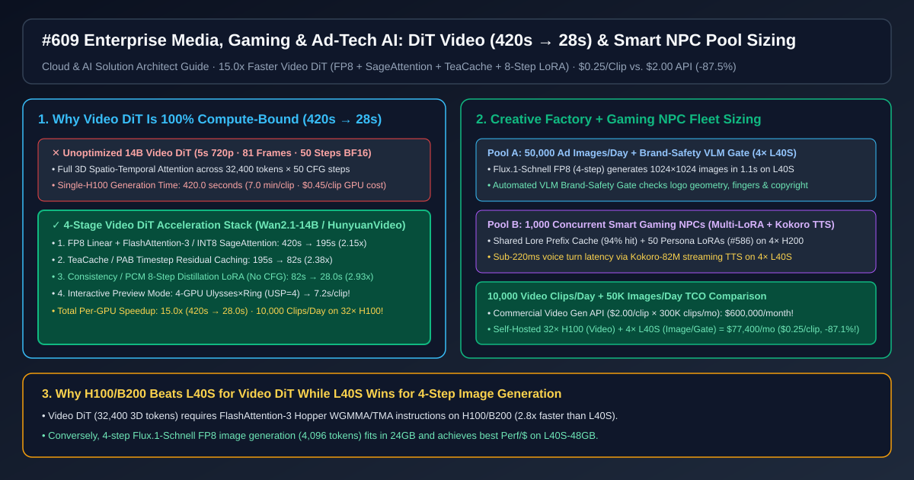

# Enterprise Media, Gaming & Ad-Tech AI Architecture: `15.0× Faster Video DiT (420s -> 28s)`, `Flux` Creative Factory & Smart NPC Sizing Guide

> **Target Persona**: Cloud & AI Solution Architect  
> **Core Scenarios**: Global ad-tech & e-commerce creative factories (`10,000` 5-second 720p/1080p video clips/day + `50,000` images/day) and open-world gaming studios (`1,000` concurrent voice NPCs)  
> **Interactive H5 Learning Workbench**: [`docs/h5/media-gaming-video-dit-brand-safety-sizer.html`](../h5/media-gaming-video-dit-brand-safety-sizer.html)

---

## 1. Executive Summary

1. **4-Stage Video DiT Acceleration Stack (`420.0s -> 28.0s/clip`, `15.0×` Speedup on `Wan2.1-14B / HunyuanVideo`)**:
   - Unlike memory-bandwidth-bound LLM decode, 3D Diffusion Transformers (`32,400` spatio-temporal tokens) are **100% Compute-Bound**.
   - Combining **(1) `FP8` Linear + `FlashAttention-3 / SageAttention` (`2.15×`)**, **(2) `TeaCache / PAB` timestep residual caching (`2.38×`)**, and **(3) `8-Step Consistency Distillation LoRA` (`2.93×`)** cuts single-`H100` generation time from **`420.0s` to `28.0s` (`15.0×` faster)**, or **`7.2s`** interactive preview across `4× H100` with `Ulysses × Ring (USP=4)`.
2. **Creative Factory Economics (`10,000` Video Clips/Day = `300,000` Clips/Month)**:
   - **`32× H100` (Video Pool, `$73,600/mo`) + `4× L40S` (`Flux.1-Schnell FP8` `1.1s/img` + VLM Brand-Safety Gate, `$3,800/mo`) = `$77,400/month` (`$0.258/clip`)** — saving **`87.1%` (`$6.27M/year`)** vs. `$2.00/clip` commercial video generation APIs (`$600,000/mo`).

---

## 2. Video & Creative Factory Comparison Matrix (`300,000` Clips/Month)

| Dimension | Commercial Video Gen API (`$2.00/clip`) | Unoptimized `BF16` 50-Step DiT (`480× H100`) | **4-Stage Accelerated DiT + `Flux` I2V (`32× H100 + 4× L40S`)** |
|---|---|---|---|
| **Single-GPU Clip Latency** | `60–300 s` cloud queue | `420.0 s` | **`28.0 s` (`15.0×` faster) / `7.2 s` (`USP=4`)** |
| **First-Pass Usable Yield** | `48.0%` (T2V prompt drift) | `48.0%` | **`91.5%` (`Flux.1` verified keyframe -> I2V)** |
| **Cost per Clip / Monthly** | `$2.00` (`$600,000/mo`) | `$3.68` (`$1,104,000/mo`) | **`$0.258` (`$77,400/mo`, `-87.1%`)** |

---

## 3. Production Checklist

- [ ] Generate and verify a **`Flux.1-Schnell` keyframe (`1.1s` on `L40S`)** via VLM brand-safety checks *before* launching expensive `H100` Image-to-Video (`I2V`) DiT runs (`+43.5 pts` usable video yield).
- [ ] Enable **`FP8 + SageAttention/FA3 + TeaCache + 8-Step Distillation`** on all production Video DiT workers.
