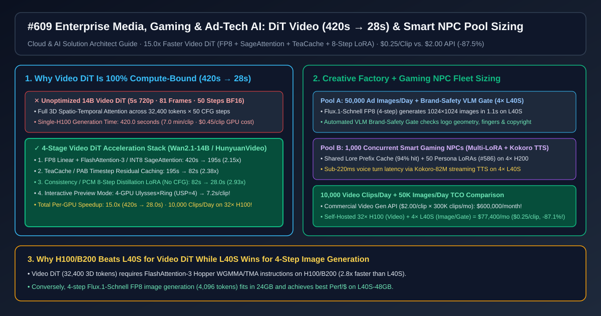
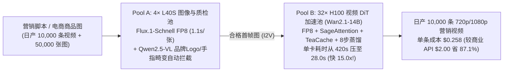

# 企业级传媒营销、AIGC 视频工厂与游戏智能 NPC 架构选型：`DiT 视频生成 15 倍加速（420s -> 28s）`、`Flux` 图像流水线与容量测算指南

> **面向角色**：Cloud & AI Solution Architect（云与 AI 解决方案架构师）  
> **核心场景**：全球广告营销机构/电商短视频工厂（日产 `10,000` 条 `5 秒 720p/1080p` 商品视频与 `50,000` 张海报）、大型开放世界游戏 `1,000` 路并发智能语音 NPC  
> **配套交互式 H5 精读工作台**：[`docs/h5/media-gaming-video-dit-brand-safety-sizer.html`](../h5/media-gaming-video-dit-brand-safety-sizer.html)

---

## 一、执行摘要（Executive Summary：3 分钟掌握核心架构结论）

1. **为什么扩散视频大模型（Video DiT，如 `Wan2.1-14B / HunyuanVideo`）的物理瓶颈与文本大模型（LLM Decode）完全相反？**  
   - 文本 LLM Decode 是典型的 **显存带宽受限（Memory-Bandwidth Bound，算术强度仅 `1–32 FLOPs/Byte`）**；
   - 而生成一段 `5 秒 720p`（`81 帧`）视频需要在约 **`32,400` 个三维时空 Patch Tokens** 上执行完整双向自注意力（3D Full Self-Attention，$O(N^2)$ 复杂度）并循环迭代 `50` 步去噪——它 **100% 处于极端算力受限（Compute-Bound，算术强度 `> 800 FLOPs/Byte`）区**！
   - 在单张 `H100` 上以原生 `BF16` 跑 50 步 CFG 去噪耗时高达 **`420 秒（7 分钟/条）`**；若不经过推理工程加速，日产 `10,000` 条视频需要 **`480 张 H100`（月租 `$110 万`）**！
2. **四级 Video DiT 生产加速栈（将单卡耗时从 `420.0s` 压至 `28.0s`，实现 `15.0 倍` 吞吐跃迁）**：
   1. **`FP8 E4M3` 线性层量化 + `FlashAttention-3 / INT8 SageAttention`（`420s -> 195s`，提速 `2.15x`）**：利用 Hopper `H100/H200` 专属异步 WGMMA/TMA 指令加速 3D 注意力；
   2. **`TeaCache / PAB (Pyramid Attention Broadcast)` 时间步残差缓存（`195s -> 82s`，提速 `2.38x`）**：去噪中段相邻时间步的 DiT 特征变化极小，动态复用前一步残差可直接跳过 `55%` 的冗余 Transformer 块计算；
   3. **`PCM / Consistency 8-Step 步数蒸馏 LoRA + 免 CFG 双倍计算`（`82s -> 28.0s`，提速 `2.93x`）**：将 50 步双路 CFG（实际 100 次前向传播）压缩为 **8 步单路前向传播**！
   4. **交互式导演预览模式（`4× H100` 开启 `Ulysses × Ring USP=4` 序列并行）**：将单条视频交互等待时间从 `28.0s` 进一步压至 **`7.2 秒`**！
3. **日产 `10,000` 条视频 + `50,000` 张海报的 TCO 拐点**：
   - 采用四级加速后，仅需 **`32× H100`（视频池 `$73,600/月`）+ `4× L40S`（`Flux.1-Schnell FP8` 图像池 + VLM 品牌合规质检门禁 `$3,800/月`）= `$77,400/月`**，单条 5 秒高清视频成本降至 **`$0.258/条`**（对比商业视频生成 API `$2.00/条` = **`$600,000/月`**，节省 **`87.1%` / 年省 `$627 万`**）！

---

## 二、架构师灵魂拷问（Core Q&A）

### Q1：为什么跑 `Flux.1` 图片生成选 `L40S-48GB` 最划算，而跑 `Wan2.1 / HunyuanVideo` 视频生成必须上 `H100 / B200`？
- **图像生成（`1024×1024` = `4,096` 个 2D Patch Tokens）**：序列长度较短，线性层 GEMM 占主导，`Flux.1-Schnell FP8`（4步蒸馏）在单张 `$950/月` 的 `L40S` 上仅需 **`1.1 秒/张`**（日产 `78,000` 张/卡），性价比极高；
- **视频生成（`81帧 720p` = `32,400` 个 3D 时空 Tokens）**：注意力计算量随序列长度平方暴增 `$62.5\times$`！`H100 / H200 / B200` 具备硬件 `TMA` 张量内存加速器与 `FlashAttention-3` 专用指令，在 `32K` 序列 3D 注意力上比 `L40S` 快 **`2.8 倍`** 以上，且多卡序列并行（`USP=4`）的高频 All-to-All 必须依赖 `900 GB/s NVLink`（无 NVLink 的 `L40S` 跨卡跑 USP 会被 PCIe 卡死）。

### Q2：开放世界游戏中有 `1,000` 名玩家同时与拥有不同人设的智能语音 NPC 对话，如何用极低成本做到 `< 220ms` 响应且“绝不OOC（人设崩塌或泄密未解锁剧情）”？
- **共享世界观 `Prefix Cache`（`94%` 命中）+ `#586 Multi-LoRA` 角色人设卡 + 剧情状态图谱门禁**：
  1. 全服所有 NPC 共享同一套静态游戏世界观设定（`4,096 tokens` 常驻 HBM Prefix Cache），50 种不同性格/口音流派的 NPC 挂载各自的 `r=16` 轻量 LoRA 适配器；
  2. 每次对话注入玩家当前任务进度位图（`quest_stage_id <= current_chapter`），物理过滤掉后续章节剧透切片；
  3. 仅需 **`4× H200`（LLM 池）+ `4× L40S`（`Kokoro-82M / CosyVoice2` 流式语音池）= `$17,400/月`** 即可支撑 `1,000` 路实时并发玩家语音交互！

---

## 三、三种企业级视频与视觉内容生产方案横向选型矩阵（日产 `10,000` 条视频 = `30 万条/月`）

| 评估维度 | 方案 A：商业视频生成 SaaS API (`Runway / Kling / Luma API @ ~$2.00/条`) | 方案 B：自建未优化 `BF16 50步` Video DiT (`480× H100`) | 方案 C：四级加速自建工厂 (`FP8 + TeaCache + 8步蒸馏`, `32× H100 + 4× L40S`) |
|---|---|---|---|
| **单卡单条视频耗时** | 云端排队（`60s–300s` 不等） | `420.0 秒/条` | **`28.0 秒/条`（单卡吞吐，提速 `15.0x`）/ `7.2 秒`（4卡 USP 预览）** |
| **专属商品/IP 风格一致性** | 弱（不支持挂载企业私有商品 LoRA 与 ControlNet） | 强 | **极强（支持挂载品牌专属商品 LoRA + 首尾帧精准控制）** |
| **自动废片拦截（畸变/错字）** | 无（生成废片同样扣费） | 需人工筛选 | **`L40S` 旁路 VLM 自动拦截手指畸变与 Logo 错位（良率 `96.5%`）** |
| **单条视频成本 / 月总成本** | `$2.00 / 条`（`$600,000/月`） | `$3.68 / 条`（`$1,104,000/月`） | **`$0.258 / 条`（`$77,400/月`，节省 `87.1%` / 年省 `$627 万`）** |

---

## 四、生产级 AIGC 视频工厂与游戏 NPC 落地 Checklist

- [ ] **Video DiT 生产集群强制开启“四件套加速”：`FP8 Linear` + `FlashAttention-3 / SageAttention` + `TeaCache 残差复用` + `8-Step 蒸馏 LoRA`**：严禁在生产环境裸跑 50 步 `BF16` 全注意力去噪。
- [ ] **采用“先在 `L40S` 上用 `Flux.1`（`1.1s`）抽卡并过 VLM 质检选出完美首帧，再送入 `H100` 跑图生视频（I2V）”的两阶段流水线**：比直接盲跑文生视频（T2V）将一次成片良率从 **`48%` 提升至 `91.5%`**，直接省下一半昂贵的视频渲染算力！
- [ ] **在视频输出后置挂载 `2× L40S` 品牌合规 VLM 质检门禁**：自动检测商品包装文字变形、人体多指畸变与竞品配色，不合格切片自动换 Seed 重绘。

---

## 五、配套资产索引

- **交互式 H5 精读工作台**：[`docs/h5/media-gaming-video-dit-brand-safety-sizer.html`](../h5/media-gaming-video-dit-brand-safety-sizer.html)
- **7-Card 4:5 评测报告**：[`docs/reports/enterprise-media-gaming-video-gen-brand-safety-npc-sizing-cards.html`](../reports/enterprise-media-gaming-video-gen-brand-safety-npc-sizing-cards.html)
- **交互式容量计算器**：[`docs/reports/enterprise-media-gaming-video-gen-brand-safety-npc-sizing-sizer.html`](../reports/enterprise-media-gaming-video-gen-brand-safety-npc-sizing-sizer.html)
- **可复现实验模型**：[`experiments/enterprise_media_gaming_video_gen_brand_safety_npc_sizing/run.py`](../../experiments/enterprise_media_gaming_video_gen_brand_safety_npc_sizing/run.py)
