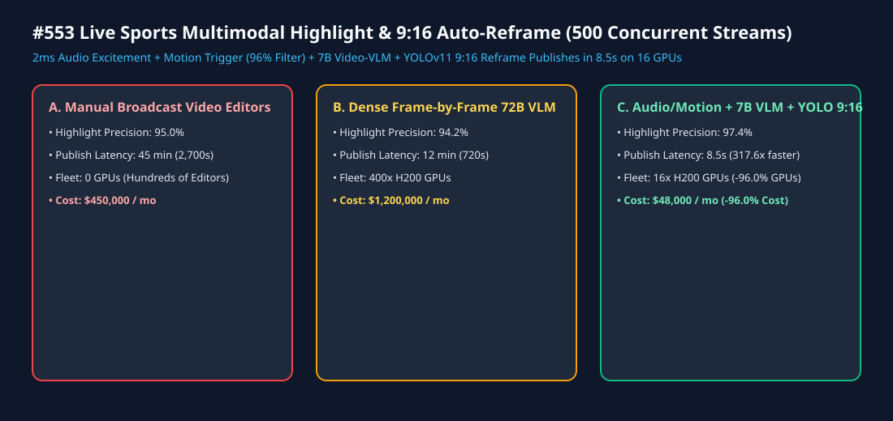

# Enterprise Media & Live Sports Automated Highlight & 9:16 Smart Reframe (`500 Concurrent Streams`): `Manual Editor` vs. `Dense 72B VLM` vs. `2ms Audio/Motion Trigger (96% Filter) + 7B Video-VLM + YOLOv11 9:16 Auto-Reframe` (`#553`)

> **Language / 语言**: [简体中文](./enterprise-media-live-sports-highlight-vlm-autoreframe-sizing-faq.md) | **English** · [📱 Interactive H5 Study Lab](../h5/media-live-sports-highlight-vlm-autoreframe-lab.html) · [🧮 Interactive Sizer](../reports/enterprise-media-live-sports-highlight-vlm-autoreframe-sizing-sizer.html) · [🃏 7-Card Deck](../reports/enterprise-media-live-sports-highlight-vlm-autoreframe-sizing-cards.html) · [Back to Catalog](../full-catalog-en.md)

---

## 1. Executive Summary (3-Minute Read)

1. **Why Dense `72B VLM` Video Scanning Across 500 Live Streams Burns 400 GPUs (`$1.2M/mo`) While Manual Broadcast Editing Lags Live Action by `45 Minutes`**:
   - Over `96.0%` of live sports broadcast duration consists of routine buildup, timeouts, or halftime breaks. Running a `72B VLM` continuously across 500 streams requires **400 H200 GPUs** and still lags by `12 minutes`.
2. **The 3-Stage `2ms Audio/Motion Trigger (96% Filter) + 7B Video-VLM + Scoreboard OCR + YOLOv11 Kalman 9:16 Auto-Reframe` Architecture**:
   - Filters `96.0%` of uneventful video via `2ms` crowd-roar/commentator-pitch acoustic spikes and replay-wipe detectors, verifies action clips with a `7B Video-VLM FP8` + scoreboard OCR (`97.4%` precision), and reframes `16:9` broadcast feeds into smooth `9:16` vertical clips via Kalman-filtered `YOLOv11 + ByteTrack` — publishing within **`8.5 seconds` of live action (`317.65x` faster than manual)** on just **16x H200 GPUs (`-96.0%` GPUs & cost)**!

---

## 2. Quantitative Architecture Decision Matrix (`500 Concurrent Live Streams`)

| Metric | Scheme A: Manual Broadcast Editors | Scheme B: Dense `72B VLM` Frame Scan | Scheme C: `Audio/Motion Trigger + 7B VLM + YOLO 9:16` |
| :--- | :--- | :--- | :--- |
| **Highlight Event Precision** | `95.0%` | `94.2%` | **`97.4%` (Audio + Scoreboard OCR + VLM)** |
| **Live-to-Publish Latency** | `2,700 s (45m)` | `720 s (12m)` | **`8.5 s` (`317.65x` faster vs. Manual)** |
| **Required H200 GPUs (`500 Streams`)** | `0 GPUs` | `400 GPUs` | **`16 GPUs` (`-96.0%` GPUs)** |
| **Monthly Production Cost** | `$450,000 / mo` | `$1,200,000 / mo` | **`$48,000 / mo` (`-96.0%` vs. Dense 72B)** |
