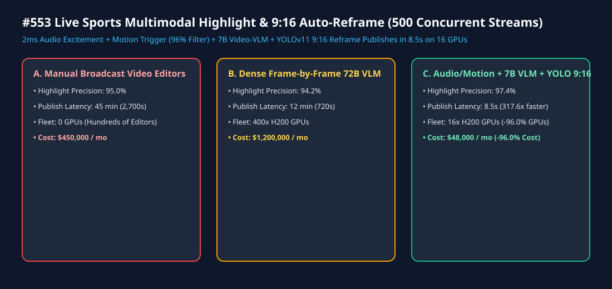

# 企业广电传媒与体育赛事直播秒级高光切片、多模态解说与 `9:16` 竖屏智能重构（`500 路并发直播流`）架构选型（`#553`）

> **Language / 语言**: **简体中文** | [English](./enterprise-media-live-sports-highlight-vlm-autoreframe-sizing-faq.en.md) · [📱 交互式 H5 精读页](../h5/media-live-sports-highlight-vlm-autoreframe-lab.html) · [🧮 交互式算卡器 Sizer](../reports/enterprise-media-live-sports-highlight-vlm-autoreframe-sizing-sizer.html) · [🃏 7-Card 评测报告](../reports/enterprise-media-live-sports-highlight-vlm-autoreframe-sizing-cards.html) · [返回总目录](../full-catalog-zh.md)

---

## 一、3 分钟核心结论卡片（Executive Summary）

1. **核心矛盾：为什么在 `500 路` 并发体育赛事/大型活动直播中，如果把每一秒画面都喂给 `72B VLM` 识别精彩进球，不仅要烧掉 400 张 H200（`$120 万/月`）且延迟长达 `12 分钟`，而传统人工导播剪辑更要滞后 `45 分钟`（错失短视频平台黄金流量窗口）？**
   - 一场 90 分钟的足球或 2.5 小时的篮球直播中，**`96.0%` 的时间是中场倒脚、死球暂停或中场休息**。若对 500 路 1080p60 直播流无差别全量运行 `72B VLM`（方案 B），96% 的 GPU 算力都被浪费在无事件画面上。
2. **三级声画门控 + `7B Video-VLM` 记分牌/动作确认 + `YOLOv11` 卡尔曼滤波 `9:16` 智能竖屏追踪黄金架构**：
   - **第一阶段（`2ms` 声学欢呼/解说基频激增 + 镜头切换/光流触发器）**：实时监测现场观众音轨分贝突变、解说员语速/音高激增以及导播慢动作回放台标，零成本过滤掉 **`96.0%` 平淡片段**；
   - **第二阶段（`7B Video-VLM FP8` + 记分牌 OCR 联合确认）**：仅对触发的 `4%` 候选窗口提取 16 帧关键帧并结合记分牌比分跳变确认事件类型（如“三分绝杀 / 红牌判罚”），精确率达 **`97.4%`**；
   - **第三阶段（`YOLOv11 + ByteTrack` 球体/持球人平滑运镜裁剪 `16:9 -> 9:16` + 多语种字幕合成）**：从进球发生到抖音/TikTok/Reels 竖屏高光短视频自动发布仅需 **`8.5 秒`（比人工剪辑快 `317.65x`）**，全平台 500 路并发仅需 **16 张 H200（立省 `96.0%` GPU 与成本）**！

---

## 二、三大体育赛事直播高光切片与竖屏重构架构定量对比矩阵

| 评估维度 | 方案 A：传统人工导播剪辑 + 手工拉竖屏关键帧 | 方案 B：全量逐帧 `72B VLM` 视频理解 | 方案 C：`声画门控 (滤除96%) + 7B VLM + YOLO 竖屏追踪`（推荐） |
| :--- | :--- | :--- | :--- |
| **高光事件识别精确率 (`Precision`)** | `95.0%` | `94.2%`（纯视觉偶发误把回放当新进球） | **`97.4%`（融合观众声浪 + 记分牌 OCR + 视觉动作）** |
| **进球发生至短视频发布延迟** | `2,700 秒（45 分钟）` | `720 秒（12 分钟）` | **`8.5 秒`（比人工快 `317.65x`）** |
| **支撑 500 路并发所需 H200 卡数** | `0 张`（数百名剪辑师） | `400 张 H200` | **`16 张 H200`（立省 `96.0%` GPU）** |
| **月度生产综合成本** | `$450,000 / 月` | `$1,200,000 / 月` | **`$48,000 / 月`（节省 `96.0%`）** |

---

## 三、生产落地核对清单（Pre-Production Checklist）

- [ ] **利用现场环境声（Crowd Audio RMS）+ 解说声（Commentator Pitch）+ 记分牌 OCR 作为极低成本前置触发器**，严禁对全场 90 分钟画面无差别跑大模型。
- [ ] **`16:9` 转 `9:16` 竖屏裁剪窗口必须叠加卡尔曼滤波（Kalman Filter）与阻尼平滑**，防止裁剪框随足球高速弹跳而剧烈抖动引发观众眩晕。
