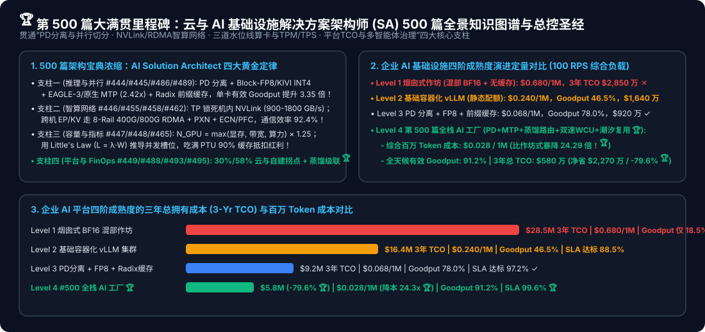

# Historic Milestone #500: Cloud & AI Infrastructure Solution Architect (`SA`) 500-Playbook Master Encyclopedia & End-to-End Decision Engine (#500)

> **Executive Summary**:
> Marking the **500th bilingual architecture selection guide (`#001–#500` + 2 flagship blueprints = 502 deliverables)** in `turbo998/ai-infra-research`, this master playbook synthesizes the **Four Core Pillars of Enterprise AI Infrastructure** (**LLM Inference & Parallelism**, **NVLink/IB/RoCEv2 High-Speed Networking**, **3-Watermark GPU Sizing & `TPM/TPS/PTU` Math**, and **Enterprise AI Platform TCO & Multi-Agent Governance**) into a 4-Level Maturity Model. Advancing an enterprise from **Level 1 (`Ad-Hoc Colocated BF16 Silos`)** to **Level 4 (`Milestone #500 Full-Stack AI Factory`: PD Disaggregation + `Block-FP8/KIVI` + `EAGLE-3/MTP` + `671B->32B/8B` Distilled Cascade + Dual-Rate `CIR/EIR WCU` QoS + 24h Tidal Reuse + 5-Year Role Cascade)** reduces blended token cost **24.3x** (`$0.680/1M -> $0.028/1M`), boosts effective cluster Goodput from `18.5%` to **`91.2%`** (`99.6%` P99 SLA compliance), and slashes 3-Year Enterprise TCO by **`79.6%` (`$5.8M` vs. `$28.5M`, saving `$22.7M`)**.
>
> **⚡ Interactive H5 Study Lab**: [**Open the Milestone #500 AI Infra Master Encyclopedia & 4-Level Maturity TCO Simulator (`docs/h5/milestone-500-ai-infra-architect-master-encyclopedia-lab.html`)**](../h5/milestone-500-ai-infra-architect-master-encyclopedia-lab.html)

---

## 1. Quantitative 4-Level Enterprise AI Infrastructure Maturity Matrix

| Enterprise AI Infra Maturity Level (`100 RPS` Baseline) | Blended `$/1M Tokens` | Effective Goodput | `P99` SLA Compliance | 3-Year Total TCO |
| :--- | :--- | :--- | :--- | :--- |
| **Level 1: Ad-Hoc Siloed GPU Prototypes (Colocated BF16)** | `$0.680 / 1M` ✕ | `18.5%` ✕ | `64.0%` ✕ | `$28.5M` ✕ |
| **Level 2: Basic Containerized vLLM (Static Quotas, FP16)** | `$0.240 / 1M` | `46.5%` | `88.5%` | `$16.4M` |
| **Level 3: Disaggregated PD + FP8 + Radix Prefix Cache** | `$0.068 / 1M` ✓ | `78.0%` ✓ | `97.2%` ✓ | `$9.2M` ✓ |
| **Level 4: Milestone #500 Full-Stack AI Factory 🏆** | **`$0.028 / 1M (24.3x)` 🏆** | **`91.2%` 🏆** | **`99.6%` 🏆** | **`$5.8M (-79.6%)` 🏆** |
