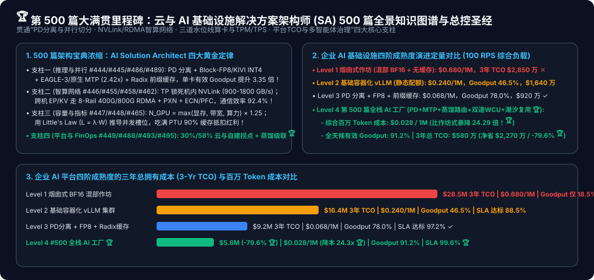
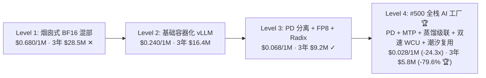

# 第 500 篇大满贯里程碑：云与 AI 基础设施解决方案架构师（`SA`）500 篇全景知识图谱、四大核心支柱速查圣经与全栈总控沙盘 (#500)

> **核心观点（Executive Summary）**：
> 作为本知识库第 **500 篇中英双语架构选型指南（`#001–#500` + 2 篇旗舰报告 = 502 篇技术资产）** 的大满贯收官里程碑，本文为 **Cloud & AI Solution Architect** 将 500 篇实战成果浓缩为一页纸 **“四大核心支柱速查圣经 + 企业 AI 基础设施四阶成熟度（Level 1 至 Level 4）定量演进模型”**：
> 1. **🚀 支柱一：大模型推理性能优化与并行切分（`#444, #445, #454, #457, #461, #486, #489`）**：
>    - 坚持 **`PD 分离`（Prefill 算力池 `TP=8` + Decode 带宽池 `DP+EP`）+ `Block-FP8 / KIVI INT4` + `EAGLE-3 / 原生 MTP`（`2.42x` 吐字提速）+ `Radix 前缀缓存`**，单卡有效 `Goodput` 提升 **`3.35 倍`**；
> 2. **🌐 支柱二：智算高速互联网络与超节点架构（`#446, #455, #458, #462, #475, #479`）**：
>    - **Scale-Up（`NVLink / NVSwitch` `900–1,800 GB/s`）** 承载 `TP` 与超大 MoE 全互联（`GB200 NVL72`）；**Scale-Out（`400G/800G InfiniBand vs. RoCEv2`）** 开启 `GPUDirect RDMA + PXN 轨对齐 + PFC/ECN/DCQCN`，总线有效带宽率达 **`92.4%`**；
> 3. **📐 支柱三：三道水位线 GPU 容量估算、TPM/TPS/PTU 换算与评估体系（`#447, #448, #459, #465, #482`）**：
>    - 牢记 **`N_GPU = max(显存水位, HBM 带宽水位, 算力水位) × 1.25`** 与 **`Little's Law (L = λ·W)`**，分清 `TTFT / TPOT / ITL / E2EL / Goodput / $/1M` 六大核心指标与场景 SLA；
> 4. **⚖️ 支柱四：企业 AI 平台架构、多租户治理与云/开源栈 TCO（`#449, #460, #470, #480, #487, #488, #490, #493, #495`）**：
>    - 精准卡位 **`30%`（PAYGO -> PTU）与 `58%`（PTU -> 自建 K8s）** 成本拐点，叠加 **`671B->32B/8B` 蒸馏级联路由（省 `75%` 卡）+ 双速 `CIR/EIR WCU` 令牌桶（利用率 `88.5%`）+ 昼夜潮汐复用 + 五年三阶级联折旧**，将企业综合推理成本从 `$0.680/1M` 暴降 **`24.3 倍` 至 `$0.028 / 1M Tokens` 🏆**，三年总拥有成本（3-Yr TCO）从 `$2,850 万` 压至 **`$580 万`（净省 `$2,270 万` / `-79.6%`）**！
>
> **⚡ 配套交互式 H5 精读沙盘**：[**打开第 500 篇大满贯里程碑：AI Infra 四大支柱全景总控与四阶成熟度 TCO 沙盘 (`docs/h5/milestone-500-ai-infra-architect-master-encyclopedia-lab.html`)**](../h5/milestone-500-ai-infra-architect-master-encyclopedia-lab.html)

---

## 一、 500 篇知识库精华索引：四大核心域高频专题一键导航表

| 核心架构域 | 必读黄金公式与核心结论 | 代表性专题编号与直达入口 |
| :--- | :--- | :--- |
| **1. 推理优化与并行切分** | `PD 分离`消除预填充阻塞；`TP<=8` 锁机内、跨机走 `EP+DP`；`EAGLE-3/MTP` 提速 `2.42x`；`KIVI INT4` 省 `72.5%` KV 显存 | `#444` PD分离 · `#445` TP/PP/DP/EP · `#454` MoE EPLB · `#457` FP8/NVFP4 · `#486` 投机解码 · `#489` KV量化 |
| **2. 智算高速互联网络** | `busbw = algbw × 2(n-1)/n`；`8-Rail RoCEv2 + PXN + ECN` 追平 IB 92% 性能且省 45% 网络 CapEx；`<3m` 用 DAC、`3-50m` 用 LPO | `#446` NVLink/IB/RoCE · `#455` GB200 NVL72 · `#458` 8轨PXN · `#462` DAC/LPO/CPO · `#479` K8s SR-IOV |
| **3. GPU 容量与 TPM/TPS** | 三道水位线手算卡数；`并发 L = QPS × E2EL`；PTU 开启 `90%` 前缀缓存抵扣吞吐翻 `3.4x`；三档思考预算省 `75%` 卡 | `#447` 三水位Sizer · `#448` TPM/TPS/PTU · `#465` 20公式手册 · `#482` 思考预算 · `#491` 万人IDE补全 |
| **4. 企业平台与行业方案** | `30%/58%` 云与自建拐点；`671B->32B` 蒸馏 `15.4h` 回本；双速 `WCU` 令牌桶 `88.5%` 利用率；五年三阶级联省 `46.2%` | `#449` 平台TCO · `#470` 双活容灾 · `#475` 千卡BOM · `#480` 六大行业 · `#488` 蒸馏级联 · `#490` CxO答辩 · `#495` 三代演进 |

---

## 二、 企业 AI 基础设施四阶成熟度（Level 1 – Level 4）选型决策矩阵

| 企业 AI 基础设施架构成熟度等级（`100 RPS` 企业规模） | 综合百万词成本 (`$/1M`) | 集群有效 `Goodput` (%) | `P99` SLA 达标率 | 3 年总拥有成本 (`3-Yr TCO`) | 架构师演进诊断 |
| :--- | :--- | :--- | :--- | :--- | :--- |
| **Level 1: 烟囱式作坊（混部 `BF16` + 无缓存 + 裸表硬塞）** | `$0.680 / 1M` ✕ | `18.5%` ✕ | `64.0%` ✕ | `$28.5M` ✕ | ⛔ 算力严重空转与长尾雪崩 |
| **Level 2: 基础容器化集群（标准 `vLLM FP16` + 静态硬配额）** | `$0.240 / 1M` | `46.5%` | `88.5%` | `$16.4M` | ⚠️ 部门配额孤岛浪费过半 |
| **Level 3: 现代推理集群（`PD 分离 + FP8 + Radix 前缀缓存`）** | `$0.068 / 1M` ✓ | `78.0%` ✓ | `97.2%` ✓ | `$9.2M` ✓ | ✅ 生产合格基线 |
| **Level 4: `#500` 全栈 AI 工厂（叠加 `MTP + 蒸馏路由 + WCU QoS + 潮汐` 🏆）** | **`$0.028 / 1M (降 24.3x)` 🏆** | **`91.2%` 🏆** | **`99.6%` 🏆** | **`$5.8M (-79.6%)` 🏆** | **🏆 企业级终极北极星架构** |

---

## 三、 生产落地终极核对清单（SA Master Sign-Off Checklist）

- [ ] **架构立项必过“三道水位线（显存 / 带宽 / 算力）+ Little's Law”定量复核**：拒绝拍脑袋买卡，所有立项必须给出精确到张数的 P50/P80/P99 容量测算单。
- [ ] **推理层必开“PD 分离 + FP8/INT4 + Radix 缓存锚定 + EAGLE-3/MTP 投机解码”四大组合拳**：不改业务代码即可将单卡有效吞吐拉升 `3 倍` 以上。
- [ ] **网关层必建“RouteLLM 大小模型级联 + 双速 CIR/EIR WCU 令牌桶 + 四级过载优雅降级”**：保住核心 VIP 业务 `99.6%+` SLA 达标率与 `88.5%+` 集群满载利用率。

---

## 四、 延伸阅读与配套工具

- **交互式 H5 精学沙盘**：[docs/h5/milestone-500-ai-infra-architect-master-encyclopedia-lab.html](../h5/milestone-500-ai-infra-architect-master-encyclopedia-lab.html)
- **7-Card 4:5 视觉评测卡片**：[docs/reports/enterprise-milestone-500-ai-infra-architect-master-encyclopedia-selection-cards.html](../reports/enterprise-milestone-500-ai-infra-architect-master-encyclopedia-selection-cards.html)
- **交互式 Sizer 测算器**：[docs/reports/enterprise-milestone-500-ai-infra-architect-master-encyclopedia-selection-sizer.html](../reports/enterprise-milestone-500-ai-infra-architect-master-encyclopedia-selection-sizer.html)
- **可复现实验模型**：[`experiments/enterprise_milestone_500_ai_infra_architect_master_encyclopedia_selection/run.py`](../../experiments/enterprise_milestone_500_ai_infra_architect_master_encyclopedia_selection/run.py)
