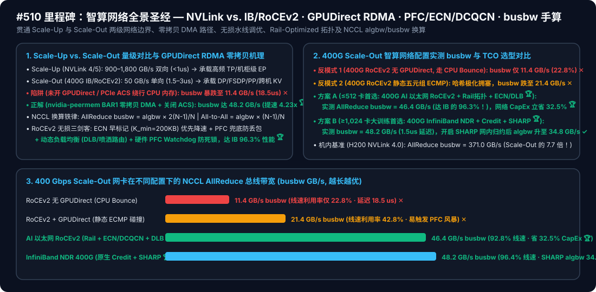

# Milestone #510: Enterprise AI High-Speed Interconnect Bible — Scale-Up (`NVLink 4/5 & NVSwitch`) vs. Scale-Out (`InfiniBand NDR/XDR` vs. `RoCEv2 AI Ethernet`), `GPUDirect RDMA`, `PFC+ECN+DCQCN` & `algbw/busbw` Sizer (#510)

> **Executive Summary**:
> As **Milestone #510**, this guide provides **Cloud & AI Solution Architects** with the definitive engineering reference for AI cluster networking across **Scale-Up (`NVLink / NVSwitch`)** and **Scale-Out (`InfiniBand vs. RoCEv2`)**:
> 1. **Scale-Up vs. Scale-Out Hierarchy**: Intra-node `NVLink 4.0` (`900 GB/s` bidirectional, `371 GB/s` `busbw`, `0.8 us` latency) and `NVLink 5.0` (`1,800 GB/s`) provide **`7.7x–18x` more bandwidth per GPU** than a `400G RDMA` NIC (`50 GB/s` unidirectional). Keep latency-sensitive `TP <= 8` strictly inside Scale-Up; reserve Scale-Out for `DP / FSDP / PP / EP` and disaggregated KV streaming;
> 2. **`GPUDirect RDMA` Zero-Copy Mandate**: Without `nvidia-peermem` and `PCIe ACS Disable`, traffic bounces through Host CPU DRAM, collapsing 400G `AllReduce busbw` from **`48.2 GB/s` down to `11.4 GB/s` (`4.23x` slower ✕)**;
> 3. **Tuned AI Ethernet RoCEv2 vs. InfiniBand NDR**: Combining **`Rail-Optimized Leaf-Spine` + `ECN before PFC (K_min=200KB, K_max=1600KB)` + `Dynamic Load Balancing (DLB / Packet Spraying)` + `Hardware PFC Watchdog`** delivers **`46.4 GB/s` `busbw` (`96.3%` of InfiniBand NDR `48.2 GB/s` 🏆)** while reducing network CapEx by **`32.5%`**.
>
> **⚡ Interactive H5 Study Lab**: [**Open Milestone #510 NVLink/IB/RoCEv2 & algbw/busbw Interactive Calculator (`docs/h5/milestone-510-nvlink-ib-rocev2-gpudirect-busbw-lab.html`)**](../h5/milestone-510-nvlink-ib-rocev2-gpudirect-busbw-lab.html)

---

## 1. Core Formulas: `algbw` vs. `busbw` and RoCEv2 Lossless Headroom

$$\text{busbw}_{\text{AllReduce}} = \text{algbw} \times \frac{2(N - 1)}{N}, \qquad \text{busbw}_{\text{AllToAll / AllGather / ReduceScatter}} = \text{algbw} \times \frac{N - 1}{N}$$

$$\text{Buffer}_{\text{PFC\_Headroom}} \ge \text{RTT}_{\text{hop}} \times \text{LineRate}, \qquad K_{\min,\text{ECN}} < K_{\max,\text{ECN}} < X_{\text{off,PFC}}$$

---

## 2. Quantitative Decision Matrix (`Scale-Up & 400G Scale-Out`)

| AI Fabric Configuration | Unidirectional BW / GPU | `AllReduce algbw` | `AllReduce busbw` | P2P Latency | Wire Efficiency | Relative Network CapEx |
| :--- | :--- | :--- | :--- | :--- | :--- | :--- |
| **Anti-Pattern 1: `400G RoCEv2` without GPUDirect (CPU Bounce)** | `50.0 GB/s (400G)` | `5.8 GB/s` ✕ | `11.4 GB/s` ✕ | `18.5 us` ✕ | `22.8%` ✕ | `67.5%` |
| **Anti-Pattern 2: `400G RoCEv2` Static 5-Tuple ECMP** | `50.0 GB/s (400G)` | `10.9 GB/s` ✕ | `21.4 GB/s` ✕ | `6.8 us` ✕ | `42.8%` ✕ | `67.5%` |
| **Option A (`<=512 GPUs`): `400G AI Ethernet RoCEv2` (`Rail + ECN/DCQCN + DLB` 🏆)** | `50.0 GB/s (400G)` | **`23.6 GB/s` ✓** | **`46.4 GB/s` 🏆** | **`2.6 us` ✓** | **`92.8%` 🏆** | **`67.5% (-32.5%)` 🏆** |
| **Option B (`>=1,024 GPUs`): `400G InfiniBand NDR` (`Credit + AR + SHARP` 🏆)** | `50.0 GB/s (400G)` | **`34.8 GB/s (SHARP)` 🏆** | **`48.2 GB/s` 🏆** | **`1.5 us` 🏆** | **`96.4%` 🏆** | `100.0%` |
| **Scale-Up Reference: Intra-Node `H200 NVLink 4.0 + NVSwitch`** | `450.0 GB/s` | **`212.0 GB/s`** | **`371.0 GB/s`** | **`0.8 us`** | `82.4%` | `Included in HGX` |

---

## 3. Companion Links

- **Interactive H5 Study Lab**: [docs/h5/milestone-510-nvlink-ib-rocev2-gpudirect-busbw-lab.html](../h5/milestone-510-nvlink-ib-rocev2-gpudirect-busbw-lab.html)
- **7-Card 4:5 Visual Report**: [docs/reports/enterprise-milestone-510-nvlink-infiniband-rocev2-gpudirect-busbw-bible-cards.html](../reports/enterprise-milestone-510-nvlink-infiniband-rocev2-gpudirect-busbw-bible-cards.html)
- **HTML Sizer**: [docs/reports/enterprise-milestone-510-nvlink-infiniband-rocev2-gpudirect-busbw-bible-sizer.html](../reports/enterprise-milestone-510-nvlink-infiniband-rocev2-gpudirect-busbw-bible-sizer.html)
- **Reproducible Model**: [`experiments/enterprise_milestone_510_nvlink_infiniband_rocev2_gpudirect_busbw_bible/run.py`](../../experiments/enterprise_milestone_510_nvlink_infiniband_rocev2_gpudirect_busbw_bible/run.py)
