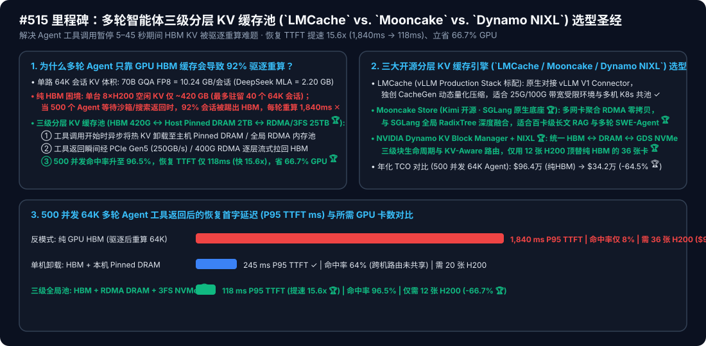

# Milestone #515: Enterprise 3-Tier KV Cache Pool (`GPU HBM <-> Host Pinned DRAM <-> RDMA/3FS NVMe`) Selection Guide — `LMCache` vs. `Mooncake Store` vs. `NVIDIA Dynamo NIXL` (#515)

> **Executive Summary**:
> In multi-turn agentic workloads (`SWE-Agent / Deep Research`), agents pause for `5–45 seconds` during tool execution. Relying on GPU HBM alone (`420 GB` free KV/node = `40` active `64K` sessions) causes **`92%` KV eviction across `500` concurrent agents**, forcing expensive 64K Prefill recomputation (`1,840 ms` `P95 TTFT`, `36x H200 GPUs` ✕). **Milestone #515** establishes the **3-Tier Hierarchical KV Cache Pool**:
> 1. **3-Tier Offloading (`HBM <-> Host Pinned DRAM / RDMA Pool <-> 3FS NVMe GDS`)**: Lifts multi-turn cache hit rate from `8.0%` to **`96.5%` 🏆**, slashes turn-resume `P95 TTFT` from `1,840 ms` to **`118 ms` (`15.59x` faster 🏆)**, and cuts cluster size from `36` to **`12x H200 GPUs` (`-66.7%` GPUs, saving `$622,000/yr` 🏆)**;
> 2. **Engine Selection**: Choose **`LMCache`** for vLLM V1 + `CacheGen` KV compression over 25G/100G links; **`Mooncake Store`** for multi-NIC RDMA global DRAM pooling with SGLang `RadixAttention`; and **`NVIDIA Dynamo + NIXL`** for unified 3-tier `HBM/DRAM/GDS-NVMe` orchestration on Kubernetes.
>
> **⚡ Interactive H5 Study Lab**: [**Open Milestone #515 3-Tier KV Cache Pool & Resume TTFT Sizer (`docs/h5/milestone-515-tiered-kv-cache-lmcache-mooncake-nixl-lab.html`)**](../h5/milestone-515-tiered-kv-cache-lmcache-mooncake-nixl-lab.html)

---

## 1. Quantitative Decision Matrix (`500 Concurrent 64K Multi-Turn Agents`)

| KV Cache Architecture | Active `64K` Sessions Held | Multi-Turn Hit Rate | Turn-Resume `P95 TTFT` | Required `H200` GPUs | Annual Infra TCO |
| :--- | :--- | :--- | :--- | :--- | :--- |
| **Anti-Pattern: `HBM-Only` (Evict & Recompute)** | `40 sessions` ✕ | `8.0%` ✕ | `1,840 ms` ✕ | `36 GPUs` ✕ | `$964,000 / yr` ✕ |
| **Single-Node Offload: `HBM + Local 2TB Pinned DRAM`** | `235 sessions` ✓ | `64.0%` ✓ | `245 ms` ✓ | `20 GPUs` ✓ | `$548,000 / yr` ✓ |
| **Optimal 3-Tier Pool: `HBM + RDMA DRAM + 3FS NVMe` 🏆** | **`2,500 sessions` 🏆** | **`96.5%` 🏆** | **`118 ms (15.6x faster)` 🏆** | **`12 GPUs (-66.7%)` 🏆** | **`$342,000 (-64.5%)` 🏆** |

---

## 2. Companion Links

- **Interactive H5 Study Lab**: [docs/h5/milestone-515-tiered-kv-cache-lmcache-mooncake-nixl-lab.html](../h5/milestone-515-tiered-kv-cache-lmcache-mooncake-nixl-lab.html)
- **7-Card 4:5 Visual Report**: [docs/reports/enterprise-milestone-515-tiered-kv-cache-lmcache-mooncake-nixl-sizing-selection-cards.html](../reports/enterprise-milestone-515-tiered-kv-cache-lmcache-mooncake-nixl-sizing-selection-cards.html)
- **HTML Sizer**: [docs/reports/enterprise-milestone-515-tiered-kv-cache-lmcache-mooncake-nixl-sizing-selection-sizer.html](../reports/enterprise-milestone-515-tiered-kv-cache-lmcache-mooncake-nixl-sizing-selection-sizer.html)
- **Reproducible Model**: [`experiments/enterprise_milestone_515_tiered_kv_cache_lmcache_mooncake_nixl_sizing_selection/run.py`](../../experiments/enterprise_milestone_515_tiered_kv_cache_lmcache_mooncake_nixl_sizing_selection/run.py)
