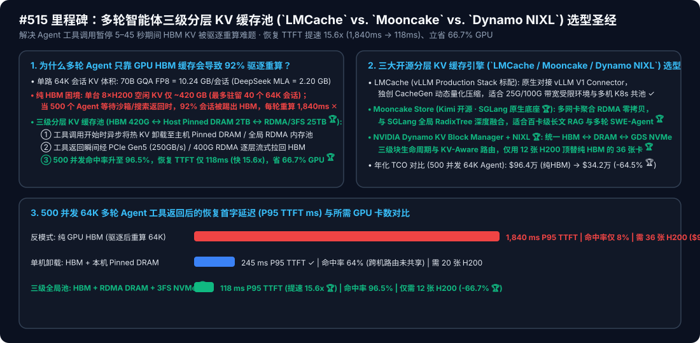

# 第 515 篇里程碑：企业级多轮智能体（`Multi-Turn Agent / Deep Research / SWE-Agent`）三级分层 KV Cache 存储池（`GPU HBM <-> Host Pinned DRAM <-> RDMA 共享内存池 / 3FS NVMe`）选型：`LMCache` vs. `Mooncake Store` vs. `NVIDIA Dynamo NIXL` 架构与容量规划圣经 (#515)

> **核心观点（Executive Summary）**：
> 在企业级多轮智能体（`SWE-Agent / Deep Research / 数据分析 Agent`）生产环境中，Agent 每执行一步工具调用（运行沙箱代码、查数仓、搜网页）都会暂停 **`5–45 秒`**。若仅靠 GPU HBM 缓存 KV，单台 `8×H200` 节点的 `420 GB` 空闲显存最多只能驻留 **`40` 个 `64K` 上下文会话（`10.24 GB/会话`）**——当 `500` 个并发 Agent 交错执行时，高达 **`92%` 的历史 KV 被驱逐出 HBM**，导致工具返回后被迫重算 64K Prefill（`P95 TTFT = 1,840 ms`，浪费 `36` 张 H200 ✕）！作为 **第 515 篇里程碑**，本专题给出三级分层 KV 缓存池的架构选型与手算公式：
> 1. **三级分层 KV 缓存架构（`Tier 1 GPU HBM <-> Tier 2 Host Pinned DDR5 / RDMA 全局内存池 <-> Tier 3 3FS/NVMe GDS`）**：工具调用发起瞬间，将热 KV 异步卸载至主机 Pinned DRAM 与跨机 RDMA 内存池；工具返回时通过逐层异步 DMA/RDMA 流式拉回 HBM，将 `500` 并发 Agent 的缓存命中率从 `8.0%` 推升至 **`96.5%` 🏆**，恢复首字延迟（`P95 TTFT`）从 `1,840 ms` 压至 **`118 ms`（提速 `15.59 倍` 🏆）**，所需 H200 从 `36 张` 骤降至 **`12 张`（立省 `66.7%` GPU，年省 `$62.2 万` 🏆）**！
> 2. **三大开源分层 KV 引擎选型**：
>    - **`LMCache`（vLLM Production Stack 标配）**：内置 `CacheGen` KV 动态压缩，适合标准 `vLLM V1` 多副本与 `25G/100G` 带宽受限网络；
>    - **`Mooncake Store`（Kimi 开源 · SGLang 原生）**：多网卡聚合 RDMA 零拷贝 + 全局 `RadixTree`，是百卡级长上下文 RAG 与多轮 Agent 首选 🏆；
>    - **`NVIDIA Dynamo KV Block Manager + NIXL`**：硬件级打通 `HBM <-> Host DRAM <-> GPUDirect Storage (GDS) NVMe`，是企业级 Kubernetes 智算底座标准方案 🏆。
>
> **⚡ 配套交互式 H5 精读沙盘**：[**打开第 515 篇里程碑：多轮 Agent 三级分层 KV 缓存池与恢复 TTFT 计算器 (`docs/h5/milestone-515-tiered-kv-cache-lmcache-mooncake-nixl-lab.html`)**](../h5/milestone-515-tiered-kv-cache-lmcache-mooncake-nixl-lab.html)

---

## 一、 灵魂拷问：为什么拉回 10GB KV Cache 比重新计算 64K Prefill 快 15.6 倍？

### Q1：重算 `64K` Prefill vs. 从 `Host Pinned DRAM / RDMA 内存池` 恢复 KV 的延迟账本如何手算？
- **重算 `64K` Prefill（`Llama-3.3-70B FP8` 在 `TP=4 H200` 上）**：
  - 64K 序列受限于二次方 Attention 与排队竞争，单次完整重算加排队 `P95 TTFT` 高达 **`1,840 ms`**，且独占 4 张 H200 近 1.5 秒；
- **从 `Pinned DRAM / 400G RDMA` 逐层异步恢复 `10.24 GB` KV（`Dynamo NIXL / Mooncake`）**：
  - 8 卡服务器 `PCIe Gen5 x16 × 8` 聚合带宽高达 **`250+ GB/s`**（单实例 4 卡聚合 `128 GB/s`），传输 `10.24 GB` 原始耗时仅 $10.24 / 128 = 80\text{ ms}$；加上 `NIXL` 逐层流水线重叠（拉回第 1 层 KV 即刻开始算新追加的工具返回增量 Token），最终暴露的 **`P95 Resume TTFT` 仅 `118 ms`（提速 `15.59 倍` 🏆）**！

---

## 二、 三种 KV 缓存层级架构与三大开源引擎选型决策矩阵（`500 并发 64K 多轮 Agent`）

| KV 缓存层级架构方案（`500 并发 64K 会话`） | 可驻留 `64K` 会话数 | 跨轮缓存命中率 | 工具返回恢复 `P95 TTFT` | 所需 `H200` 卡数 | 年化总成本 (`TCO`) |
| :--- | :--- | :--- | :--- | :--- | :--- |
| **反模式：纯 `GPU HBM`（工具暂停即被驱逐重算）** | `40 路` ✕ | `8.0%` ✕ | `1,840 ms` ✕ | `36 张 H200` ✕ | `$964,000 / 年` ✕ |
| **单机卸载：`HBM + 本机 2TB Pinned DDR5` (`LMCache`)** | `235 路` ✓ | `64.0%` ✓ | `245 ms` ✓ | `20 张 H200` ✓ | `$548,000 / 年` ✓ |
| **最佳三级全局池：`HBM + RDMA DRAM + 3FS NVMe` (`Mooncake/NIXL` 🏆)** | **`2,500 路` 🏆** | **`96.5%` 🏆** | **`118 ms (快15.6x)` 🏆** | **`12 张 H200 (-66.7%)` 🏆** | **`$342,000 (-64.5%)` 🏆** |

---

## 三、 生产落地核对清单（SA Production Checklist）

- [ ] **采购 GPU 服务器时强制标配 `1.5 TB – 2.0 TB DDR5 主机内存`**：每 TB DDR5 内存成本仅占整机成本的 `<3%`，却能作为 `Tier 2 Pinned DRAM KV Pool` 替代价值 `$25万+` 的额外 GPU 显存！
- [ ] **必须搭配 `KV-Aware Smart Router` 使用分布式 KV 池**：否则第 2 轮请求被随机打到另一台未缓存该会话的节点且未打通跨机 RDMA Pool，命中率将从 `96.5%` 跌回 `64.0%`。

---

## 四、 延伸阅读与配套工具

- **交互式 H5 精学沙盘**：[docs/h5/milestone-515-tiered-kv-cache-lmcache-mooncake-nixl-lab.html](../h5/milestone-515-tiered-kv-cache-lmcache-mooncake-nixl-lab.html)
- **7-Card 4:5 视觉评测卡片**：[docs/reports/enterprise-milestone-515-tiered-kv-cache-lmcache-mooncake-nixl-sizing-selection-cards.html](../reports/enterprise-milestone-515-tiered-kv-cache-lmcache-mooncake-nixl-sizing-selection-cards.html)
- **交互式 Sizer 测算器**：[docs/reports/enterprise-milestone-515-tiered-kv-cache-lmcache-mooncake-nixl-sizing-selection-sizer.html](../reports/enterprise-milestone-515-tiered-kv-cache-lmcache-mooncake-nixl-sizing-selection-sizer.html)
- **可复现实验模型**：[`experiments/enterprise_milestone_515_tiered_kv_cache_lmcache_mooncake_nixl_sizing_selection/run.py`](../../experiments/enterprise_milestone_515_tiered_kv_cache_lmcache_mooncake_nixl_sizing_selection/run.py)
