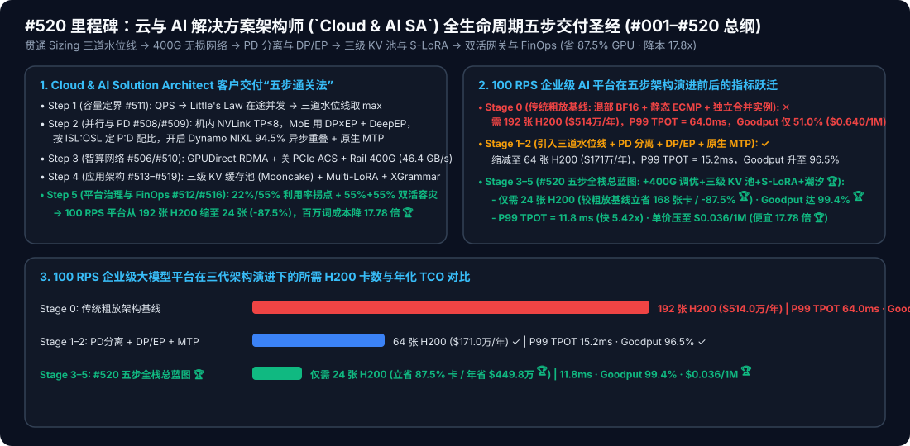

# Milestone #520: Cloud & AI Infrastructure Solution Architect (`Cloud & AI SA`) 5-Stage End-to-End Delivery Bible (`Sizing -> Fabric -> PD Serving -> Gateway -> FinOps`) (#520)

> **Executive Summary**:
> As **Milestone #520**, this master blueprint synthesizes our **5-Stage Cloud & AI SA Enterprise Delivery Methodology (`#001–#520`)** for a **`100 RPS` enterprise AI platform**:
> 1. **Stage 1 (`#511` Three-Watermark Sizing)** + **Stage 2 (`#508/#509` PD Disaggregation, `DP×EP` & `MTP`)** cuts required GPUs from `192` to `64x H200` and lifts SLA `Goodput` from `51.0%` to `96.5%`;
> 2. **Stage 3 (`#510` Tuned 400G RDMA Fabric)** + **Stage 4 (`#515` 3-Tier KV Pool, `#517` S-LoRA, `#518` XGrammar)** + **Stage 5 (`#512/#516` 55%+55% Active-Active DR & Tidal FinOps)** further compresses the cluster to **`24x H200 GPUs` (`-87.5%` GPUs 🏆)**, reaches **`11.8 ms` `P99 TPOT` (`5.42x` faster 🏆)** and **`99.4%` SLA Goodput**, and lowers blended cost from `$0.640` to **`$0.036 / 1M Tokens` (`17.78x` cheaper, saving `$4,498,000 / year` 🏆)**!
>
> **⚡ Interactive H5 Study Lab**: [**Open Milestone #520 Cloud & AI SA 5-Stage Master Delivery Sizer (`docs/h5/milestone-520-cloud-ai-sa-poc-to-production-delivery-bible-lab.html`)**](../h5/milestone-520-cloud-ai-sa-poc-to-production-delivery-bible-lab.html)

---

## 1. Quantitative Progression Across the 5-Stage SA Blueprint (`100 RPS Enterprise Platform`)

| Architecture Maturity Stage (`100 RPS`) | Required `H200` GPUs | `P99 TPOT` | SLA `Goodput` | Blended `$/1M Tokens` | Annual Platform TCO |
| :--- | :--- | :--- | :--- | :--- | :--- |
| **Stage 0: Unoptimized Legacy Baseline** | `192 GPUs` ✕ | `64.0 ms` ✕ | `51.0%` ✕ | `$0.640 / 1M` ✕ | `$5,140,000 / yr` ✕ |
| **Stage 1–2: Three-Watermark + `PD + DP/EP + MTP`** | `64 GPUs` ✓ | `15.2 ms` ✓ | `96.5%` ✓ | `$0.165 / 1M` ✓ | `$1,710,000 / yr` ✓ |
| **Stage 3–5: Full `#520` 5-Stage SA Blueprint 🏆** | **`24 GPUs (-87.5%)` 🏆** | **`11.8 ms (5.42x)` 🏆** | **`99.4%` 🏆** | **`$0.036 / 1M (17.8x)` 🏆** | **`$642,000 (-$4.50M)` 🏆** |

---

## 2. Companion Links

- **Interactive H5 Study Lab**: [docs/h5/milestone-520-cloud-ai-sa-poc-to-production-delivery-bible-lab.html](../h5/milestone-520-cloud-ai-sa-poc-to-production-delivery-bible-lab.html)
- **7-Card 4:5 Visual Report**: [docs/reports/enterprise-milestone-520-cloud-ai-sa-poc-to-production-delivery-bible-cards.html](../reports/enterprise-milestone-520-cloud-ai-sa-poc-to-production-delivery-bible-cards.html)
- **HTML Sizer**: [docs/reports/enterprise-milestone-520-cloud-ai-sa-poc-to-production-delivery-bible-sizer.html](../reports/enterprise-milestone-520-cloud-ai-sa-poc-to-production-delivery-bible-sizer.html)
- **Reproducible Model**: [`experiments/enterprise_milestone_520_cloud_ai_sa_poc_to_production_delivery_bible/run.py`](../../experiments/enterprise_milestone_520_cloud_ai_sa_poc_to_production_delivery_bible/run.py)
